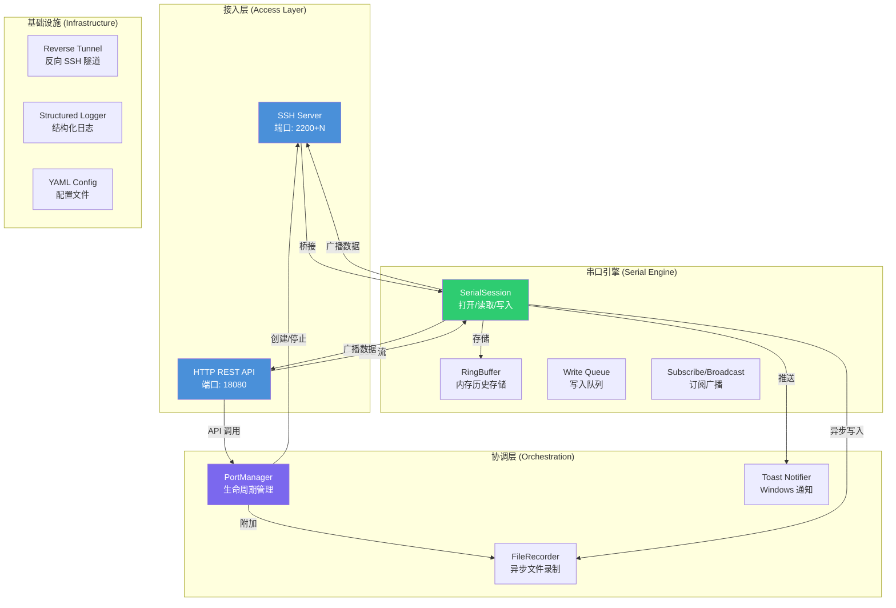
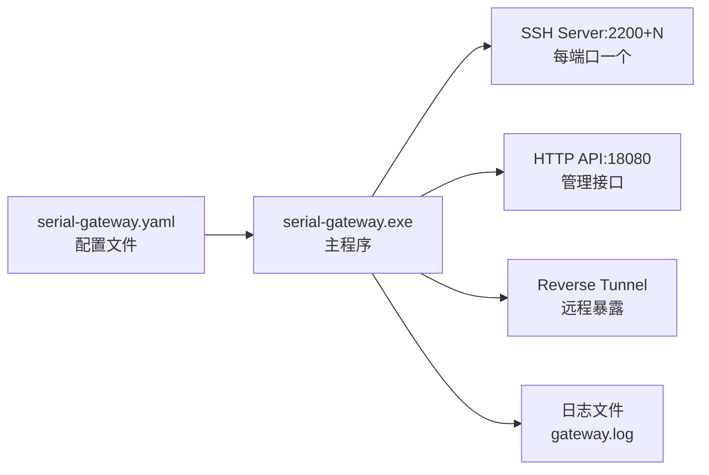

## 一句话定义

**SerialGateway** 是一个用 Go 语言编写的串口网关服务，它将 Windows 系统上的物理 COM 串口映射为 SSH 监听端口，同时提供 HTTP REST API 用于远程管理和历史数据查询。你可以把它理解为一座桥梁——让任何支持 SSH 协议的终端工具或 HTTP 客户端，都能像操作本地设备一样，与远端的串口设备通信。

Sources: [README.md](README.md#L1-L4)

---

## 它解决了什么问题？

在嵌入式开发、工业自动化和网络设备管理中，串口（RS-232）仍然是最常见的设备调试接口。传统的串口访问方式存在几个痛点：

| 问题 | 传统做法 | SerialGateway 的解法 |
|------|---------|---------------------|
| **物理距离限制** | 必须坐在电脑前插线操作 | 将串口映射为 SSH 端口，局域网内任何设备都可 SSH 连接 |
| **多客户端竞争** | 一个串口只能被一个程序占用 | 订阅-广播模式，多个 SSH/HTTP 客户端同时读取输出 |
| **无历史记录** | 串口数据流过即失 | 内存环形缓冲区（RingBuffer）保存最近 N 行历史 |
| **自动化困难** | 需要编写专门的串口通信程序 | 提供 REST API，curl 即可发送命令、获取输出 |

SerialGateway 的核心理念是：**串口是一种资源，应该像网络服务一样被管理**。

Sources: [internal/serial/session.go](internal/serial/session.go#L24-L44), [internal/serial/ringbuffer.go](internal/serial/ringbuffer.go#L1-L60)

---

## 核心架构：四层设计模型

SerialGateway 采用分层架构，每一层职责清晰、可独立替换：



**各层说明：**

- **接入层** — SSH 和 HTTP 两种接入方式，解决「怎么连」的问题
- **协调层** — PortManager 统筹每端口的 SSH 服务器和录制器生命周期，解决「谁管理」的问题
- **串口引擎** — 一个 SerialSession 实例管理一个串口的全部 I/O，包含并发读写、广播、历史缓存、重连，解决「怎么通」的问题
- **基础设施** — 日志、配置、反向隧道等通用能力，解决「怎么跑」的问题

Sources: [internal/core/portmanager.go](internal/core/portmanager.go#L13-L28), [internal/ssh/server.go](internal/ssh/server.go#L32-L41), [internal/serial/session.go](internal/serial/session.go#L24-L44)

---

## 两种接入方式

### SSH 隧道模式

每个配置的 COM 端口（如 `COM3`）会被映射为一个独立的 SSH 监听端口。端口号的计算规则是：

> **SSH 端口 = `base_port` + COM 端口号**

默认 `base_port = 2200`，因此 `COM3` 映射为 `2203`，`COM25` 映射为 `2225`。

连接命令与普通 SSH 无异：
```bash
ssh -p 2203 serial@localhost
```

输入密码（默认 `serial`），你就获得了一个直接连到串口设备的终端。SSH 会话处理程序在串口和 SSH 之间建立了**双向桥接**：从键盘键入的字符写入串口，串口输出的数据实时回显到终端。

Sources: [README.md](README.md#L51-L57), [internal/ssh/server.go](internal/ssh/server.go#L20-L30), [internal/ssh/handler.go](internal/ssh/handler.go#L15-L73)

### HTTP REST API 模式

HTTP 接入提供了更丰富的管理能力：

| 方法 | 端点 | 用途 |
|------|------|------|
| `GET` | `/api/ports` | 扫描系统中所有可用 COM 端口及其详情 |
| `GET` | `/api/mappings` | 查看当前已映射的端口列表 |
| `POST` | `/api/mappings` | 动态创建新端口映射（无需重启） |
| `DELETE` | `/api/mappings/{device}` | 删除指定端口映射 |
| `POST` | `/api/mappings/{device}/write` | 向串口发送数据 |
| `GET` | `/api/mappings/{device}/exec?cmd=` | 发送命令并通过 SSE 流式获取实时输出 |
| `GET` | `/api/mappings/{device}/tail?lines=N` | 获取串口最近 N 行历史输出 |
| `GET` | `/api/mappings/{device}/log?format=jsonl` | 获取完整历史记录 |
| `POST` | `/api/notify` | 发出一条 Windows Toast 通知 |

API 设计遵循 RESTful 风格，响应体为 JSON 格式。其中 `exec` 端点使用 **Server-Sent Events（SSE）** 协议，支持静默超时和最长执行时间两种终止条件。

Sources: [README.md](README.md#L60-L85), [internal/http/server.go](internal/http/server.go#L1-L40), [internal/http/handlers.go](internal/http/handlers.go#L1-L281)

---

## 关键设计决策

### 串口 I/O 并发模型

串口本身是一个半双工设备，SerialGateway 采用了**读取广播 + 写入队列**的并发模型来解决多客户端竞争问题：

- **读取** — 后台 `readLoop` 持续从串口读取原始字节，解析为行文本后同时广播给所有订阅者（SSH 会话、HTTP SSE 流），并追加到 RingBuffer 和文件录制器
- **写入** — 所有写入请求通过 channel 进入 `writeLoop` 串行化处理，确保写入操作不会相互干扰

这种设计使得多个 SSH 客户端和 HTTP 请求可以同时读取同一个串口的输出，而写入则保持有序。

Sources: [internal/serial/session.go](internal/serial/session.go#L152-L231)

### 断连自动重连

串口设备可能随时断开（如物理线缆松动、设备重启）。SerialGateway 内置了指数退避重连机制：

- 检测到串口读取错误后自动标记为断开状态
- 从 `initial_interval`（默认 1 秒）开始尝试重连
- 每次失败后等待时间翻倍，直到 `max_interval`（默认 30 秒）
- 断开期间可选择丢弃写入请求（`discard_input_on_disconnect: true`）

Sources: [internal/serial/session.go](internal/serial/session.go#L244-L280), [serial-gateway.yaml](serial-gateway.yaml#L22-L25)

### 内存环形缓冲区

每个串口关联一个 RingBuffer，在内存中缓存最近的历史行数据：

```
默认配置: max_lines = 100,000 条 / max_bytes = 10 MB
```

当任意一个上限被触发时，最旧的条目被自动淘汰。这使得 `tail` 和 `log` API 可以立即返回最近的历史数据，无需访问磁盘文件。

Sources: [internal/serial/ringbuffer.go](internal/serial/ringbuffer.go#L1-L60), [serial-gateway.yaml](serial-gateway.yaml#L13-L16)

---

## 运行方式

SerialGateway 设计为 Windows 后台服务运行：



启动命令：
```powershell
.\serial-gateway.exe --config serial-gateway.yaml
```

项目提供了 `run.vbs`（无窗口后台运行）、`stop.bat`（停止）和 `status.bat`（查看状态）三个辅助脚本，方便日常运维。

Sources: [README.md](README.md#L47-L49), [cmd/serial-gateway/main.go](cmd/serial-gateway/main.go#L1-L80)

---

## 技术栈一览

| 组件 | 技术选型 | 选择理由 |
|------|---------|---------|
| 语言 | Go 1.22+ | 静态编译、单文件部署、跨平台 |
| SSH 服务 | [gliderlabs/ssh](https://github.com/gliderlabs/ssh) | 纯 Go 实现，无需外部依赖 |
| 串口通信 | [go.bug.st/serial](https://github.com/bugst/go-serial) | 跨平台串口库，支持枚举 |
| HTTP 服务 | `net/http`（标准库） | 零依赖，性能足够 |
| 配置解析 | `gopkg.in/yaml.v3` | YAML 格式更接近人类阅读 |
| 日志轮转 | [lumberjack](https://github.com/natefinch/lumberjack) | 成熟的文件日志轮转方案 |

Sources: [README.md](README.md#L5-L13), [go.mod](go.mod#L1-L18)

---

## 适用场景

- **嵌入式开发调试** — 开发机通过 SSH 连接远程设备串口，替代串口服务器硬件
- **设备自动化测试** — 使用 HTTP API 自动化发送命令并采集输出结果
- **远程设备监控** — 结合反向 SSH 隧道，将内网串口设备暴露到外网服务器
- **多人协作调试** — 多个工程师同时 SSH 到同一个串口，共享设备输出
- **设备日志采集** — FileRecorder 自动将串口输出持久化到文件，支持自动裁剪

---

## 下一步阅读

如果你是第一次接触 SerialGateway，建议按以下顺序阅读：

1. **[快速启动：5 分钟内运行串口网关](2-kuai-su-qi-dong-5-fen-zhong-nei-yun-xing-chuan-kou-wang-guan)** — 跟着步骤实际启动一个实例，感受核心功能
2. **[系统架构全景：四层设计模型](3-xi-tong-jia-gou-quan-jing-si-ceng-she-ji-mo-xing)** — 深入理解各层之间的协作关系
3. **[配置文件详解](7-pei-zhi-wen-jian-xiang-jie-suo-you-jie-zi-duan-yu-mo-ren-zhi)** — 了解所有可配置项及其默认值

如果你已经有明确需求，也可以直接跳转到对应专题：

- **想了解 SSH 怎么连串口** → [SSH 端口映射策略与主机密钥管理](10-ssh-duan-kou-ying-she-ce-lue-yu-zhu-ji-mi-yao-guan-li)
- **想用 HTTP API 发命令** → [串口写入与 Exec 端点](13-chuan-kou-xie-ru-yu-exec-duan-dian-fa-song-ming-ling-bing-huo-qu-shi-shi-shu-chu-sse)
- **想配置后台服务开机自启** → [后台服务部署](9-hou-tai-fu-wu-bu-shu-shi-yong-run-vbs-yu-pi-chu-li-jiao-ben)