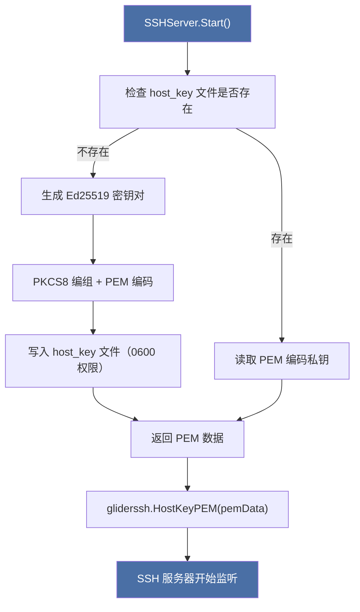
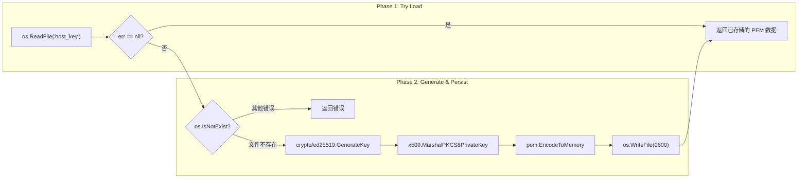
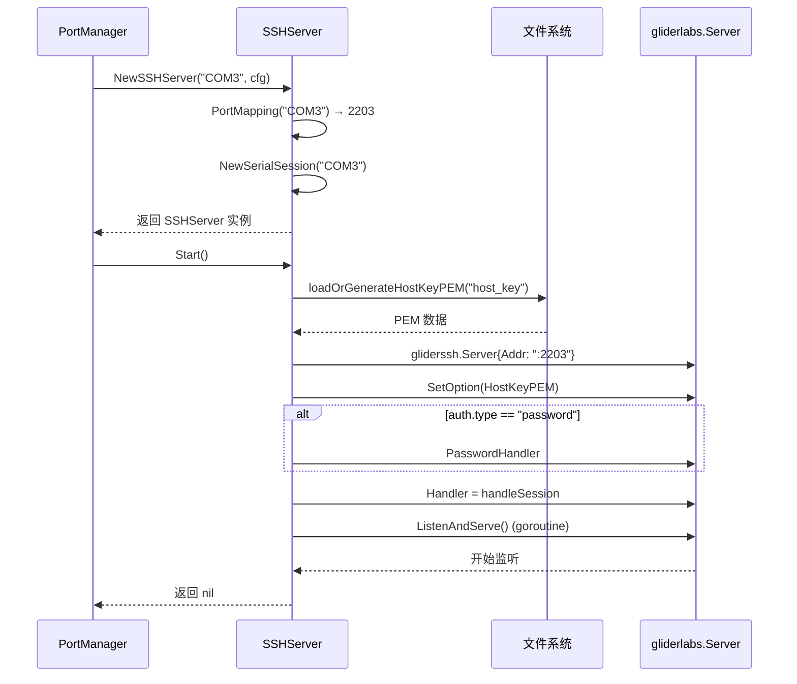
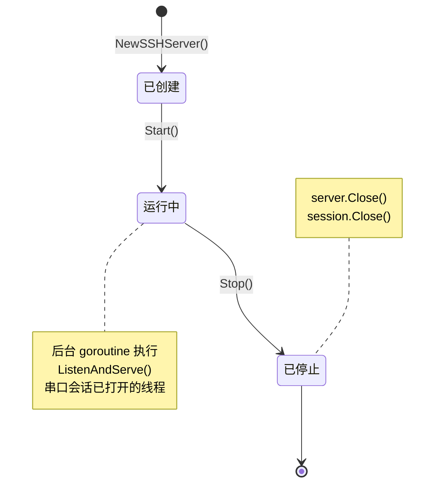

SerialGateway 为每一个串口设备启动一个独立的 SSH 服务器进程，形成**设备—端口—SSH 服务**的一对一映射关系。这要求端口分配策略必须满足确定性、无冲突、便于记忆三项原则。同时，每个 SSH 服务器实例都需要管理自己的主机密钥（host key），以保证客户端的首次连接安全性。本文深入这两方面：端口映射算法如何工作，以及主机密钥如何生成、持久化与加载。

---

## 端口映射策略：COM 编号到 TCP 端口的确定性转换

映射的核心是一个简单的数学变换：从串口设备名中提取数字后缀，加上系统配置的 `base_port` 基值。该逻辑集中在 `PortMapping()` 函数中。

```go
func PortMapping(device string, cfg *config.Config) int {
    numStr := device
    if len(numStr) > 3 && numStr[:3] == "COM" {
        numStr = numStr[3:]
    }
    num, err := strconv.Atoi(numStr)
    if err != nil {
        return 0
    }
    return cfg.SSH.BasePort + num
}
```

Sources: [internal/ssh/server.go](internal/ssh/server.go#L18-L33)

### 映射规则详解

| 串口设备 | BasePort（默认 2200） | 映射 SSH 端口 | 推导过程 |
|----------|----------------------|---------------|----------|
| COM3     | 2200                 | 2203          | 去除 "COM" 得 "3" → 2200 + 3 |
| COM8     | 2200                 | 2208          | 去除 "COM" 得 "8" → 2200 + 8 |
| COM25    | 2200                 | 2225          | 去除 "COM" 得 "25" → 2200 + 25 |
| /dev/ttyUSB0 | 2200             | 0（无效）     | 不匹配 "COM" 前缀，`Atoi` 失败 → 返回 0 |

**关键特性**：
- **确定性**：给定设备名与基端口，映射结果固定不变，利于运维人员记忆（COM3 → 2203、COM4 → 2204……）
- **零冲突风险**：不同 COM 编号自然产生不同 TCP 端口，无需动态分配或端口协商
- **边界处理**：非 COM 格式的设备名（如 Linux 下的 `/dev/ttyUSB0`）返回 0，`NewSSHServer` 在检测到端口为 0 时会返回错误，防止创建无效服务

**适用场景限制**：该映射策略专为 Windows 平台 `COM<N>` 命名规范设计。若需支持 Linux 串口命名（`/dev/ttyS0`、`/dev/ttyUSB<N>`），需要扩展 `PortMapping()` 函数以支持正则匹配或其他命名模式。

### 配置中的 BasePort

BasePort 默认值为 2200，可在 YAML 配置中自定义：

```yaml
ssh:
  base_port: 2200    # 将此值改为 3000，则 COM3 → 3003
  auth:
    type: "password"
    password: "mysecret"
```

Sources: [internal/config/config.go](internal/config/config.go#L158-L159)，[serial-gateway.yaml](serial-gateway.yaml#L18-L21)

若配置文件中未指定 `base_port`，`applyDefaults()` 函数会将其设置为 2200。

---

## 主机密钥管理：生成、持久化与加载

每个 SSH 服务器实例需要一对主机密钥（host key）来标识自身身份。与传统的 OpenSSH 服务器使用预生成的持久密钥文件不同，SerialGateway 采取了**惰性生成 + 自动持久化**的策略。

### 全生命周期流程



Sources: [internal/ssh/server.go](internal/ssh/server.go#L66-L118)

### `loadOrGenerateHostKeyPEM`：核心函数剖析

该函数实现了经典的 "存在则加载，不存在则创建" 模式：



**技术细节**：

| 步骤 | 方法 | 说明 |
|------|------|------|
| 密钥算法 | Ed25519 | 相比 RSA，Ed25519 密钥更短（32 字节私钥）、生成更快、安全性相当 |
| 私钥编码 | PKCS8 + PEM | `x509.MarshalPKCS8PrivateKey()` 将 `ed25519.PrivateKey` 编组为标准 PKCS8 格式，外层用 PEM 封装 |
| 文件权限 | `0600` | 仅文件所有者可读/写，防止其他用户窃取私钥 |
| 存储文件名 | `host_key` | 硬编码于工作目录，目前不可配置 |
| 错误处理 | 区分 `os.IsNotExist` | 仅当文件不存在时生成新密钥，其他 I/O 错误直接返回 |

Sources: [internal/ssh/server.go](internal/ssh/server.go#L66-L98)

### 首次启动 vs 后续启动的行为差异

| 场景 | 行为 | 对客户端的影响 |
|------|------|---------------|
| 首次启动（无 `host_key`） | 生成 Ed25519 密钥，写入 `host_key` 文件 | 客户端会看到主机密钥指纹，需确认信任 |
| 后续重启（`host_key` 存在） | 直接读取文件，复用同一密钥 | 客户端主机密钥指纹不变，无警告 |
| 文件损坏或权限错误 | 返回错误，SSH 服务启动失败 | 无影响（服务不可用） |

这一设计保证了：**只要工作目录下的 `host_key` 文件不被删除，同一串口映射的 SSH 服务在每次重启后都使用相同的主机密钥**，避免客户端因主机密钥变更而收到 `WARNING: REMOTE HOST IDENTIFICATION HAS CHANGED!` 的警告。

---

## SSH 服务器创建与认证机制

### 整体创建流程

`NewSSHServer()` 和 `Start()` 顺序执行以下步骤：

1. **端口计算**：调用 `PortMapping(device, cfg)` 确定 SSH 监听端口
2. **串口会话创建**：`serial.NewSerialSession(device, cfg, logger)` 创建串口会话对象（此时尚未打开串口）
3. **主机密钥准备**：`loadOrGenerateHostKeyPEM("host_key", logger)` 加载或生成主机密钥
4. **SSH 服务器配置**：使用 `gliderlabs/ssh` 库创建服务器实例
5. **认证设置**：若配置类型为 `password`，设置 `PasswordHandler`
6. **会话处理**：注册 `handleSession` 为连接处理函数
7. **异步启动**：`go s.server.ListenAndServe()` 在后台 goroutine 中监听



Sources: [internal/ssh/server.go](internal/ssh/server.go#L35-L139)

### 当前支持的认证方式

SerialGateway 目前支持**密码认证**，可扩展支持公钥认证（配置结构中已定义 `PublicKeys` 字段）。

```yaml
ssh:
  auth:
    type: "password"        # 可选值："password" | "publickey"（预留）
    password: "mysecret"    # type 为 password 时使用
    # public_keys:          # type 为 publickey 时使用（尚未实现）
    #   - "ssh-ed25519 AAA..."
```

**密码认证实现**：
```go
if s.cfg.SSH.Auth.Type == "password" {
    sshServer.PasswordHandler = func(ctx gliderssh.Context, password string) bool {
        return password == s.cfg.SSH.Auth.Password
    }
}
```

Sources: [internal/ssh/server.go](internal/ssh/server.go#L111-L115)

> ⚠️ **安全注意事项**：密码以明文形式存储在 YAML 配置中，在共享环境中需注意配置文件的访问权限。生产环境建议扩展公钥认证支持。

### SSHConfig 与 SSHAuth 配置结构

`config.go` 中定义了完整的配置模型：

```go
type SSHConfig struct {
    BasePort int     `yaml:"base_port"`
    Auth     SSHAuth `yaml:"auth"`
}

type SSHAuth struct {
    Type       string   `yaml:"type"`
    Password   string   `yaml:"password"`
    PublicKeys []string `yaml:"public_keys"`
}
```

Sources: [internal/config/config.go](internal/config/config.go#L30-L37)

| 字段 | 类型 | 默认值 | 说明 |
|------|------|--------|------|
| `ssh.base_port` | int | `2200` | SSH 端口映射的基值 |
| `ssh.auth.type` | string | `"password"` | 认证方式，目前仅支持 `password` |
| `ssh.auth.password` | string | `""` | 密码认证的密码 |
| `ssh.auth.public_keys` | []string | `nil` | 公钥列表（预留，尚未实现） |

---

## SSH 服务生命周期管理

每个串口映射的 SSH 服务由 `PortManager` 统一管理其生命周期。

### 服务启停流程



`PortManager.AutoStart()` 遍历配置中的 `ports` 列表，依次为每个设备创建并启动 SSH 服务：

```go
for _, portCfg := range pm.cfg.Ports {
    srv, err := ssh.NewSSHServer(portCfg.Device, pm.cfg, logger)
    if err := srv.Start(); err != nil {
        pm.logger.Error("SSH server start failed", "device", portCfg.Device, "error", err)
        continue
    }
    pm.servers[portCfg.Device] = srv
}
```

Sources: [internal/core/portmanager.go](internal/core/portmanager.go#L31-L62)

**停止顺序**为：先停止所有录制器（recorder），再停止所有 SSH 服务器，确保日志落盘完成后再断开连接。

---

## 与其他模块的关联

SSH 端口映射层位于系统架构的接入层，与以下模块紧密协作：

- **[系统架构全景：四层设计模型](3-xi-tong-jia-gou-quan-jing-si-ceng-she-ji-mo-xing)** — SSH 接入层在整体架构中的位置与职责
- **[SSH 会话处理：终端 I/O 与串口的双向桥接](11-ssh-hui-hua-chu-li-zhong-duan-i-o-yu-chuan-kou-de-shuang-xiang-qiao-jie)** — 本页的 `handleSession` 函数详解
- **[每端口 SSH 服务器创建与会话桥接](23-mei-duan-kou-ssh-fu-wu-qi-chuang-jian-yu-hui-hua-qiao-jie)** — PortManager 如何协调多个 SSH 服务实例
- **[PortManager：协调 SSH 服务器与录制器的生命周期](22-portmanager-xie-diao-ssh-fu-wu-qi-yu-lu-zhi-qi-de-sheng-ming-zhou-qi)** — 更进一步的生命周期管理细节
- **[启动流程流水线：从 main.go 到运行中的服务](8-qi-dong-liu-cheng-liu-shui-xian-cong-main-go-dao-yun-xing-zhong-de-fu-wu)** — 启动时序图中 SSH 服务器的初始化位置

---

## 设计决策总结

| 决策 | 选择 | 权衡 |
|------|------|------|
| 映射算法 | `BasePort + COM_N` 线性映射 | 简单直观，但缺乏端口可用性校验；不兼容 Linux 串口命名 |
| 主机密钥算法 | Ed25519 | 速度与安全性俱佳，但非所有 SSH 客户端默认支持 |
| 密钥存储 | `host_key` 文件，工作目录，600 权限 | 简单可靠，但路径不可配置，多实例场景可能冲突 |
| 密钥生成时机 | 首次启动时惰性生成 | 无需额外初始化步骤，但首次连接时客户端需确认指纹 |
| 认证方式 | 仅密码（密码在配置中明文存储） | 实现简单，满足开发/测试需求；生产环境建议扩展公钥认证 |