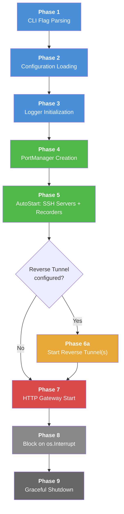
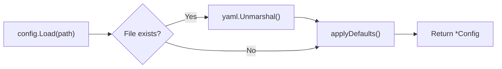
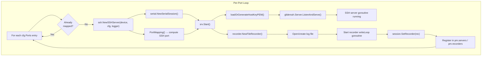
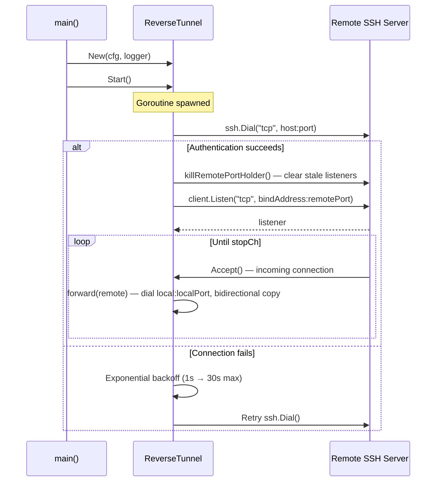
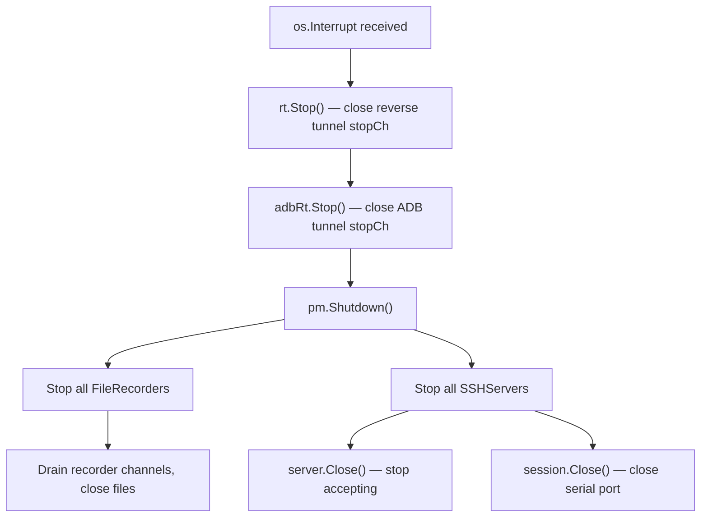

This page traces the complete initialization sequence of SerialGateway — from the moment `main()` is invoked to the point where all services (SSH servers, HTTP API, reverse tunnels) are running and the process enters its steady-state signal wait. Understanding this flow is essential for debugging startup issues, extending the gateway with new services, or reasoning about the order in which components become available.

## The Big Picture

SerialGateway follows a **sequential bootstrap with concurrent service launch** pattern. The `main()` function orchestrates a deterministic initialization pipeline where each phase builds upon the previous one, then transitions into a blocking wait for shutdown signals.



The flow is organized into three logical stages: **foundation** (phases 1–3, colored blue) establishes configuration and observability; **core services** (phases 4–5, colored green) bring up serial port mappings; and **access layer** (phases 6–7, colored orange/red) exposes the gateway to the network. The entire process is single-threaded until goroutines are explicitly spawned for long-running services.

Sources: [main.go](cmd/serial-gateway/main.go#L17-L80)

## Phase 1: CLI Flag Parsing

The entry point accepts two command-line flags that allow runtime overrides of the configuration file:

| Flag | Default | Purpose |
|------|---------|---------|
| `-config` | `serial-gateway.yaml` | Path to the YAML configuration file |
| `-http-port` | `0` (use config) | Override the HTTP API listening port |

```go
configPath := flag.String("config", "serial-gateway.yaml", "config file path")
httpPort := flag.Int("http-port", 0, "override HTTP port (0 = use config)")
flag.Parse()
```

The `-http-port` override is applied **after** configuration loading, allowing operators to change the HTTP port without editing the YAML file — useful for containerized deployments or port-conflict resolution.

Sources: [main.go](cmd/serial-gateway/main.go#L18-L20), [main.go](cmd/serial-gateway/main.go#L28-L30)

## Phase 2: Configuration Loading

Configuration is loaded via `config.Load()`, which reads a YAML file and applies sensible defaults for any missing fields. The function is **tolerant of missing files**: if the specified path does not exist, it returns a configuration populated entirely with defaults rather than failing.



The `Config` struct is the central data container that every subsystem receives. It aggregates ten configuration sections:

| Section | Key Fields | Default Behavior |
|---------|------------|------------------|
| `GatewayConfig` | `HTTPPort` | Defaults to `8080` |
| `SerialDefaults` | `Baudrate`, `Timeout`, `ByteSize`, `Parity`, `StopBits`, `WriteTimeout`, `ExecSilenceTimeout`, `ExecMaxDuration` | 115200 baud, 8N1, 5s timeout |
| `SSHConfig` | `BasePort`, `Auth` (type, password, public_keys) | Base port `2200`, password auth |
| `RingBufferConfig` | `MaxLines`, `MaxBytes` | 100,000 lines, 10 MB |
| `ReconnectConfig` | `InitialInterval`, `MaxInterval`, `DiscardInputOnDisconnect` | 1s initial, 30s max |
| `ReverseTunnelConfig` | `Host`, `Port`, `User`, `RemotePort`, `LocalPort`, `BindAddress` | Optional; only activates if `Host` is set |
| `AdbReverseTunnel` | Same structure as `ReverseTunnelConfig` | Optional; separate tunnel for ADB |
| `FileRecordingConfig` | `OutputDir`, `MaxSizeMB`, `TrimSizeMB` | `./serial_logs`, 1024 MB max |
| `LoggingConfig` | `Level`, `Format`, `Output`, `FilePath`, rotation settings | `info`, `text`, `stdout` |
| `Ports` | `[]PortConfig{Device, Baudrate}` | Empty — no auto-start mappings |

The `applyDefaults()` function uses zero-value detection: if a field is `0`, `""`, or otherwise unset, it is populated with the default. This means explicit zero values in the YAML will be overridden — a deliberate design choice that favors safe defaults.

Sources: [config.go](internal/config/config.go#L103-L125), [config.go](internal/config/config.go#L127-L229)

## Phase 3: Logger Initialization

With configuration loaded, the logger is created via `sgwlog.New(&cfg.Logging)`. This function constructs a `*slog.Logger` with the following decision tree:

| Decision | Options | Effect |
|----------|---------|--------|
| **Output** | `stdout`, `stderr`, `file` | Determines the writer; `file` uses `lumberjack.Logger` for rotation |
| **Format** | `text`, `json` | `text` uses a custom `compactHandler` with color support; `json` uses `slog.NewJSONHandler` |
| **Level** | `debug`, `info`, `warn`, `error` | Minimum log level filter |

When output is `stdout` or `stderr`, ANSI color codes are enabled for the `text` format. When output is `file`, colors are suppressed. The `lumberjack.Logger` handles log rotation based on `MaxSizeMB`, `MaxAgeDays`, `MaxBackups`, and `Compress` settings.

The resulting logger is installed as the **global default** via `slog.SetDefault(logger)`, making it available to any code that uses `slog.Info()`, `slog.Warn()`, etc. without explicit dependency injection.

```go
logger, err := sgwlog.New(&cfg.Logging)
// ... error handling ...
slog.SetDefault(logger)
```

This design means that from this point forward, every subsystem receives either the logger instance directly (via constructor injection) or can use the global `slog` package.

Sources: [main.go](cmd/serial-gateway/main.go#L32-L37), [log.go](internal/log/log.go#L162-L200)

## Phase 4: PortManager Creation

The `PortManager` is the **central coordinator** that owns the lifecycle of all SSH servers and file recorders. It is created as a simple struct initialization — no goroutines, no I/O:

```go
pm := core.NewPortManager(cfg, logger)
```

Internally, the `PortManager` holds:

| Field | Type | Purpose |
|-------|------|---------|
| `cfg` | `*config.Config` | Shared configuration reference |
| `logger` | `*slog.Logger` | Logger with manager context |
| `servers` | `map[string]*ssh.SSHServer` | Device name → SSH server mapping |
| `recorders` | `map[string]*recorder.FileRecorder` | Device name → file recorder mapping |
| `mu` | `sync.RWMutex` | Protects concurrent access to maps |

The `PortManager` is passed by reference to the HTTP gateway, allowing runtime API calls to add/remove port mappings dynamically. At this phase, both maps are empty — the actual service creation happens in the next phase.

Sources: [main.go](cmd/serial-gateway/main.go#L39), [portmanager.go](internal/core/portmanager.go#L13-L27)

## Phase 5: AutoStart — SSH Servers and Recorders

`pm.AutoStart()` iterates over every entry in `cfg.Ports` and provisions the full service stack for each serial device. This is the most complex phase of startup, launching multiple goroutines.



### 5a. SSH Server Creation

For each port configuration, `ssh.NewSSHServer()` performs two key operations:

1. **Port computation** via `PortMapping()`: extracts the numeric suffix from the device name (e.g., `COM3` → `3`) and adds it to `cfg.SSH.BasePort`. For `COM3` with `BasePort=2200`, the SSH port is `2203`.

2. **SerialSession creation** via `serial.NewSerialSession()`: initializes the session struct with a write channel (buffered at 64), an empty subscriber map, a fresh `RingBuffer`, and a stop channel. The serial port is **not opened yet** — this happens lazily when the first SSH client connects (see the [SerialSession Lifecycle](12-serialsession-lifecycle-open-read-write-close) page).

If the device name cannot be parsed to a number (e.g., a USB device path), `PortMapping()` returns `0` and the port is skipped with a warning.

Sources: [portmanager.go](internal/core/portmanager.go#L31-L38), [server.go](internal/ssh/server.go#L19-L26), [server.go](internal/ssh/server.go#L42-L57)

### 5b. SSH Server Start

`srv.Start()` brings the SSH listener online:

1. **Host key resolution**: `loadOrGenerateHostKeyPEM("host_key", ...)` attempts to read `host_key` from the working directory. If absent, it generates an Ed25519 key pair, marshals it to PKCS8/PEM format, and writes it to disk with `0600` permissions. This ensures the SSH server has a stable identity across restarts.

2. **Server configuration**: A `gliderssh.Server` is configured with the computed port, the host key PEM data, and an authentication handler. If `cfg.SSH.Auth.Type` is `"password"`, a `PasswordHandler` is installed that compares against the configured password.

3. **Listener launch**: `server.ListenAndServe()` is invoked in a **new goroutine**, making the SSH server immediately available for connections. The `Start()` method returns without blocking.

The session handler (`handleSession`) is not invoked at startup — it fires only when an SSH client connects. At that point, it opens the serial port (if not already open), subscribes to the broadcast channel, and bridges bidirectional I/O between the SSH session and the serial port.

Sources: [server.go](internal/ssh/server.go#L97-L131), [handler.go](internal/ssh/handler.go#L16-L73)

### 5c. File Recorder Attachment

After the SSH server is running, a `FileRecorder` is created for the device:

1. **Directory creation**: `os.MkdirAll(dir, 0755)` ensures the output directory exists.
2. **File open**: The log file is opened in append mode at `<output_dir>/<device>` (e.g., `./serial_logs/COM3`).
3. **Write loop goroutine**: A background goroutine drains a buffered channel (capacity 256) and writes to disk, with automatic trimming when the file exceeds `MaxSizeMB`.

The recorder is attached to the `SerialSession` via `SetRecorder()`. From this point, every byte read from the serial port is asynchronously written to the log file. If recorder creation fails (e.g., permission denied), the error is logged but the SSH server continues operating without file logging.

Sources: [portmanager.go](internal/core/portmanager.go#L47-L57), [recorder.go](internal/recorder/recorder.go#L35-L65)

## Phase 6: Reverse Tunnel Initialization

If `cfg.ReverseTunnel.Host` is non-empty, a reverse SSH tunnel is established to expose the local HTTP API to a remote server. An identical mechanism handles `cfg.AdbReverseTunnel` for ADB port forwarding.



Key implementation details:

- **Resilient reconnection**: The `run()` loop implements exponential backoff (1s initial, 30s maximum) and retries indefinitely until `Stop()` is called.
- **Stale port cleanup**: Before binding the remote port, `killRemotePortHolder()` executes `ss -tlnp` on the remote to find and kill any process occupying the target port. This handles the case where a previous tunnel crashed without releasing the port.
- **Forwarding model**: Each accepted connection on the remote listener spawns a goroutine that dials `localhost:localPort` and performs bidirectional `io.Copy`.

The tunnel is entirely optional and degrades gracefully — if the remote server is unreachable, the gateway continues operating locally while the tunnel retries in the background.

Sources: [main.go](cmd/serial-gateway/main.go#L44-L62), [reverse.go](internal/tunnel/reverse.go#L38-L170)

## Phase 7: HTTP Gateway Start

The HTTP gateway is the final service to start. It is created with a reference to the `PortManager`, enabling API endpoints to query and manipulate port mappings at runtime.

```go
gw := sgwhttp.NewGatewayWithManager(cfg, pm, logger)
go gw.StartHTTP()
```

`StartHTTP()` registers five routes on an `http.ServeMux` and calls `http.ListenAndServe()`:

| Route | Handler | Purpose |
|-------|---------|---------|
| `GET /api/ports` | `handleGetPorts` | List available serial ports on the system |
| `GET /api/mappings` | `handleMappings` | List active SSH port mappings |
| `GET/POST/DELETE /api/mappings/` | `handleMappingDetail` | Manage individual mappings |
| `GET/PUT /api/config` | `handleConfig` | Read or update runtime configuration |
| `POST /api/notify` | `handleNotify` | Send Windows toast notifications |

The HTTP server runs in its own goroutine and blocks on `ListenAndServe()`. It does not participate in graceful shutdown explicitly — when the process exits, the listener is closed by the OS.

Sources: [main.go](cmd/serial-gateway/main.go#L64-L65), [server.go](internal/http/server.go#L28-L40)

## Phase 8: Signal Wait and Steady State

After all services are launched, the main goroutine enters a blocking wait:

```go
logger.Info("SerialGateway started", "http_port", cfg.Gateway.HTTPPort, "ssh_base_port", cfg.SSH.BasePort)

sigCh := make(chan os.Signal, 1)
signal.Notify(sigCh, os.Interrupt)
<-sigCh
```

At this point, the process is in its **steady state** with the following concurrent activities:

| Goroutine | Owner | Activity |
|-----------|-------|----------|
| SSH `ListenAndServe` (×N) | `ssh.SSHServer` | Accepting SSH connections per mapped port |
| SSH session handlers (×M) | `ssh.SSHServer` | Bridging serial I/O for connected clients |
| Serial `readLoop` (×N) | `serial.SerialSession` | Reading from serial ports, broadcasting to subscribers |
| Serial `writeLoop` (×N) | `serial.SerialSession` | Draining write channel to serial ports |
| Recorder `writeLoop` (×N) | `recorder.FileRecorder` | Persisting serial data to disk |
| Reverse tunnel `run` (×0-2) | `tunnel.ReverseTunnel` | Maintaining remote port forwarding |
| Reverse tunnel `forward` (×K) | `tunnel.ReverseTunnel` | Proxying individual tunnel connections |
| HTTP `ListenAndServe` | `http.Gateway` | Serving REST API requests |
| Serial reconnect loops (×0-N) | `serial.SerialSession` | Attempting reconnection for disconnected ports |

The exact number of goroutines depends on how many ports are configured, how many SSH clients are connected, and whether reverse tunnels are active.

Sources: [main.go](cmd/serial-gateway/main.go#L67-L72)

## Phase 9: Graceful Shutdown

When `SIGINT` (Ctrl+C) is received, shutdown proceeds in a deterministic order:



The shutdown sequence is:

1. **Reverse tunnels** are stopped first by closing their `stopCh` channels. The `Stop()` method waits for the tunnel goroutine to exit via `sync.WaitGroup`.
2. **PortManager.Shutdown()** then iterates over all recorders and SSH servers:
   - Recorders are stopped first, draining any buffered writes to disk before closing file handles.
   - SSH servers are stopped by calling `server.Close()` (which terminates the listener) and `session.Close()` (which closes the serial port and signals the read/write loops to exit).

Notably, there is **no explicit HTTP server shutdown** — the `http.ListenAndServe()` goroutine is terminated when the process exits. This is acceptable for a gateway tool but would warrant a `context`-based graceful shutdown in a production service.

Sources: [main.go](cmd/serial-gateway/main.go#L74-L80), [portmanager.go](internal/core/portmanager.go#L118-L130)

## Complete Startup Timing

Understanding the temporal characteristics of startup helps diagnose "why isn't X ready yet" scenarios:

| Phase | Blocking? | Typical Duration | What Could Go Wrong |
|-------|-----------|------------------|---------------------|
| Config load | Yes (sync) | <10ms | YAML parse error, file permission |
| Logger init | Yes (sync) | <5ms | Invalid log level/format/output |
| PortManager create | Yes (sync) | <1ms | — |
| AutoStart (per port) | Yes (sync loop) | 10-50ms per port | Serial port in use, SSH port conflict, host key write failure |
| SSH server listen | No (goroutine) | Immediate | Port already bound |
| Serial port open | **Deferred** | On first SSH connect | Device not found, wrong baud rate |
| Reverse tunnel | No (goroutine) | Variable (retry loop) | Remote unreachable, auth failure |
| HTTP listen | No (goroutine) | Immediate | Port already bound |

The critical insight is that **serial ports are not opened at startup**. The `SerialSession.Open()` call is deferred until the first SSH client connects to a given port. This means startup succeeds even if serial devices are temporarily disconnected — the reconnection logic handles availability asynchronously.

Sources: [server.go](internal/ssh/server.go#L97-L131), [handler.go](internal/ssh/handler.go#L24-L33), [session.go](internal/serial/session.go#L79-L116)

## Further Reading

Now that you understand how the system boots up, these pages dive deeper into the components that were initialized:

- **[SSH Port Mapping Strategy and Host Key Management](11-ssh-port-mapping-strategy-and-host-key-management)** — How device names map to SSH ports and how host keys are persisted
- **[SerialSession Lifecycle: Open, Read, Write, Close](12-serialsession-lifecycle-open-read-write-close)** — What happens when the first SSH client triggers serial port opening
- **[PortManager: Coordinating SSH Servers and Recorders](17-portmanager-coordinating-ssh-servers-and-recorders)** — Runtime mapping management beyond AutoStart
- **[Reverse SSH Tunnel for Remote Access](23-reverse-ssh-tunnel-for-remote-access)** — Deep dive into tunnel forwarding and resilience
- **[Route Registration and Gateway Struct](18-route-registration-and-gateway-struct)** — HTTP API internals