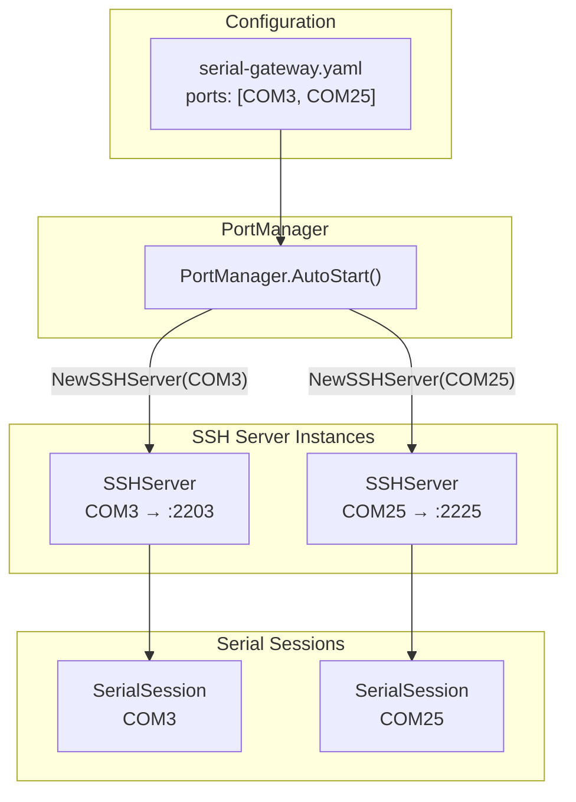
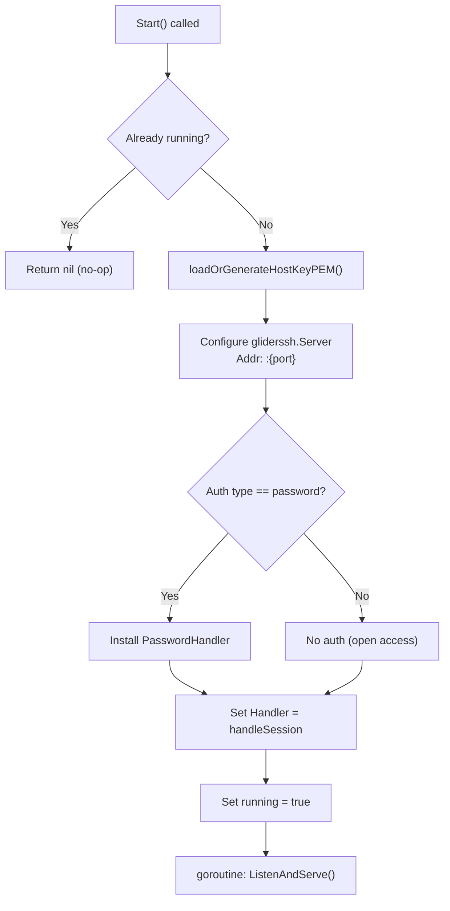
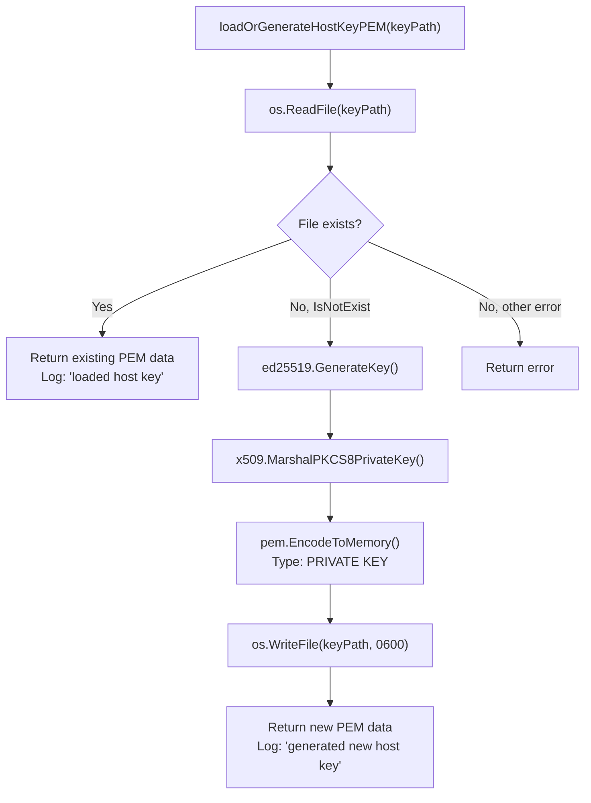
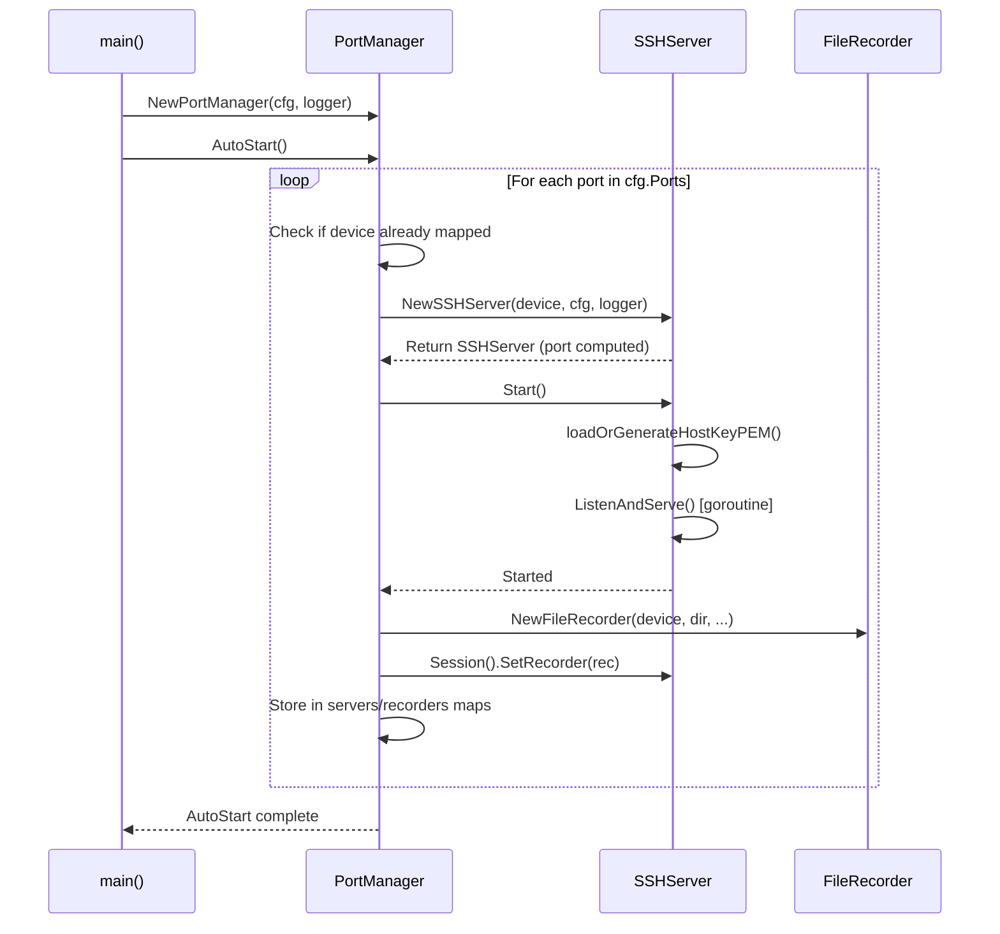

This page documents the deterministic algorithm that maps Windows COM port identifiers to SSH listening ports, the lifecycle of per-device SSH server instances, and the host key generation and persistence strategy. These mechanisms form the bridge between physical serial hardware and network-accessible SSH endpoints, enabling any standard SSH client to interact with a serial device as though it were a remote shell.

## The Port Mapping Algorithm

At the heart of the gateway's SSH strategy lies a **deterministic, arithmetic port mapping** — a pure function that converts a serial device name into a TCP port number. This design ensures that the same COM port always maps to the same SSH port across restarts, eliminating the need for service discovery in most workflows.

The `PortMapping` function extracts the numeric suffix from a device name (stripping the `"COM"` prefix if present), then adds it to the configured `base_port`. If the device name does not yield a valid integer, the function returns `0`, signaling that the device cannot be mapped.

```
PortMapping("COM3",  cfg{BasePort: 2200}) → 2200 + 3  = 2203
PortMapping("COM25", cfg{BasePort: 2200}) → 2200 + 25 = 2225
PortMapping("COM8",  cfg{BasePort: 2200}) → 2200 + 8  = 2208
```

Sources: [server.go](internal/ssh/server.go#L20-L30)

### Mapping Formula and Configuration

The base port is defined in the YAML configuration under `ssh.base_port` and defaults to `2200` when omitted. This default is applied during the `applyDefaults` phase of configuration loading.

| Parameter | YAML Key | Default | Description |
|-----------|----------|---------|-------------|
| Base Port | `ssh.base_port` | `2200` | The numeric offset added to the COM port number |
| Device Name | `ports[].device` | — | Must follow `COM<n>` pattern for valid mapping |

```yaml
ssh:
  base_port: 2200
```

The formula is intentionally simple: **`ssh_port = base_port + com_number`**. This means COM3 always listens on port 2203, COM25 on port 2225, and so on. The mapping is computed at server creation time and remains fixed for the lifetime of the `SSHServer` instance.

Sources: [config.go](internal/config/config.go#L31-L34), [config.go](internal/config/config.go#L148-L149), [server.go](internal/ssh/server.go#L20-L30)

### Edge Cases and Failure Modes

The `PortMapping` function handles two key edge cases:

1. **Non-COM device names**: If the device string lacks the `"COM"` prefix, the function attempts to parse the entire string as an integer. This provides flexibility for non-standard naming while still requiring a numeric result.
2. **Unparseable names**: If `strconv.Atoi` fails on the extracted number string, the function returns `0`. The calling code in `NewSSHServer` treats this as a hard error, refusing to create an SSH server for the device.

The `NewSSHServer` constructor validates the mapping result immediately and returns a descriptive error if the port cannot be determined, preventing silent failures at server start time.

Sources: [server.go](internal/ssh/server.go#L43-L57)

### Port Mapping in the HTTP API

The same `PortMapping` function is invoked by the HTTP layer when reporting available ports. The `handleGetPorts` handler computes the projected SSH port for every discovered serial device — even those without an active mapping — giving clients a preview of which port a device *would* occupy if mapped. Active mappings are additionally queryable through the `/api/mappings` endpoint, which reports the live state from the `PortManager`.

Sources: [handlers.go](internal/http/handlers.go#L22-L56), [handlers.go](internal/http/handlers.go#L69-L83)

## SSH Server Architecture

Each serial device receives its own dedicated SSH server instance — an isolated network listener bound to the computed port. This one-to-one mapping between COM port and SSH server ensures clean session isolation and independent lifecycle management.



The `SSHServer` struct encapsulates five core fields: the device name, the computed SSH port, a reference to the shared configuration, a structured logger tagged with the device name, and the `SerialSession` that bridges SSH I/O to the physical serial port. A mutex-protected `running` flag tracks the server's operational state.

Sources: [server.go](internal/ssh/server.go#L32-L41)

### Server Startup Sequence

When `Start()` is invoked, the server performs a precise initialization sequence:

1. **Idempotency check** — If already running, returns immediately without side effects.
2. **Host key acquisition** — Loads or generates the Ed25519 host key (detailed in the next section).
3. **Server configuration** — Creates a `gliderssh.Server` with the computed listen address and applies the host key PEM data.
4. **Authentication wiring** — If `cfg.SSH.Auth.Type` is `"password"`, installs a `PasswordHandler` closure that compares incoming passwords against the configured value.
5. **Session handler binding** — Assigns `handleSession` as the SSH session handler, which bridges SSH I/O to the serial session's pub/sub and write channels.
6. **Asynchronous listen** — Launches `ListenAndServe()` in a goroutine, with the running flag set to `true` before the goroutine starts.



Sources: [server.go](internal/ssh/server.go#L94-L125)

### Authentication Model

The gateway supports **password-based authentication** configured through the YAML file. The `SSHAuth` struct defines three fields, but only `type` and `password` are actively wired into the server's authentication pipeline:

| Field | YAML Key | Status | Description |
|-------|----------|--------|-------------|
| `Type` | `ssh.auth.type` | **Active** | Authentication method; currently only `"password"` is implemented |
| `Password` | `ssh.auth.password` | **Active** | The shared password for all SSH connections |
| `PublicKeys` | `ssh.auth.public_keys` | Structural only | Declared in config struct but not wired to the SSH server |

When `auth.type` is not `"password"`, the server starts **without any authentication handler**, effectively allowing open access. This is an intentional fallback for development environments but should be avoided in production.

Sources: [config.go](internal/config/config.go#L25-L29), [server.go](internal/ssh/server.go#L110-L114)

## Host Key Generation and Persistence

SSH host keys serve as the server's cryptographic identity — clients use them to verify they are connecting to the expected server and to establish an encrypted channel. The gateway implements a **load-or-generate** strategy that balances convenience with security.

### The Load-or-Generate Pattern

The `loadOrGenerateHostKeyPEM` function implements a three-step decision tree:



On first launch, the function generates a fresh **Ed25519 key pair** using `crypto/rand` as the entropy source. The private key is marshaled into PKCS8 format and PEM-encoded with the standard `"PRIVATE KEY"` block type. The resulting file is written with `0600` permissions (owner read/write only), following the security convention for private key material.

On subsequent launches, the existing key file is read and returned directly, ensuring **host identity continuity** — SSH clients that have previously accepted the host key will not see a key mismatch warning.

Sources: [server.go](internal/ssh/server.go#L64-L92)

### Shared Key Across All Servers

A critical architectural detail: the host key file path `"host_key"` is **hardcoded as a relative path** in the `Start()` method. Since all `SSHServer` instances call `loadOrGenerateHostKeyPEM("host_key", ...)` with the same path, **every SSH server in the gateway shares the same host key**.

| Aspect | Behavior |
|--------|----------|
| Key file path | `"host_key"` (relative to working directory) |
| Key algorithm | Ed25519 |
| Key format | PKCS8, PEM-encoded |
| File permissions | `0600` (owner read/write) |
| Sharing model | **All SSH servers use the same key** |
| Generation trigger | First `Start()` call when file doesn't exist |

This shared-key design means that a client connecting to `localhost:2203` (COM3) and `localhost:2225` (COM25) will see the **same host key fingerprint** for both connections. This is a deliberate simplification — it avoids the complexity of per-port key management while still providing encrypted transport. Clients using `StrictHostKeyChecking` will accept the key once and trust it across all gateway ports.

Sources: [server.go](internal/ssh/server.go#L101-L109)

### Key Lifecycle Implications

The host key file resides in the gateway's working directory. Its lifecycle is straightforward:

- **First boot**: Key is auto-generated and persisted. No manual intervention required.
- **Normal operation**: Key is loaded from disk on every server start. The key never rotates automatically.
- **Key rotation**: Delete the `host_key` file and restart the gateway. A new key will be generated. Connected clients will see a host key change warning on their next connection.
- **Key backup**: Copy the `host_key` file to preserve identity across deployments or machine migrations.

## PortManager: Orchestrating SSH Server Lifecycle

The `PortManager` acts as the central coordinator for SSH server instances, managing their creation during startup, supporting dynamic addition and removal at runtime, and ensuring clean shutdown.

### Startup Flow

During application startup in `main()`, the `PortManager.AutoStart()` method iterates over every device listed in `cfg.Ports` and creates an `SSHServer` for each. The startup sequence for each port includes:

1. **Duplicate check** — Skips devices that already have a server instance.
2. **Server creation** — Calls `ssh.NewSSHServer()`, which computes the port mapping and initializes the serial session.
3. **Server start** — Calls `srv.Start()` to load the host key and begin listening.
4. **Recorder attachment** — Creates a `FileRecorder` for persistent logging and attaches it to the serial session.
5. **Registry update** — Stores the server and recorder in the PortManager's maps under mutex protection.

Failures during individual port startup are logged as warnings or errors but do **not halt** the overall startup process — remaining ports continue to initialize. This fault-isolation design ensures that a single unavailable COM port does not prevent the gateway from serving other devices.



Sources: [portmanager.go](internal/core/portmanager.go#L30-L68), [main.go](cmd/serial-gateway/main.go#L38-L41)

### Runtime Mapping Management

Beyond startup, the `PortManager` exposes `AddMapping` and `RemoveMapping` methods for dynamic port management via the HTTP API:

| Operation | Method | Endpoint | PortManager Call | Behavior |
|-----------|--------|----------|-------------------|----------|
| List mappings | `GET` | `/api/mappings` | `Mappings()` | Returns all active mappings with connection state |
| Create mapping | `POST` | `/api/mappings` | `AddMapping(device)` | Creates and starts a new SSH server; rejects duplicates with 409 |
| Delete mapping | `DELETE` | `/api/mappings/{device}` | `RemoveMapping(device)` | Stops the SSH server and removes it from the registry |
| Query mapping | `GET` | `/api/mappings/{device}` | `GetServer(device)` | Returns device details and SSH port |

The `AddMapping` method performs its own duplicate check under mutex and returns a `409 Conflict` if a mapping already exists for the requested device. The `RemoveMapping` method calls `srv.Stop()`, which gracefully closes the SSH listener and the underlying serial session.

Sources: [portmanager.go](internal/core/portmanager.go#L90-L117), [handlers.go](internal/http/handlers.go#L85-L156)

### Shutdown Sequence

The `Shutdown()` method performs an orderly teardown in a specific sequence — recorders are stopped first (flushing any buffered data to disk), then SSH servers are stopped (closing network listeners and serial sessions). Both maps are reset to empty after cleanup, ensuring no dangling references remain.

Sources: [portmanager.go](internal/core/portmanager.go#L119-L130)

## Configuration Quick Reference

The following table consolidates all SSH-related configuration options that influence port mapping and host key behavior:

| Config Path | Type | Default | Impact |
|-------------|------|---------|--------|
| `ssh.base_port` | `int` | `2200` | Offset for all SSH port calculations |
| `ssh.auth.type` | `string` | `"password"` | Authentication method (`"password"` or empty for none) |
| `ssh.auth.password` | `string` | `""` | Shared password for SSH connections |
| `ssh.auth.public_keys` | `[]string` | `[]` | Declared but not implemented |
| `ports[].device` | `string` | — | COM port name; must contain a parseable number |
| Host key path | Hardcoded | `"host_key"` | Relative path to Ed25519 private key file |

Sources: [config.go](internal/config/config.go#L25-L34), [config.go](internal/config/config.go#L148-L153), [server.go](internal/ssh/server.go#L101)

## Verification: Test Coverage

The port mapping algorithm is validated by unit tests that confirm the arithmetic mapping for COM3 (→ 2203) and COM8 (→ 2208) against the default base port. The `TestNewSSHServer` test further verifies that the constructor correctly computes and stores the port. Integration tests validate end-to-end SSH connectivity by dialing `localhost:2203` with password authentication and performing character-by-character echo verification.