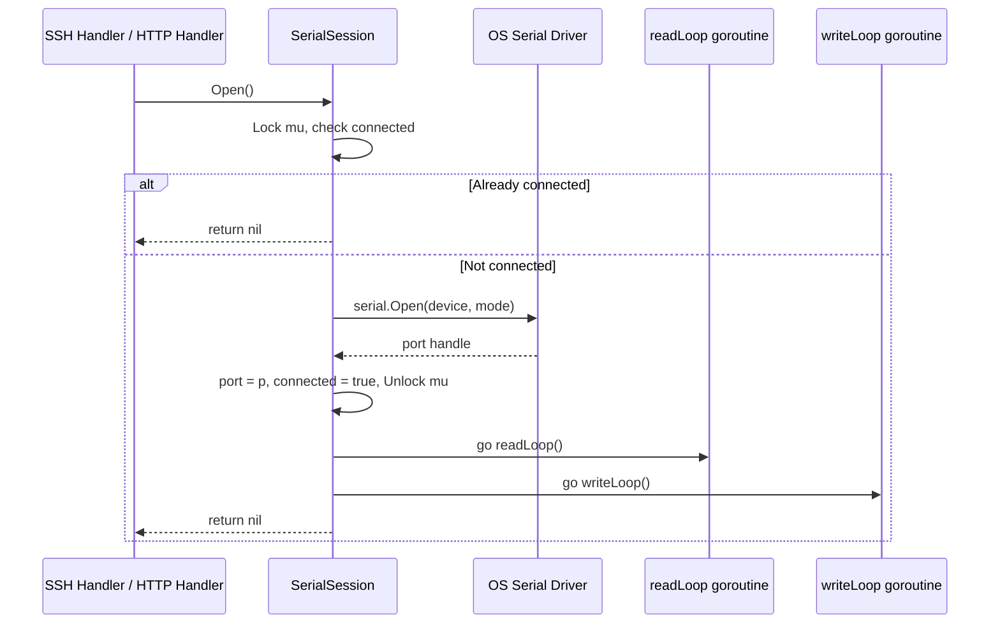
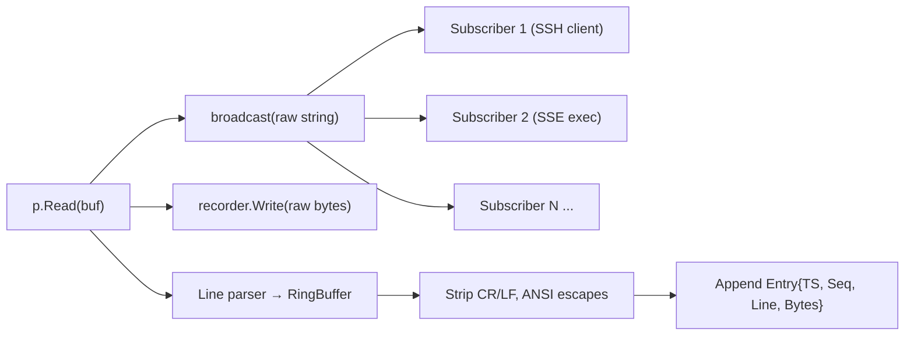
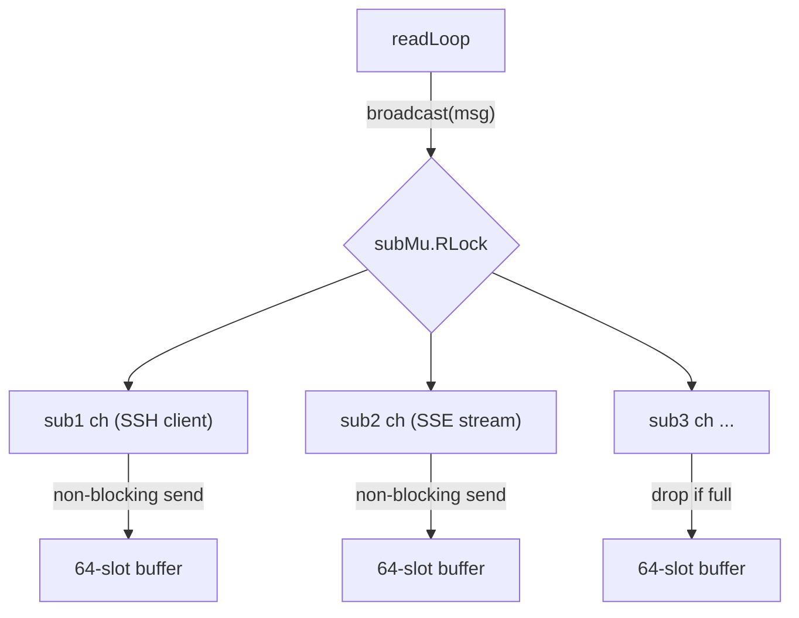
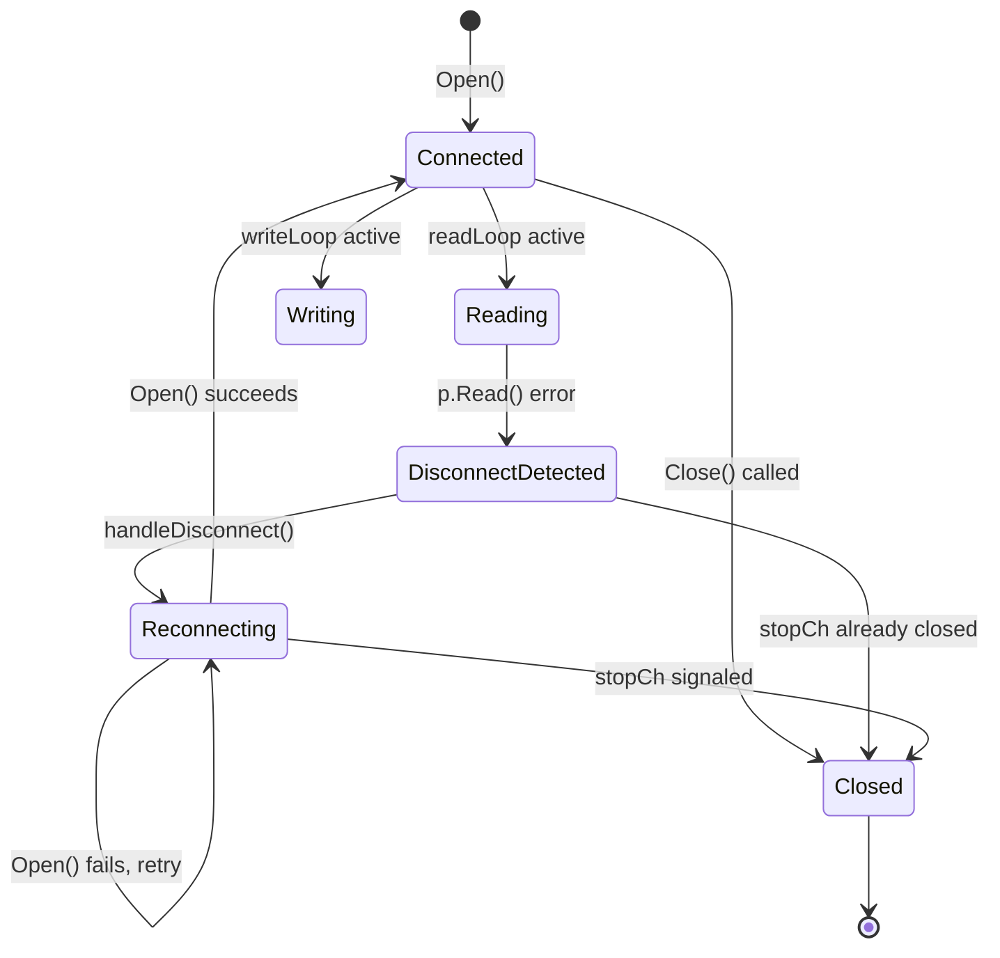
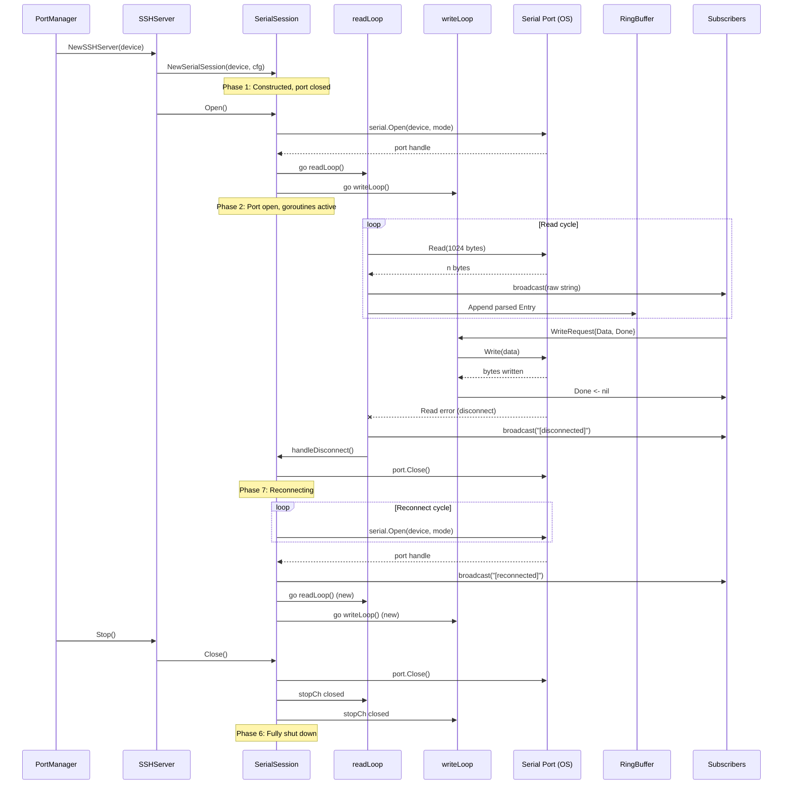

The `SerialSession` is the central abstraction in SerialGateway's serial communication engine. It encapsulates the complete lifecycle of a single physical serial port connection — from initial construction through port opening, concurrent read/write operations, subscriber-based broadcasting, and graceful shutdown with automatic reconnection. Every SSH terminal session, every HTTP write request, and every exec command ultimately routes through a `SerialSession` instance.

This page traces that lifecycle phase by phase, examining the data structures, goroutine coordination, and concurrency invariants that make it work.

## The SerialSession Struct

At its core, `SerialSession` is a stateful object that binds a device name (e.g., `COM3`) to a physical port handle, two dedicated goroutines, a subscriber fan-out system, and an in-memory ring buffer. The struct definition reveals all of these collaborators at a glance:

```go
type SerialSession struct {
    device   string
    baudrate int
    cfg      *config.Config
    logger   *slog.Logger

    mu        sync.Mutex
    port      serial.Port
    connected bool

    writeCh     chan WriteRequest
    subscribers map[chan string]struct{}
    subMu       sync.RWMutex

    ringBuffer *RingBuffer
    seqCounter int

    recorder interface{ Write([]byte) }

    stopCh chan struct{}
}
```

Sources: [session.go](internal/serial/session.go#L24-L44)

The struct uses a **dual-mutex strategy**: `mu` guards the physical port handle and connection state (contended by read, write, and close paths), while `subMu` independently guards the subscriber map (contended by subscribe/unsubscribe and broadcast). This separation prevents broadcast operations from blocking on port-level mutex contention.

| Field | Type | Purpose |
|---|---|---|
| `port` | `serial.Port` | OS-level serial port handle from `go.bug.st/serial` |
| `connected` | `bool` | Logical connection flag, always read/written under `mu` |
| `writeCh` | `chan WriteRequest` | Buffered channel (capacity 64) for serializing write operations |
| `subscribers` | `map[chan string]struct{}` | Set of active subscriber channels for read broadcasting |
| `ringBuffer` | `*RingBuffer` | Bounded in-memory store of parsed output lines |
| `seqCounter` | `int` | Monotonically increasing sequence number for ring buffer entries |
| `recorder` | `interface{ Write([]byte) }` | Optional file recorder for persistent logging |
| `stopCh` | `chan struct{}` | Broadcast signal for goroutine termination |

## Phase 1: Construction

A `SerialSession` is created by `NewSerialSession`, which resolves the baudrate and initializes all internal state — but critically, **does not open the port**. This deferred-open pattern allows sessions to exist as lightweight configuration holders until an actual connection is needed.

```go
func NewSerialSession(device string, cfg *config.Config, logger *slog.Logger) *SerialSession {
    baudrate := cfg.SerialDefaults.Baudrate
    for _, p := range cfg.Ports {
        if p.Device == device && p.Baudrate != 0 {
            baudrate = p.Baudrate
        }
    }
    return &SerialSession{
        device:      device,
        baudrate:    baudrate,
        cfg:         cfg,
        logger:      logger,
        writeCh:     make(chan WriteRequest, 64),
        subscribers: make(map[chan string]struct{}),
        ringBuffer:  NewRingBuffer(cfg.RingBuffer.MaxLines, cfg.RingBuffer.MaxBytes),
        stopCh:      make(chan struct{}),
    }
}
```

Sources: [session.go](internal/serial/session.go#L46-L63)

**Baudrate resolution** follows an override pattern: the global default from `serial_defaults.baudrate` is used unless a per-port entry in the `ports` array specifies a non-zero baudrate for this device. This allows mixed-baudrate environments where different serial devices operate at different speeds.

Sources: [config.go](internal/config/config.go#L14-L23)

Construction is triggered by `SSHServer` creation, which in turn is driven by `PortManager.AutoStart()` at startup or `AddMapping()` for runtime port additions:

```
PortManager.AutoStart()
  └─ ssh.NewSSHServer(device, cfg, logger)
       └─ serial.NewSerialSession(device, cfg, logger)
```

Sources: [server.go](internal/ssh/server.go#L43-L57), [portmanager.go](internal/core/portmanager.go#L30-L68)

## Phase 2: Opening the Port

The `Open()` method is the transition point from passive configuration holder to active communication channel. It is **idempotent** — calling it on an already-connected session returns `nil` immediately, which is essential because multiple callers (SSH handler, HTTP write, HTTP exec) may independently trigger `Open()` on the same session.

```go
func (s *SerialSession) Open() error {
    s.mu.Lock()
    if s.connected {
        s.mu.Unlock()
        return nil
    }
    // ... configure serial.Mode from cfg ...
    p, err := serial.Open(s.device, mode)
    if err != nil {
        s.mu.Unlock()
        return fmt.Errorf("open %s: %w", s.device, err)
    }
    s.port = p
    s.connected = true
    s.mu.Unlock()
    go s.readLoop()
    go s.writeLoop()
    return nil
}
```

Sources: [session.go](internal/serial/session.go#L75-L114)

### Serial Mode Configuration

Before calling `serial.Open`, the method translates the YAML configuration into a `serial.Mode` struct. The configuration supports the full range of RS-232 parameters:

| Parameter | Config Key | Supported Values | Default |
|---|---|---|---|
| Baud rate | `serial_defaults.baudrate` | Any integer (e.g., 9600, 115200) | `115200` |
| Data bits | `serial_defaults.bytesize` | `5`, `6`, `7`, `8` | `8` |
| Parity | `serial_defaults.parity` | `"N"`, `"E"`, `"O"`, `"M"`, `"S"` | `"N"` |
| Stop bits | `serial_defaults.stopbits` | `1`, `1.5`, `2` | `1` |

Sources: [session.go](internal/serial/session.go#L81-L102), [config.go](internal/config/config.go#L114-L135)

### Goroutine Spawning

After a successful port open, two goroutines are launched **outside the mutex lock**:

1. **`readLoop()`** — continuously reads from the serial port
2. **`writeLoop()`** — consumes write requests from the buffered channel

Launching them after releasing `mu` is intentional: the goroutines themselves acquire `mu` to snapshot the port reference, so holding the lock during `go` statement execution would create unnecessary contention windows.



### Lazy Open from Multiple Entry Points

The session is not opened at construction time. Instead, the first entity that needs the port triggers `Open()`:

- **SSH handler**: Opens the port when a client connects, before subscribing for reads.
- **HTTP write handler**: Opens the port if not connected, before sending data.
- **HTTP exec handler**: Opens the port if not connected, before executing a command.

Sources: [handler.go](internal/ssh/handler.go#L22-L30), [handlers.go](internal/http/handlers.go#L244-L250), [exec.go](internal/http/exec.go#L28-L33)

## Phase 3: The Read Loop

The `readLoop` is the session's heartbeat. It runs in a dedicated goroutine, continuously pulling raw bytes from the serial port and distributing them through three parallel pipelines: **subscriber broadcast**, **file recording**, and **ring buffer ingestion**.

```go
func (s *SerialSession) readLoop() {
    stopCh := s.stopCh
    buf := make([]byte, 1024)
    lineBuf := []byte{}
    for {
        select {
        case <-stopCh:
            return
        default:
        }
        s.mu.Lock()
        p := s.port
        s.mu.Unlock()
        if p == nil {
            time.Sleep(100 * time.Millisecond)
            continue
        }
        n, err := p.Read(buf)
        if err != nil {
            s.logger.Error("serial read error", "error", err)
            s.broadcast("[serial disconnected - waiting for reconnect...]\n")
            s.handleDisconnect()
            return
        }
        // ... process n bytes ...
    }
}
```

Sources: [session.go](internal/serial/session.go#L152-L209)

### Port Snapshot Pattern

A subtle but critical pattern appears at the top of each iteration: the loop snapshots `s.port` under the mutex, then uses the local copy `p` for the blocking `Read()` call **outside the lock**. This prevents `Close()` from deadlocking — `Close()` needs `mu` to nil out `s.port`, and it can acquire it because `Read()` does not hold the lock.

The trade-off is that `Read()` may execute on a port that is concurrently being closed. The `go.bug.st/serial` library handles this gracefully by returning an error, which the read loop catches and treats as a disconnect.

### Three-Way Data Distribution

For every successful read of `n` bytes, the data flows through three paths:



1. **Broadcast** (`s.broadcast(string(buf[:n]))`) — sends the raw string to all active subscriber channels. Subscribers are typically SSH terminal sessions and SSE exec streams. The broadcast is **non-blocking**: if a subscriber's channel buffer (capacity 64) is full, the message is silently dropped for that subscriber.

2. **Recording** (`s.recorder.Write(buf[:n])`) — forwards raw bytes to the optional `FileRecorder` for persistent logging. The recorder's `Write` method is itself non-blocking, using an internal buffered channel (capacity 256).

3. **Line parsing and ring buffer** — accumulates bytes in `lineBuf`, splits on `\n`, strips trailing `\r` and ANSI escape sequences, assigns a monotonically increasing sequence number, and appends an `Entry` to the ring buffer.

Sources: [session.go](internal/serial/session.go#L179-L207)

### ANSI Escape Stripping

The line parser applies a regex to remove ANSI terminal control sequences before storing lines in the ring buffer. This ensures that HTTP API consumers (tail, log, exec) receive clean text without terminal formatting codes:

```go
var ansiEscape = regexp.MustCompile(`\x1b\[[0-9;]*[A-Za-z]|\x1b[^[A-Za-z]?[A-Za-z]`)
```

This pattern matches both CSI sequences (`ESC[...letter`) and simpler two-character escape sequences (`ESC` followed by a non-`[` control character).

Sources: [session.go](internal/serial/session.go#L17)

### Carriage Return Handling

Serial devices often emit `\r\n` line endings, and some devices emit standalone `\r` for line-overwrite behavior (progress bars, status lines). The parser handles both: it first strips a trailing `\r` from the line, then checks for an embedded `\r` and keeps only the text after the last one. This effectively implements "overwrite on `\r`" semantics, storing only the final state of each line.

Sources: [session.go](internal/serial/session.go#L191-L194)

## Phase 4: The Write Loop

Writes are serialized through a single goroutine consuming from a buffered channel. This design ensures that concurrent writers (multiple SSH clients, HTTP API callers) never interleave their data on the physical port.

```go
type WriteRequest struct {
    Data []byte
    Done chan error
}

func (s *SerialSession) writeLoop() {
    stopCh := s.stopCh
    for {
        select {
        case <-stopCh:
            return
        case req := <-s.writeCh:
            s.mu.Lock()
            p := s.port
            s.mu.Unlock()
            if p == nil {
                if s.cfg.Reconnect.DiscardInputOnDisconnect {
                    req.Done <- fmt.Errorf("serial disconnected, input discarded")
                }
                continue
            }
            _, err := p.Write(req.Data)
            req.Done <- err
        }
    }
}
```

Sources: [session.go](internal/serial/session.go#L19-L22), [session.go](internal/serial/session.go#L211-L231)

### Request-Response Pattern

The `WriteRequest` struct implements a **synchronous-over-async** pattern: the caller enqueues a request with a `Done` channel, then blocks waiting for the result. This provides backpressure — the caller knows whether the write succeeded before proceeding.

The `writeCh` has a buffer capacity of **64**, allowing up to 64 write requests to be queued without blocking the caller's send. However, callers typically wait on `Done` before sending the next request, so the buffer mainly absorbs burst traffic from concurrent writers.

### Disconnected Write Behavior

When the port is `nil` (disconnected), the write loop consults the `discard_input_on_disconnect` configuration:

| Config Value | Behavior |
|---|---|
| `true` | Sends an error on `Done`, informing the caller that data was discarded |
| `false` | Silently drops the write — the `Done` channel never receives, and the caller will time out |

The `continue` statement means the write request is consumed from the channel regardless; it is never retried after reconnection.

Sources: [session.go](internal/serial/session.go#L221-L226), [serial-gateway.yaml](serial-gateway.yaml#L25)

### Write Timeout at the Caller

Neither the write loop nor `SerialSession` itself enforces a write timeout. Instead, **callers** impose timeouts:

- **SSH handler**: Waits up to `serial_defaults.write_timeout` (default 10s) for the `Done` response.
- **HTTP write handler**: Same timeout via `gw.cfg.SerialDefaults.WriteTimeout`.
- **HTTP exec handler**: Same pattern.

This caller-side timeout design keeps the session layer simple while allowing different consumers to customize their timeout behavior.

Sources: [handler.go](internal/ssh/handler.go#L60-L67), [handlers.go](internal/http/handlers.go#L259-L263), [exec.go](internal/http/exec.go#L46-L55)

## Phase 5: Subscriber Broadcasting

The pub/sub mechanism in `SerialSession` enables multiple consumers to receive a live copy of all serial output without contending on the read loop's critical path.

```go
func (s *SerialSession) Subscribe() chan string {
    ch := make(chan string, 64)
    s.subMu.Lock()
    s.subscribers[ch] = struct{}{}
    s.subMu.Unlock()
    return ch
}

func (s *SerialSession) Unsubscribe(ch chan string) {
    s.subMu.Lock()
    delete(s.subscribers, ch)
    s.subMu.Unlock()
    close(ch)
}
```

Sources: [session.go](internal/serial/session.go#L137-L150)

The broadcast function uses a **non-blocking send** with a `select/default` guard:

```go
func (s *SerialSession) broadcast(msg string) {
    s.subMu.RLock()
    defer s.subMu.RUnlock()
    for ch := range s.subscribers {
        select {
        case ch <- msg:
        default:
        }
    }
}
```

Sources: [session.go](internal/serial/session.go#L233-L242)

This means a slow subscriber (one whose 64-slot buffer is full) will miss messages rather than blocking the read loop. This is a deliberate **latency-over-reliability** trade-off: the serial read loop must never stall, because stalling means losing data from the physical port's hardware buffer.



### Subscriber Lifecycle in SSH

The SSH handler demonstrates the canonical subscribe/consume/unsubscribe pattern:

1. **Subscribe** before starting the output goroutine
2. **Consume** messages in a dedicated goroutine, translating `\n` to `\r\n` for terminal compatibility
3. **Unsubscribe** via `defer` when the SSH session ends, which also closes the channel and signals the output goroutine to exit

Sources: [handler.go](internal/ssh/handler.go#L32-L43)

## Phase 6: Closing the Session

The `Close()` method performs an orderly shutdown of the physical port and signals all goroutines to terminate:

```go
func (s *SerialSession) Close() {
    s.mu.Lock()
    if s.port != nil {
        s.port.Close()
        s.port = nil
    }
    s.connected = false
    s.mu.Unlock()
    select {
    case <-s.stopCh:
    default:
        close(s.stopCh)
    }
}
```

Sources: [session.go](internal/serial/session.go#L116-L129)

### Shutdown Sequence

The close sequence follows a specific order to prevent deadlocks and data races:

1. **Acquire `mu`** — prevents the read/write loops from snapshotting a stale port reference
2. **Close the OS port handle** — causes any in-progress `p.Read()` to return with an error
3. **Nil the port** — ensures subsequent loop iterations see `p == nil`
4. **Set `connected = false`** — updates the logical state
5. **Release `mu`** — allows goroutines to observe the nil port
6. **Close `stopCh`** — broadcasts the termination signal to both loops

The `select/default` guard on `close(s.stopCh)` makes `Close()` **idempotent** — calling it multiple times does not panic from double-closing the channel.

### Goroutine Termination

Both `readLoop` and `writeLoop` check `stopCh` at the top of each iteration via a `select/default`:

```go
select {
case <-stopCh:
    return
default:
}
```

This is a **cooperative cancellation** pattern. The read loop may be blocked on `p.Read()` when `stopCh` is closed; in that case, `port.Close()` (called in step 2 above) forces `Read()` to return with an error, and the loop exits through the error handling path rather than the `stopCh` check.

Sources: [session.go](internal/serial/session.go#L157-L161), [session.go](internal/serial/session.go#L213-L216)

### Close Initiation Points

`Close()` is called from two places:

1. **`SSHServer.Stop()`** — when the PortManager removes a mapping or shuts down, it calls `srv.Stop()`, which closes the SSH listener and then calls `session.Close()`.
2. **`handleDisconnect()`** — when the read loop encounters a read error, it calls `handleDisconnect()` instead of `Close()`, because disconnect handling requires additional steps (see next section).

Sources: [server.go](internal/ssh/server.go#L127-L139)

## Phase 7: Disconnect and Reconnection

When a physical read error occurs — typically caused by USB-to-serial adapter removal or cable disconnect — the read loop enters the disconnect/reconnect cycle rather than terminating permanently.



### handleDisconnect

```go
func (s *SerialSession) handleDisconnect() {
    s.mu.Lock()
    if s.port == nil {
        s.mu.Unlock()
        return
    }
    s.port.Close()
    s.port = nil
    s.connected = false
    select {
    case <-s.stopCh:
    default:
        close(s.stopCh)
    }
    s.stopCh = make(chan struct{})
    s.mu.Unlock()
    go s.reconnectLoop()
}
```

Sources: [session.go](internal/serial/session.go#L244-L261)

This method performs the same cleanup as `Close()` but with one critical addition: **it creates a new `stopCh`**. This is essential because the old `stopCh` is closed (signaling the old read/write loops to exit), but the new `reconnectLoop` and the future `readLoop`/`writeLoop` spawned by a successful `Open()` need a fresh, unclosed channel.

### reconnectLoop

```go
func (s *SerialSession) reconnectLoop() {
    stopCh := s.stopCh
    interval := s.cfg.Reconnect.InitialInterval
    for {
        select {
        case <-stopCh:
            return
        default:
        }
        time.Sleep(interval)
        err := s.Open()
        if err == nil {
            s.broadcast("[serial reconnected]\n")
            return
        }
        s.logger.Warn("reconnect attempt failed", "error", err)
    }
}
```

Sources: [session.go](internal/serial/session.go#L263-L280)

The reconnect loop uses a **fixed-interval** retry strategy at `reconnect.initial_interval` (default 1 second). It does not implement exponential backoff up to `reconnect.max_interval`, despite the configuration supporting it — this appears to be a simplification in the current implementation.

When reconnection succeeds, `Open()` spawns fresh `readLoop` and `writeLoop` goroutines, and the session broadcasts `[serial reconnected]` to all current subscribers, informing SSH clients and SSE streams that data flow has resumed.

| Config Key | Default | Purpose |
|---|---|---|
| `reconnect.initial_interval` | `1s` | Delay between reconnection attempts |
| `reconnect.max_interval` | `30s` | Configured but not currently used for backoff |
| `reconnect.discard_input_on_disconnect` | `true` | Whether to error on writes during disconnect |

Sources: [config.go](internal/config/config.go#L36-L40), [serial-gateway.yaml](serial-gateway.yaml#L22-L25)

## Complete Lifecycle Diagram

The following diagram shows the full lifecycle from construction through potential reconnection, integrating all phases:



## Concurrency Safety Summary

| Operation | Mutex | Channel | Notes |
|---|---|---|---|
| `Open()` | `mu` | — | Idempotent; spawns goroutines after unlock |
| `Close()` | `mu` | `stopCh` | Idempotent; closes port then signals stop |
| `readLoop` | `mu` (snapshot only) | `stopCh` | Non-blocking broadcast, no lock during `Read()` |
| `writeLoop` | `mu` (snapshot only) | `writeCh`, `stopCh` | Serialized writes, caller blocks on `Done` |
| `Subscribe/Unsubscribe` | `subMu` | — | Channel lifecycle managed by caller |
| `broadcast` | `subMu` (read lock) | — | Non-blocking sends; drops on full buffer |
| `handleDisconnect` | `mu` | `stopCh` | Creates new `stopCh` for reconnection |
| `reconnectLoop` | — | `stopCh` | Calls `Open()` which manages its own locking |

The overall design follows the principle that **the serial port's hardware buffer is the scarcest resource** — data arriving from the device must be consumed immediately or it is lost. This drives the non-blocking broadcast, the buffered write channel, and the cooperative goroutine cancellation pattern.

## Next Steps

- [Read Broadcasting and Write Queue Concurrency Model](13-read-broadcasting-and-write-queue-concurrency-model) — Deep dive into the fan-out mechanics and write serialization guarantees
- [Disconnect Detection and Automatic Reconnection](14-disconnect-detection-and-automatic-reconnection) — Extended coverage of failure modes and reconnection edge cases
- [Ring Buffer: In-Memory History Storage and Retrieval](15-ring-buffer-in-memory-history-storage-and-retrieval) — How parsed lines are stored and queried
- [Per-Port SSH Server Creation and Session Bridging](16-per-port-ssh-server-creation-and-session-bridging) — How SSH sessions interact with SerialSession