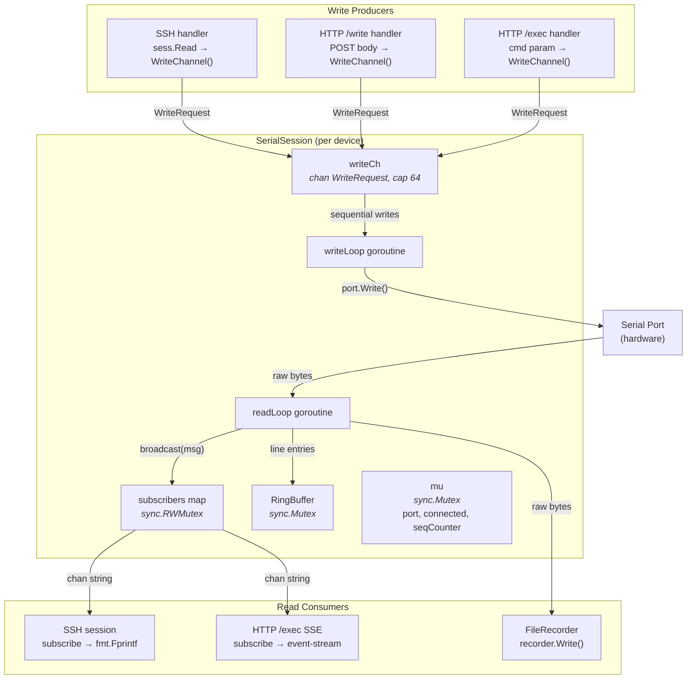

Serial ports are inherently single-producer for reads and single-consumer for writes at the hardware level. SerialGateway enforces this constraint through a carefully designed concurrency model built around two core goroutines — `readLoop` and `writeLoop` — that form the backbone of every `SerialSession`. This page dissects how incoming data fans out to multiple concurrent subscribers, how outgoing writes from disparate sources are serialized through a bounded channel, and how these mechanisms interact with the ring buffer, reconnect lifecycle, and HTTP/SSH client layers.

---

## Architectural Overview

The `SerialSession` struct orchestrates all concurrent access to a single serial port device. Its concurrency model can be decomposed into four distinct subsystems, each governed by specific synchronization primitives:



The fundamental design principle is **asymmetric fan-out**: reads from the serial port are broadcast to zero or many subscribers, while writes from zero or many producers are funneled through a single serialization point. This mirrors the physical reality of UART communication while enabling multi-client observation and command injection.

Sources: [session.go](internal/serial/session.go#L24-L44)

---

## The Read Broadcasting Pipeline

### readLoop: The Single Reader

Every `SerialSession` spawns exactly one `readLoop` goroutine when `Open()` succeeds. This goroutine owns all read access to the underlying serial port, eliminating any possibility of concurrent read contention at the driver level.

```go
func (s *SerialSession) readLoop() {
    stopCh := s.stopCh
    buf := make([]byte, 1024)
    lineBuf := []byte{}
    for {
        select {
        case <-stopCh:
            return
        default:
        }
        s.mu.Lock()
        p := s.port
        s.mu.Unlock()
        if p == nil {
            time.Sleep(100 * time.Millisecond)
            continue
        }
        n, err := p.Read(buf)
        // ...
    }
}
```

The loop begins each iteration by checking `stopCh` for a termination signal, then acquires a snapshot of the `port` reference under the session mutex. The port pointer is copied locally before the mutex is released, ensuring that the blocking `p.Read(buf)` call does not hold the lock. The 1024-byte read buffer is allocated once and reused across iterations.

Sources: [session.go](internal/serial/session.go#L152-L178)

### Two-Stage Data Processing

When `p.Read(buf)` returns `n > 0` bytes, the readLoop processes them through two distinct stages:

**Stage 1 — Raw Broadcast.** The raw byte slice is immediately converted to a string and dispatched to all subscribers via `broadcast()`. This preserves the unmodified byte stream for real-time consumers like SSH sessions and SSE exec streams. Additionally, if a `recorder` is attached, the raw bytes are forwarded to it asynchronously.

**Stage 2 — Line-Oriented Ring Buffer Ingestion.** The same bytes are appended to `lineBuf`, an accumulator that persists across read iterations. The loop then scans for `\n` delimiters, extracting complete lines. Each line undergoes normalization: trailing `\r` is stripped, embedded `\r` characters (from cursor-return sequences) cause everything before them to be discarded, and ANSI escape sequences are removed via a compiled regex. The cleaned line receives a monotonically increasing sequence number (protected by `mu`) and is appended to the `RingBuffer` as a timestamped `Entry`.

```go
s.broadcast(string(buf[:n]))          // Stage 1: fan-out raw data
if s.recorder != nil {
    s.recorder.Write(buf[:n])         // Stage 1: persist raw data
}
lineBuf = append(lineBuf, buf[:n]...) // Stage 2: accumulate for line splitting
for {
    idx := bytes.IndexByte(lineBuf, '\n')
    if idx < 0 { break }
    line := string(lineBuf[:idx])
    lineBuf = lineBuf[idx+1:]
    // ... normalize, strip ANSI, assign sequence ...
    s.ringBuffer.Append(entry)
}
```

This dual-stage design means that real-time subscribers receive the exact byte stream from the device (including ANSI codes and partial lines), while the ring buffer stores only clean, complete lines suitable for the `/tail` and `/log` endpoints.

Sources: [session.go](internal/serial/session.go#L179-L208)

### The broadcast() Function: Non-Blocking Fan-Out

The `broadcast` method is the distribution mechanism for pushing data to all active subscribers. Its critical design decision is the **non-blocking send**:

```go
func (s *SerialSession) broadcast(msg string) {
    s.subMu.RLock()
    defer s.subMu.RUnlock()
    for ch := range s.subscribers {
        select {
        case ch <- msg:
        default:
        }
    }
}
```

The `select` with a `default` case means that if any subscriber's buffered channel (capacity 64) is full, the message is silently dropped for that subscriber rather than blocking the entire readLoop. This is a deliberate trade-off: **a slow consumer cannot stall the read pipeline**, which would cause data loss at the serial port level and affect all other subscribers.

The `subMu` (a `sync.RWMutex`) is held with `RLock` during iteration, allowing concurrent `broadcast` calls while still preventing concurrent modification of the subscriber map. Since only one goroutine (readLoop) calls `broadcast`, the RLock here primarily protects against concurrent `Subscribe`/`Unsubscribe` operations which take the full write lock.

Sources: [session.go](internal/serial/session.go#L233-L242)

### Subscriber Lifecycle: Subscribe and Unsubscribe

Clients acquire a subscription channel through `Subscribe()`, which creates a buffered `chan string` with capacity 64 and registers it in the `subscribers` map under a write lock. The empty struct `struct{}{}` is used as the map value to minimize memory — the map effectively functions as a concurrent set.

```go
func (s *SerialSession) Subscribe() chan string {
    ch := make(chan string, 64)
    s.subMu.Lock()
    s.subscribers[ch] = struct{}{}
    s.subMu.Unlock()
    return ch
}

func (s *SerialSession) Unsubscribe(ch chan string) {
    s.subMu.Lock()
    delete(s.subscribers, ch)
    s.subMu.Unlock()
    close(ch)
}
```

`Unsubscribe` removes the channel from the map and then **closes it**, which signals the consumer's `for msg := range sub` loop to terminate. The ordering is critical: deletion under the lock prevents `broadcast` from sending to a closed channel, and closing after deletion ensures no goroutine holds a reference to a closed channel within the map.

Sources: [session.go](internal/serial/session.go#L137-L150)

### Subscriber Interactions Across Layers

| Consumer | How It Subscribes | Data Flow |
|---|---|---|
| **SSH session** | `s.session.Subscribe()` in `handleSession` | Reads from channel, converts `\n` → `\r\n`, writes to SSH session via `fmt.Fprintf` |
| **HTTP /exec** | `sess.Subscribe()` before writing the command | Reads from channel in SSE loop, splits on `\n`, emits `data:` events |
| **FileRecorder** | Not a subscriber — receives raw bytes directly from readLoop | `recorder.Write(buf[:n])` called inline |

The SSH handler demonstrates the typical subscriber pattern: it subscribes immediately upon session establishment, launches a dedicated goroutine to drain the subscription channel, and defers `Unsubscribe` for cleanup when the SSH session terminates.

Sources: [handler.go](internal/ssh/handler.go#L32-L43), [exec.go](internal/http/exec.go#L36-L37)

---

## The Write Queue: Serialized Multi-Producer Concurrency

### WriteRequest and the Bounded Channel

Write operations enter the system through a `WriteRequest` struct that pairs the payload with a response channel for synchronous error reporting:

```go
type WriteRequest struct {
    Data []byte
    Done chan error
}
```

The session's `writeCh` is a buffered channel with capacity 64, created during `NewSerialSession`. This buffer provides backpressure absorption: up to 64 write requests can be queued without blocking producers, accommodating burst scenarios where multiple HTTP or SSH clients submit commands in rapid succession.

```go
writeCh: make(chan WriteRequest, 64),
```

The `WriteChannel()` accessor exposes this channel to external producers (SSH handlers and HTTP handlers), establishing a clean producer boundary.

Sources: [session.go](internal/serial/session.go#L19-L22), [session.go](internal/serial/session.go#L58)

### writeLoop: The Single Writer

The `writeLoop` goroutine is the exclusive writer to the serial port, ensuring that concurrent write requests are serialized and never interleaved at the byte level:

```go
func (s *SerialSession) writeLoop() {
    stopCh := s.stopCh
    for {
        select {
        case <-stopCh:
            return
        case req := <-s.writeCh:
            s.mu.Lock()
            p := s.port
            s.mu.Unlock()
            if p == nil {
                if s.cfg.Reconnect.DiscardInputOnDisconnect {
                    req.Done <- fmt.Errorf("serial disconnected, input discarded")
                }
                continue
            }
            _, err := p.Write(req.Data)
            req.Done <- err
        }
    }
}
```

The loop follows a receive-process-acknowledge pattern:
1. **Receive** a `WriteRequest` from `writeCh` (blocking until available or `stopCh` fires).
2. **Snapshot** the port reference under the mutex.
3. **Handle disconnection**: If `port` is nil, the request is either acknowledged with an error (if `DiscardInputOnDisconnect` is true) or silently consumed. Note the subtle asymmetry — when `DiscardInputOnDisconnect` is false, the `Done` channel is never written to, which means the producer will eventually time out via its `time.After` guard.
4. **Write and acknowledge**: `p.Write(req.Data)` executes the actual serial write, and the resulting error (or nil) is sent back through `req.Done`.

The `Done` channel is always buffered with capacity 1 (`make(chan error, 1)`) to prevent the writeLoop from blocking if the producer has already moved on (e.g., due to timeout).

Sources: [session.go](internal/serial/session.go#L211-L231)

### Producer Patterns: SSH and HTTP Write Paths

All write producers follow an identical protocol: construct a `WriteRequest`, send it to `writeCh`, then await the result on `Done` with a timeout guard.

**SSH Handler** — Reads keystrokes from the SSH session in a loop, packages each chunk into a `WriteRequest`, and waits for acknowledgment with the configured `WriteTimeout`:

```go
req := serial.WriteRequest{
    Data: buf[:n],
    Done: make(chan error, 1),
}
s.session.WriteChannel() <- req
select {
case writeErr := <-req.Done:
    // handle error
case <-time.After(s.cfg.SerialDefaults.WriteTimeout):
    fmt.Fprintf(sess, "[write timeout]\n")
}
```

**HTTP /write Handler** — Decodes a JSON body, submits the data as a single `WriteRequest`, and waits with the same timeout pattern. After success, it sleeps 500ms and reads the last 50 ring buffer entries to return as "output."

**HTTP /exec Handler** — Subscribes *before* writing (to avoid missing early output), sends the command string as a `WriteRequest`, and on success transitions into SSE streaming mode where it drains the subscription channel.

Sources: [handler.go](internal/ssh/handler.go#L55-L67), [handlers.go](internal/http/handlers.go#L252-L263), [exec.go](internal/http/exec.go#L36-L55)

### Write Concurrency Guarantees

| Property | Mechanism |
|---|---|
| **No write interleaving** | Single `writeLoop` goroutine drains `writeCh` sequentially |
| **Bounded queue** | `writeCh` buffered channel with capacity 64; blocks producers when full |
| **Synchronous error reporting** | `Done chan error` provides per-request acknowledgment |
| **Timeout protection** | Producers use `time.After(WriteTimeout)` to avoid indefinite blocking |
| **Disconnect resilience** | `DiscardInputOnDisconnect` config controls whether queued writes fail-fast or time out |

---

## Synchronization Primitives at a Glance

The `SerialSession` employs four distinct synchronization mechanisms, each chosen for a specific concurrency concern:

| Primitive | Field | Protects | Access Pattern |
|---|---|---|---|
| `sync.Mutex` | `mu` | `port`, `connected`, `seqCounter` | Short critical sections; snapshot-then-release |
| `sync.RWMutex` | `subMu` | `subscribers` map | `RLock` for broadcast (hot path), `Lock` for subscribe/unsubscribe |
| `chan WriteRequest` | `writeCh` (cap 64) | Write serialization | Multiple producers → single consumer |
| `chan struct{}` | `stopCh` | Goroutine lifecycle | Closed once to signal all goroutines to terminate |

The **mutex design avoids lock nesting**: `mu` protects port state, `subMu` protects the subscriber map, and neither is ever held while the other is acquired. The `seqCounter` is incremented under `mu` during line processing in `readLoop`, which is safe because `readLoop` is the only goroutine that writes to it (the lock primarily ensures memory visibility for readers like the ring buffer's `Tail` method).

Sources: [session.go](internal/serial/session.go#L30-L44)

---

## Interaction with the Reconnect Lifecycle

The concurrency model has a defined interaction with disconnect and reconnection events. When `p.Read(buf)` returns an error in `readLoop`, the following sequence occurs:

1. A disconnect message is broadcast to all subscribers: `"[serial disconnected - waiting for reconnect...]\n"`
2. `handleDisconnect()` is called, which closes the port, sets `connected = false`, closes the old `stopCh`, creates a **new** `stopCh`, and launches `reconnectLoop()`.
3. The old `readLoop` and `writeLoop` terminate because the old `stopCh` was closed.
4. During the reconnect window, `writeLoop` is not running — writes sent to `writeCh` accumulate in the buffer (up to 64) or block if the buffer is full.
5. When `reconnectLoop` succeeds in calling `Open()`, a new `readLoop` and `writeLoop` are spawned on the new `stopCh`, and a `"[serial reconnected]\n"` message is broadcast.

The key insight is that **`stopCh` is recreated** on each disconnect (`s.stopCh = make(chan struct{})`), ensuring that the new goroutines use a fresh signal channel while the old goroutines respond to the closed one. The `writeCh` persists across reconnections, so queued writes survive the disconnect/reconnect cycle as long as the buffer is not exhausted.

Sources: [session.go](internal/serial/session.go#L244-L280)

---

## Sequence Number Monotonicity

Every line entry appended to the ring buffer receives a sequence number from `seqCounter`, incremented under `mu`:

```go
s.mu.Lock()
s.seqCounter++
seq := s.seqCounter
s.mu.Unlock()
```

Since `readLoop` is the sole writer to `seqCounter` (no other goroutine modifies it), the mutex here serves primarily as a memory barrier to ensure visibility. The sequence numbers are **monotonically increasing within a session's lifetime** but do not reset on reconnect. Consumers can use the `Seq` field to detect gaps or order entries across ring buffer snapshots.

Sources: [session.go](internal/serial/session.go#L196-L199)

---

## ANSI Escape Sequence Stripping

The compiled regex `\x1b\[[0-9;]*[A-Za-z]|\x1b[^[A-Za-z]?[A-Za-z]` matches common ANSI escape sequences (color codes, cursor movements) and is applied during line processing in `readLoop`. This regex is compiled once at package initialization as a package-level variable, avoiding repeated compilation overhead on every line.

The stripping only affects ring buffer entries — raw broadcast data retains ANSI sequences, so SSH clients that support terminal emulation receive the full escape sequences for proper rendering.

Sources: [session.go](internal/serial/session.go#L17), [session.go](internal/serial/session.go#L195)

---

## Related Pages

- **[SerialSession Lifecycle: Open, Read, Write, Close](12-serialsession-lifecycle-open-read-write-close)** — Detailed walkthrough of session creation, port configuration, and teardown
- **[Ring Buffer: In-Memory History Storage and Retrieval](15-ring-buffer-in-memory-history-storage-and-retrieval)** — How the `RingBuffer` stores and serves the line entries produced by `readLoop`
- **[Disconnect Detection and Automatic Reconnection](14-disconnect-detection-and-automatic-reconnection)** — Deep dive into `handleDisconnect` and `reconnectLoop` mechanics
- **[Server-Sent Events (SSE) Streaming for Command Execution](19-server-sent-events-sse-streaming-for-command-execentication)** — How `/exec` leverages subscribe-before-write and SSE streaming
- **[Per-Port SSH Server Creation and Session Bridging](16-per-port-ssh-server-creation-and-session-bridging)** — How SSH sessions interact with subscribe/write patterns