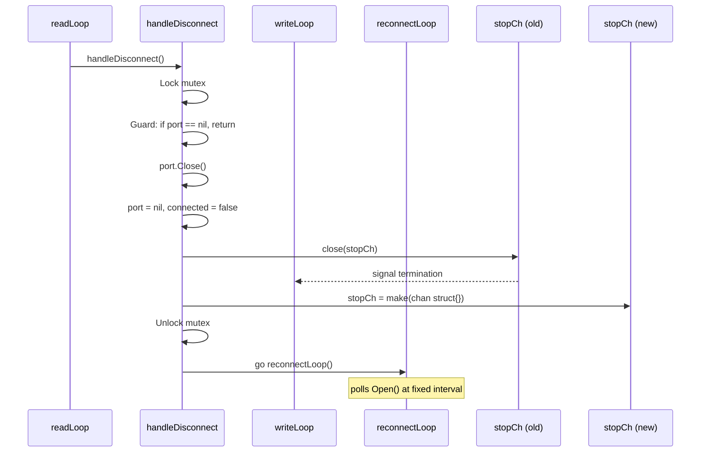
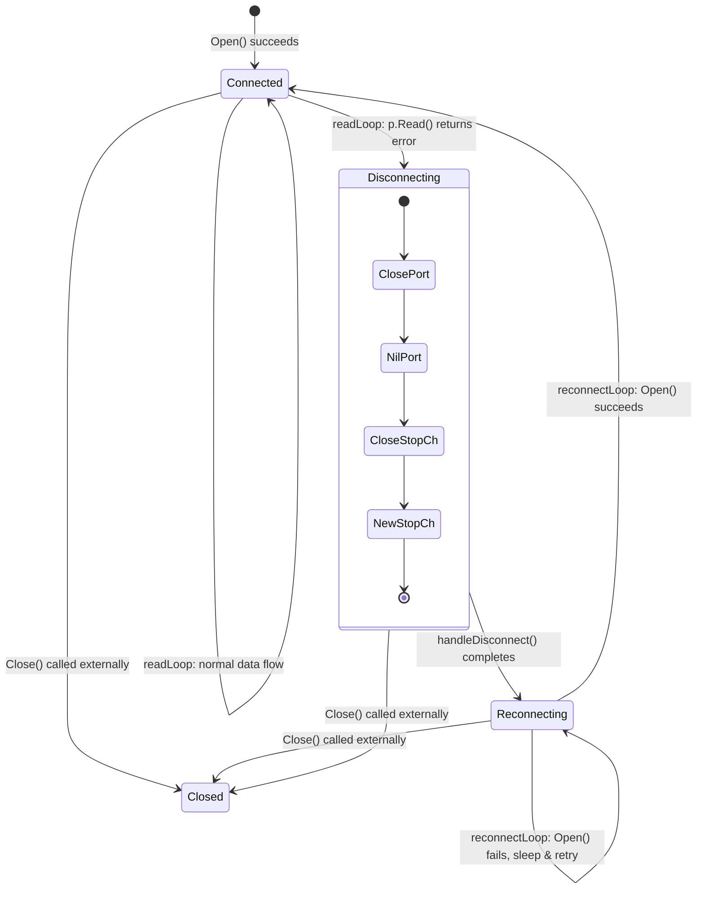

Serial devices connected over USB or physical cables are inherently unreliable — cables get bumped, devices reset, and drivers occasionally release their port handles. SerialGateway addresses this reality with a self-healing session model: the `SerialSession` continuously monitors the read path for errors, interprets any I/O failure as a disconnect, tears down its internal goroutines, and then enters a polling reconnection loop until the device reappears. This page dissects every stage of that lifecycle, from the moment a `Read()` call fails to the instant a fresh `readLoop` begins streaming data again.

## The Disconnect Detection Trigger

The sole mechanism for detecting a serial disconnect is a **read error** in the session's `readLoop` goroutine. The loop performs a blocking `p.Read(buf)` against the underlying OS serial handle. When the device is physically removed or the driver releases the port, this call returns a non-nil error — typically a Windows `ERROR_ACCESS_DENIED` or `ERROR_FILE_NOT_FOUND` wrapped by the `go.bug.st/serial` library.

```go
n, err := p.Read(buf)
if err != nil {
    s.logger.Error("serial read error", "error", err)
    s.broadcast("[serial disconnected - waiting for reconnect...]\n")
    s.handleDisconnect()
    return
}
```

Sources: [session.go](internal/serial/session.go#L169-L175)

There is no proactive health-check or periodic polling of device presence. The design relies on the OS-level I/O subsystem to surface the disconnect through the read path. This means a device that is disconnected while no data is flowing will not be detected until the next attempted read — but since `readLoop` issues continuous blocking reads with no idle gaps, detection is effectively immediate.

Upon detecting the error, `readLoop` broadcasts a status message to all active subscribers (SSH clients, SSE streams) informing them of the disconnect, then delegates to `handleDisconnect()` and terminates itself via `return`.

Sources: [session.go](internal/serial/session.go#L152-L175)

## The handleDisconnect Orchestrator

`handleDisconnect()` is the critical state-transition function. It performs four ordered operations under a mutex to ensure no race conditions with concurrent `writeLoop` or external `Close()` calls.



The function first guards against double-disconnect by checking `s.port == nil` — if another goroutine already handled the disconnect, it returns immediately. It then closes the underlying serial port handle, nils the port pointer, and sets `connected = false`.

Sources: [session.go](internal/serial/session.go#L244-L252)

The **stopCh lifecycle** is the most subtle aspect. The current `stopCh` is closed to signal the `writeLoop` goroutine (which is still running) to terminate. A `select` with `default` branch guards against closing an already-closed channel. Immediately after, a **new** `stopCh` is allocated via `make(chan struct{})`. This fresh channel will be used by the `reconnectLoop` goroutine and, upon successful reconnection, by the new `readLoop` and `writeLoop` spawned from `Open()`.

Sources: [session.go](internal/serial/session.go#L253-L260)

| Step | Operation | Purpose |
|------|-----------|---------|
| 1 | Guard `port == nil` | Prevent duplicate disconnect handling |
| 2 | `port.Close()` | Release OS handle for the dead device |
| 3 | `port = nil`, `connected = false` | Mark session as disconnected |
| 4 | `close(stopCh)` (old) | Terminate the surviving `writeLoop` |
| 5 | `stopCh = make(chan struct{})` (new) | Create fresh cancellation token for reconnect |
| 6 | `go reconnectLoop()` | Begin polling for device reappearance |

Sources: [session.go](internal/serial/session.go#L244-L261)

## The Reconnection Polling Loop

Once launched, `reconnectLoop` enters a tight retry cycle. It captures the current `stopCh` reference and the configured `InitialInterval`, then loops: sleep, attempt `Open()`, check result.

```go
func (s *SerialSession) reconnectLoop() {
    stopCh := s.stopCh
    interval := s.cfg.Reconnect.InitialInterval
    for {
        select {
        case <-stopCh:
            return
        default:
        }
        time.Sleep(interval)
        err := s.Open()
        if err == nil {
            s.broadcast("[serial reconnected]\n")
            return
        }
        s.logger.Warn("reconnect attempt failed", "error", err)
    }
}
```

Sources: [session.go](internal/serial/session.go#L263-L280)

Each failed attempt is logged at `Warn` level with the underlying error, giving operators visibility into *why* reconnection is failing (e.g., the device hasn't been re-plugged, or a different process has claimed the port). When `Open()` finally succeeds, a `[serial reconnected]` message is broadcast to all subscribers, and the function returns — the new `readLoop` and `writeLoop` are already running inside `Open()`.

### Reconnection Flow After Success

When `Open()` succeeds during reconnection, it follows the exact same code path as the initial open: it calls `serial.Open()` to obtain a fresh OS handle, sets `s.port` and `s.connected`, then spawns new `readLoop` and `writeLoop` goroutines. These goroutines reference `s.stopCh` — the same channel created in `handleDisconnect` — ensuring a single `Close()` call can terminate the entire session at any point.

Sources: [session.go](internal/serial/session.go#L75-L114)

## Write Behavior During Disconnection

The `writeLoop` goroutine handles writes queued by SSH clients and HTTP API callers. When a disconnect occurs, the old `writeLoop` is terminated via the closed `stopCh`. However, the `writeCh` channel (buffered, capacity 64) persists as a struct field. Any writes submitted during the disconnect window accumulate in this buffer.

```go
func (s *SerialSession) writeLoop() {
    stopCh := s.stopCh
    for {
        select {
        case <-stopCh:
            return
        case req := <-s.writeCh:
            s.mu.Lock()
            p := s.port
            s.mu.Unlock()
            if p == nil {
                if s.cfg.Reconnect.DiscardInputOnDisconnect {
                    req.Done <- fmt.Errorf("serial disconnected, input discarded")
                }
                continue
            }
            _, err := p.Write(req.Data)
            req.Done <- err
        }
    }
}
```

Sources: [session.go](internal/serial/session.go#L211-L231)

The `DiscardInputOnDisconnect` configuration flag governs a narrow race window: if a write arrives *after* `port` has been nil'd but *before* the `stopCh` closure propagates to `writeLoop`, the write encounters a nil port. When the flag is `true`, the caller receives an explicit error on the `Done` channel. When `false`, the write is silently dropped (the `continue` skips without responding on `Done`).

| Scenario | `DiscardInputOnDisconnect: true` | `DiscardInputOnDisconnect: false` |
|----------|----------------------------------|-----------------------------------|
| writeLoop already terminated | Writes queue in `writeCh` buffer (up to 64) | Same — queued for post-reconnect delivery |
| writeLoop still alive, port nil | Caller gets `"serial disconnected, input discarded"` error | Write silently dropped, no `Done` response |
| After reconnection | Queued writes processed by new writeLoop | Same |

Sources: [session.go](internal/serial/session.go#L217-L229)

## Configuration Parameters

The `ReconnectConfig` struct defines three fields that control the reconnection behavior:

```go
type ReconnectConfig struct {
    InitialInterval          time.Duration `yaml:"initial_interval"`
    MaxInterval              time.Duration `yaml:"max_interval"`
    DiscardInputOnDisconnect bool          `yaml:"discard_input_on_disconnect"`
}
```

Sources: [config.go](internal/config/config.go#L36-L40)

| Parameter | YAML Key | Default | Description |
|-----------|----------|---------|-------------|
| `InitialInterval` | `initial_interval` | `1s` | Fixed delay between reconnection attempts |
| `MaxInterval` | `max_interval` | `30s` | Reserved for future exponential backoff (not currently used by `reconnectLoop`) |
| `DiscardInputOnDisconnect` | `discard_input_on_disconnect` | `false` | Whether to return errors for writes arriving during the nil-port race window |

Sources: [config.go](internal/config/config.go#L155-L160)

Example YAML configuration:

```yaml
reconnect:
  initial_interval: 1s
  max_interval: 30s
  discard_input_on_disconnect: true
```

Sources: [serial-gateway.yaml](serial-gateway.yaml#L22-L25)

> **Implementation note**: The current `reconnectLoop` uses `InitialInterval` as a **fixed** polling interval. The `MaxInterval` field is loaded from configuration and stored, but no exponential backoff logic references it. This is a defined-but-unused parameter that may serve as a placeholder for future backoff implementation.

Sources: [session.go](internal/serial/session.go#L265)

## Session State Machine

The complete lifecycle of disconnect and reconnection can be modeled as a finite state machine with four states and well-defined transitions:



The `Closed` state is terminal for the session — once `Close()` is called (either by `SSHServer.Stop()` during mapping removal or gateway shutdown), the `stopCh` is closed and no further reconnection attempts are made. The guard in `reconnectLoop` (`case <-stopCh: return`) ensures clean termination.

Sources: [session.go](internal/serial/session.go#L116-L129)

## Subscriber Notification During Disconnect

The broadcast mechanism ensures that all connected consumers — SSH terminal sessions, SSE exec streams — receive real-time status updates during the disconnect/reconnect cycle. The `broadcast()` method iterates over all subscriber channels with a non-blocking send (dropping messages for slow consumers to avoid backpressure).

| Event | Broadcast Message | Timing |
|-------|-------------------|--------|
| Read error detected | `[serial disconnected - waiting for reconnect...]\n` | Immediately before `handleDisconnect()` |
| Reconnection succeeds | `[serial reconnected]\n` | Immediately after `Open()` returns nil |

Sources: [session.go](internal/serial/session.go#L172) and [session.go](internal/serial/session.go#L275)

SSH clients connected via the handler in `ssh/handler.go` receive these messages as inline terminal text, giving the operator immediate visual feedback that the device was lost and when it has been recovered. The handler also applies `\n` → `\r\n` conversion for proper terminal rendering.

Sources: [handler.go](internal/ssh/handler.go#L36-L43)

## Interaction with PortManager and External Shutdown

The `PortManager` is intentionally **not** involved in the reconnection loop. Each `SerialSession` manages its own disconnect/reconnect lifecycle independently. The `PortManager.Mappings()` method queries `srv.Session().IsConnected()` to report current status to the HTTP API, but does not intervene in the reconnection process.

Sources: [portmanager.go](internal/core/portmanager.go#L70-L82)

When the gateway shuts down or a mapping is removed, `SSHServer.Stop()` calls `session.Close()`, which closes the `stopCh`. This terminates any running `reconnectLoop`, `readLoop`, or `writeLoop` goroutines. The mutex-guarded `stopCh` closure uses the same `select`/`default` idiom to prevent double-close panics:

```go
select {
case <-s.stopCh:
default:
    close(s.stopCh)
}
```

Sources: [session.go](internal/serial/session.go#L116-L129)

## HTTP API Visibility of Connection State

The connection state is exposed through the REST API, allowing external monitoring tools to detect disconnects. The `GET /api/mappings` endpoint returns a `connected` boolean for each mapping, sourced directly from `SerialSession.IsConnected()`.

Sources: [handlers.go](internal/http/handlers.go#L69-L83)

During a disconnect, this field transitions to `false` and remains so throughout the reconnection polling phase. Upon successful reconnection, it flips back to `true`. This provides a simple polling-based health check for integration with external dashboards or alerting systems.

## Concurrency Safety Summary

| Shared Resource | Protection Mechanism | Guard Scope |
|-----------------|---------------------|-------------|
| `s.port` | `sync.Mutex` (`s.mu`) | Read/write of port pointer and connected flag |
| `s.connected` | `sync.Mutex` (`s.mu`) | Always updated atomically with port state |
| `s.stopCh` | `sync.Mutex` (`s.mu`) | Reassignment in handleDisconnect; closure guarded by select/default |
| `s.subscribers` | `sync.RWMutex` (`s.subMu`) | Subscribe/Unsubscribe/broadcast operations |
| `s.writeCh` | Channel buffer (64) | Natural concurrency safety via Go channel semantics |
| `s.seqCounter` | `sync.Mutex` (`s.mu`) | Incremented per-line in readLoop |

Sources: [session.go](internal/serial/session.go#L24-L44)

## Next Steps

- **[SerialSession Lifecycle: Open, Read, Write, Close](12-serialsession-lifecycle-open-read-write-close)** — Understand the full session lifecycle that frames the disconnect/reconnect behavior
- **[Read Broadcasting and Write Queue Concurrency Model](13-read-broadcasting-and-write-queue-concurrency-model)** — Deep dive into how subscribers and writers behave during normal operation and edge cases
- **[Ring Buffer: In-Memory History Storage and Retrieval](15-ring-buffer-in-memory-history-storage-and-retrieval)** — The ring buffer persists through disconnects, so reconnecting clients can still retrieve pre-disconnect history