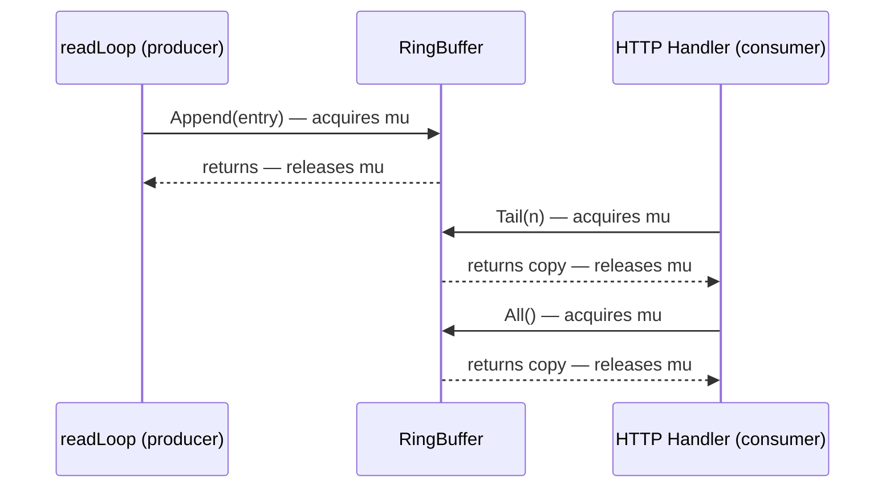
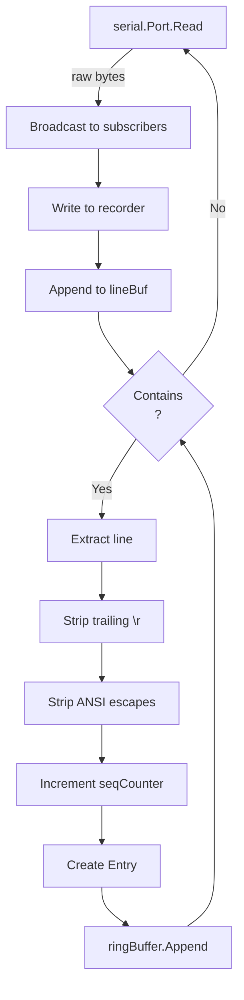
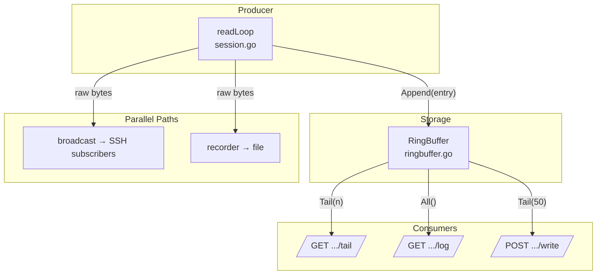

Every byte that flows through a serial port is ephemeral — once read, it vanishes from the wire. The ring buffer is SerialGateway's mechanism for giving that data a second life: a bounded, in-memory history that lets HTTP clients, SSH sessions, and command-execution endpoints look backward in time. This page dissects its data model, eviction strategy, concurrency model, and the integration points where producers and consumers meet.

## The Entry Data Model

Each unit of stored history is an `Entry` — a single complete line of serial output enriched with metadata:

```go
type Entry struct {
    TS    time.Time `json:"ts"`
    Seq   int       `json:"seq"`
    Line  string    `json:"line"`
    Bytes int       `json:"bytes"`
}
```

Sources: [ringbuffer.go](internal/serial/ringbuffer.go#L8-L13)

| Field   | Type      | Purpose                                                                 |
|---------|-----------|-------------------------------------------------------------------------|
| `TS`    | `time.Time` | Wall-clock timestamp captured at the moment the line is fully assembled |
| `Seq`   | `int`       | Monotonically increasing sequence number assigned per-session           |
| `Line`  | `string`    | The cleaned line content (ANSI escapes stripped, `\r` removed)          |
| `Bytes` | `int`       | Byte length of `Line`, used for the byte-budget eviction policy         |

The `Seq` counter lives on `SerialSession` (not on the ring buffer itself) and is incremented under the session's own mutex before each `Append` call. This guarantees that entries are strictly ordered even though the ring buffer has its own lock.

Sources: [session.go](internal/serial/session.go#L196-L199)

## Ring Buffer Structure and Dual-Constraint Eviction

The `RingBuffer` struct wraps a Go slice with a mutex and two capacity limits:

```go
type RingBuffer struct {
    mu         sync.Mutex
    entries    []Entry
    maxLines   int
    maxBytes   int
    totalBytes int
}
```

Sources: [ringbuffer.go](internal/serial/ringbuffer.go#L15-L21)

Despite its name, this is not a classical circular buffer with head/tail index wrapping. It is a **bounded FIFO queue** backed by a slice, where eviction always removes from the front. The "ring" metaphor applies to its bounded, recycling nature rather than its internal mechanics.

### Initialization

`NewRingBuffer` pre-allocates the backing slice to `maxLines` capacity, avoiding repeated slice growth during the fill-up phase:

```go
func NewRingBuffer(maxLines, maxBytes int) *RingBuffer {
    return &RingBuffer{
        entries:  make([]Entry, 0, maxLines),
        maxLines: maxLines,
        maxBytes: maxBytes,
    }
}
```

Sources: [ringbuffer.go](internal/serial/ringbuffer.go#L23-L29)

### The Append-and-Evict Loop

The `Append` method is the sole write path. After adding a new entry, it runs an eviction loop that removes the oldest entries until **both** constraints are satisfied:

```go
func (rb *RingBuffer) Append(e Entry) {
    rb.mu.Lock()
    defer rb.mu.Unlock()
    rb.entries = append(rb.entries, e)
    rb.totalBytes += e.Bytes
    for len(rb.entries) > rb.maxLines || rb.totalBytes > rb.maxBytes {
        removed := rb.entries[0]
        rb.entries = rb.entries[1:]
        rb.totalBytes -= removed.Bytes
    }
}
```

Sources: [ringbuffer.go](internal/serial/ringbuffer.go#L31-L41)

The eviction condition uses `||` (logical OR), meaning eviction fires when **either** limit is exceeded. This is a **dual-constraint** design:

```mermaid
flowchart LR
    A[New Entry Arrives] --> B{entries > maxLines<br/>OR<br/>totalBytes > maxBytes?}
    B -- Yes --> C[Remove entries[0]]
    C --> D[Decrement totalBytes]
    D --> B
    B -- No --> E[Buffer Stable]
```

| Constraint   | Trigger                           | Effect                                   |
|-------------|-----------------------------------|------------------------------------------|
| `maxLines`  | `len(entries) > maxLines`         | Caps the number of stored lines          |
| `maxBytes`  | `totalBytes > maxBytes`           | Caps the total memory footprint by bytes |

Whichever limit is hit first triggers eviction. In practice, `maxBytes` acts as a safety net for unusually long lines that could inflate memory even when the line count is within bounds.

## Concurrency Model

All three public methods — `Append`, `Tail`, and `All` — acquire the same `sync.Mutex`. This creates a simple, correct concurrency model at the cost of potential contention under very high serial throughput.



Both `Tail` and `All` return **defensive copies** of the requested entries, not references to the internal slice. This means consumers can iterate over results without holding the lock, and mutations to the returned slice will not affect the buffer.

Sources: [ringbuffer.go](internal/serial/ringbuffer.go#L43-L60)

```go
func (rb *RingBuffer) Tail(n int) []Entry {
    rb.mu.Lock()
    defer rb.mu.Unlock()
    if n > len(rb.entries) {
        n = len(rb.entries)
    }
    result := make([]Entry, n)
    copy(result, rb.entries[len(rb.entries)-n:])
    return result
}
```

The `Tail` method clamps `n` to the actual entry count, so requesting more entries than available simply returns everything — it never panics or returns nil-padded results.

Sources: [ringbuffer.go](internal/serial/ringbuffer.go#L43-L52)

## How Entries Are Produced: The readLoop Pipeline

The ring buffer's sole producer is `SerialSession.readLoop`, which runs as a goroutine for each open serial port. The pipeline from raw bytes to buffered entry involves several transformations:



Key transformations applied before an entry reaches the ring buffer:

1. **Line splitting**: Raw bytes accumulate in `lineBuf` until a `\n` delimiter is found.
2. **Carriage return cleanup**: Trailing `\r` is stripped, and embedded `\r` sequences cause only the text after the last `\r` to be kept (handling terminal line-overwrite patterns).
3. **ANSI escape removal**: A compiled regex strips ANSI/VT100 control sequences so the buffer stores clean text.
4. **Sequence numbering**: The session-level `seqCounter` is atomically incremented under the session mutex.

Sources: [session.go](internal/serial/session.go#L152-L208)

The `Bytes` field of each entry is set to `len(line)` — the byte length of the **cleaned** text, not the original raw bytes. This means `totalBytes` in the ring buffer tracks the memory cost of stored content, which aligns with the byte-budget eviction policy.

Sources: [session.go](internal/serial/session.go#L200-L206)

## How Entries Are Consumed: Three HTTP Endpoints

The ring buffer exposes its contents through three distinct HTTP endpoints, each with different access patterns:

### GET /api/mappings/{device}/tail — Last N Lines

Returns the most recent `n` lines (default 200) as plain text. This is the "quick look" endpoint for monitoring dashboards:

```go
func (gw *Gateway) handleTail(w http.ResponseWriter, r *http.Request, srv *ssh.SSHServer) {
    lines := 200
    if l := r.URL.Query().Get("lines"); l != "" {
        if n, err := strconv.Atoi(l); err == nil && n > 0 {
            lines = n
        }
    }
    entries := srv.Session().RingBuffer().Tail(lines)
    // ... joins Entry.Line values with "\n"
}
```

Sources: [handlers.go](internal/http/handlers.go#L176-L191)

### GET /api/mappings/{device}/log — Full History

Returns **all** buffered entries in either `text` or `jsonl` format. The text format includes timestamps and device names; the JSONL format emits each `Entry` as a JSON object:

| Format | Output Pattern                                           |
|--------|----------------------------------------------------------|
| text   | `2024-01-15T10:30:00Z [COM3] device output line`        |
| jsonl  | `{"ts":"2024-01-15T10:30:00Z","seq":42,"line":"...","bytes":15}` |

Sources: [handlers.go](internal/http/handlers.go#L193-L225)

### POST /api/mappings/{device}/write — Command Response Capture

After sending a command via the write endpoint, the handler waits 500ms for the device to respond, then reads the **last 50 entries** from the ring buffer to include as the command's output:

```go
time.Sleep(500 * time.Millisecond)
entries := sess.RingBuffer().Tail(50)
```

This usage pattern treats the ring buffer as a **response capture buffer** — a pragmatic approach that avoids the complexity of correlating writes with their responses at the protocol level.

Sources: [handlers.go](internal/http/handlers.go#L270-L281)

## Configuration

The ring buffer's capacity is configured per-gateway (not per-port) through the `ring_buffer` section:

| Parameter    | Type  | Default    | Description                              |
|-------------|-------|------------|------------------------------------------|
| `max_lines` | `int` | `100000`   | Maximum number of entries stored          |
| `max_bytes` | `int` | `10485760` | Maximum total byte budget (10 MB)        |

Sources: [config.go](internal/config/config.go#L42-L45), [config.go](internal/config/config.go#L142-L147)

The YAML configuration mirrors these defaults:

```yaml
ring_buffer:
  max_lines: 100000
  max_bytes: 10485760
```

Sources: [serial-gateway.yaml](serial-gateway.yaml#L13-L15)

At session creation time, these values are passed directly to `NewRingBuffer`:

```go
ringBuffer: NewRingBuffer(cfg.RingBuffer.MaxLines, cfg.RingBuffer.MaxBytes),
```

Sources: [session.go](internal/serial/session.go#L60)

> **Important**: Changing `ring_buffer` settings at runtime via `PUT /api/config` does **not** resize existing ring buffers. The new values only apply to sessions created after the configuration update. See [Runtime Configuration Update via PUT /api/config](20-runtime-configuration-update-via-put-api-config) for details.

## Testing the Boundaries

The test suite validates four critical behaviors:

| Test                          | What It Verifies                                              |
|-------------------------------|---------------------------------------------------------------|
| `TestRingBufferAppendAndTail` | Basic append/tail with correct ordering and count clamping    |
| `TestRingBufferOverflow`      | Line-count eviction keeps exactly `maxLines` newest entries   |
| `TestRingBufferAllEntries`    | `All()` returns every entry when under capacity               |
| `TestRingBufferByteLimit`     | Byte-budget eviction fires before line-count limit is reached |

Sources: [ringbuffer_test.go](internal/serial/ringbuffer_test.go#L1-L65)

The byte-limit test is particularly instructive: with `maxLines=1000` but `maxBytes=20`, appending 10 entries of 7 bytes each results in at most 3 entries retained (21 bytes would exceed 20, so eviction removes the oldest until the budget is satisfied).

Sources: [ringbuffer_test.go](internal/serial/ringbuffer_test.go#L56-L65)

## Architectural Position

The ring buffer sits at the intersection of the serial I/O engine and the HTTP API layer:



The ring buffer stores **processed** data (cleaned lines), while the broadcast and recorder paths handle **raw** bytes. This separation means SSH clients see live output with ANSI codes intact, while the ring buffer and file recorder serve different purposes — quick retrieval vs. persistent archival. For the persistent counterpart, see [File Recorder: Persistent Serial Logging with Size Limits and Trim](21-file-recorder-persistent-serial-logging-with-size-limits-and-trim).