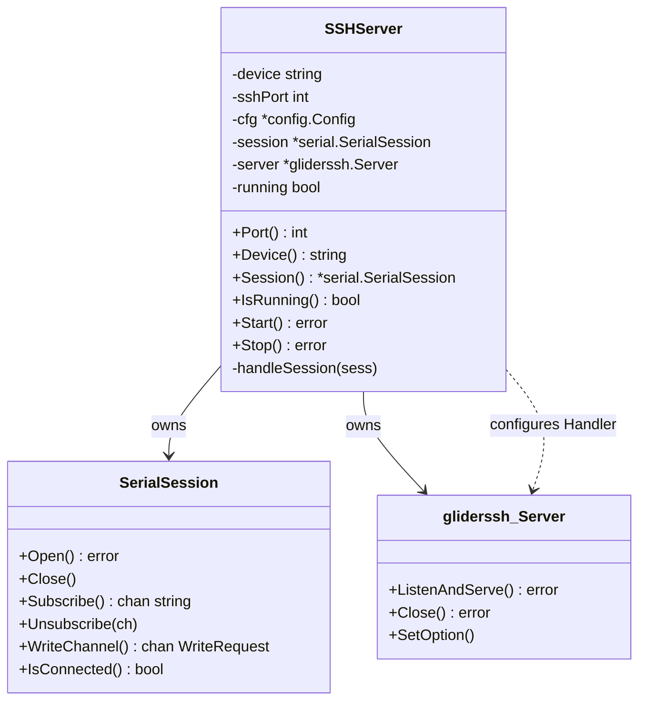
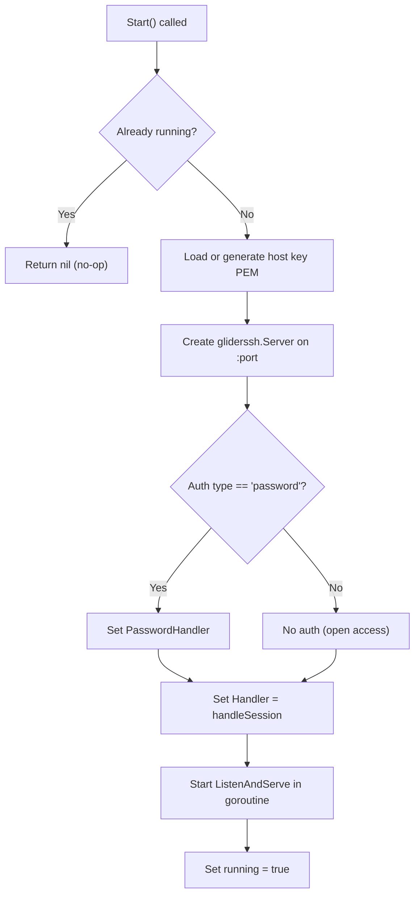
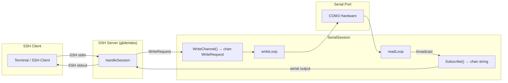
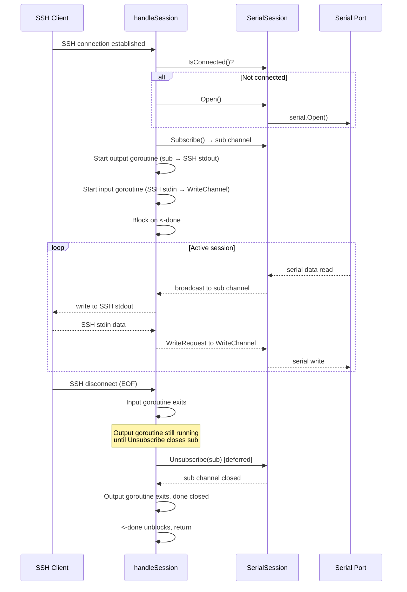
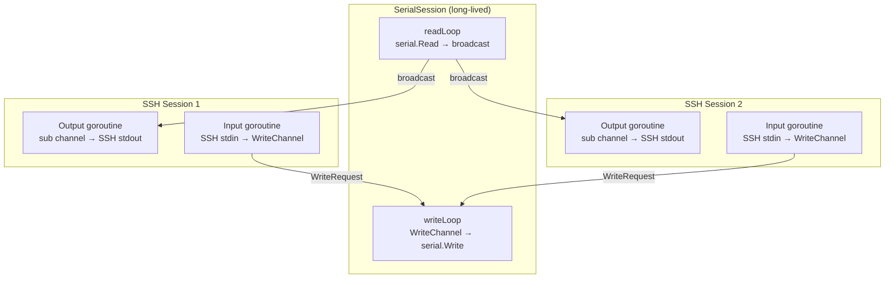

This page documents the mechanism by which Serial Gateway creates a dedicated SSH server for each configured serial port and bridges interactive SSH sessions to live serial communication. The SSH gateway layer is what transforms Serial Gateway from a mere HTTP API into a transparent terminal proxy — allowing any SSH client to interact with a serial device as if directly connected.

The implementation spans two files in the `internal/ssh` package: [server.go](internal/ssh/server.go) handles server lifecycle (creation, start, stop, host key management), while [handler.go](internal/ssh/handler.go) implements the bidirectional data bridge between SSH sessions and the underlying `SerialSession`.

## SSHServer Struct: The Per-Port Unit of Work

Each serial port is served by exactly one `SSHServer` instance. This struct encapsulates everything needed to accept SSH connections and relay them to a specific device:

```go
type SSHServer struct {
    device  string                  // e.g., "COM3"
    sshPort int                     // derived listening port, e.g., 2203
    cfg     *config.Config
    logger  *slog.Logger
    session *serial.SerialSession  // the serial communication engine
    server  *gliderssh.Server       // the gliderlabs SSH server
    mu      sync.Mutex
    running bool
}
```

Sources: [server.go](internal/ssh/server.go#L32-L41)

The `SSHServer` acts as an **adapter** between two distinct communication domains: the SSH protocol (handled by the `gliderlabs/ssh` library) and the serial I/O subsystem (managed by `SerialSession`). It owns both a `SerialSession` and a `gliderssh.Server`, holding the only references needed to bridge them.



## Construction: NewSSHServer

The `NewSSHServer` factory function performs three steps: compute the SSH port mapping, create a fresh `SerialSession` for the device, and assemble the struct.

```go
func NewSSHServer(device string, cfg *config.Config, logger *slog.Logger) (*SSHServer, error) {
    sshPort := PortMapping(device, cfg)
    if sshPort == 0 {
        return nil, fmt.Errorf("cannot determine SSH port for device %s", device)
    }
    sess := serial.NewSerialSession(device, cfg, logger.With("component", "serial"))
    // ... assemble and return
}
```

Sources: [server.go](internal/ssh/server.go#L43-L57)

Critically, `NewSSHServer` does **not** open the serial port or start listening. It only prepares the data structures. The serial port is opened lazily — either when an SSH client connects (via `handleSession`) or when the recorder subsystem triggers it. This lazy-open pattern avoids blocking startup on unavailable hardware.

The `PortMapping` function derives the SSH listening port from the device name by extracting the numeric portion and adding it to `cfg.SSH.BasePort` (default `2200`):

| Device | Base Port | SSH Port |
|--------|-----------|----------|
| COM3   | 2200      | 2203     |
| COM8   | 2200      | 2208     |
| COM25  | 2200      | 2225     |

Sources: [server.go](internal/ssh/server.go#L20-L30), [config.go](internal/config/config.go#L148-L149)

If the device name does not start with `COM` or the numeric extraction fails, `PortMapping` returns `0`, causing `NewSSHServer` to return an error. This guards against non-Windows device paths that would produce ambiguous port assignments.

## Host Key Management

Every SSH server requires a host key to establish secure connections. The `loadOrGenerateHostKeyPEM` function implements a **load-or-create** strategy using Ed25519 keys:

```go
func loadOrGenerateHostKeyPEM(keyPath string, logger *slog.Logger) ([]byte, error) {
    keyData, err := os.ReadFile(keyPath)
    if err == nil {
        return keyData, nil  // existing key found
    }
    // Generate new Ed25519 key pair
    _, priv, err := ed25519.GenerateKey(rand.Reader)
    // Marshal to PKCS8 PEM format and write with 0600 permissions
    // ...
}
```

Sources: [server.go](internal/ssh/server.go#L64-L92)

The key is persisted to a file named `host_key` in the working directory. On first run, a new key is generated and saved; on subsequent runs, the same key is loaded, ensuring SSH clients do not see host-key-changed warnings. The PEM encoding uses the standard PKCS8 format (`PRIVATE KEY` block type), which is compatible with the `gliderlabs/ssh` library's `HostKeyPEM` option.

| Aspect | Detail |
|--------|--------|
| Algorithm | Ed25519 (fast, modern, small key size) |
| Format | PKCS8 PEM (`PRIVATE KEY` block) |
| File path | `host_key` (relative to working directory) |
| Permissions | `0600` (owner read/write only) |
| Generation trigger | File does not exist on `Start()` |

> **Note**: All SSH servers currently share the same `host_key` file. Since each server is configured independently with `HostKeyPEM(pemData)`, they all present the same host identity regardless of port.

## Server Startup: The Start Method

The `Start` method transitions the server from constructed to listening. It is guarded by a mutex and an idempotency check (`if s.running { return nil }`):



Sources: [server.go](internal/ssh/server.go#L94-L125)

The authentication model is intentionally simple. When `cfg.SSH.Auth.Type` is `"password"`, a `PasswordHandler` closure is installed that compares the incoming password against `cfg.SSH.Auth.Password`. If no auth type is configured, the server accepts all connections without authentication. The `gliderlabs/ssh` library handles the SSH protocol negotiation, key exchange, and channel multiplexing — the gateway only needs to provide the session handler.

The `server.ListenAndServe()` call runs in a dedicated goroutine so that `Start` returns immediately. If the listener fails (e.g., port already in use), the error is logged at `Warn` level but does not crash the process. This allows other port mappings to continue functioning even if one port is unavailable.

## Session Bridging: The handleSession Method

The `handleSession` method is the **core architectural bridge** — it connects an incoming SSH session to the `SerialSession`'s pub/sub and write-queue systems. This is where the gateway earns its name.



Sources: [handler.go](internal/ssh/handler.go#L15-L73)

The method proceeds through four distinct phases:

### Phase 1: Lazy Serial Port Opening

```go
if !s.session.IsConnected() {
    err := s.session.Open()
    if err != nil {
        fmt.Fprintf(sess, "[serial open failed: %v]\n", err)
        sess.Close()
        return
    }
}
```

Sources: [handler.go](internal/ssh/handler.go#L22-L30)

If the serial port is not yet open, `handleSession` attempts to open it. This is the primary trigger for serial port initialization in the SSH path. If opening fails (device unplugged, permission denied), the SSH client receives an error message and the session is closed. This lazy pattern means the serial port is opened on-demand — only when someone actually connects via SSH.

### Phase 2: Subscribe to Serial Output

```go
sub := s.session.Subscribe()
defer s.session.Unsubscribe(sub)
```

Sources: [handler.go](internal/ssh/handler.go#L32-L33)

Each SSH session subscribes to the `SerialSession`'s broadcast channel. The `Subscribe` method creates a buffered channel (`cap=64`) and registers it in the subscriber map. The `defer Unsubscribe` ensures cleanup when the SSH session ends, regardless of how it terminates.

Sources: [session.go](internal/serial/session.go#L137-L150)

### Phase 3: Output Goroutine — Serial → SSH

A dedicated goroutine reads from the subscription channel and writes to the SSH session. It performs **line-ending normalization** to ensure terminal compatibility:

```go
go func() {
    for msg := range sub {
        msg = strings.ReplaceAll(msg, "\r\n", "\n")   // normalize to LF
        msg = strings.ReplaceAll(msg, "\n", "\r\n")    // expand to CRLF
        fmt.Fprintf(sess, "%s", msg)
    }
    close(done)
}()
```

Sources: [handler.go](internal/ssh/handler.go#L36-L43)

The two-step replacement (`\r\n` → `\n` → `\r\n`) ensures that:
- Bare `\n` from Linux devices is expanded to `\r\n` for proper terminal cursor behavior
- Existing `\r\n` from Windows devices is not double-expanded to `\r\r\n`
- Mixed line endings are normalized consistently

This is critical for interactive terminal sessions where incorrect line endings cause display artifacts (staircase text, overwritten lines).

### Phase 4: Input Goroutine — SSH → Serial

A second goroutine reads from the SSH session's stdin and forwards data to the serial port through the `WriteRequest` channel:

```go
go func() {
    buf := make([]byte, 1024)
    for {
        n, err := sess.Read(buf)
        if err != nil { /* handle disconnect */ return }
        req := serial.WriteRequest{
            Data: buf[:n],
            Done: make(chan error, 1),
        }
        s.session.WriteChannel() <- req
        select {
        case writeErr := <-req.Done:
            if writeErr != nil { /* report error */ }
        case <-time.After(s.cfg.SerialDefaults.WriteTimeout):
            /* report timeout */
        }
    }
}()
```

Sources: [handler.go](internal/ssh/handler.go#L45-L69)

This goroutine uses the `WriteRequest` pattern — a request/response protocol over channels. Each write is submitted as a `WriteRequest` containing the data and a `Done` channel. The `SerialSession`'s `writeLoop` picks up the request, performs the actual `port.Write()`, and signals completion (or error) on the `Done` channel. The SSH handler waits for the response with a configurable timeout (`cfg.SerialDefaults.WriteTimeout`, default 10 seconds).

Sources: [session.go](internal/serial/session.go#L19-L22), [session.go](internal/serial/session.go#L211-L231)

| Data Direction | Source | Destination | Mechanism | Buffer |
|----------------|--------|-------------|-----------|--------|
| Serial → SSH | `readLoop` broadcast | SSH stdout | `Subscribe()` channel (cap 64) | Non-blocking drop on full |
| SSH → Serial | SSH stdin read | `writeLoop` | `WriteChannel()` + `WriteRequest` | Buffered (cap 64), blocking send |

## Session Lifecycle and Termination

The `handleSession` method blocks on `<-done`, which fires only when the output goroutine exits (i.e., when the subscription channel is closed). This means the SSH session's lifetime is determined by the serial output stream:



Sources: [handler.go](internal/ssh/handler.go#L15-L73)

When the SSH client disconnects:
1. The input goroutine's `sess.Read()` returns `io.EOF`, causing it to exit
2. The deferred `Unsubscribe(sub)` call removes the channel from the subscriber map and closes it
3. The output goroutine's `range sub` loop terminates, closing the `done` channel
4. The `<-done` unblocks, and `handleSession` returns

## Server Shutdown: The Stop Method

`Stop` performs a coordinated shutdown of both the SSH listener and the serial session:

```go
func (s *SSHServer) Stop() error {
    s.mu.Lock()
    defer s.mu.Unlock()
    if !s.running { return nil }
    s.running = false
    if s.server != nil { s.server.Close() }  // stop accepting new SSH connections
    s.session.Close()                         // close the serial port
    return nil
}
```

Sources: [server.go](internal/ssh/server.go#L127-L139)

Calling `s.server.Close()` terminates the TCP listener, which causes `ListenAndServe` to return an error (logged at `Warn` level). Existing SSH sessions are disconnected when the server closes. The `session.Close()` call closes the serial port and signals the `stopCh`, which terminates the serial `readLoop` and `writeLoop` goroutines.

## Concurrency Architecture

The per-port SSH bridge creates a layered concurrency model. For each active SSH session, three levels of goroutines are in play:



Key concurrency properties:

- **Multiple SSH clients** can connect to the same serial port simultaneously — each receives all broadcast data via their own subscription channel
- **Write serialization** is guaranteed by the single `writeLoop` goroutine consuming from the `WriteChannel` (buffered, cap 64). Multiple SSH clients' writes are naturally serialized through this channel
- **Non-blocking broadcast**: the `broadcast` method uses a `select` with `default` case, meaning a slow SSH client's subscription channel will drop messages rather than blocking the serial `readLoop`

Sources: [session.go](internal/serial/session.go#L233-L242)

## Integration with PortManager

`SSHServer` instances are created and managed by the `PortManager`, which orchestrates the lifecycle of all per-port servers:

```go
// During startup
for _, portCfg := range pm.cfg.Ports {
    srv, err := ssh.NewSSHServer(portCfg.Device, pm.cfg, pm.logger)
    srv.Start()
    pm.servers[portCfg.Device] = srv
}
```

Sources: [portmanager.go](internal/core/portmanager.go#L30-L68)

The `PortManager` also supports runtime addition (`AddMapping`) and removal (`RemoveMapping`) of port mappings via the HTTP API, each of which creates or destroys an `SSHServer` on the fly. During shutdown, `PortManager.Shutdown()` iterates all servers and calls `Stop()` on each.

Sources: [portmanager.go](internal/core/portmanager.go#L90-L130)

## Dependency: gliderlabs/ssh

The SSH protocol implementation is provided by [`github.com/gliderlabs/ssh`](https://github.com/gliderlabs/ssh) v0.3.8, a high-level Go SSH server library built on top of `golang.org/x/crypto/ssh`. It abstracts away the complexity of SSH channel management, providing a simple `Handler` callback that receives a `gliderssh.Session` — an `io.ReadWriteCloser` with additional metadata (remote address, user, etc.).

Sources: [go.mod](go.mod#L6), [server.go](internal/ssh/server.go#L14)

The library handles:
- SSH transport protocol (key exchange, encryption, MAC)
- User authentication (password handler integration)
- Channel and session multiplexing
- PTY allocation requests (accepted but not fully utilized)

## Further Reading

- [SSH Port Mapping Strategy and Host Key Management](11-ssh-port-mapping-strategy-and-host-key-management) — deeper analysis of the port allocation algorithm and key persistence
- [SerialSession Lifecycle: Open, Read, Write, Close](12-serialsession-lifecycle-open-read-write-close) — the serial communication engine that SSH sessions bridge to
- [Read Broadcasting and Write Queue Concurrency Model](13-read-broadcasting-and-write-queue-concurrency-model) — how the pub/sub and write-queue patterns serve multiple SSH clients
- [PortManager: Coordinating SSH Servers and Recorders](17-portmanager-coordinating-ssh-servers-and-recorders) — how SSH servers are orchestrated and managed at runtime
- [Connecting to a Serial Device Via SSH](8-connecting-to-a-serial-device-via-ssh) — user-facing guide for SSH client connections