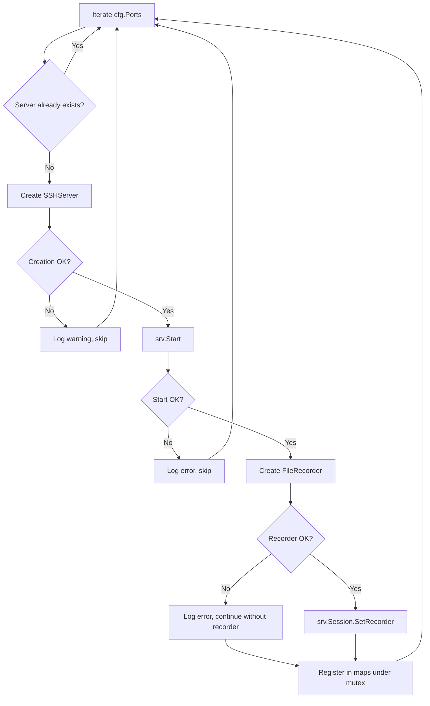
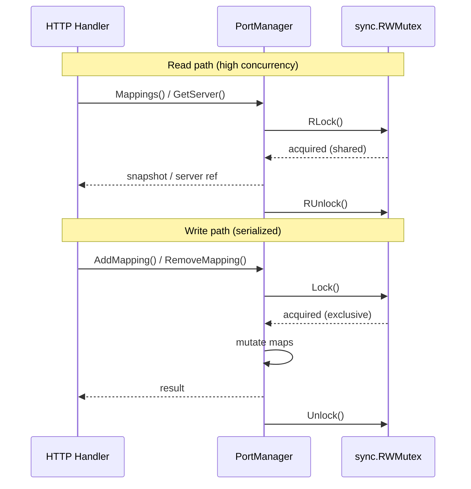
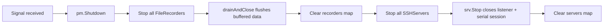
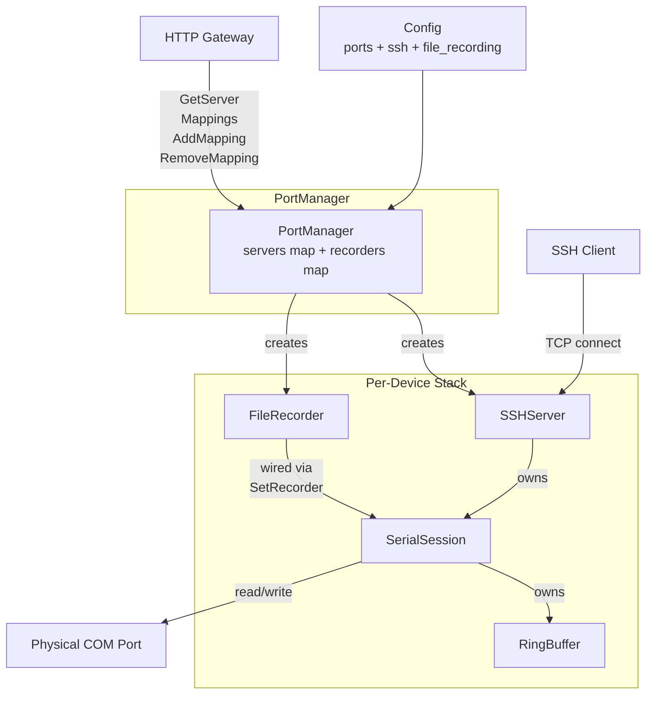

The `PortManager` is the central orchestration component in SerialGateway. It owns the lifecycle of every active serial-to-SSH mapping — from initial creation through runtime mutation to graceful shutdown. Positioned in the `internal/core` package, it acts as the single source of truth for which serial devices are currently bridged to SSH endpoints, and it wires each bridge to a persistent file recorder for data capture.

This page dissects the PortManager's internal structure, its coordination protocols, and the concurrency guarantees that make it safe for concurrent access from the HTTP API layer.

## Structural Composition

The `PortManager` struct is deliberately minimal — a composition of two keyed registries (SSH servers and file recorders), a shared configuration reference, a structured logger, and a read-write mutex that governs all access to the registries.

```go
type PortManager struct {
    cfg       *config.Config
    logger    *slog.Logger
    servers   map[string]*ssh.SSHServer
    recorders map[string]*recorder.FileRecorder
    mu        sync.RWMutex
}
```

Sources: [portmanager.go](internal/core/portmanager.go#L13-L19)

Both maps are keyed by **device name** (e.g., `"COM3"`), establishing a 1:1 relationship between a serial device and its corresponding SSH server and file recorder. The `sync.RWMutex` enables high-concurrency reads (multiple HTTP requests querying mappings simultaneously) while serializing mutations (adding or removing a mapping).

| Field | Type | Purpose |
|---|---|---|
| `cfg` | `*config.Config` | Shared configuration — SSH base port, serial defaults, file recording settings |
| `logger` | `*slog.Logger` | Structured logger with component-level context |
| `servers` | `map[string]*ssh.SSHServer` | Registry of active SSH server instances, keyed by device name |
| `recorders` | `map[string]*recorder.FileRecorder` | Registry of active file recorders, keyed by device name |
| `mu` | `sync.RWMutex` | Concurrency guard for both maps |

The constructor initializes both maps as empty, deferring all population to the `AutoStart()` method or runtime `AddMapping()` calls:

```go
func NewPortManager(cfg *config.Config, logger *slog.Logger) *PortManager {
    return &PortManager{
        cfg:       cfg,
        logger:    logger,
        servers:   make(map[string]*ssh.SSHServer),
        recorders: make(map[string]*recorder.FileRecorder),
    }
}
```

Sources: [portmanager.go](internal/core/portmanager.go#L21-L28)

## AutoStart: Boot-Time Orchestration

`AutoStart()` is the primary initialization pathway, invoked once during application startup from `main.go`. It iterates over every port defined in the YAML configuration (`cfg.Ports`) and performs a three-phase setup for each: **SSH server creation**, **file recorder creation**, and **recorder-to-session wiring**.



Sources: [portmanager.go](internal/core/portmanager.go#L30-L68)

### Fail-Soft Philosophy

A critical design decision in `AutoStart()` is its **fail-soft** behavior. Rather than aborting the entire startup when one port fails, the method logs the failure and proceeds to the next port. This is essential for a gateway that may manage dozens of serial devices — a single unavailable COM port should not prevent other mappings from becoming operational. The method always returns `nil`, and the caller in `main.go` treats any non-nil return as a warning rather than a fatal error:

```go
pm := core.NewPortManager(cfg, logger)
if err := pm.AutoStart(); err != nil {
    logger.Warn("auto-start had warnings", "error", err)
}
```

Sources: [main.go](cmd/serial-gateway/main.go#L38-L41)

### Three-Phase Setup Per Port

**Phase 1 — SSH Server Creation and Start.** Each `ssh.NewSSHServer()` call computes the SSH port via deterministic mapping (`base_port + COM number`), instantiates a `SerialSession`, and configures the gliderlabs SSH server. The server begins listening in a background goroutine upon `srv.Start()`.

Sources: [server.go](internal/ssh/server.go#L43-L57), [server.go](internal/ssh/server.go#L94-L125)

**Phase 2 — File Recorder Creation.** A `recorder.NewFileRecorder()` is created using the file recording configuration (output directory, max size, trim size). The recorder opens its output file in append mode and starts its own write-loop goroutine. If recorder creation fails, the SSH server remains operational — it simply won't persist data to disk.

Sources: [portmanager.go](internal/core/portmanager.go#L45-L57), [recorder.go](internal/recorder/recorder.go#L30-L61)

**Phase 3 — Recorder-to-Session Wiring.** The recorder is injected into the serial session via `srv.Session().SetRecorder(rec)`. This establishes a loose coupling through an interface (`interface{ Write([]byte) }`), meaning the `SerialSession` doesn't depend on the concrete `FileRecorder` type. During the read loop, every chunk of serial data is forwarded to the recorder asynchronously.

Sources: [portmanager.go](internal/core/portmanager.go#L55), [session.go](internal/serial/session.go#L41-L42), [session.go](internal/serial/session.go#L180-L182)

### Duplicate Guard

Before processing each port, `AutoStart()` checks whether a server already exists for that device name. This prevents duplicate mappings if the configuration contains repeated entries:

```go
if _, exists := pm.servers[portCfg.Device]; exists {
    continue
}
```

Sources: [portmanager.go](internal/core/portmanager.go#L32-L34)

## Runtime Mapping Management

Beyond boot-time initialization, the PortManager exposes a CRUD-style API for dynamic mapping manipulation at runtime. These methods are invoked by the HTTP handler layer in response to REST API calls.

### AddMapping: Dynamic Creation

`AddMapping()` creates and starts a new SSH server for a device that wasn't configured at boot time. It holds the **write lock** for the entire operation to prevent race conditions where two concurrent requests might try to create a mapping for the same device:

```go
func (pm *PortManager) AddMapping(device string) (*ssh.SSHServer, error) {
    pm.mu.Lock()
    defer pm.mu.Unlock()
    if _, exists := pm.servers[device]; exists {
        return nil, fmt.Errorf("mapping already exists for %s", device)
    }
    srv, err := ssh.NewSSHServer(device, pm.cfg, pm.logger.With("device", device))
    if err != nil {
        return nil, err
    }
    if err := srv.Start(); err != nil {
        return nil, err
    }
    pm.servers[device] = srv
    return srv, nil
}
```

Sources: [portmanager.go](internal/core/portmanager.go#L90-L105)

**Notable asymmetry**: Unlike `AutoStart()`, `AddMapping()` does **not** create a file recorder. This means dynamically-added mappings will not persist serial data to disk. This is a deliberate scope limitation — runtime mappings are treated as ephemeral connections.

### RemoveMapping: Dynamic Teardown

`RemoveMapping()` stops the SSH server (which in turn closes the serial session and its underlying port) and removes it from the registry:

```go
func (pm *PortManager) RemoveMapping(device string) error {
    pm.mu.Lock()
    defer pm.mu.Unlock()
    srv, exists := pm.servers[device]
    if !exists {
        return fmt.Errorf("no mapping for %s", device)
    }
    srv.Stop()
    delete(pm.servers, device)
    return nil
}
```

Sources: [portmanager.go](internal/core/portmanager.go#L107-L117)

The `srv.Stop()` call triggers a cascade: the SSH listener is closed, the `running` flag is cleared, and `session.Close()` shuts down the serial port. However, any associated file recorder in the `recorders` map is **not** stopped or removed by `RemoveMapping()` — it is only cleaned up during `Shutdown()`.

### Mappings: Read-Only Snapshot

`Mappings()` returns a point-in-time snapshot of all active mappings. It acquires only the **read lock**, allowing multiple concurrent readers:

```go
func (pm *PortManager) Mappings() []map[string]interface{} {
    pm.mu.RLock()
    defer pm.mu.RUnlock()
    result := make([]map[string]interface{}, 0, len(pm.servers))
    for _, srv := range pm.servers {
        result = append(result, map[string]interface{}{
            "serial_port": srv.Device(),
            "ssh_port":    srv.Port(),
            "connected":   srv.Session().IsConnected(),
        })
    }
    return result
}
```

Sources: [portmanager.go](internal/core/portmanager.go#L70-L82)

Each entry exposes three fields — the serial device name, the SSH port number, and the live connection status of the underlying serial session. The HTTP layer enriches this data further (adding baudrate, connection counts) before returning it to API consumers.

Sources: [handlers.go](internal/http/handlers.go#L69-L83)

### GetServer: Direct Lookup

`GetServer()` provides O(1) device-keyed lookup for the HTTP layer, which uses the returned `*ssh.SSHServer` reference to access the serial session for tail, log, write, and exec operations:

```go
func (pm *PortManager) GetServer(device string) *ssh.SSHServer {
    pm.mu.RLock()
    defer pm.mu.RUnlock()
    return pm.servers[device]
}
```

Sources: [portmanager.go](internal/core/portmanager.go#L84-L88)

A `nil` return indicates no mapping exists for the requested device, which the HTTP layer translates into a 404 response.

Sources: [handlers.go](internal/http/handlers.go#L131-L135)

## Concurrency Model

The PortManager employs a **read-write mutex strategy** optimized for the typical access pattern of a gateway: many concurrent reads (API queries) with infrequent writes (mapping additions/removals).



| Operation | Lock Type | Rationale |
|---|---|---|
| `Mappings()` | `RLock` | Multiple API clients can read simultaneously |
| `GetServer()` | `RLock` | Same — read-only map access |
| `AddMapping()` | `Lock` | Exclusive — prevents duplicate creation races |
| `RemoveMapping()` | `Lock` | Exclusive — prevents use-after-delete |
| `AutoStart()` | `Lock` (per-port) | Acquires write lock only during map insertion |
| `Shutdown()` | `Lock` | Exclusive — iterates and clears all maps |

**Lock granularity in AutoStart**: The write lock is acquired only at the point of map insertion (lines 59–64), not for the entire SSH server and recorder creation. This means the expensive I/O operations (opening serial ports, starting SSH listeners, creating files) happen outside the critical section, minimizing contention.

Sources: [portmanager.go](internal/core/portmanager.go#L59-L64)

## Shutdown: Ordered Teardown

`Shutdown()` implements a deliberate **recorders-first, servers-second** teardown sequence. This ordering ensures that any data buffered in recorder write channels is flushed to disk before the serial sessions that feed them are destroyed:

```go
func (pm *PortManager) Shutdown() {
    pm.mu.Lock()
    defer pm.mu.Unlock()
    for _, rec := range pm.recorders {
        rec.Stop()
    }
    pm.recorders = make(map[string]*recorder.FileRecorder)
    for _, srv := range pm.servers {
        srv.Stop()
    }
    pm.servers = make(map[string]*ssh.SSHServer)
}
```

Sources: [portmanager.go](internal/core/portmanager.go#L119-L130)



The `FileRecorder.Stop()` call signals the write-loop goroutine to drain remaining items from its buffered channel (capacity 256) and close the file handle. Only after all recorders have been stopped does the manager proceed to tear down SSH servers, which closes serial ports and terminates read/write loops.

Sources: [recorder.go](internal/recorder/recorder.go#L78-L85), [recorder.go](internal/recorder/recorder.go#L101-L116), [server.go](internal/ssh/server.go#L127-L139)

Both maps are replaced with fresh empty maps rather than using `delete()` on individual entries — a clean-slate approach that prevents any post-shutdown access from referencing stale objects.

## Integration with the HTTP Layer

The PortManager is injected into the HTTP `Gateway` struct at startup, making it the single coordination point for all REST API operations that involve serial port mappings:

```go
type Gateway struct {
    cfg    *config.Config
    pm     *core.PortManager
    logger *slog.Logger
}
```

Sources: [server.go](internal/http/server.go#L12-L16)

The following table maps each HTTP endpoint to the PortManager method it invokes:

| HTTP Endpoint | Method | PortManager Call | Purpose |
|---|---|---|---|
| `GET /api/ports` | Discovery | `GetServer()` | Check if a discovered port has an active mapping |
| `GET /api/mappings` | List | `Mappings()` + `GetServer()` | Enumerate all active mappings with status |
| `POST /api/mappings` | Create | `AddMapping()` | Dynamically add a new serial-to-SSH bridge |
| `DELETE /api/mappings/{device}` | Remove | `RemoveMapping()` | Tear down an existing bridge |
| `GET /api/mappings/{device}` | Detail | `GetServer()` | Retrieve single mapping status |
| `GET /api/mappings/{device}/tail` | Read | `GetServer()` → `Session().RingBuffer()` | Tail serial output history |
| `POST /api/mappings/{device}/write` | Write | `GetServer()` → `Session().WriteChannel()` | Send data to serial port |
| `POST /api/mappings/{device}/exec` | Exec | `GetServer()` → SSE streaming | Execute command with streaming output |

Sources: [handlers.go](internal/http/handlers.go#L22-L156), [server.go](internal/http/server.go#L26-L34)

This design ensures the HTTP layer is a thin routing facade — all state and lifecycle logic resides in the PortManager and its managed components.

## Component Interaction Diagram

The following diagram illustrates how the PortManager sits at the intersection of the system's major subsystems:



The PortManager creates both the SSH server and the file recorder for each device, then connects them through the serial session's `SetRecorder()` interface. The HTTP gateway queries the PortManager for server references, then interacts directly with the server's session for data operations.

## Testing Approach

The PortManager's test suite focuses on construction validation and configuration-driven startup behavior. Tests verify that the manager can be instantiated with an empty configuration and that `AutoStart()` degrades gracefully when no physical ports are available:

```go
func TestNewPortManager(t *testing.T) {
    cfg := &config.Config{}
    config.ApplyDefaults(cfg)
    pm := NewPortManager(cfg, slog.Default())
    if pm == nil {
        t.Fatal("PortManager should not be nil")
    }
}
```

Sources: [portmanager_test.go](internal/core/portmanager_test.go#L10-L17)

The `TestAutoStart` test exercises the boot path with an empty port list, validating the fail-soft contract. Integration tests in the `tests/` directory exercise the full stack including real port interactions.

Sources: [portmanager_test.go](internal/core/portmanager_test.go#L32-L40)

## Further Reading

- **[Per-Port SSH Server Creation and Session Bridging](16-per-port-ssh-server-creation-and-session-bridging)** — details the SSHServer internals that PortManager creates and manages
- **[File Recorder: Persistent Serial Logging with Size Limits and Trim](21-file-recorder-persistent-serial-logging-with-size-limits-and-trim)** — deep dive into the FileRecorder lifecycle that PortManager orchestrates
- **[Route Registration and Gateway Struct](18-route-registration-and-gateway-struct)** — how the HTTP layer consumes PortManager's API
- **[Startup Flow: From main.go to Running Services](10-startup-flow-from-main-go-to-running-services)** — the full initialization sequence where PortManager plays the central role