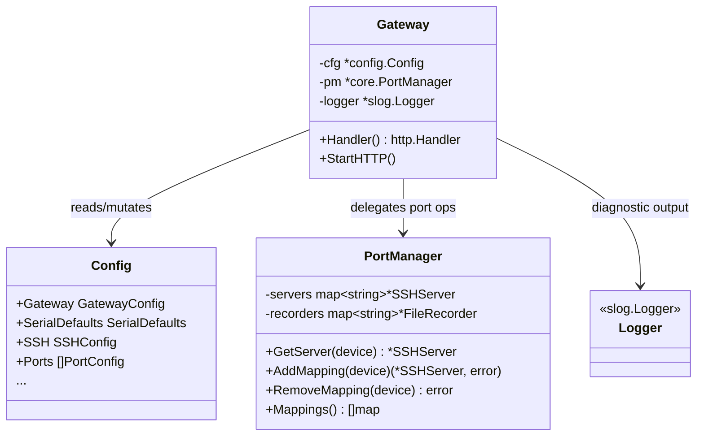
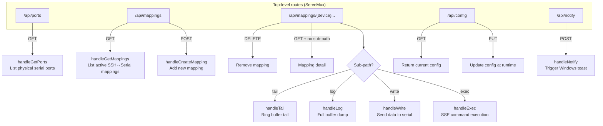

This page documents the HTTP layer's central nervous system: the `Gateway` struct that aggregates all runtime dependencies, and the route registration mechanism that maps URL paths to handler methods. Understanding these two elements provides the blueprint for how every REST API request flows through the system — from raw HTTP ingress to the appropriate domain service.

## The Gateway Struct

The `Gateway` is the HTTP layer's facade — a lightweight struct that holds pointers to the three subsystems every API handler needs to do its job. It is defined in `server.go` with exactly three fields, each serving a distinct architectural role:

| Field | Type | Role |
|-------|------|------|
| `cfg` | `*config.Config` | Mutable pointer to the application configuration; allows runtime updates via `PUT /api/config` |
| `pm` | `*core.PortManager` | Gateway to all serial-port and SSH-server operations — the bridge between HTTP and the serial communication engine |
| `logger` | `*slog.Logger` | Structured logger for request-level and diagnostic logging |

Sources: [server.go](internal/http/server.go#L12-L16)



The design is intentionally minimal: no mutex, no state beyond the config pointer. All concurrency control lives inside `PortManager` (which uses `sync.RWMutex`), and all serial I/O state lives inside individual `SSHServer` and `SerialSession` instances. The Gateway is a **stateless dispatcher** — it receives HTTP requests, routes them to the correct handler method, and lets the handler pull whatever it needs from `cfg` or `pm`.

Sources: [server.go](internal/http/server.go#L12-L16), [portmanager.go](internal/core/portmanager.go#L13-L19)

## Construction and Dependency Injection

The `NewGatewayWithManager` constructor is the single entry point for creating a Gateway instance. It accepts pre-constructed dependencies — the config, port manager, and logger must all be created and wired by the caller (typically the `main` function or startup sequence). This pattern keeps the HTTP package free of initialization side-effects and makes it straightforward to construct a Gateway in tests with mock or default dependencies.

```go
gw := NewGatewayWithManager(cfg, pm, logger)
```

Sources: [server.go](internal/http/server.go#L18-L24)

The test suite demonstrates this clearly: each test constructs a minimal `Config` with defaults applied, a fresh `PortManager`, and a default logger — then creates a Gateway and exercises its handler through `httptest`:

Sources: [handlers_test.go](internal/http/handlers_test.go#L13-L34)

## Route Registration

Route registration happens in the `Handler()` method, which creates a standard library `http.ServeMux` and binds five top-level patterns to their respective handler methods. The method returns the mux as an `http.Handler` interface, keeping the server-startup code decoupled from the routing logic.

```go
func (gw *Gateway) Handler() http.Handler {
    mux := http.NewServeMux()
    mux.HandleFunc("/api/ports", gw.handleGetPorts)
    mux.HandleFunc("/api/mappings", gw.handleMappings)
    mux.HandleFunc("/api/mappings/", gw.handleMappingDetail)
    mux.HandleFunc("/api/config", gw.handleConfig)
    mux.HandleFunc("/api/notify", gw.handleNotify)
    return mux
}
```

Sources: [server.go](internal/http/server.go#L26-L34)

A critical detail here is the **trailing slash** on `/api/mappings/`. In Go's `http.ServeMux`, a pattern ending with `/` acts as a subtree pattern — it matches any path that begins with that prefix. This means `/api/mappings/COM3`, `/api/mappings/COM3/tail`, and `/api/mappings/COM3/exec` all route to `handleMappingDetail`, while the exact pattern `/api/mappings` (no trailing slash) routes to `handleMappings`. This two-pattern design cleanly separates collection-level operations (list/create) from resource-level operations (detail/delete/sub-resources).

Sources: [server.go](internal/http/server.go#L29-L30)

## Route Tree and Method Dispatch

The full routing tree expands from those five registrations into a richer set of endpoints through manual method dispatch and path parsing inside the handler methods:



The following table provides the complete endpoint inventory with their HTTP methods, handler locations, and responsibilities:

| Route Pattern | Method | Handler | File | Responsibility |
|---|---|---|---|---|
| `/api/ports` | GET | `handleGetPorts` | [handlers.go](internal/http/handlers.go#L22-L56) | Enumerate physical serial ports with status, baud rate, and SSH port mapping |
| `/api/mappings` | GET | `handleGetMappings` | [handlers.go](internal/http/handlers.go#L69-L83) | List all active port mappings with connection state |
| `/api/mappings` | POST | `handleCreateMapping` | [handlers.go](internal/http/handlers.go#L85-L111) | Create a new SSH server for a serial device |
| `/api/mappings/{device}` | GET | `handleMappingDetail` | [handlers.go](internal/http/handlers.go#L113-L156) | Return detail for a specific mapping |
| `/api/mappings/{device}` | DELETE | `handleMappingDetail` | [handlers.go](internal/http/handlers.go#L118-L129) | Tear down a mapping and stop its SSH server |
| `/api/mappings/{device}/tail` | GET | `handleTail` | [handlers.go](internal/http/handlers.go#L176-L191) | Return the last N lines from the ring buffer |
| `/api/mappings/{device}/log` | GET | `handleLog` | [handlers.go](internal/http/handlers.go#L193-L225) | Dump full ring buffer contents (text or JSONL) |
| `/api/mappings/{device}/write` | POST | `handleWrite` | [handlers.go](internal/http/handlers.go#L227-L281) | Write data to serial port and return recent output |
| `/api/mappings/{device}/exec` | GET | `handleExec` | [exec.go](internal/http/exec.go#L15-L155) | Execute command with SSE-streamed response |
| `/api/config` | GET | `handleConfig` | [handlers.go](internal/http/handlers.go#L158-L174) | Return the current configuration as JSON |
| `/api/config` | PUT | `handleConfig` | [handlers.go](internal/http/handlers.go#L163-L170) | Replace the runtime configuration |
| `/api/notify` | POST | `handleNotify` | [notify_handler.go](internal/http/notify_handler.go#L16-L50) | Dispatch a Windows toast notification |

## Sub-Path Routing in handleMappingDetail

The `handleMappingDetail` method is the most complex router in the system. It performs manual path parsing to dispatch to four different sub-resource handlers based on the URL segments after `/api/mappings/`. The device name is extracted from the first path segment, and any subsequent segment selects the sub-resource:

```go
path := r.URL.Path
parts := strings.Split(strings.TrimPrefix(path, "/api/mappings/"), "/")
device := parts[0]
```

If the path has exactly one segment (`/api/mappings/COM3`) and the method is `DELETE`, it removes the mapping. If it has two segments, the second segment (`parts[1]`) acts as a sub-resource selector via a `switch` statement that dispatches to `handleTail`, `handleLog`, `handleWrite`, or `handleExec`. Each of these handlers receives the resolved `*ssh.SSHServer` instance directly, eliminating redundant lookups.

Sources: [handlers.go](internal/http/handlers.go#L113-L156)

This manual sub-routing approach was chosen over a more elaborate router library — it keeps the dependency footprint minimal and the routing logic fully visible in a single method. The trade-off is that adding new sub-resources requires editing the `switch` block, but given the small and stable set of endpoints, this is an acceptable maintenance cost.

## HTTP Server Startup

The `StartHTTP` method is a thin wrapper that formats the listen address from configuration and calls the standard library's `http.ListenAndServe`. It uses the `Handler()` method to build the mux, ensuring that route registration and server startup remain separate concerns:

```go
func (gw *Gateway) StartHTTP() {
    addr := fmt.Sprintf(":%d", gw.cfg.Gateway.HTTPPort)
    gw.logger.Info("HTTP API listening", "addr", addr)
    http.ListenAndServe(addr, gw.Handler())
}
```

This method blocks for the lifetime of the process. The listen port defaults to `8080` when not specified in configuration, as enforced by `applyDefaults` in the config package.

Sources: [server.go](internal/http/server.go#L36-L40), [config.go](internal/config/config.go#L115-L117)

## Handler Organization Across Files

The handler methods are split across three files in the `internal/http` package, each grouping related concerns:

| File | Handlers | Concern |
|------|----------|---------|
| [handlers.go](internal/http/handlers.go) | `handleGetPorts`, `handleMappings`, `handleGetMappings`, `handleCreateMapping`, `handleMappingDetail`, `handleConfig`, `handleTail`, `handleLog`, `handleWrite` | Core CRUD operations, port discovery, buffer access, and serial writes |
| [exec.go](internal/http/exec.go) | `handleExec` | SSE-streamed command execution with silence/timeout management |
| [notify_handler.go](internal/http/notify_handler.go) | `handleNotify` | Windows toast notification dispatch |

All handler methods are defined on the `*Gateway` receiver, giving them uniform access to `cfg`, `pm`, and `logger`. The `writeJSON` helper function (not a method — it's a package-level function) provides consistent JSON response formatting with proper `Content-Type` headers across all endpoints:

```go
func writeJSON(w http.ResponseWriter, code int, data interface{}) {
    w.Header().Set("Content-Type", "application/json")
    w.WriteHeader(code)
    json.NewEncoder(w).Encode(data)
}
```

Sources: [handlers.go](internal/http/handlers.go#L16-L20)

## Error Handling Conventions

Every handler follows a consistent error-response pattern using `writeJSON` with appropriate HTTP status codes. The conventions observed across all handlers are:

| Scenario | Status Code | Example |
|----------|-------------|---------|
| Wrong HTTP method | `405` | `"method not allowed"` |
| Invalid request body | `400` | `"invalid request body"` |
| Missing required field | `400` | `"device is required"` |
| Resource conflict | `409` | `"mapping already exists for COM3"` |
| Resource not found | `404` | `"mapping not found for COM3"` |
| Internal failure | `500` | Serial open failure, write timeout, etc. |

The method-not-allowed check is performed explicitly in each handler rather than relying on middleware — this keeps each handler self-contained and testable in isolation.

Sources: [handlers.go](internal/http/handlers.go#L22-L26), [handlers.go](internal/http/handlers.go#L85-L111), [notify_handler.go](internal/http/notify_handler.go#L17-L20)

## Related Pages

- **[Server-Sent Events (SSE) Streaming for Command Execution](19-server-sent-events-sse-streaming-for-command-execution)** — deep dive into the `handleExec` handler's SSE protocol, silence detection, and subscriber model
- **[Runtime Configuration Update via PUT /api/config](20-runtime-configuration-update-via-put-api-config)** — detailed analysis of the config mutation path and its implications
- **[PortManager: Coordinating SSH Servers and Recorders](17-portmanager-coordinating-ssh-servers-and-recorders)** — the subsystem that most handlers delegate to
- **[Startup Flow: From main.go to Running Services](10-startup-flow-from-main-go-to-running-services)** — how the Gateway is constructed and `StartHTTP` is invoked during application boot