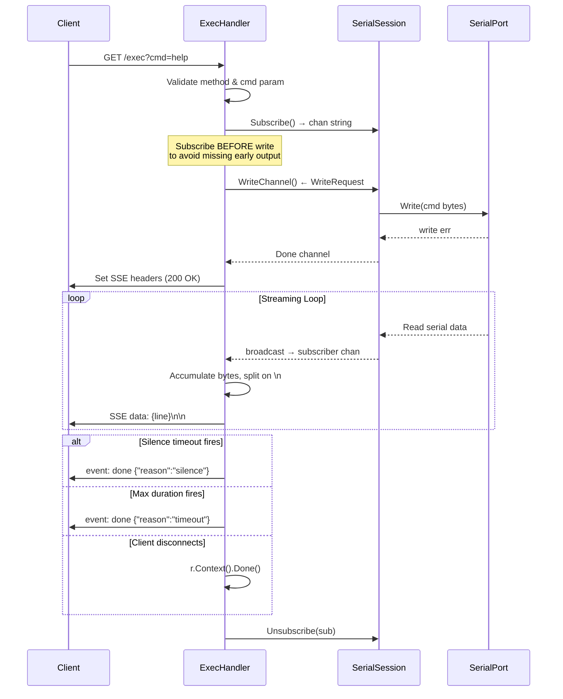
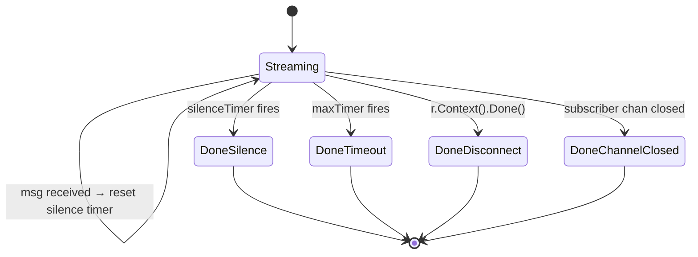
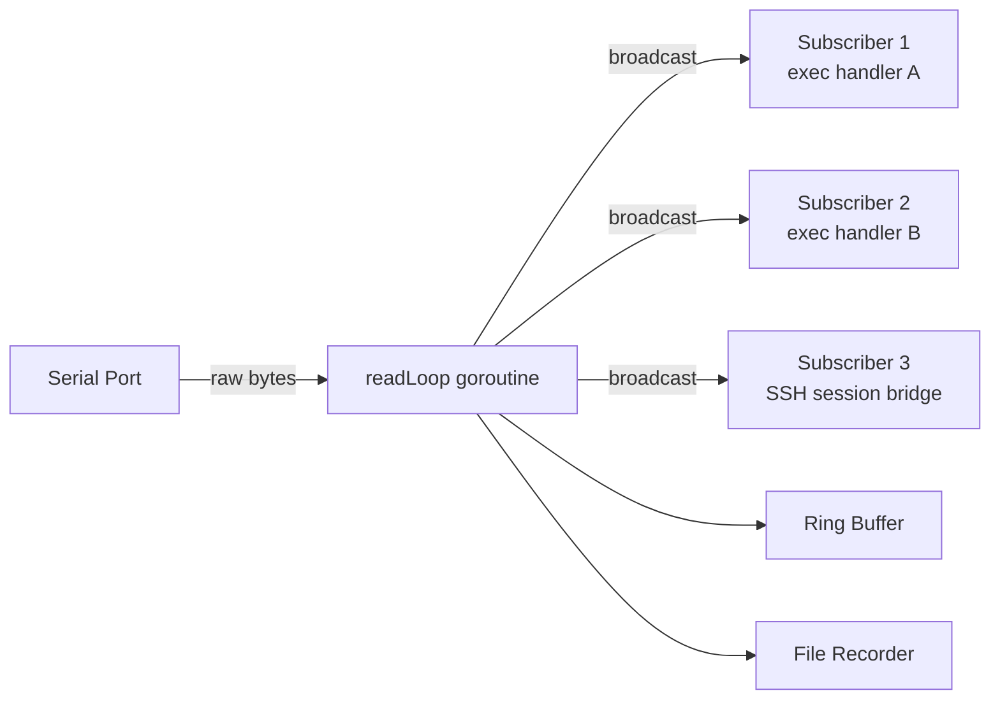

The `/exec` endpoint transforms a serial command-response cycle into a real-time, line-delimited Server-Sent Events stream. Unlike the `/write` endpoint — which fires a command and returns a static snapshot after an arbitrary sleep — `/exec` subscribes to the serial session's broadcast channel *before* writing, captures output as it arrives, and terminates the stream using configurable silence and max-duration heuristics. This design solves the fundamental challenge of serial I/O: knowing when a device has finished responding.

## Route Registration and Request Dispatch

The exec endpoint is not registered as an independent route. Instead, it is dispatched through the `/api/mappings/` catch-all handler, which parses the URL path to determine the target device and sub-command. When the path segment after the device name is `exec`, control is delegated to `handleExec` along with the resolved `*ssh.SSHServer` instance.

```
GET /api/mappings/{device}/exec?cmd={command}
```

Sources: [handlers.go](internal/http/handlers.go#L113-L149), [server.go](internal/http/server.go#L26-L34)

The `Gateway` struct holds references to the shared `*config.Config` and `*core.PortManager`, providing `handleExec` with access to both timeout configuration and the per-device serial session.

Sources: [server.go](internal/http/server.go#L12-L24)

## Execution Lifecycle

The `handleExec` function follows a strict four-phase pipeline: **validate → subscribe → write → stream**. Each phase is gated by error handling that returns a JSON error response and aborts before the SSE headers are committed.



Sources: [exec.go](internal/http/exec.go#L15-L155)

### Phase 1 — Validation

The handler enforces `GET` as the only permitted HTTP method and requires the `cmd` query parameter. Either violation returns a JSON error (405 or 400) before any streaming infrastructure is initialized. The serial port is also lazily opened at this stage if not already connected.

Sources: [exec.go](internal/http/exec.go#L16-L33)

### Phase 2 — Subscribe-Before-Write

This is the critical ordering invariant. The handler calls `sess.Subscribe()` to register a buffered channel (`capacity: 64`) in the session's fan-out map **before** dispatching the write request. This guarantees that no output bytes are missed between the write and the subscription registration — a race condition that would silently drop the first lines of a fast-responding device.

Sources: [exec.go](internal/http/exec.go#L36-L37), [session.go](internal/serial/session.go#L137-L143)

The subscriber channel is registered via an `RWMutex`-protected map insertion in `Subscribe()`, and the corresponding `Unsubscribe()` removes the entry and closes the channel. The `defer` on `Unsubscribe` ensures cleanup even on abnormal exits.

Sources: [session.go](internal/serial/session.go#L137-L150)

### Phase 3 — Command Dispatch

The command string is sent as raw bytes through the session's `WriteChannel()`, a buffered channel (`capacity: 64`) consumed by a dedicated `writeLoop` goroutine. The handler blocks on the `Done` channel with a timeout governed by `SerialDefaults.WriteTimeout` (default: 10 seconds). If the write fails or times out, a JSON error is returned before SSE headers are committed.

Sources: [exec.go](internal/http/exec.go#L39-L55), [session.go](internal/serial/session.go#L211-L231)

### Phase 4 — SSE Stream

Once the write succeeds, the handler commits to the SSE protocol by setting response headers and entering the streaming event loop.

Sources: [exec.go](internal/http/exec.go#L57-L67)

## SSE Protocol Implementation

### Response Headers

Four headers configure the SSE connection:

| Header | Value | Purpose |
|--------|-------|---------|
| `Content-Type` | `text/event-stream` | Declares SSE protocol to the client |
| `Cache-Control` | `no-cache` | Prevents intermediate proxy caching |
| `Connection` | `keep-alive` | Maintains persistent connection |
| `X-Accel-Buffering` | `no` | Disables nginx reverse-proxy buffering |

Sources: [exec.go](internal/http/exec.go#L58-L62)

The `http.Flusher` interface is obtained via type assertion. If the `ResponseWriter` does not support flushing (unlikely with `net/http` but possible behind certain middleware), a warning is logged and streaming continues in potentially buffered mode.

Sources: [exec.go](internal/http/exec.go#L64-L67)

### Event Format

The stream emits two types of SSE events:

**Data events** — Each complete line (delimited by `\n`, stripped of trailing `\r`) is sent as an unnamed SSE event:
```
data: Line content here\n
\n
```

The extra blank line (`\n\n`) after the batch serves as the SSE event terminator. Multiple lines arriving in a single broadcast message are each emitted as individual `data:` fields within a single SSE event block.

**Terminal event** — A named event signals stream completion:
```
event: done\n
data: {"reason":"silence"}\n
\n
```

The `reason` field is either `"silence"` (no data received within the silence window) or `"timeout"` (absolute maximum duration exceeded).

Sources: [exec.go](internal/http/exec.go#L96-L116), [exec.go](internal/http/exec.go#L147-L149)

### Line Buffering Strategy

Raw serial data arrives in arbitrary chunks that rarely align with line boundaries. The handler maintains a `lineBuf` byte slice that accumulates incoming bytes and splits them on `\n` characters. Complete lines are emitted immediately; partial trailing data remains in the buffer until the next chunk arrives or a termination event fires, at which point any residual content is flushed as a final data event.

Sources: [exec.go](internal/http/exec.go#L87-L148)

This is implemented as a manual byte scan rather than `bufio.Scanner` to maintain precise control over flush timing and to avoid scanner's line-length limitations.

## Termination Heuristics

The streaming loop is governed by a `select` statement with four cases, creating a dual-timer termination model:



| Timer | Config Key | Default | Query Override | Semantics |
|-------|-----------|---------|----------------|-----------|
| Silence timeout | `exec_silence_timeout` | 5s | `silence_timeout` (seconds, float) | Resets on every received message; fires when the device stops sending |
| Max duration | `exec_max_duration` | 30s | `max_duration` (seconds, float) | Absolute wall-clock limit from stream start; never resets |

Sources: [exec.go](internal/http/exec.go#L69-L85), [config.go](internal/config/config.go#L136-L141)

Both query parameters accept floating-point seconds (e.g., `silence_timeout=2.5` for 2.5 seconds). Invalid or non-positive values are silently ignored, falling back to configuration defaults.

Sources: [exec.go](internal/http/exec.go#L70-L80)

The silence timer reset uses a drain-and-reset pattern that safely handles the case where the timer has already fired between the `select` iteration and the `Stop()` call:

```go
if !silenceTimer.Stop() {
    select {
    case <-silenceTimer.C:
    default:
    }
}
silenceTimer.Reset(silenceTimeout)
```

Sources: [exec.go](internal/http/exec.go#L123-L129)

## Broadcast Fan-Out Architecture

The exec handler's subscriber channel is one node in a fan-out broadcast system. The `readLoop` goroutine in `SerialSession` reads raw bytes from the serial port and calls `broadcast()`, which iterates over all registered subscriber channels under an `RLock`. Each broadcast uses a non-blocking send with a `default` case — if a subscriber's buffer (capacity 64) is full, that message is silently dropped for that subscriber rather than blocking the read loop.



Sources: [session.go](internal/serial/session.go#L152-L209), [session.go](internal/serial/session.go#L233-L242)

This non-blocking design means that a slow SSE client (one that reads the HTTP response slowly) will not cause backpressure on the serial read loop. However, it also means that under high-throughput serial output, an exec subscriber with a full buffer may miss lines. The 64-element buffer provides significant headroom for typical command-response workloads.

## Comparison: Exec vs Write Endpoints

| Dimension | `/exec` (SSE) | `/write` (JSON) |
|-----------|---------------|-----------------|
| **HTTP method** | GET | POST |
| **Command delivery** | Query parameter `?cmd=` | JSON body `{"data": "..."}` |
| **Response format** | `text/event-stream` | `application/json` |
| **Output capture** | Real-time subscription | Post-hoc ring buffer tail (50 lines) |
| **Timing model** | Dual-timer (silence + max) | Fixed 500ms sleep |
| **Connection lifetime** | Persistent until termination | Request-response |
| **Data completeness** | Captures all output from subscription point | May miss output arriving after sleep |
| **Use case** | Programmatic automation, real-time UIs | Simple fire-and-forget scripts |

Sources: [exec.go](internal/http/exec.go#L15-L155), [handlers.go](internal/http/handlers.go#L227-L281)

## Client Integration Pattern

A minimal Go client consuming the exec stream:

```go
resp, _ := http.Get("http://localhost:18080/api/mappings/COM3/exec?cmd=help&silence_timeout=3")
defer resp.Body.Close()

scanner := bufio.NewScanner(resp.Body)
for scanner.Scan() {
    line := scanner.Text()
    if strings.HasPrefix(line, "event: done") {
        break
    }
    if strings.HasPrefix(line, "data: ") {
        fmt.Println(strings.TrimPrefix(line, "data: "))
    }
}
```

The integration test validates this exact pattern — verifying the `Content-Type` header, reading `data:` prefixed lines, and confirming that a `done` event terminates the stream.

Sources: [integration_test.go](tests/integration_test.go#L158-L200)

## Error Handling Boundaries

Errors are classified by the phase in which they occur. Pre-SSE errors (validation, connection, write) return standard JSON error responses with appropriate HTTP status codes. Post-SSE errors (client disconnect, channel closure) result in silent termination — the handler simply returns, and Go's HTTP server cleans up the connection. There is no mechanism to send an error event mid-stream; a serial disconnect during streaming will manifest as a broadcast message (`"[serial disconnected...]"`) followed by eventual silence timeout.

| Phase | Error | Response |
|-------|-------|----------|
| Validation | Wrong method | `405 {"error": "method not allowed, use GET"}` |
| Validation | Missing cmd | `400 {"error": "cmd query parameter is required"}` |
| Connection | Port open failure | `500 {"error": "serial open failed: ..."}` |
| Write | Write error | `500 {"error": "..."}` |
| Write | Write timeout | `500 {"error": "write timeout"}` |
| Stream | Client disconnect | Silent return via `r.Context().Done()` |
| Stream | Subscriber closed | Silent return (channel receive `ok == false`) |

Sources: [exec.go](internal/http/exec.go#L16-L55), [exec.go](internal/http/exec.go#L89-L121)

## Related Pages

- [Sending Commands via Write and Exec Endpoints](7-sending-commands-via-write-and-exec-endpoints) — User-facing API guide covering both endpoints
- [Read Broadcasting and Write Queue Concurrency Model](13-read-broadcasting-and-write-queue-concurrency-model) — Deep dive into the subscriber fan-out and write serialization architecture
- [Route Registration and Gateway Struct](18-route-registration-and-gateway-struct) — Full route table and the `handleMappingDetail` dispatch logic
- [SerialSession Lifecycle: Open, Read, Write, Close](12-serialsession-lifecycle-open-read-write-close) — Complete session lifecycle including the `readLoop` and `writeLoop` goroutines