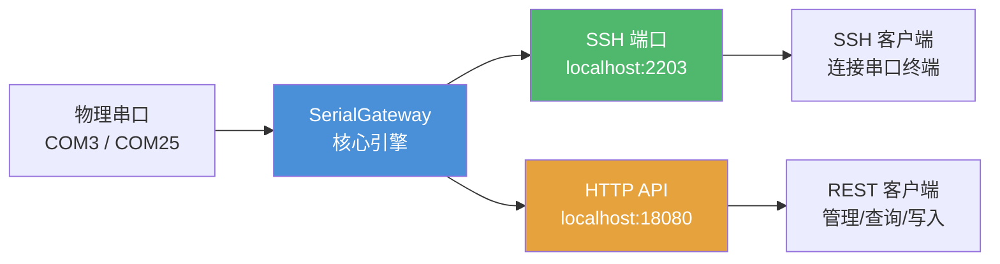
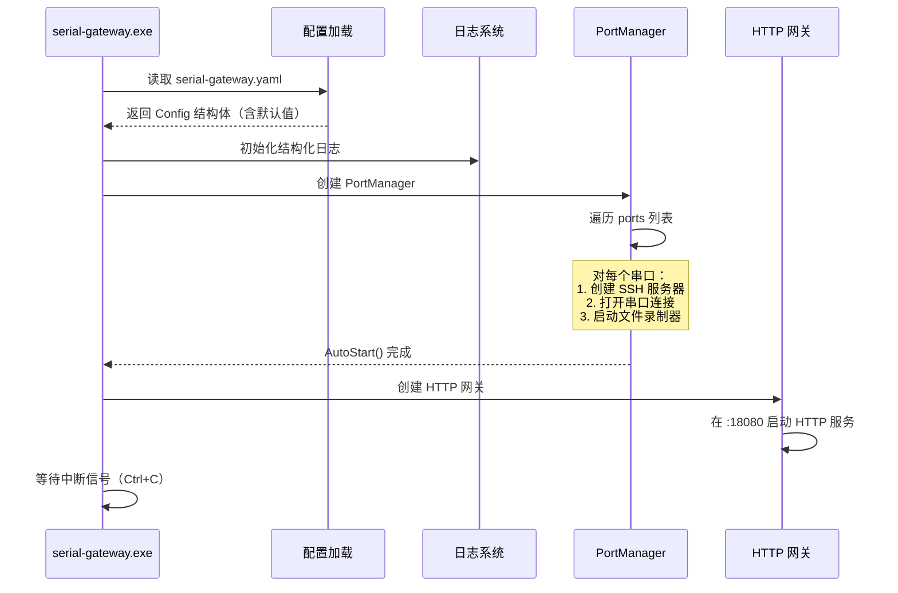

SerialGateway 是一个将物理 COM 串口映射为 SSH 监听端口的网关工具，同时提供 HTTP REST API 进行设备管理和历史数据查询。本指南将带你从零开始，在 5 分钟内完成构建、配置、启动和验证。



## 前置条件

开始之前，请确保你的环境中已具备以下条件：

| 项目 | 要求 | 说明 |
|------|------|------|
| 操作系统 | Windows (10/11) | 当前版本基于 Windows 开发，利用 COM 端口命名规范 |
| Go 语言 | 1.22+ | 构建工具链，模块路径 `github.com/zisen123/serialgateway` |
| 串口设备 | 至少一个物理或虚拟 COM 端口 | 如 COM3、COM25 |
| 终端工具 | PowerShell、cmd 以及 SSH 客户端 | Windows 自带 OpenSSH 客户端即可 |

> **提示**：如果没有物理串口，可使用虚拟串口驱动（如 com0com）创建一对回环串口用于测试。参考 [集成测试：使用虚拟串口驱动进行端到端测试](24-ji-cheng-ce-shi-shi-yong-xu-ni-chuan-kou-qu-dong-jin-xing-duan-dao-duan-ce-shi) 了解详情。

Sources: [go.mod](go.mod#L1-L3), [README.md](README.md#L1-L6)

---

## 步骤 1：构建可执行文件

项目采用标准 Go 模块布局，`main.go` 位于 `cmd/serial-gateway/` 目录下。打开 PowerShell 或 cmd，进入项目根目录执行：

```powershell
go build -o serial-gateway.exe ./cmd/serial-gateway/
```

命令执行完毕后，当前目录会生成 `serial-gateway.exe`。构建过程会自动下载所有依赖（`gliderlabs/ssh`、`go.bug.st/serial`、`gopkg.in/yaml.v3` 等）。

| 构建产物 | 路径 | 大小（参考） |
|---------|------|-------------|
| serial-gateway.exe | `./serial-gateway.exe` | ~15MB（取决于 Go 版本） |

> **故障排除**：若构建因网络问题失败，可设置 Go 模块代理：`go env -w GOPROXY=https://goproxy.cn,direct`

Sources: [main.go](cmd/serial-gateway/main.go#L1-L10), [README.md](README.md#L13-L15)

---

## 步骤 2：编写最小配置文件

项目使用 YAML 格式的配置文件，默认文件名为 `serial-gateway.yaml`。以下是一个 **最小可用配置**，仅需指定 HTTP 端口和要映射的串口：

```yaml
gateway:
  http_port: 18080

serial_defaults:
  baudrate: 115200

ssh:
  base_port: 2200
  auth:
    type: "password"
    password: "serial"

ports:
  - device: "COM3"
    baudrate: 115200
```

### 配置字段速览

| 节 | 关键字段 | 本示例值 | 作用 |
|----|---------|---------|------|
| `gateway` | `http_port` | `18080` | HTTP REST API 监听端口 |
| `serial_defaults` | `baudrate` | `115200` | 串口默认波特率（可被端口级覆盖） |
| `ssh` | `base_port` | `2200` | SSH 端口基准号，`base_port + COM 编号` |
| `ssh.auth` | `password` | `"serial"` | SSH 连接密码，所有映射端口共用 |
| `ports` | `device` + `baudrate` | `COM3` / `115200` | 需要自启动映射的串口列表 |

> 完整的配置共包含 10 个配置节（gateway、serial_defaults、ring_buffer、ssh、reconnect、reverse_tunnel 等），每个都有合理的默认值。详见 [配置文件详解：所有节字段与默认值](7-pei-zhi-wen-jian-xiang-jie-suo-you-jie-zi-duan-yu-mo-ren-zhi)。

### 端口映射规则

SSH 监听端口的计算规则为 `base_port + COM 端口号`。例如：

| 串口设备 | SSH 端口 | 计算公式 |
|---------|---------|---------|
| COM3 | 2203 | 2200 + 3 |
| COM8 | 2208 | 2200 + 8 |
| COM25 | 2225 | 2200 + 25 |

该映射逻辑实现在 `internal/ssh/server.go` 的 `PortMapping()` 函数中：从设备名提取数字部分，加上 `base_port`。Sources: [serial-gateway.yaml](serial-gateway.yaml#L1-L22), [internal/ssh/server.go](internal/ssh/server.go#L25-L34)

---

## 步骤 3：启动网关

构建完成后，在项目根目录执行：

```powershell
.\serial-gateway.exe --config serial-gateway.yaml
```

启动后会依次执行以下流程：



你将在终端看到类似下面的日志输出：

```
INFO SerialGateway started http_port=18080 ssh_base_port=2200
INFO started mapping device=COM3 ssh_port=2203
INFO file recorder started device=COM3 dir=./serial_logs
```

> **让它在后台运行**：双击 `run.vbs`（或从命令行执行 `cscript //nologo run.vbs`），网关将在后台静默运行，不占用终端窗口。

Sources: [cmd/serial-gateway/main.go](cmd/serial-gateway/main.go#L15-L80), [internal/core/portmanager.go](internal/core/portmanager.go#L28-L63), [run.vbs](run.vbs#L1-L4)

---

## 步骤 4：通过 SSH 连接串口

网关启动后，即可像连接远程服务器一样，通过 SSH 接入串口设备。打开另一个终端，执行：

```powershell
ssh -p 2203 serial@localhost
```

密码输入 `serial`（即配置文件中设置的密码）。连接成功后，你看到的不再是 Shell 提示符，而是**串口设备的实时输出流**——你在终端输入的任何字符都会直接发送到 COM3 串口。

### SSH 连接参数说明

| 参数 | 值 | 说明 |
|------|----|------|
| `-p 2203` | SSH 端口 | COM3 → 2203，依此类推 |
| `serial` | 用户名 | 固定为 `serial`（可配置） |
| `localhost` | 主机地址 | 网关默认在本地运行 |
| 密码 | `serial` | 在 `ssh.auth.password` 中设置 |

> 如果串口设备是一个网络设备的 console 口（如交换机、路由器），通过 SSH 连接网关后，你将获得对该设备 console 的远程访问能力——这是 SerialGateway 最核心的使用场景。

Sources: [README.md](README.md#L27-L30)

---

## 步骤 5：通过 HTTP API 进行管理

网关提供了完整的 REST API，用于串口管理、数据查询和命令发送。以下是最常用的几个操作：

### 查看所有可用串口

```powershell
curl http://localhost:18080/api/ports
```

返回示例：
```json
{
  "ports": [
    {"device": "COM3", "description": "USB Serial Port", "baudrate": 115200, "ssh_port": 2203, "status": "active"},
    {"device": "COM25", "description": "COM25", "baudrate": 115200, "ssh_port": 2225, "status": "active"}
  ]
}
```

### 查看当前映射

```powershell
curl http://localhost:18080/api/mappings
```

### 创建新映射（动态添加）

```powershell
curl -X POST http://localhost:18080/api/mappings -H "Content-Type: application/json" -d '{"device":"COM8"}'
```

### 向串口发送命令

```powershell
Invoke-RestMethod -Uri "http://localhost:18080/api/mappings/COM3/write" `
  -Method POST `
  -Body '{"data":"AT\r\n"}' `
  -ContentType "application/json"
```

### 查看最近串口输出

```powershell
curl http://localhost:18080/api/mappings/COM3/tail?lines=50
```

### 完整 API 速查表

| 方法 | 端点 | 说明 |
|------|------|------|
| GET | `/api/ports` | 枚举系统所有物理串口及状态 |
| GET | `/api/mappings` | 列出当前已激活的串口→SSH 映射 |
| POST | `/api/mappings` | 动态创建串口映射 `{"device":"COM3"}` |
| DELETE | `/api/mappings/{device}` | 删除指定映射 |
| GET | `/api/mappings/{device}/tail?lines=N` | 获取最近 N 行串口输出 |
| GET | `/api/mappings/{device}/log?format=text` | 获取完整串口历史（RingBuffer 全部数据） |
| POST | `/api/mappings/{device}/write` | 向串口发送数据 `{"data":"command\n"}` |
| GET | `/api/mappings/{device}/exec?cmd=AT` | 发送命令并通过 SSE 实时获取输出 |
| GET | `/api/config` | 查看当前运行配置 |
| PUT | `/api/config` | 热更新配置 |
| POST | `/api/notify` | 发送 Windows 桌面通知 |

Sources: [README.md](README.md#L32-L67), [internal/http/server.go](internal/http/server.go#L17-L38), [internal/http/handlers.go](internal/http/handlers.go#L25-L130)

---

## 辅助管理脚本

项目根目录提供了四个批处理脚本，方便将 SerialGateway 作为 Windows 后台服务管理：

| 脚本 | 用途 | 执行方式 |
|------|------|---------|
| `run.vbs` | 后台静默启动（无终端窗口） | 双击或 `cscript //nologo run.vbs` |
| `restart.bat` | 重启网关（先 kill 再启动） | 双击或在命令行执行 |
| `stop.bat` | 停止网关 | 双击或在命令行执行 |
| `status.bat` | 检查网关是否在运行 | 双击或在命令行执行 |

**建议的工作流**：首次配置完成后，使用 `restart.bat` 即可完成"停止-启动"全过程，无需手动查找进程。

Sources: [run.vbs](run.vbs#L1-L4), [restart.bat](restart.bat#L1-L8), [stop.bat](stop.bat#L1-L4), [status.bat](status.bat#L1-L9)

---

## 验证：网关是否正常运行？

执行以下两步快速验证：

**1. 检查进程状态**
```powershell
.\status.bat
```
或手动检查：
```powershell
tasklist /fi "imagename eq serial-gateway.exe"
```

**2. 测试 HTTP API 响应**
```powershell
curl http://localhost:18080/api/ports
```
如果返回 JSON 格式的端口列表，说明网关正在正常运行。

---

## 常见问题

| 问题 | 可能原因 | 解决方法 |
|------|---------|---------|
| `failed to load config` | 配置文件不存在或 YAML 格式错误 | 检查 `serial-gateway.yaml` 路径和缩进 |
| 串口状态为 `inactive` | 串口被其他程序占用 | 关闭占用该串口的程序（如串口调试助手） |
| SSH 连接超时 | 端口计算错误或防火墙拦截 | 确认 `base_port + COM 编号` 正确；检查 Windows 防火墙 |
| 串口无输出 | 波特率不匹配 | 在 `ports` 节中为该设备单独指定 `baudrate` |
| 构建失败 | Go 版本过低或网络问题 | 确保 Go 1.22+；设置 `GOPROXY=https://goproxy.cn` |

Sources: [internal/config/config.go](internal/config/config.go#L106-L116)

---

## 下一步

至此，你已经在 5 分钟内完成了 SerialGateway 的构建、配置、启动和基本验证。建议按以下顺序深入理解系统：

1. **[系统架构全景：四层设计模型](3-xi-tong-jia-gou-quan-jing-si-ceng-she-ji-mo-xing)** — 理解 SSH 层、HTTP 层、串口引擎和基础设施服务如何协同工作
2. **[启动流程流水线：从 main.go 到运行中的服务](8-qi-dong-liu-cheng-liu-shui-xian-cong-main-go-dao-yun-xing-zhong-de-fu-wu)** — 深入理解网关的初始化链路
3. **[配置文件详解：所有节字段与默认值](7-pei-zhi-wen-jian-xiang-jie-suo-you-jie-zi-duan-yu-mo-ren-zhi)** — 了解全部可配置项
4. **[SSH 端口映射策略与主机密钥管理](10-ssh-duan-kou-ying-she-ce-lue-yu-zhu-ji-mi-yao-guan-li)** — 深入 SSH 接入层的工作原理
5. **[反向 SSH 隧道：将本地服务暴露到远程服务器](20-fan-xiang-ssh-sui-dao-jiang-ben-di-fu-wu-bao-lu-dao-yuan-cheng-fu-wu-qi)** — 如果你需要从远程访问本地的串口网关