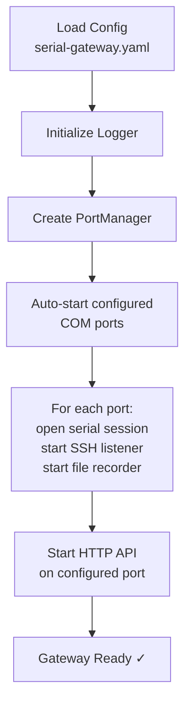

This guide walks you through building, configuring, and running SerialGateway for the first time. By the end, you will have a working gateway that maps a physical COM port to an SSH endpoint and exposes an HTTP API for serial communication — all in under five minutes.

SerialGateway solves a common problem in embedded development: you need to interact with serial devices (routers, switches, IoT boards) but want modern access methods like SSH and REST APIs instead of raw terminal emulators. The gateway sits between your physical COM ports and the network, giving you programmatic control over serial sessions.

## Prerequisites

Before you begin, make sure you have the following installed on your Windows machine:

| Requirement | Minimum Version | How to Check |
|---|---|---|
| **Go** | 1.22+ | `go version` |
| **Git** | Any recent | `git --version` |
| **An SSH client** | OpenSSH (built into Windows 10+) | `ssh -V` |
| **At least one COM port** | Physical or virtual | Device Manager → Ports (COM & LPT) |

If you don't have Go installed, download it from [go.dev](https://go.dev/dl/).

Sources: [go.mod](go.mod#L3-L3)

## Step 1 — Clone and Build

Clone the repository and build the executable:

```powershell
git clone https://github.com/zisen123/serialgateway.git
cd SerialGateway
go build -o serial-gateway.exe ./cmd/serial-gateway/
```

After the build completes, you will see `serial-gateway.exe` in the project root. The binary is self-contained — it bundles all dependencies and requires no additional runtime beyond the Go standard library, `gliderlabs/ssh` for SSH serving, and `go.bug.st/serial` for COM port access.

Sources: [main.go](cmd/serial-gateway/main.go#L1-L14), [go.mod](go.mod#L5-L9)

## Step 2 — Create a Configuration File

SerialGateway reads its settings from a YAML file. Create a file named `serial-gateway.yaml` in the project root with the following minimal configuration:

```yaml
gateway:
  http_port: 18080

serial_defaults:
  baudrate: 115200

ssh:
  base_port: 2200
  auth:
    type: "password"
    password: "serial"

ports:
  - device: "COM3"
    baudrate: 115200
```

Here is what each section controls:

| Section | Purpose | Key Setting |
|---|---|---|
| **`gateway`** | HTTP API listener port | `http_port: 18080` — the REST API will be available at `http://localhost:18080` |
| **`serial_defaults`** | Default serial parameters | `baudrate: 115200` — applied to all ports unless overridden per-port |
| **`ssh`** | SSH server settings | `base_port: 2200` — the starting port number for SSH listeners |
| **`ports`** | Which COM ports to expose | Each entry maps one COM device to an SSH listener |

Replace `"COM3"` with the actual COM port your device is connected to. You can find your COM port number in Windows Device Manager under **Ports (COM & LPT)**.

If the configuration file is missing at startup, SerialGateway applies built-in defaults (HTTP port 8080, SSH base port 2200, baud rate 115200) and starts with no port mappings.

Sources: [config.go](internal/config/config.go#L94-L110), [serial-gateway.yaml](serial-gateway.yaml#L1-L59)

## Step 3 — Understand the Port Mapping Formula

SerialGateway uses a deterministic formula to assign SSH ports to COM devices. Understanding this formula is essential for connecting to your devices:


The formula is: **SSH Port = `base_port` + COM number**. The `PortMapping` function extracts the numeric portion of the device name and adds it to the configured base port.

Sources: [server.go](internal/ssh/server.go#L20-L32)

Here are some common examples assuming `base_port: 2200`:

| COM Device | SSH Port | SSH Command |
|---|---|---|
| COM3 | 2203 | `ssh -p 2203 serial@localhost` |
| COM5 | 2205 | `ssh -p 2205 serial@localhost` |
| COM8 | 2208 | `ssh -p 2208 serial@localhost` |
| COM25 | 2225 | `ssh -p 2225 serial@localhost` |

## Step 4 — Start the Gateway

Run the executable with the `--config` flag pointing to your configuration file:

```powershell
.\serial-gateway.exe --config serial-gateway.yaml
```

You can also override the HTTP port from the command line without editing the config file:

```powershell
.\serial-gateway.exe --config serial-gateway.yaml --http-port 9090
```

On startup, the gateway performs the following sequence:



The `AutoStart` method iterates over every device listed in the `ports` section, creates an SSH server for each, and begins listening. If a COM port is unavailable (e.g., the device is unplugged), the gateway logs a warning and continues — it does not crash.

Sources: [main.go](cmd/serial-gateway/main.go#L19-L65), [portmanager.go](internal/core/portmanager.go#L34-L72)

## Step 5 — Verify It's Running

Open a second terminal and check that the gateway is responding:

**Check the HTTP API is alive:**

```powershell
curl http://localhost:18080/api/ports
```

You should see a JSON response listing all detected COM ports on your system, including their assigned SSH ports and current status:

```json
{
  "ports": [
    {
      "device": "COM3",
      "description": "USB Serial Port",
      "baudrate": 115200,
      "ssh_port": 2203,
      "status": "active"
    }
  ]
}
```

**Check active mappings:**

```powershell
curl http://localhost:18080/api/mappings
```

This returns only the COM ports you have explicitly configured or added at runtime, along with their connection status.

Sources: [handlers.go](internal/http/handlers.go#L24-L63), [handlers.go](internal/http/handlers.go#L78-L92)

## Step 6 — Connect via SSH

With the gateway running, connect to your serial device using any SSH client. The username can be anything (e.g., `serial`); authentication is password-based with the password defined in your config file.

```powershell
ssh -p 2203 serial@localhost
```

When prompted, enter the password you set in the configuration (`serial` in the example above). Once connected, you have a live interactive terminal session with the serial device — every byte read from the COM port is forwarded to your SSH session, and every keystroke you type is written to the serial port.

On the first connection, the SSH server auto-generates an Ed25519 host key and saves it to a file named `host_key` in the working directory. Subsequent restarts reuse this key so your SSH client won't complain about host key changes.

Sources: [server.go](internal/ssh/server.go#L72-L95), [server.go](internal/ssh/server.go#L104-L128)

## Step 7 — Send Commands via the HTTP API

For automation and scripting, the HTTP API lets you send commands and read output without an interactive SSH session.

**Send a command and get recent output:**

```powershell
curl -X POST http://localhost:18080/api/mappings/COM3/write `
  -H "Content-Type: application/json" `
  -d "{\"data\": \"cat /etc/hostname\n\"}"
```

The `/write` endpoint sends the `data` string to the serial port, waits 500ms for the device to respond, then returns the last 50 lines from the ring buffer.

Sources: [handlers.go](internal/http/handlers.go#L231-L281)

**Stream command output in real time using the `/exec` endpoint:**

```powershell
curl -N "http://localhost:18080/api/mappings/COM3/exec?cmd=ls%20-la%0A"
```

The `/exec` endpoint uses Server-Sent Events (SSE) to stream output line-by-line as it arrives. The stream ends automatically when the device is silent for 5 seconds (configurable via `exec_silence_timeout`) or after 30 seconds maximum (configurable via `exec_max_duration`).

Sources: [exec.go](internal/http/exec.go#L17-L155)

**Read recent serial output history:**

```powershell
curl "http://localhost:18080/api/mappings/COM3/tail?lines=100"
```

This returns the last 100 lines stored in the in-memory ring buffer (up to 100,000 lines and 10 MB by default).

Sources: [handlers.go](internal/http/handlers.go#L174-L188), [config.go](internal/config/config.go#L139-L144)

## Step 8 — Manage Mappings at Runtime

You don't need to restart the gateway to add or remove COM port mappings. The HTTP API supports dynamic mapping management:

| Action | Method | Endpoint | Example |
|---|---|---|---|
| **Add a mapping** | POST | `/api/mappings` | `{"device": "COM5"}` |
| **Remove a mapping** | DELETE | `/api/mappings/{device}` | `DELETE /api/mappings/COM5` |
| **List all mappings** | GET | `/api/mappings` | — |
| **List all COM ports** | GET | `/api/ports` | — |

**Add COM5 at runtime:**

```powershell
curl -X POST http://localhost:18080/api/mappings `
  -H "Content-Type: application/json" `
  -d "{\"device\": \"COM5\"}"
```

The gateway immediately creates an SSH listener on port 2205 (2200 + 5) and opens the serial session. The new mapping persists only until the gateway is restarted — to make it permanent, add it to the `ports` section in your YAML config.

Sources: [handlers.go](internal/http/handlers.go#L94-L126), [portmanager.go](internal/core/portmanager.go#L96-L113)

## Stopping and Restarting

SerialGateway includes convenience batch scripts for Windows lifecycle management:

| Script | Purpose |
|---|---|
| `stop.bat` | Terminates the running `serial-gateway.exe` process |
| `restart.bat` | Stops the current process, waits 1 second, then relaunches via `run.vbs` |
| `status.bat` | Reports whether `serial-gateway.exe` is currently running |
| `run.vbs` | Launches the gateway as a hidden background process (no console window) |

To stop the gateway:

```powershell
.\stop.bat
```

To restart after changing configuration:

```powershell
.\restart.bat
```

The `run.vbs` script is particularly useful — it starts the gateway without a visible console window by using `WScript.Shell` with window style `0` (hidden). This is how the gateway runs when launched via `restart.bat` or when you want it running unobtrusively in the background.

Sources: [stop.bat](stop.bat#L1-L4), [restart.bat](restart.bat#L1-L8), [status.bat](status.bat#L1-L9), [run.vbs](run.vbs#L1-L4)

## Quick Reference: HTTP API Endpoints

For convenience, here is the complete HTTP API surface at a glance. Detailed usage is covered in dedicated pages.

| Method | Endpoint | Purpose |
|---|---|---|
| GET | `/api/ports` | List all physical COM ports on the system |
| GET | `/api/mappings` | List all active SSH-to-serial mappings |
| POST | `/api/mappings` | Create a new mapping `{"device": "COMx"}` |
| DELETE | `/api/mappings/{device}` | Remove an existing mapping |
| GET | `/api/mappings/{device}/tail?lines=N` | Get the last N lines of serial output |
| GET | `/api/mappings/{device}/log?format=text` | Get full serial history (text or jsonl) |
| POST | `/api/mappings/{device}/write` | Send data to the serial port |
| GET | `/api/mappings/{device}/exec?cmd=...` | Send a command and stream output via SSE |
| GET | `/api/config` | View the current runtime configuration |
| PUT | `/api/config` | Update the runtime configuration |

Sources: [server.go](internal/http/server.go#L29-L37), [handlers.go](internal/http/handlers.go#L137-L165)

## Troubleshooting

| Symptom | Likely Cause | Fix |
|---|---|---|
| `auto-start had warnings` in log | COM port is unplugged or in use by another application | Verify the device is connected in Device Manager; close other terminal programs |
| SSH connection refused | SSH port already in use by another service | Change `base_port` in config to a different value |
| Empty response from `/api/ports` | No COM ports detected by the OS | Check Device Manager; install device drivers |
| `host key` errors in SSH client | Host key changed (e.g., `host_key` file was deleted) | Remove the old key from `~/.ssh/known_hosts` for the affected port |
| Gateway exits immediately | Missing or malformed YAML config | Validate your YAML syntax; the gateway falls back to defaults if the file is absent |

## Where to Go Next

Now that SerialGateway is running, here is a recommended reading path to deepen your understanding:

- **[Configuration Reference](3-configuration-reference)** — Learn every configuration option, including serial defaults, ring buffer tuning, reconnect behavior, and logging settings.
- **[Running as a Background Service](4-running-as-a-background-service)** — Set up SerialGateway as a persistent Windows service that starts on boot.
- **[Port Discovery and Mapping Management](5-port-discovery-and-mapping-management)** — Deep dive into the HTTP API for managing COM port mappings dynamically.
- **[Reading Serial History: Tail and Log Endpoints](6-reading-serial-history-tail-and-log-endpoints)** — Master the ring buffer query endpoints for monitoring and debugging.
- **[Sending Commands via Write and Exec Endpoints](7-sending-commands-via-write-and-exec-endpoints)** — Automate serial communication with the write and SSE-streaming exec endpoints.
- **[Connecting to a Serial Device via SSH](8-connecting-to-a-serial-device-via-ssh)** — Full guide to interactive SSH sessions, including authentication options and terminal behavior.