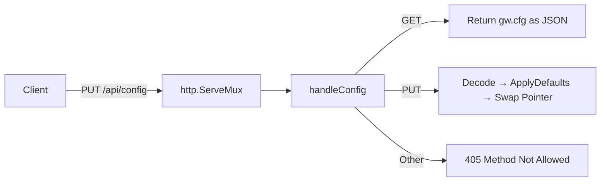
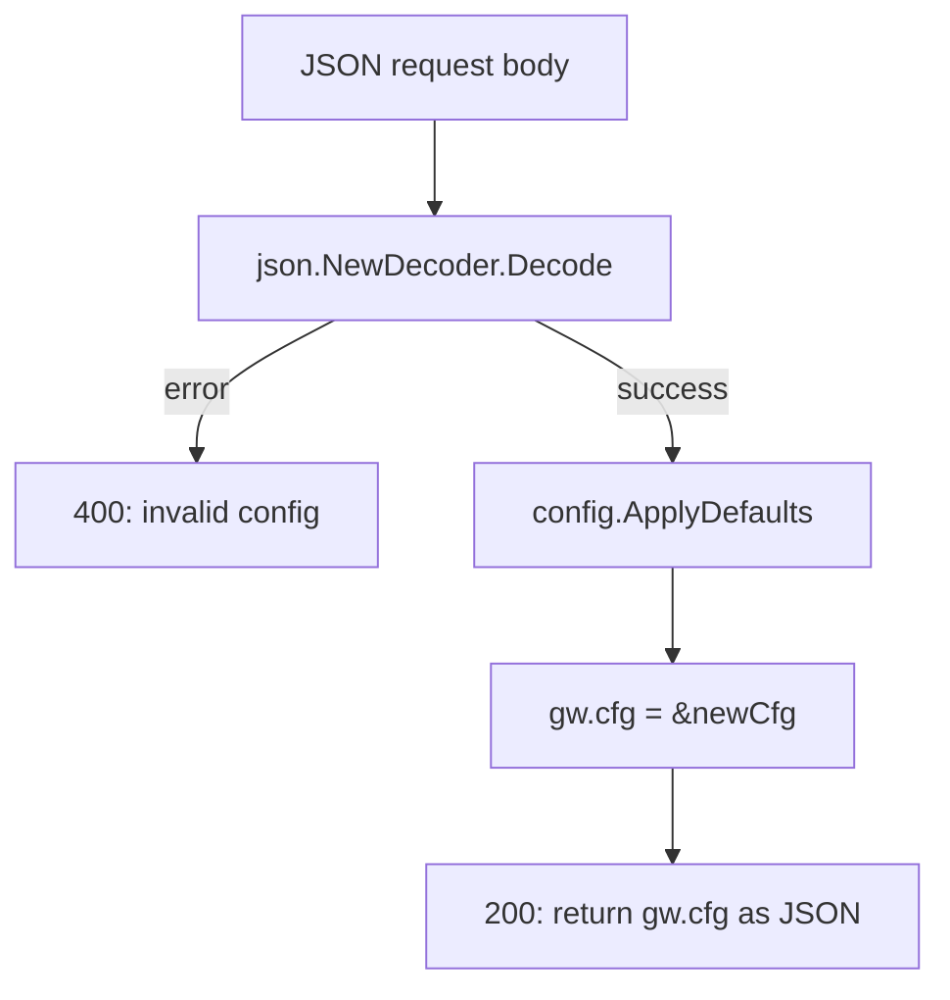
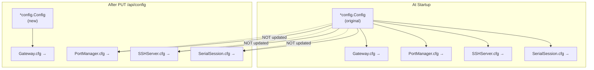

The Serial Gateway exposes a runtime configuration endpoint that allows operators to inspect and modify the gateway's behavior without restarting the process. The `PUT /api/config` endpoint accepts a complete configuration payload, applies default values for any omitted fields, and swaps the gateway's active configuration pointer. This page documents the request/response contract, the propagation boundaries of runtime changes, and the important limitations you must understand before relying on this endpoint in production workflows.

## Endpoint Overview and Route Registration

The configuration endpoint is registered alongside all other HTTP API routes in the gateway's `Handler()` method. The same path serves both `GET` (read current config) and `PUT` (replace config) methods, dispatched through a method-switch inside the handler function.



The route is registered as a standard `HandleFunc` on Go's `http.ServeMux`, with no middleware or authentication layer applied. Any client with network access to the HTTP port can read or replace the configuration.

Sources: [server.go](internal/http/server.go#L26-L34)

## Request and Response Contract

### PUT /api/config

The handler expects a **complete** `Config` JSON object in the request body. It does not support partial updates — any field omitted or set to its zero value will be filled with the compiled-in default by `ApplyDefaults`.

**Request body**: A JSON object matching the `Config` struct schema. All top-level sections are optional; missing sections receive defaults.

**Success response** (`200 OK`): The effective configuration after defaults have been applied, returned as JSON.

**Error response** (`400 Bad Request`): Returned when the JSON body cannot be deserialized into the `Config` struct.

```
PUT /api/config HTTP/1.1
Content-Type: application/json

{
  "serial_defaults": {
    "baudrate": 9600,
    "exec_silence_timeout": 10000000000
  }
}
```

The response echoes back the full effective configuration, including defaults for fields you did not supply:

```
HTTP/1.1 200 OK
Content-Type: application/json

{
  "gateway": { "http_port": 8080 },
  "serial_defaults": {
    "baudrate": 9600,
    "timeout": 5000000000,
    "bytesize": 8,
    "parity": "N",
    "stopbits": 1,
    "write_timeout": 10000000000,
    "exec_silence_timeout": 10000000000,
    "exec_max_duration": 30000000000
  },
  ...
}
```

> **Note on `time.Duration` encoding**: Go's `time.Duration` serializes as nanoseconds in JSON. A 5-second timeout is `5000000000`. When constructing payloads, use nanosecond integers rather than human-readable strings like `"5s"` (which work in YAML but not JSON).

Sources: [handlers.go](internal/http/handlers.go#L158-L174), [config.go](internal/config/config.go#L80-L91)

### GET /api/config

Returns the current in-memory configuration as JSON. This is useful for inspecting what the gateway is currently using, especially after a PUT update.

Sources: [handlers.go](internal/http/handlers.go#L159-L161)

## The Config Struct: Updatable Fields

The full `Config` struct contains eleven top-level sections. The table below summarizes each section, its purpose, and the default values applied when fields are zero-valued.

| Section | JSON Key | Purpose | Key Defaults |
|---------|----------|---------|-------------|
| `GatewayConfig` | `gateway` | HTTP API listener port | `http_port`: 8080 |
| `SerialDefaults` | `serial_defaults` | Default serial port parameters | `baudrate`: 115200, `timeout`: 5s, `bytesize`: 8, `parity`: "N", `stopbits`: 1, `write_timeout`: 10s, `exec_silence_timeout`: 5s, `exec_max_duration`: 30s |
| `RingBufferConfig` | `ring_buffer` | In-memory history buffer limits | `max_lines`: 100000, `max_bytes`: 10485760 |
| `SSHConfig` | `ssh` | SSH server base port and auth | `base_port`: 2200, `auth.type`: "password" |
| `ReconnectConfig` | `reconnect` | Serial reconnection backoff | `initial_interval`: 1s, `max_interval`: 30s |
| `ReverseTunnelConfig` | `reverse_tunnel` | Reverse SSH tunnel settings | `port`: 22, `user`: "root", `remote_port`: 18080 |
| `ReverseTunnelConfig` | `adb_reverse_tunnel` | ADB reverse tunnel settings | `port`: 22, `remote_port`: 15037, `local_port`: 5037 |
| `FileRecordingConfig` | `file_recording` | Persistent serial log settings | `output_dir`: "./serial_logs", `max_size_mb`: 1024, `trim_size_mb`: 100 |
| `LoggingConfig` | `logging` | Structured logging configuration | `level`: "info", `format`: "text", `output`: "stdout" |
| `[]PortConfig` | `ports` | Per-port device and baudrate overrides | *(empty list)* |

Sources: [config.go](internal/config/config.go#L10-L91), [config.go](internal/config/config.go#L114-L229)

## The Update Pipeline: Decode → Defaults → Pointer Swap

The PUT handler follows a three-step pipeline with no intermediate validation:



**Step 1 — Deserialization**: The request body is decoded into a stack-allocated `config.Config` value. Any JSON that does not match the struct layout (unknown fields are silently ignored by Go's JSON decoder; type mismatches cause an error) triggers a `400` response.

**Step 2 — Default application**: The exported `config.ApplyDefaults()` function fills every zero-valued field with its compiled-in default. This is the same function called during initial YAML config loading, ensuring consistency between startup and runtime configuration.

**Step 3 — Pointer swap**: The gateway's `cfg` field is reassigned to point to the new config struct. This is a simple pointer assignment with no mutex protection.

Sources: [handlers.go](internal/http/handlers.go#L162-L170), [config.go](internal/config/config.go#L110-L112)

## Propagation Boundaries: What Changes and What Doesn't

This is the most critical architectural detail for this endpoint. The configuration update has **limited and asymmetric propagation** because multiple components hold independent pointers to the original config object.



The table below details which operations read from `gw.cfg` (updated) versus `pm.cfg` / `s.cfg` (stale):

| Operation | Config Source | Sees PUT Updates? | Affected Fields |
|-----------|--------------|-------------------|----------------|
| `GET /api/ports` — baudrate display | `gw.cfg` | ✅ Yes | `serial_defaults.baudrate`, `ports[]` |
| `GET /api/ports` — SSH port calculation | `gw.cfg` | ✅ Yes | `ssh.base_port` |
| `POST /api/mappings/{device}/write` — write timeout | `gw.cfg` | ✅ Yes | `serial_defaults.write_timeout` |
| `GET /api/mappings/{device}/exec` — silence/max duration | `gw.cfg` | ✅ Yes | `serial_defaults.exec_silence_timeout`, `exec_max_duration` |
| `POST /api/mappings` — new mapping creation | `pm.cfg` | ❌ No | All fields passed to `NewSSHServer` |
| Serial port `Open()` — mode parameters | `s.cfg` (SerialSession) | ❌ No | `serial_defaults.bytesize`, `parity`, `stopbits` |
| Reconnection loop — backoff interval | `s.cfg` (SerialSession) | ❌ No | `reconnect.initial_interval` |
| SSH password authentication | `s.cfg` (SSHServer) | ❌ No | `ssh.auth.password` |
| Write loop — discard on disconnect | `s.cfg` (SerialSession) | ❌ No | `reconnect.discard_input_on_disconnect` |

**Practical implication**: Updating `serial_defaults.exec_silence_timeout` via PUT takes effect immediately for subsequent `/exec` calls. But updating `serial_defaults.baudrate` or `serial_defaults.parity` does **not** affect already-open serial sessions — those parameters are captured at session construction time and used during `Open()`.

Sources: [handlers.go](internal/http/handlers.go#L158-L174), [handlers.go](internal/http/handlers.go#L261), [exec.go](internal/http/exec.go#L52-L80), [portmanager.go](internal/core/portmanager.go#L13-L28), [server.go](internal/ssh/server.go#L43-L57), [session.go](internal/serial/session.go#L46-L63)

## Practical Usage Examples

### Adjusting exec timeouts for a slow device

If a connected device takes longer than the default 5 seconds of silence to finish its output, increase the silence timeout:

```bash
curl -X PUT http://localhost:18080/api/config \
  -H "Content-Type: application/json" \
  -d '{
    "serial_defaults": {
      "exec_silence_timeout": 15000000000,
      "exec_max_duration": 120000000000
    }
  }'
```

This sets `exec_silence_timeout` to 15 seconds and `exec_max_duration` to 120 seconds. All other fields will receive their compiled-in defaults. The change takes effect on the next `/exec` call because exec reads these values from `gw.cfg` at invocation time.

### Reading and then modifying the current config

A safer pattern is to first fetch the current config, modify the desired fields, and PUT the result back:

```bash
# Step 1: Fetch current config
curl -s http://localhost:18080/api/config > current.json

# Step 2: Edit current.json (e.g., change baudrate for future port listings)
# Step 3: Push back
curl -X PUT http://localhost:18080/api/config \
  -H "Content-Type: application/json" \
  -d @current.json
```

This approach preserves all existing values and avoids unintentionally resetting fields to defaults.

Sources: [handlers.go](internal/http/handlers.go#L158-L174)

## Limitations and Design Considerations

Understanding the following limitations prevents unexpected behavior when using this endpoint:

**No persistence.** The updated configuration exists only in the gateway process's memory. A restart reverts to whatever is in `serial-gateway.yaml`. If you need persistent changes, edit the YAML file directly.

**No input validation.** The handler performs no range checking, port conflict detection, or semantic validation beyond JSON deserialization. Setting `baudrate` to `-1` or `http_port` to `0` will be accepted without error (though `ApplyDefaults` will replace `http_port: 0` with `8080`).

**No concurrency protection.** The pointer swap `gw.cfg = &newCfg` is not guarded by a mutex. Concurrent reads of `gw.cfg` by in-flight HTTP handlers could theoretically observe a partially-updated pointer on non-x86 architectures, though in practice Go's memory model makes single-word pointer writes atomic on most platforms.

**No cascading notification.** Running SSH servers, serial sessions, and file recorders are not notified of the config change. They continue operating with the config snapshot they received at construction time.

**Full replacement semantics.** The PUT body replaces the entire config — there is no PATCH-style partial merge. Omitted sections reset to defaults rather than preserving their previous values.

| Limitation | Impact | Mitigation |
|-----------|--------|-----------|
| No persistence | Changes lost on restart | Edit `serial-gateway.yaml` for permanent changes |
| No validation | Invalid values accepted | Validate payloads client-side before sending |
| No mutex on pointer swap | Theoretical race condition | Avoid concurrent PUT requests |
| No cascading notification | Existing sessions use stale config | Remove and re-add mappings to pick up new settings |
| Full replacement | Omitted fields reset to defaults | Always GET → modify → PUT to preserve values |

Sources: [handlers.go](internal/http/handlers.go#L158-L174), [config.go](internal/config/config.go#L110-L229)

## Testing the Endpoint

The codebase includes a unit test for the `GET /api/config` direction that verifies the handler returns a valid config response with the expected top-level keys. No automated test currently exercises the `PUT` path, so validation of update behavior relies on manual testing or integration tests.

```go
func TestGetConfig(t *testing.T) {
    cfg := &config.Config{}
    config.ApplyDefaults(cfg)
    pm := core.NewPortManager(cfg, slog.Default())
    gw := NewGatewayWithManager(cfg, pm, slog.Default())
    handler := gw.Handler()

    req := httptest.NewRequest("GET", "/api/config", nil)
    w := httptest.NewRecorder()
    handler.ServeHTTP(w, req)

    if w.Code != 200 {
        t.Fatalf("expected 200, got %d", w.Code)
    }
    // Verifies gateway key is present in response
}
```

Sources: [handlers_test.go](internal/http/handlers_test.go#L59-L78)

## Related Pages

- **[Route Registration and Gateway Struct](18-route-registration-and-gateway-struct)** — How all HTTP routes, including `/api/config`, are wired to the `Gateway` struct.
- **[Sending Commands via Write and Exec Endpoints](7-sending-commands-via-write-and-exec-endpoints)** — The endpoints that consume `serial_defaults.write_timeout`, `exec_silence_timeout`, and `exec_max_duration` from the updated config.
- **[Configuration Reference](3-configuration-reference)** — Complete reference for all configuration fields and their YAML/JSON representations.
- **[Startup Flow: From main.go to Running Services](10-startup-flow-from-main-go-to-running-services)** — How the initial config is loaded and distributed to all components at boot time.