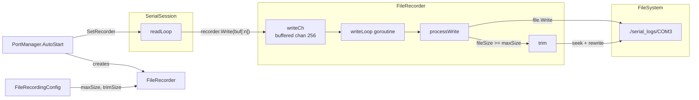
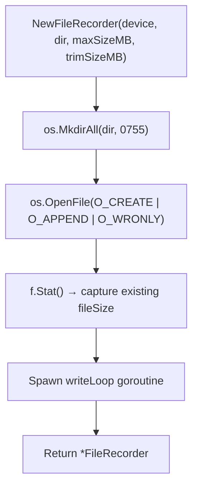
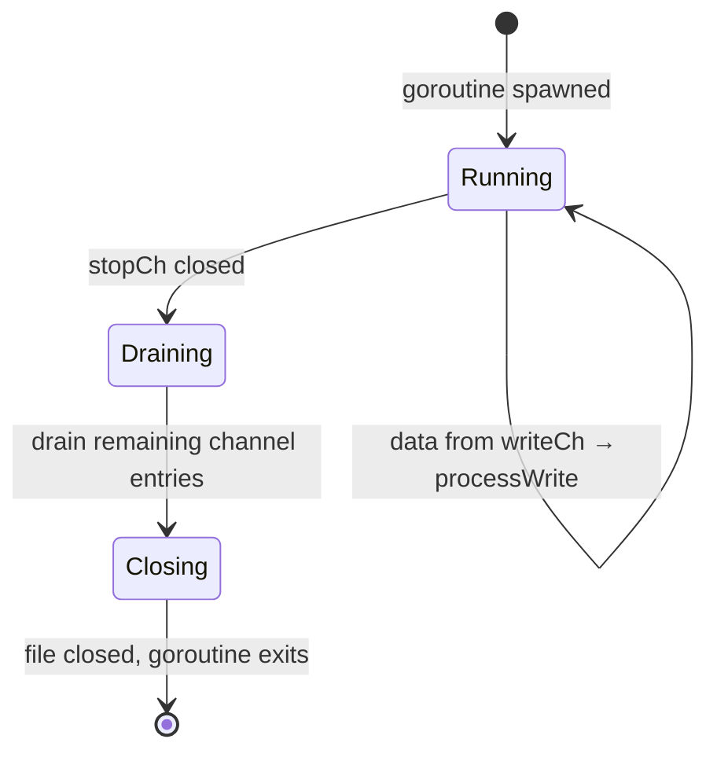
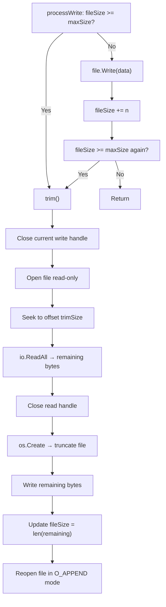

The File Recorder provides **continuous, asynchronous disk logging** of raw serial port data. Every byte read from a serial device is persisted to a per-device file, with an automatic head-trim mechanism that prevents unbounded disk consumption. This page examines the recorder's architecture, concurrency model, trim algorithm, and integration points within the broader SerialGateway system.

## Architectural Overview

The File Recorder sits at the intersection of three subsystems: the serial read pipeline feeds it raw bytes, the configuration system governs its size limits, and the PortManager orchestrates its lifecycle. The following diagram illustrates these relationships:



The recorder is created during port initialization and attached to the `SerialSession` via a minimal `interface{ Write([]byte) }` contract. This interface-based coupling means the serial session has zero knowledge of the recorder's internal implementation — it simply forwards raw bytes after each successful serial read.

Sources: [recorder.go](internal/recorder/recorder.go#L12-L27), [session.go](internal/serial/session.go#L41), [portmanager.go](internal/core/portmanager.go#L45-L56)

## Configuration

The recorder is governed by three configuration fields within the `FileRecordingConfig` struct, loaded from the `file_recording` section of `serial-gateway.yaml`:

| Field | YAML Key | Default | Description |
|-------|----------|---------|-------------|
| **OutputDir** | `output_dir` | `./serial_logs` | Directory where per-device log files are created. Created automatically if absent. |
| **MaxSizeMB** | `max_size_mb` | `1024` | Maximum file size in megabytes before a trim operation is triggered. |
| **TrimSizeMB** | `trim_size_mb` | `100` | Number of oldest megabytes to discard from the file head during each trim. |

Sources: [config.go](internal/config/config.go#L63-L67), [config.go](internal/config/config.go#L220-L228)

These values are converted to bytes internally (`maxSizeMB * 1024 * 1024`) and stored as `int64` fields on the `FileRecorder` struct. The current `serial-gateway.yaml` does not include a `file_recording` section, so the system operates entirely on defaults — 1 GB max file size with 100 MB trimmed per cycle.

A YAML configuration example would look like:

```yaml
file_recording:
  output_dir: "./serial_logs"
  max_size_mb: 512
  trim_size_mb: 50
```

Sources: [serial-gateway.yaml](serial-gateway.yaml#L1-L59)

## Initialization and File Setup

When `NewFileRecorder` is called, it performs a deterministic three-step setup: **directory creation**, **file open in append mode**, and **size introspection**.



The log file is named after the device identifier — for example, device `COM3` produces the file `./serial_logs/COM3` with no extension. The file is opened with `O_APPEND` flag, ensuring that restarting the gateway appends to existing data rather than overwriting it. The initial `fileSize` is captured from `f.Stat()` so that trim decisions account for pre-existing content.

The buffered write channel is allocated with a capacity of **256 entries**. Each entry is a variable-length byte slice representing one serial read chunk (up to 1024 bytes from the read buffer).

Sources: [recorder.go](internal/recorder/recorder.go#L29-L61)

## Async Write Pipeline

The recorder's concurrency model follows a **single-writer goroutine** pattern that decouples the serial read path from disk I/O latency.

### Non-Blocking Write Entry Point

The `Write` method is designed to **never block the caller**. It performs a defensive copy of the input data (since the serial read buffer is reused across iterations) and attempts a non-blocking channel send:

```go
func (r *FileRecorder) Write(data []byte) {
    copied := make([]byte, len(data))
    copy(copied, data)
    select {
    case r.writeCh <- copied:
    default:
        r.logger.Warn("recorder channel full, dropping data", ...)
    }
}
```

The `select` with a `default` case means that if all 256 buffer slots are occupied, the data is **silently dropped** with a warning log. This is a deliberate design choice: the serial read loop must never stall waiting for disk I/O, as that would cascade into missed data from the hardware port.

Sources: [recorder.go](internal/recorder/recorder.go#L63-L75)

### The writeLoop Goroutine

The dedicated `writeLoop` goroutine consumes from `writeCh` in a tight select loop, dispatching each chunk to `processWrite`. When the stop signal arrives, it transitions to a drain phase:



Sources: [recorder.go](internal/recorder/recorder.go#L87-L98)

### Drain and Close

The `drainAndClose` method ensures **no buffered data is lost** during shutdown. It loops over the channel with a non-blocking receive, processing each remaining entry. Only when the channel is empty does it acquire the mutex and close the file handle:

```go
func (r *FileRecorder) drainAndClose() {
    for {
        select {
        case data := <-r.writeCh:
            r.processWrite(data)
        default:
            r.mu.Lock()
            if r.file != nil {
                r.file.Close()
                r.file = nil
            }
            r.mu.Unlock()
            return
        }
    }
}
```

This guarantees that all data submitted to the channel before `Stop()` was called will reach disk.

Sources: [recorder.go](internal/recorder/recorder.go#L100-L116)

## The Trim Algorithm

When `processWrite` detects that `fileSize >= maxSize`, it invokes the `trim` method — a **read-rewrite strategy** that removes the oldest bytes from the file head.



**Step-by-step breakdown**:

1. **Close the write handle** — the file must be closed before it can be safely reopened for reading on Windows.
2. **Open read-only and seek** — `rf.Seek(r.trimSize, 0)` positions the read cursor past the oldest `trimSize` bytes, effectively marking them for deletion.
3. **Read remaining content** — `io.ReadAll(rf)` loads everything after the trim boundary into memory.
4. **Truncate and rewrite** — `os.Create(filePath)` truncates the file to zero bytes, then the remaining content is written back.
5. **Reopen for append** — the file is reopened with `O_CREATE|O_APPEND|O_WRONLY` so subsequent writes continue seamlessly.

**Important constraint**: The trim operation loads the entire post-trim content into memory. With default settings (1024 MB max, 100 MB trim), this means ~924 MB is read into a byte slice. This is a known trade-off for simplicity over memory efficiency.

**Post-write trim check**: `processWrite` checks the size limit both *before* and *after* writing the current chunk. This handles the edge case where a single write pushes the file over the limit.

Sources: [recorder.go](internal/recorder/recorder.go#L118-L200)

## Integration with SerialSession

The recorder is wired into the serial read pipeline through a minimal interface:

```go
// In SerialSession
recorder interface{ Write([]byte) }

func (s *SerialSession) SetRecorder(r interface{ Write([]byte) }) {
    s.recorder = r
}
```

During `readLoop`, after each successful serial port read, the raw bytes are forwarded to the recorder **before** line parsing and ring buffer insertion:

```go
n, err := p.Read(buf)
// ...
s.broadcast(string(buf[:n]))        // SSH subscribers
if s.recorder != nil {
    s.recorder.Write(buf[:n])        // Disk persistence
}
// ... line parsing → ringBuffer     // In-memory history
```

This ordering is significant: the recorder receives the **same raw bytes** as SSH subscribers, preserving exact byte fidelity including any control characters, ANSI escape sequences, or binary data. The ring buffer, by contrast, stores cleaned lines with ANSI codes stripped.

Sources: [session.go](internal/serial/session.go#L41-L42), [session.go](internal/serial/session.go#L70-L73), [session.go](internal/serial/session.go#L179-L182)

## Lifecycle Management by PortManager

The `PortManager` creates one `FileRecorder` per configured port during `AutoStart()` and stores it in a parallel map alongside the SSH server:

```go
rec, err := recorder.NewFileRecorder(
    portCfg.Device,
    pm.cfg.FileRecording.OutputDir,
    pm.cfg.FileRecording.MaxSizeMB,
    pm.cfg.FileRecording.TrimSizeMB,
    pm.logger.With("component", "recorder", "device", portCfg.Device),
)
if err != nil {
    pm.logger.Error("failed to create recorder", ...)
} else {
    srv.Session().SetRecorder(rec)
}
```

If recorder creation fails (e.g., permission denied on the output directory), the port still starts — recording is treated as **optional**. The error is logged but does not prevent the SSH server or serial session from operating.

During shutdown, `PortManager.Shutdown()` stops all recorders **before** stopping SSH servers, ensuring the drain-and-close phase completes while serial data may still be flowing:

```go
func (pm *PortManager) Shutdown() {
    for _, rec := range pm.recorders {
        rec.Stop()
    }
    for _, srv := range pm.servers {
        srv.Stop()
    }
}
```

Sources: [portmanager.go](internal/core/portmanager.go#L45-L57), [portmanager.go](internal/core/portmanager.go#L119-L130)

## Concurrency and Thread Safety

The recorder employs a layered concurrency strategy:

| Concern | Mechanism | Rationale |
|---------|-----------|-----------|
| **Write submission** | Buffered channel (256) + non-blocking send | Caller never blocks; decouples serial read speed from disk write speed |
| **File access** | `sync.Mutex` in `processWrite` / `trim` | Only the `writeLoop` goroutine touches the file, but the mutex protects against edge cases during trim re-open |
| **Stop signal** | `chan struct{}` with idempotent close | Safe to call `Stop()` multiple times without panic |
| **Data copying** | `copy(copied, data)` in `Write()` | The serial read buffer `buf` is reused across iterations; without copying, channel consumers would see corrupted data |

The single-writer goroutine design means that the mutex in `processWrite` is technically redundant under normal operation (only one goroutine ever calls it). However, it provides a safety net for the `drainAndClose` path and any future concurrent access patterns.

Sources: [recorder.go](internal/recorder/recorder.go#L13-L27), [recorder.go](internal/recorder/recorder.go#L63-L75), [recorder.go](internal/recorder/recorder.go#L77-L85)

## Testing Strategy

The test suite in `recorder_test.go` covers five behavioral contracts:

| Test | Validates |
|------|-----------|
| `TestNewFileRecorder_CreatesDirAndFile` | Directory auto-creation and file existence after construction |
| `TestFileRecorder_Write` | End-to-end: write data → stop → read file → verify content |
| `TestFileRecorder_Append` | Two sequential recorder lifecycles on the same file produce concatenated output |
| `TestFileRecorder_StopIdempotent` | Calling `Stop()` twice does not panic |
| `TestFileRecorder_NonBlockingWrite` | 500 rapid writes into a 256-slot channel do not deadlock |
| `TestFileRecorder_Trim` | Writing 1100 bytes with maxSize=1024 and trimSize=512 produces a file between 400–1024 bytes |

The trim test is particularly instructive: it sets `maxSize=1024` and `trimSize=512` (bypassing the MB conversion by directly mutating struct fields), then writes 11 chunks of 100 bytes each. After trimming, the file should contain roughly 588 bytes (1100 − 512), within the assertion range of 400–1024.

Sources: [recorder_test.go](internal/recorder/recorder_test.go#L17-L154)

## Design Trade-offs and Limitations

**Memory during trim**: The trim operation reads the entire post-trim file content into memory via `io.ReadAll`. For the default 1 GB max size, this allocates ~900 MB. In memory-constrained environments, a streaming approach (copy to temp file, then rename) would be more appropriate.

**No log rotation**: The recorder uses a single file per device with in-place trimming. There is no date-based rotation, compression of old logs, or multi-file archival. Trimmed data is permanently lost.

**Best-effort persistence**: The non-blocking channel write means that under sustained high-throughput serial data (exceeding disk write speed × 256 buffer slots), data will be dropped. The recorder prioritizes serial read pipeline health over logging completeness.

**No file locking**: On Windows, file handles are implicitly exclusive, but there is no explicit advisory lock. External tools reading the log file while the recorder is active may encounter sharing violations.

## Further Reading

- [PortManager: Coordinating SSH Servers and Recorders](17-portmanager-coordinating-ssh-servers-and-recorders) — how the PortManager orchestrates recorder creation and shutdown
- [SerialSession Lifecycle: Open, Read, Write, Close](12-serialsession-lifecycle-open-read-write-close) — the serial read pipeline that feeds the recorder
- [Ring Buffer: In-Memory History Storage and Retrieval](15-ring-buffer-in-memory-history-storage-and-retrieval) — the complementary in-memory history mechanism
- [Reading Serial History: Tail and Log Endpoints](6-reading-serial-history-tail-and-log-endpoints) — HTTP endpoints for accessing recorded data