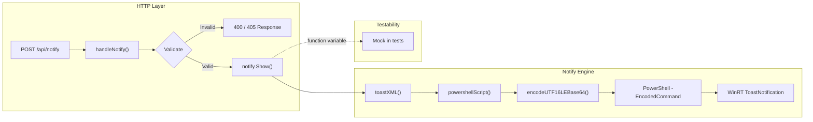
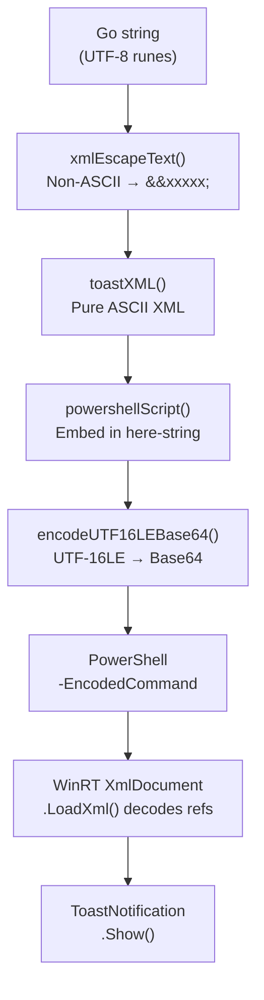

The toast notification subsystem enables external callers to push native Windows desktop notifications through a simple HTTP endpoint. Rather than depending on third-party toast libraries — which proved unreliable with non-ASCII text — the system implements a custom encoding pipeline that generates WinRT-compatible XML, wraps it in a PowerShell script, and dispatches it via PowerShell's `-EncodedCommand` mechanism. This approach guarantees correct rendering of CJK and other Unicode characters across the entire Go → PowerShell → WinRT boundary chain.

## Architectural Overview

The notification system spans two packages and follows a clean separation between the HTTP transport layer and the platform-specific dispatch engine.



The `Gateway` struct in the HTTP package holds the route registration, while the `notify` package exposes a single `Show` function variable that encapsulates all platform interaction. This function-variable pattern allows tests to swap in a mock without touching the HTTP handler logic.

Sources: [server.go](internal/http/server.go#L26-L34), [toast.go](internal/notify/toast.go#L22-L24)

## HTTP API: POST /api/notify

The route is registered in the central `Handler()` method alongside all other API endpoints, mapping the `/api/notify` path to `handleNotify`.

Sources: [server.go](internal/http/server.go#L32)

### Request Schema

The handler accepts a JSON body with three fields, two of which are mandatory:

| Field | Type | Required | Description |
|-------|------|----------|-------------|
| `title` | `string` | **Yes** | Toast notification headline (displayed in bold) |
| `content` | `string` | **Yes** | Toast notification body text |
| `duration` | `string` | No | `"short"` (default) or `"long"` — controls how long the toast remains visible |

Sources: [notify_handler.go](internal/http/notify_handler.go#L10-L14)

### Validation and Error Handling

The handler applies a strict validation chain before dispatching:

| Condition | HTTP Status | Error Message |
|-----------|-------------|---------------|
| Method is not `POST` | `405` | `"method not allowed"` |
| Malformed JSON body | `400` | `"invalid request body"` |
| `title` or `content` is empty | `400` | `"title and content are required"` |
| `duration` is not `"short"` or `"long"` | `400` | `"duration must be 'short' or 'long'"` |
| PowerShell execution fails | `500` | Wrapped error from `notify.Show()` |

On success, the handler responds with `200` and a JSON body: `{"status": "dispatched", "duration": "<resolved_duration>"}`.

Sources: [notify_handler.go](internal/http/notify_handler.go#L16-L50)

### Example Usage

```bash
# Short notification (default duration)
curl -X POST http://localhost:8081/api/notify \
  -H "Content-Type: application/json" \
  -d '{"title":"Port Connected","content":"COM3 session established"}'

# Long-duration notification with Chinese text
curl -X POST http://localhost:8081/api/notify \
  -H "Content-Type: application/json" \
  -d '{"title":"串口警告","content":"COM3 设备已断开连接","duration":"long"}'
```

## The Encoding Pipeline

The core engineering challenge is reliably transporting Unicode text through a chain of four encoding-sensitive systems: Go strings, XML, PowerShell scripts, and WinRT's `XmlDocument`. The solution is a deliberate encoding strategy that keeps intermediate representations within safe ASCII bounds.



### Step 1: XML Numeric Character Reference Encoding

The `xmlEscapeText` function iterates over every rune in the input string. ASCII characters pass through verbatim, while five XML-special characters receive standard entity escaping (`&amp;`, `&lt;`, `&gt;`, `&quot;`, `&apos;`). Any rune with a code point above 127 is converted to an XML numeric character reference in the format `&#<decimal>;`. This guarantees the output string is **100% ASCII**, eliminating all encoding ambiguity downstream.

```go
// Example: "中文" → "&#20013;&#25991;"
```

Sources: [toast.go](internal/notify/toast.go#L29-L50)

### Step 2: Toast XML Template Generation

The `toastXML` function composes the escaped title and content into a WinRT-compatible toast XML template. The template uses the `ToastGeneric` binding with `activationType="protocol"` and includes a default notification sound.

```xml
<toast activationType="protocol" duration="short">
    <visual>
        <binding template="ToastGeneric">
            <text id="1">{title}</text>
            <text id="2">{content}</text>
        </binding>
    </visual>
    <audio src="ms-winsoundevent:Notification.Default" loop="false"/>
</toast>
```

The `duration` attribute accepts either `"short"` (approximately 7 seconds) or `"long"` (approximately 25 seconds), as defined by the WinRT toast schema.

Sources: [toast.go](internal/notify/toast.go#L53-L63), [toast.go](internal/notify/toast.go#L17-L20)

### Step 3: PowerShell Script Assembly

The `powershellScript` function wraps the XML in a PowerShell script that loads the Windows Runtime notification APIs. The XML is embedded inside a single-quoted here-string (`@'...'@`) to prevent PowerShell from interpreting `$` characters or other metacharacters. The script uses the application ID `SerialGateway.Notifier` when creating the toast notifier.

Sources: [toast.go](internal/notify/toast.go#L14), [toast.go](internal/notify/toast.go#L67-L82)

### Step 4: UTF-16LE Base64 Encoding

PowerShell's `-EncodedCommand` parameter expects a Base64-encoded UTF-16LE byte stream. The `encodeUTF16LEBase64` function converts each rune of the script to a 16-bit little-endian integer, serializes the bytes into a buffer, and then applies standard Base64 encoding. This is the critical step that eliminates all file-encoding issues — the script never touches the filesystem as a `.ps1` file.

Sources: [toast.go](internal/notify/toast.go#L86-L92)

### Step 5: Process Dispatch

The `showImpl` function orchestrates the full pipeline and spawns a hidden PowerShell process:

| Flag | Purpose |
|------|---------|
| `-NoProfile` | Skip user profile scripts for deterministic execution |
| `-NonInteractive` | Prevent interactive prompts |
| `-ExecutionPolicy Bypass` | Override restrictive execution policies |
| `-EncodedCommand` | Accept the Base64 UTF-16LE encoded script |

The process is launched with `SysProcAttr.HideWindow = true` to suppress the PowerShell console window, and `cmd.Run()` blocks until the toast dispatch completes. If PowerShell exits with an error, the captured `stderr` output is included in the returned error for diagnostics.

Sources: [toast.go](internal/notify/toast.go#L94-L110)

## BUG-001: The go-toast Encoding Failure

The custom implementation in `internal/notify` exists specifically because the `github.com/go-toast/toast` library could not handle non-ASCII characters correctly. Understanding this failure illuminates why the current design choices were made.

### Root Cause

The go-toast library used `text/template` to inject Go UTF-8 strings into a PowerShell script, wrote it to a temporary `.ps1` file with a UTF-8 BOM, and then executed it. Despite the BOM, PowerShell's here-string parsing mangled non-ASCII bytes before they reached `XmlDocument.LoadXml()`, resulting in U+FFFD replacement characters (displayed as `` on screen).

### The Encoding Chain Comparison

| Aspect | go-toast (broken) | Custom implementation (fixed) |
|--------|-------------------|-------------------------------|
| String encoding | Raw UTF-8 in template | XML numeric refs (`&#xxxxx;`) |
| Script delivery | Temp `.ps1` file | `-EncodedCommand` (in-memory) |
| Intermediate charset | Mixed UTF-8 / ASCII | Pure ASCII throughout |
| Filesystem dependency | Yes (temp file) | No |
| CJK support | **Broken** | **Correct** |

### Debugging Lesson

During fix verification, the team discovered that an old binary was still running on port 8081 (the previous process was not killed before starting the new one). This caused the "fixed" code to appear broken because requests were being served by the old process. The lesson: always verify process identity (`Get-Process`) before testing encoding fixes.

Sources: [BUG-001-chinese-garbled-toast.md](.bug/BUG-001-chinese-garbled-toast.md#L1-L70)

## Testability: The Function Variable Pattern

The `Show` variable in the `notify` package is declared as an exported package-level variable pointing to `showImpl`. This allows any test — including those in other packages like `internal/http` — to replace the real PowerShell dispatch with a mock:

```go
// In production code:
var Show = showImpl

// In test code:
origShow := notify.Show
defer func() { notify.Show = origShow }()
notify.Show = func(title, content, duration string) error {
    return nil // mock success
}
```

This pattern avoids the need for interfaces or dependency injection frameworks while keeping the production code simple and the test code isolated from Windows-specific side effects.

Sources: [toast.go](internal/notify/toast.go#L22-L24), [notify_handler_test.go](internal/http/notify_handler_test.go#L18-L25)

## Test Coverage

The notification system is validated through two complementary test suites:

### Unit Tests (notify package)

| Test | Type | Description |
|------|------|-------------|
| `TestTC01_XMLGeneration_ChineseToNumericRef` | Automatic | Verifies Chinese characters become `&#xxxxx;` references; asserts zero non-ASCII runes in output |
| `TestTC02_XMLGeneration_EnglishVerbatim` | Automatic | Verifies English text passes through without encoding |
| `TestTC03_UTF16LEBase64_Roundtrip` | Automatic | Encodes and decodes mixed Chinese/English, verifies roundtrip fidelity |
| `TestTC04_FullPipeline_PreservesReferences` | Automatic | Runs the full XML → script → base64 → decode chain, verifies references survive |
| `TestTC07_XMLGeneration_LongDuration` | Automatic | Asserts `duration="long"` in generated XML |
| `TestTC07b_XMLGeneration_ShortDuration` | Automatic | Asserts `duration="short"` in generated XML |

### Integration Tests (notify package, manual)

| Test | Prerequisite | Description |
|------|-------------|-------------|
| `TestTC05_PowerShellXMLParse_DecodesChineseCorrectly` | `RUN_TOAST_TEST=1` + Windows desktop | Loads XML via WinRT XmlDocument, verifies `InnerText` matches original Chinese |
| `TestTC06_ActualToast_Chinese` | `RUN_TOAST_TEST=1` + Windows desktop | Dispatches a real toast, requires manual visual verification |

### HTTP Handler Tests

| Test | Description |
|------|-------------|
| `TestHandleNotify_Valid` | Successful dispatch returns `200` with `status: dispatched` |
| `TestHandleNotify_MissingTitle` | Omitted title returns `400` |
| `TestHandleNotify_MissingContent` | Omitted content returns `400` |
| `TestHandleNotify_EmptyFields` | Table-driven test for various empty-field combinations |
| `TestHandleNotify_InvalidJSON` | Malformed body returns `400`; `Show` is never called |
| `TestHandleNotify_WrongMethod` | `GET` request returns `405` |
| `TestHandleNotify_ShowFails` | When `Show` returns an error, handler responds with `500` |

Sources: [toast_test.go](internal/notify/toast_test.go#L1-L217), [notify_handler_test.go](internal/http/notify_handler_test.go#L1-L222)

## Next Steps

- To understand how this endpoint fits into the broader HTTP API, see [Route Registration and Gateway Struct](18-route-registration-and-gateway-struct)
- For the full API surface including port management and serial communication endpoints, see [Port Discovery and Mapping Management](5-port-discovery-and-mapping-management)
- To learn about persistent logging of serial data (an alternative to transient toast notifications), see [File Recorder: Persistent Serial Logging with Size Limits and Trim](21-file-recorder-persistent-serial-logging-with-size-limits-and-trim)
- For the testing methodology behind both automatic and manual test cases, see [Testing Strategy: Unit, Integration, and Real-Port Tests](25-testing-strategy-unit-integration-and-real-port-tests)