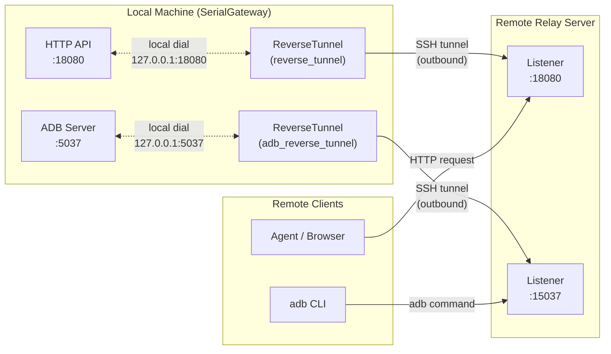
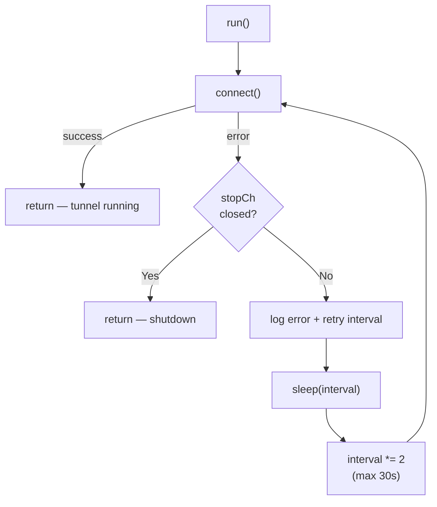
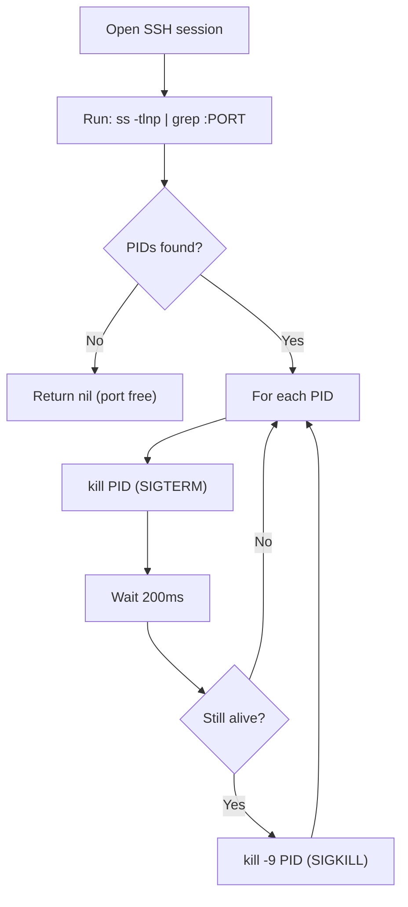
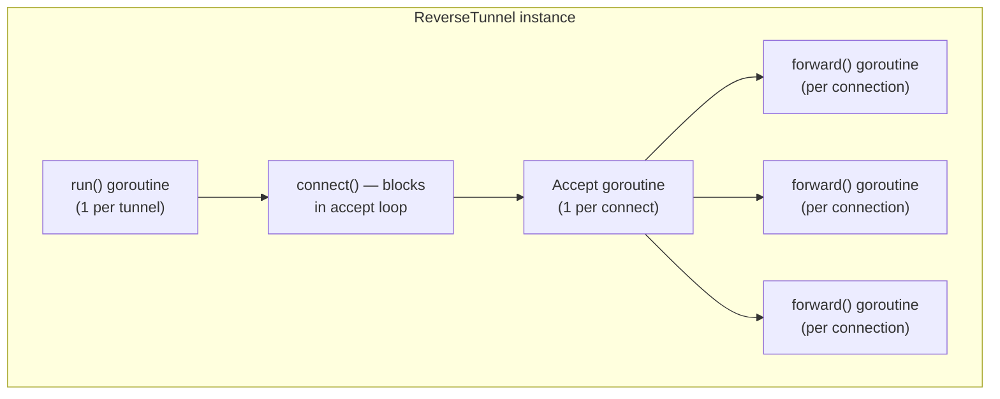

The reverse SSH tunnel is SerialGateway's mechanism for exposing local services — the HTTP API and optionally ADB — to a remote server without requiring inbound firewall rules or VPN configuration. By initiating an outbound SSH connection to a relay server and requesting a remote port listener, the tunnel inverts the traditional client-server topology: the gateway becomes the SSH client, and any connection to the remote port is transparently forwarded back to a local service.

This page provides a deep architectural analysis of the tunnel implementation, its resilience model, configuration semantics, and operational considerations.

## Architectural Overview

The reverse tunnel operates as an independent subsystem within SerialGateway, initialized after the core port mappings (SSH servers and recorders) are running. It is entirely optional — the gateway functions fully without it — and degrades gracefully when the remote server is unreachable.



The system supports **two independent tunnel instances**, each managed by its own `ReverseTunnel` struct: one for the HTTP API (`reverse_tunnel`) and one for ADB forwarding (`adb_reverse_tunnel`). Both share identical code paths but operate on separate goroutines with independent lifecycle management.

Sources: [reverse.go](internal/tunnel/reverse.go#L18-L32), [config.go](internal/config/config.go#L80-L91)

## The ReverseTunnel Struct

The `ReverseTunnel` type encapsulates all state required for a single reverse tunnel:

```go
type ReverseTunnel struct {
    cfg    *config.ReverseTunnelConfig
    logger *slog.Logger
    stopCh chan struct{}
    once   sync.Once
    wg     sync.WaitGroup
}
```

| Field | Type | Purpose |
|-------|------|---------|
| `cfg` | `*config.ReverseTunnelConfig` | Pointer to the shared configuration; contains host, port, credentials, and port mapping |
| `logger` | `*slog.Logger` | Logger tagged with `"component": "tunnel"` for structured output correlation |
| `stopCh` | `chan struct{}` | Broadcast channel closed on `Stop()` to signal all goroutines to exit |
| `once` | `sync.Once` | Guarantees `stopCh` is closed exactly once, preventing double-close panics |
| `wg` | `sync.WaitGroup` | Tracks all active goroutines (the main `run()` loop and per-connection `forward()` goroutines) |

The struct is created via `New()`, which simply initializes the fields without starting any I/O. The actual tunnel lifecycle begins when `Start()` is called.

Sources: [reverse.go](internal/tunnel/reverse.go#L18-L32)

## Lifecycle: Start, Run, Connect, Forward

The tunnel follows a four-stage execution pipeline with clear separation between reconnection logic, SSH session management, and data forwarding.

### Stage 1: Start — Goroutine Launch

`Start()` increments the `WaitGroup` and spawns a single goroutine executing `run()`. This is a non-blocking call — the caller (typically `main()`) proceeds immediately to the next initialization phase.

```go
func (t *ReverseTunnel) Start() {
    t.wg.Add(1)
    go t.run()
}
```

Sources: [reverse.go](internal/tunnel/reverse.go#L34-L37)

### Stage 2: Run — Reconnection Loop with Exponential Backoff

The `run()` method implements a **retry-until-success** loop. It calls `connect()` and, if the connection fails, waits with exponential backoff before retrying. The backoff starts at **1 second** and doubles after each failure, capping at **30 seconds**.



The loop terminates under two conditions: `connect()` returns `nil` (meaning the tunnel is running and will only exit on listener failure), or `stopCh` is closed during the backoff wait. The exponential backoff prevents aggressive reconnection storms when the remote server is temporarily unavailable.

A critical design choice: when `connect()` returns `nil`, `run()` returns as well. This means a successful connection is expected to **block for the tunnel's entire lifetime** within `connect()`. If the connection drops mid-session, `connect()` returns an error, and `run()` re-enters the retry loop.

Sources: [reverse.go](internal/tunnel/reverse.go#L46-L70)

### Stage 3: Connect — SSH Session and Remote Listener

`connect()` is the core method that establishes the SSH connection, clears stale remote ports, and enters the connection-accept loop. It performs the following sequence:

**1. Address resolution and authentication setup**

The target address is constructed from `cfg.Host` and `cfg.Port` using `net.JoinHostPort()`. Authentication methods are assembled in priority order:

| Priority | Method | Condition | Implementation |
|----------|--------|-----------|----------------|
| 1 | Public key | `PrivateKeyFile` is non-empty | `loadPrivateKey()` reads the PEM file and calls `ssh.ParsePrivateKey()` |
| 2 | Password | `Password` is non-empty | `ssh.Password()` auth method |

If neither credential is configured, `connect()` returns an error immediately — there is no fallback to agent-based authentication.

**2. SSH client connection**

The SSH client is configured with a **10-second dial timeout** and `ssh.InsecureIgnoreHostKey()` for the host key callback. The insecure callback is a deliberate trade-off: the relay server's host key may change (e.g., after re-imaging), and the tunnel's purpose is outbound connectivity, not inbound authentication security.

**3. Stale port cleanup**

Before requesting a remote listener, `killRemotePortHolder()` is called to clear any residual process occupying the target remote port. This addresses a common failure mode: if the previous tunnel crashed or was killed without graceful shutdown, the SSH daemon on the relay server may retain the port binding until the stale session times out.

**4. Remote listener establishment**

`client.Listen("tcp", remoteAddr)` requests the remote SSH server to open a TCP listener on `bindAddress:remotePort`. If this fails (typically because the port is still occupied), the tunnel waits 500ms, attempts another `killRemotePortHolder()`, waits another 500ms, and retries once. This two-attempt pattern handles race conditions between the kill command and the OS releasing the port.

**5. Accept loop**

A dedicated goroutine accepts connections from the remote listener and sends them through a buffered channel (`acceptCh`, capacity 8). The main `connect()` goroutine selects on both `acceptCh` and `stopCh`, spawning a `forward()` goroutine for each accepted connection.

Sources: [reverse.go](internal/tunnel/reverse.go#L72-L163)

### Stage 4: Forward — Bidirectional TCP Proxy

Each accepted remote connection is handled by `forward()`, which performs a straightforward TCP proxy:

```go
func (t *ReverseTunnel) forward(remote net.Conn) {
    defer remote.Close()
    localAddr := net.JoinHostPort("127.0.0.1", fmt.Sprintf("%d", t.cfg.LocalPort))
    local, err := net.DialTimeout("tcp", localAddr, 5*time.Second)
    if err != nil {
        t.logger.Error("dial local failed", "addr", localAddr, "error", err)
        return
    }
    defer local.Close()
    done := make(chan struct{}, 2)
    go func() { io.Copy(local, remote); done <- struct{}{} }()
    go func() { io.Copy(remote, local); done <- struct{}{} }()
    <-done
}
```

The forwarding model:

| Direction | Source | Destination | Description |
|-----------|--------|-------------|-------------|
| Remote → Local | `remote` (SSH channel) | `local` (TCP to 127.0.0.1:localPort) | Incoming request data from the relay server |
| Local → Remote | `local` (TCP response) | `remote` (SSH channel) | Response data from the local HTTP API or ADB server |

Two goroutines perform `io.Copy` in opposite directions. The function waits for **one** of them to complete (either direction's EOF or error), then both connections are closed via `defer`. This is the "first-to-finish" pattern: when either side closes its connection, the entire proxy session terminates.

The local dial uses a **5-second timeout** to prevent hanging if the local service is temporarily overloaded. Each `forward()` goroutine is tracked by the `WaitGroup`, ensuring `Stop()` waits for all in-flight connections to drain.

Sources: [reverse.go](internal/tunnel/reverse.go#L221-L243)

## Stale Port Cleanup: killRemotePortHolder

One of the most operationally significant features is `killRemotePortHolder()`. When a reverse tunnel crashes (e.g., the gateway process is killed with `SIGKILL`), the SSH connection to the relay server may remain in a half-open state, and the remote SSH daemon continues to hold the port binding. Without cleanup, the next tunnel instance cannot bind the same remote port.

The cleanup procedure executes remotely via SSH sessions:



The PID discovery command uses `ss -tlnp` with `grep -oP 'pid=\K[0-9]+'` to extract process IDs from the socket statistics output. The `2>/dev/null` suppresses errors from systems where `ss` may not be available or where the user lacks permission to see other processes' socket details.

The two-phase kill strategy — SIGTERM followed by SIGKILL after a 200ms grace period — balances politeness (allowing graceful shutdown) with reliability (ensuring the port is freed). Each kill operation runs in its own SSH session to avoid session reuse issues.

This is a **best-effort** operation: errors are logged as warnings but do not prevent the tunnel from proceeding. If the remote server runs a non-Linux OS or lacks `ss`, the cleanup silently fails and the tunnel relies on the retry logic in `connect()`.

Sources: [reverse.go](internal/tunnel/reverse.go#L165-L218)

## Graceful Shutdown

The `Stop()` method implements coordinated shutdown using the `sync.Once` + `close(stopCh)` pattern:

```go
func (t *ReverseTunnel) Stop() {
    t.once.Do(func() {
        close(t.stopCh)
    })
    t.wg.Wait()
}
```

When `stopCh` is closed, the following cascade occurs:

1. The `connect()` accept loop detects `stopCh` in its `select` statement and returns `nil`.
2. The `run()` goroutine (which called `connect()`) receives the `nil` return and exits.
3. Any in-flight `forward()` goroutines continue until their connections naturally close — there is no forced interruption of active data transfers.
4. `t.wg.Wait()` in `Stop()` blocks until all goroutines have exited, ensuring no leaked resources.

During the startup flow's shutdown phase (Phase 9), reverse tunnels are stopped **before** the PortManager, ensuring that no new tunnel connections arrive while serial services are being torn down.

Sources: [reverse.go](internal/tunnel/reverse.go#L39-L44), [reverse.go](internal/tunnel/reverse.go#L147-L152)

## Configuration Reference

The tunnel is configured via two top-level YAML keys: `reverse_tunnel` and `adb_reverse_tunnel`. Both use the identical `ReverseTunnelConfig` schema.

### Configuration Schema

| Field | Type | Default | Description |
|-------|------|---------|-------------|
| `host` | `string` | `""` (disabled) | Remote SSH server hostname or IP. **Setting this field activates the tunnel.** |
| `port` | `int` | `22` | SSH port on the remote server |
| `user` | `string` | `"root"` | SSH username for authentication |
| `password` | `string` | `""` | Password for SSH password authentication |
| `private_key_file` | `string` | `""` | Path to a private key file (PEM format) for public key authentication |
| `remote_port` | `int` | `18080` (reverse) / `15037` (adb) | Port to listen on the remote server |
| `local_port` | `int` | `gateway.http_port` / `5037` | Local port to forward connections to |
| `bind_address` | `string` | `"0.0.0.0"` | Bind address on the remote server (`0.0.0.0` = all interfaces, `127.0.0.1` = localhost only) |

Sources: [config.go](internal/config/config.go#L52-L61)

### Activation Logic

The tunnel is activated **only** when `host` is non-empty. This is checked in `applyDefaults()` using a zero-value guard:

```go
if cfg.ReverseTunnel.Host != "" {
    // Apply defaults for Port, User, RemotePort, LocalPort, BindAddress
}
```

If `host` is empty, the entire `ReverseTunnelConfig` remains at zero values, and `main()` skips tunnel initialization. This makes the feature purely opt-in with no runtime overhead when unused.

Sources: [config.go](internal/config/config.go#L162-L178), [config.go](internal/config/config.go#L180-L196)

### Default Value Derivation

The defaults for `reverse_tunnel` and `adb_reverse_tunnel` differ in their port mappings:

| Field | `reverse_tunnel` Default | `adb_reverse_tunnel` Default | Rationale |
|-------|--------------------------|------------------------------|-----------|
| `remote_port` | `18080` | `15037` | Mirrors common HTTP and ADB port conventions |
| `local_port` | `cfg.Gateway.HTTPPort` (typically `18080`) | `5037` | HTTP tunnel forwards to the local API; ADB tunnel forwards to the local ADB server |
| `bind_address` | `"0.0.0.0"` | `"0.0.0.0"` | Exposes to all interfaces on the relay server by default |
| `user` | `"root"` | `"root"` | Common default for embedded Linux relay servers |

The `local_port` default for the reverse tunnel is derived from `cfg.Gateway.HTTPPort`, creating an implicit coupling: changing the HTTP port automatically updates the tunnel target unless `local_port` is explicitly set.

Sources: [config.go](internal/config/config.go#L162-L196)

### Example Configuration

```yaml
# Forward local HTTP API to remote server
reverse_tunnel:
  host: "172.25.4.7"
  port: 22
  user: "yicong.wu"
  private_key_file: "C:/Users/yicong.wu/.ssh/id_ed25519"
  remote_port: 18080
  local_port: 18080
  bind_address: "127.0.0.1"

# Forward local ADB server to remote server
adb_reverse_tunnel:
  host: "172.25.4.7"
  port: 22
  user: "yicong.wu"
  private_key_file: "C:/Users/yicong.wu/.ssh/id_ed25519"
  remote_port: 15037
  local_port: 5037
  bind_address: "127.0.0.1"
```

Sources: [serial-gateway.yaml](serial-gateway.yaml#L27-L43)

## Authentication Methods

The tunnel supports two authentication methods that can be used independently or together:

| Method | Configuration | Loading Process |
|--------|---------------|-----------------|
| **Public key** | `private_key_file` | `os.ReadFile()` → `ssh.ParsePrivateKey()` → `ssh.PublicKeys(signer)` |
| **Password** | `password` | `ssh.Password(password)` |

When both are configured, they are appended to the `ssh.Auth` slice in order (public key first, password second). The SSH client library tries each method sequentially until one succeeds. This provides a fallback mechanism: if the key is rejected (e.g., not in `authorized_keys`), the password is tried automatically.

The `loadPrivateKey()` helper reads the PEM file from disk and parses it using the standard `ssh.ParsePrivateKey()` function. It supports all key types that the `golang.org/x/crypto/ssh` library recognizes: RSA, ECDSA, and Ed25519.

Sources: [reverse.go](internal/tunnel/reverse.go#L75-L91), [reverse.go](internal/tunnel/reverse.go#L245-L251)

## Concurrency Model

The tunnel's concurrency architecture uses a hierarchical goroutine tree:



| Goroutine | Count | Lifecycle | WaitGroup Tracking |
|-----------|-------|-----------|-------------------|
| `run()` | 1 per tunnel | Created at `Start()`, exits on `connect()` success or `stopCh` close | `wg.Add(1)` before spawn |
| Accept loop | 1 per `connect()` call | Created inside `connect()`, exits when listener closes | Not tracked (internal to `connect()`) |
| `forward()` | 1 per accepted connection | Created on accept, exits when either `io.Copy` completes | `wg.Add(1)` before spawn |

The `WaitGroup` tracks only the `run()` and `forward()` goroutines. The accept loop goroutine is not explicitly tracked because it is bounded by the listener's lifetime, which is in turn bounded by `connect()`'s execution within `run()`.

The `acceptCh` channel (buffered at 8) provides backpressure: if the main loop is slow to spawn `forward()` goroutines, the accept goroutine blocks, which in turn causes `listener.Accept()` to stop accepting new connections. This is an implicit rate limiter that prevents unbounded goroutine growth under connection floods.

Sources: [reverse.go](internal/tunnel/reverse.go#L130-L162)

## Private Key Loading

The `loadPrivateKey()` function is a minimal wrapper around the standard library:

```go
func loadPrivateKey(path string) (ssh.Signer, error) {
    data, err := os.ReadFile(path)
    if err != nil {
        return nil, fmt.Errorf("read key file: %w", err)
    }
    return ssh.ParsePrivateKey(data)
}
```

The function reads the entire PEM file into memory and delegates parsing to `ssh.ParsePrivateKey()`. It does not support encrypted (passphrase-protected) private keys — the `ssh.ParsePrivateKeyWithPassphrase()` variant is not used. If key encryption is required, the key must be decrypted externally before the gateway starts.

Error wrapping uses `%w` to preserve the error chain, enabling callers to use `errors.Is()` or `errors.As()` for specific error handling.

Sources: [reverse.go](internal/tunnel/reverse.go#L245-L251)

## Operational Considerations

### Security Model

The tunnel uses `ssh.InsecureIgnoreHostKey()` for the host key callback. This means the gateway does not verify the identity of the relay server. For environments where man-in-the-middle attacks are a concern, a `known_hosts`-based callback should be implemented — but this is currently not supported.

The `bind_address` setting controls exposure scope: `"0.0.0.0"` makes the forwarded port accessible from any network interface on the relay server, while `"127.0.0.1"` restricts it to local connections on the relay server itself.

### Failure Modes and Recovery

| Failure Mode | Detection | Recovery |
|-------------|-----------|----------|
| Remote server unreachable | `ssh.Dial()` returns error | Exponential backoff retry (1s → 30s) |
| Authentication failure | `ssh.Dial()` returns auth error | Logged; retries continue (useful if credentials are updated on remote) |
| Remote port occupied | `client.Listen()` returns error | `killRemotePortHolder()` + 500ms wait + single retry |
| Local service down | `net.DialTimeout()` in `forward()` fails | Connection dropped; tunnel continues accepting new connections |
| SSH connection drop | `listener.Accept()` returns error | `connect()` returns error; `run()` re-enters retry loop |
| Process crash (SIGKILL) | N/A | Stale port cleaned on next `connect()` via `killRemotePortHolder()` |

### Relay Server Requirements

The remote SSH server must have `GatewayPorts` enabled (or at least allow the configured `bind_address`) in its `sshd_config` for the listener to bind on non-loopback addresses. The `AllowTcpForwarding` directive must also permit reverse forwarding (default: `yes`).

The `killRemotePortHolder()` function requires `ss` (from `iproute2`) and standard `kill`/`grep` utilities on the relay server. These are available on virtually all modern Linux distributions but may not be present on minimal container images or non-Linux systems.

## Further Reading

- **[System Architecture and Component Overview](9-system-architecture-and-component-overview)** — How the tunnel fits into the broader system topology
- **[Startup Flow: From main.go to Running Services](10-startup-flow-from-main-go-to-running-services)** — Phase 6 details on how tunnels are initialized during startup
- **[Configuration Reference](3-configuration-reference)** — Complete YAML configuration reference including tunnel settings
- **[Structured Logging with Rotation Support](24-structured-logging-with-rotation-support)** — How tunnel events are captured in the logging system