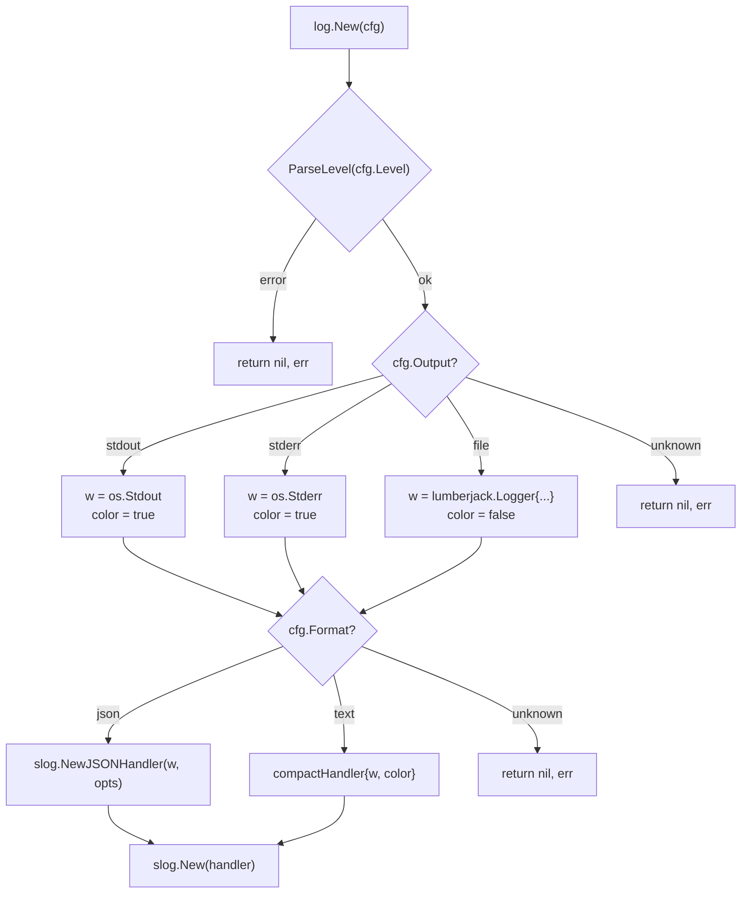
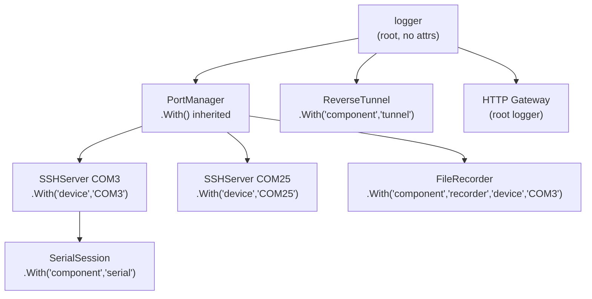
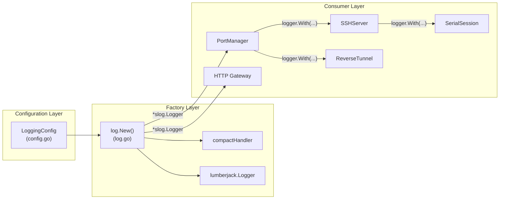

SerialGateway employs Go's standard `log/slog` package as its logging backbone, augmented with a custom compact text handler for terminal readability and the `lumberjack.v2` library for automatic file rotation. The logging subsystem is designed around three orthogonal axes — **level**, **format**, and **output** — each independently configurable through the YAML configuration file. This page documents how the logging infrastructure is assembled at startup, how structured attributes propagate through the component tree, and how file rotation keeps disk usage bounded in long-running deployments.

## Configuration Schema

The logging subsystem is governed by the `LoggingConfig` struct, which maps directly to the `logging` block in `serial-gateway.yaml`. Every field carries a YAML tag and a corresponding JSON tag for API interoperability.

Sources: [config.go](internal/config/config.go#L69-L78)

| Field | YAML Key | Type | Default | Purpose |
|---|---|---|---|---|
| `Level` | `level` | `string` | `"info"` | Minimum severity threshold (`debug`, `info`, `warn`, `error`) |
| `Format` | `format` | `string` | `"text"` | Output encoding: `"text"` (compact custom handler) or `"json"` (standard JSON handler) |
| `Output` | `output` | `string` | `"stdout"` | Destination: `"stdout"`, `"stderr"`, or `"file"` |
| `FilePath` | `file_path` | `string` | `"gateway.log"` | Log file path (only used when `output` is `"file"`) |
| `MaxSizeMB` | `max_size_mb` | `int` | `100` | Maximum size in megabytes before rotation triggers |
| `MaxAgeDays` | `max_age_days` | `int` | `30` | Maximum number of days to retain old log files |
| `MaxBackups` | `max_backups` | `int` | `7` | Maximum number of old log files to retain |
| `Compress` | `compress` | `bool` | `false` (zero value) | Whether to gzip-compress rotated log files |

The defaults are applied in `applyDefaults()` whenever the configuration is loaded — either from a YAML file or when no file exists at all. This guarantees the logger is always functional even with a completely empty configuration.

Sources: [config.go](internal/config/config.go#L198-L218)

A typical production configuration looks like this:

```yaml
logging:
  level: "info"
  format: "text"
  output: "file"
  file_path: "gateway.log"
  max_size_mb: 100
  max_age_days: 30
  max_backups: 7
  compress: true
```

Sources: [serial-gateway.yaml](serial-gateway.yaml#L45-L53)

## Logger Factory and Initialization Flow

The `log.New()` factory function in `internal/log/log.go` is the single entry point for constructing the application-wide `*slog.Logger`. It takes a `*config.LoggingConfig` and makes two independent decisions: **where** log records go (output selection) and **how** they are encoded (format selection).

Sources: [log.go](internal/log/log.go#L157-L200)



The factory is invoked exactly once during startup in `main()`, immediately after configuration loading and before any component is instantiated. The resulting logger is both stored for dependency injection and registered as the global default via `slog.SetDefault()`.

Sources: [main.go](cmd/serial-gateway/main.go#L31-L36)

```go
logger, err := sgwlog.New(&cfg.Logging)
if err != nil {
    fmt.Fprintf(os.Stderr, "failed to initialize logger: %v\n", err)
    os.Exit(1)
}
slog.SetDefault(logger)
```

## Output Destinations and Rotation

The three output modes serve distinct operational scenarios:

| Output | Writer | Color | Typical Use Case |
|---|---|---|---|
| `stdout` | `os.Stdout` | ✅ Enabled | Development, systemd-managed deployments |
| `stderr` | `os.Stderr` | ✅ Enabled | Container environments with stderr collection |
| `file` | `lumberjack.Logger` | ❌ Disabled | Production deployments requiring persistent, rotated logs |

When `output` is set to `"file"`, the writer is a `lumberjack.Logger` instance configured with all four rotation parameters from the `LoggingConfig`. Lumberjack handles the rotation lifecycle transparently: when the active log file exceeds `MaxSizeMB`, it is renamed with a timestamp suffix, a new file is created, and old files beyond `MaxBackups` count or `MaxAgeDays` age are purged. If `Compress` is `true`, rotated files are gzip-compressed asynchronously.

Sources: [log.go](internal/log/log.go#L172-L180)

```go
w = &lumberjack.Logger{
    Filename:   cfg.FilePath,
    MaxSize:    cfg.MaxSizeMB,
    MaxAge:     cfg.MaxAgeDays,
    MaxBackups: cfg.MaxBackups,
    Compress:   cfg.Compress,
    LocalTime:  true,
}
```

The `LocalTime: true` setting ensures that rotated file timestamps and age calculations use the system's local timezone rather than UTC — a practical choice for operators reviewing log archives on Windows systems.

## Compact Text Handler

When `format` is `"text"`, SerialGateway uses a custom `compactHandler` rather than Go's built-in `slog.TextHandler`. This handler produces a denser, more human-readable output optimized for serial gateway operations, with the format:

```
15:04:05.000 INFO  HTTP API listening addr=:18080
```

Sources: [log.go](internal/log/log.go#L70-L155)

The handler implements the full `slog.Handler` interface with four methods:

| Method | Behavior |
|---|---|
| `Enabled()` | Compares record level against the configured threshold |
| `Handle()` | Formats time, level, message, and all attributes into a single-line string |
| `WithAttrs()` | Returns a new handler with pre-attached attributes (supports `logger.With(...)`) |
| `WithGroup()` | Returns a new handler with a dot-separated group prefix for attribute keys |

The `Handle()` method uses a `sync.Mutex` to ensure that concurrent log calls from multiple goroutines (HTTP handlers, serial read loops, SSH servers) produce cleanly interleaved output without partial-line corruption. Each record is assembled in a `strings.Builder` and flushed to the writer as a single `Write()` call.

Sources: [log.go](internal/log/log.go#L83-L124)

### Color Coding

ANSI color codes are applied per-level when the output is a terminal (`stdout` or `stderr`). The `color` field is set to `false` for file output, preventing escape sequences from polluting log files.

Sources: [log.go](internal/log/log.go#L32-L68)

| Level | ANSI Code | Color |
|---|---|---|
| `ERROR` | `\033[31m` | Red |
| `WARN` | `\033[33m` | Yellow |
| `INFO` | `\033[32m` | Green |
| `DEBUG` | `\033[36m` | Cyan |

### Attribute Rendering

Attributes are rendered as `key=value` pairs appended after the message. When a group is active (via `WithGroup`), keys are prefixed with the group name using dot notation (e.g., `serial.baudrate=115200`). Pre-attached attributes from `WithAttrs()` are emitted before the record-level attributes, preserving the scoping hierarchy.

Sources: [log.go](internal/log/log.go#L126-L155)

## Structured Context Propagation

The logger follows a **dependency injection** pattern: it is created once at the top level and passed downward through constructors. Each component narrows the logger's context using `slog.Logger.With()`, which attaches key-value pairs that appear on every subsequent log record from that component and its children.

Sources: [main.go](cmd/serial-gateway/main.go#L31-L66)



This creates a tree of increasingly specific loggers. A log record from the serial session on COM3 would carry attributes from every ancestor: `device=COM3 component=serial`. The pattern is consistent across all components:

| Component | Scoped Attributes | Source Location |
|---|---|---|
| `PortManager` | Inherits root logger | [portmanager.go](internal/core/portmanager.go#L21-L28) |
| `SSHServer` | `device=<name>` | [portmanager.go](internal/core/portmanager.go#L35) |
| `SerialSession` | `component=serial` | [server.go](internal/ssh/server.go#L48) |
| `FileRecorder` | `component=recorder`, `device=<name>` | [portmanager.go](internal/core/portmanager.go#L50-L51) |
| `ReverseTunnel` | `component=tunnel` | [reverse.go](internal/tunnel/reverse.go#L29) |

## Level Parsing and Validation

The `ParseLevel()` function converts configuration strings to `slog.Level` values using case-insensitive matching. Unknown level strings produce a descriptive error that lists all valid options, causing startup to fail fast rather than silently defaulting.

Sources: [log.go](internal/log/log.go#L17-L30)

```go
func ParseLevel(s string) (slog.Level, error) {
    switch strings.ToLower(s) {
    case "debug": return slog.LevelDebug, nil
    case "info":  return slog.LevelInfo, nil
    case "warn":  return slog.LevelWarn, nil
    case "error": return slog.LevelError, nil
    default:
        return slog.LevelInfo, fmt.Errorf(
            "unknown log level: %q (valid: debug, info, warn, error)", s)
    }
}
```

## JSON Format Mode

When `format` is set to `"json"`, the factory delegates to Go's standard `slog.NewJSONHandler`. This produces one JSON object per line, suitable for ingestion by log aggregation systems (ELK, Loki, CloudWatch). The JSON handler uses the same writer infrastructure, so file rotation works identically regardless of format.

Sources: [log.go](internal/log/log.go#L187-L188)

```go
handler = slog.NewJSONHandler(w, &slog.HandlerOptions{Level: level})
```

## Error Handling at Boundaries

The logger factory validates both `output` and `format` values, returning errors with actionable messages for invalid configuration. At the `main()` level, logger initialization failure is treated as fatal — the process writes to `stderr` and exits with code 1, ensuring no component ever operates without a functioning logger.

Sources: [main.go](cmd/serial-gateway/main.go#L31-L35), [log.go](internal/log/log.go#L181-L196)

## Architectural Summary

The logging subsystem follows a clean separation of concerns across three layers:



**Configuration Layer** defines *what* to log and *where*. **Factory Layer** assembles the appropriate handler-writer combination. **Consumer Layer** receives pre-configured loggers and adds component-specific context through `With()` scoping.

Sources: [log.go](internal/log/log.go#L1-L200), [config.go](internal/config/config.go#L69-L78), [main.go](cmd/serial-gateway/main.go#L31-L36)

## Further Reading

- For how the `PortManager` receives and propagates the logger to SSH servers and recorders, see [PortManager: Coordinating SSH Servers and Recorders](17-portmanager-coordinating-ssh-servers-and-recorders).
- For the file recorder's own size-limited logging (distinct from application logging), see [File Recorder: Persistent Serial Logging with Size Limits and Trim](21-file-recorder-persistent-serial-logging-with-size-limits-and-trim).
- For the full configuration reference including all logging fields, see [Configuration Reference](3-configuration-reference).
- For how the startup sequence wires the logger into all components, see [Startup Flow: From main.go to Running Services](10-startup-flow-from-main-go-to-running-services).