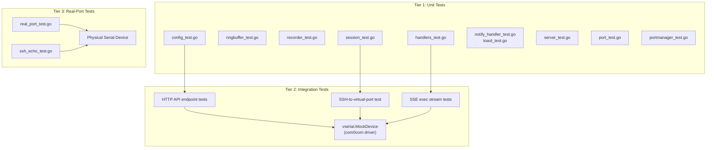
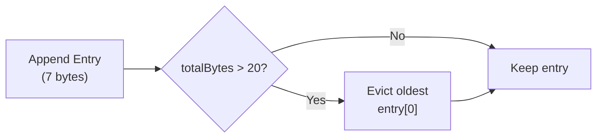
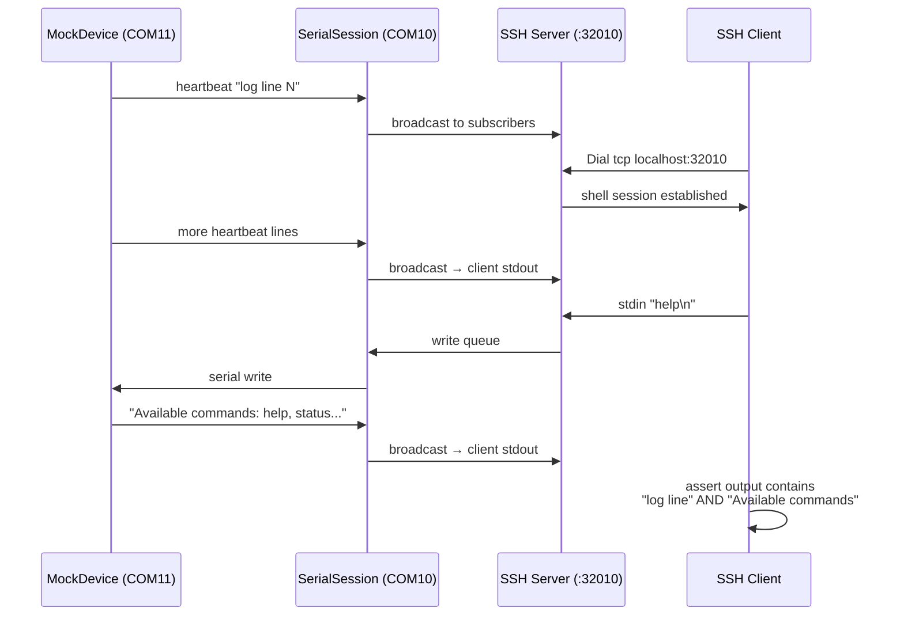

SerialGateway employs a three-tier testing strategy that mirrors its layered architecture. Tests range from isolated unit tests that validate individual components without any hardware dependency, through integration tests that exercise the full HTTP-and-SSH pipeline against virtual serial ports, to real-port tests that verify behavior against physical devices in a live environment. The entire suite uses Go's standard `testing` package exclusively — no third-party assertion libraries or mock frameworks — keeping the test surface minimal and the cognitive overhead low.



This diagram illustrates how unit tests validate components in isolation, integration tests compose those components with a virtual serial device, and real-port tests target physical hardware. Each tier progressively increases in environmental fidelity while reducing in execution speed and portability.

## Test Inventory by Tier

The following table maps every test file to its tier, the package it belongs to, and the primary technique it uses to isolate or simulate its dependencies.

| File | Tier | Package | Key Technique |
|------|------|---------|---------------|
| [config_test.go](internal/config/config_test.go) | Unit | `config` | Temp-file YAML loading |
| [portmanager_test.go](internal/core/portmanager_test.go) | Unit | `core` | Direct constructor with defaults |
| [handlers_test.go](internal/http/handlers_test.go) | Unit | `http` | `httptest.NewRequest` + `NewRecorder` |
| [notify_handler_test.go](internal/http/notify_handler_test.go) | Unit | `http` | Function-variable mock of `notify.Show` |
| [toast_test.go](internal/notify/toast_test.go) | Unit + Env-gated | `notify` | XML/encoding assertions; `RUN_TOAST_TEST` env gate |
| [recorder_test.go](internal/recorder/recorder_test.go) | Unit | `recorder` | Temp-dir file I/O; silent logger |
| [ringbuffer_test.go](internal/serial/ringbuffer_test.go) | Unit | `serial` | Pure in-memory data structure |
| [session_test.go](internal/serial/session_test.go) | Unit | `serial` | Fake device name; subscriber/buffer checks |
| [port_test.go](internal/serial/port_test.go) | Unit | `serial` | Enumerates real ports; struct field check |
| [server_test.go](internal/ssh/server_test.go) | Unit | `ssh` | Port mapping calculation; constructor |
| [integration_test.go](tests/integration_test.go) | Integration | `tests` | `vserial.MockDevice` + full gateway startup |
| [real_port_test.go](tests/real_port_test.go) | Real-port | `tests` | `SG_TEST_PORT` env gate; `t.Skipf` fallback |
| [ssh_echo_test.go](tests/ssh_echo_test.go) | Real-port | `tests` | Requires running gateway; `t.Skipf` fallback |
| [driver_test.go](tests/vserial/driver_test.go) | Integration | `vserial` | com0com virtual port pair; `t.Skipf` fallback |

Sources: [config_test.go](internal/config/config_test.go#L1-L69), [portmanager_test.go](internal/core/portmanager_test.go#L1-L40), [handlers_test.go](internal/http/handlers_test.go#L1-L78), [notify_handler_test.go](internal/http/notify_handler_test.go#L1-L222), [toast_test.go](internal/notify/toast_test.go#L1-L217), [recorder_test.go](internal/recorder/recorder_test.go#L1-L155), [ringbuffer_test.go](internal/serial/ringbuffer_test.go#L1-L65), [session_test.go](internal/serial/session_test.go#L1-L61), [port_test.go](internal/serial/port_test.go#L1-L27), [server_test.go](internal/ssh/server_test.go#L1-L33), [integration_test.go](tests/integration_test.go#L1-L294), [real_port_test.go](tests/real_port_test.go#L1-L84), [ssh_echo_test.go](tests/ssh_echo_test.go#L1-L65), [driver_test.go](tests/vserial/driver_test.go#L1-L48)

## Unit Tests: In-Process Component Verification

Unit tests live alongside their source files inside each `internal/` package. They exercise individual components in complete isolation from the operating system's serial hardware and from any running gateway process. The shared pattern across all unit tests is the construction of a minimal `config.Config` with `config.ApplyDefaults()`, providing sensible defaults (baudrate 115200, HTTP port 8080, SSH base port 2200, ring buffer 100000 lines) without requiring an actual YAML file on disk.

Sources: [config.go](internal/config/config.go#L1-L60), [config_test.go](internal/config/config_test.go#L9-L29)

### Configuration Loading

The `config` package tests validate two distinct paths: loading defaults when the YAML file does not exist, and parsing a hand-crafted YAML document written to a temporary file. `TestLoadDefaults` calls `Load("nonexistent.yaml")` and asserts that every default field matches the expected value — HTTP port 8080, baudrate 115200, SSH base port 2200, ring buffer 100000 lines, and reconnect max interval 30 seconds. `TestLoadFromFile` creates a temp file with overridden values (port 9000, baudrate 9600, password `"testpw"`, max lines 100), calls `Load()`, and verifies each override took effect. The temporary file is cleaned up via `defer os.Remove()`.

Sources: [config_test.go](internal/config/config_test.go#L9-L69)

### Ring Buffer

The ring buffer tests validate the core in-memory data structure that backs serial history retrieval. Four test functions cover the essential behaviors: `TestRingBufferAppendAndTail` fills a 100-entry buffer with 50 items and asserts that `Tail(10)` returns the correct sequence numbers (41–50). `TestRingBufferOverflow` writes 10 items into a capacity-5 buffer and confirms that the oldest 5 are evicted, leaving sequences 6–10. `TestRingBufferAllEntries` validates the `All()` accessor returns a complete copy. `TestRingBufferByteLimit` tests the dual-constraint eviction logic: with a 20-byte limit and 7-byte entries, at most 3 entries survive because the byte budget is exhausted before the line-count budget.



This flowchart shows the eviction logic tested by `TestRingBufferByteLimit`: each append increments `totalBytes`, and when the byte budget is exceeded, the oldest entry is removed from the front of the slice.

Sources: [ringbuffer_test.go](internal/serial/ringbuffer_test.go#L1-L65), [ringbuffer.go](internal/serial/ringbuffer.go#L31-L41)

### File Recorder

Recorder tests operate against the filesystem using temporary directories under `os.TempDir()`, cleaned up with `defer os.RemoveAll()`. A `discardLogger()` helper suppresses log output during testing. `TestNewFileRecorder_CreatesDirAndFile` verifies that the constructor creates both the output directory and the per-device file. `TestFileRecorder_Write` sends two writes through the async channel and verifies the concatenated content after `Stop()`. `TestFileRecorder_Append` proves that two sequential recorder instances on the same device append to the same file rather than overwriting it. `TestFileRecorder_NonBlockingWrite` fires 500 writes rapidly into a 256-slot channel buffer to verify no deadlock occurs under backpressure. `TestFileRecorder_Trim` manually sets `maxSize=1024` and `trimSize=512`, writes 1100 bytes, and asserts the final file size stays between 400 and 1024 bytes after trimming.

Sources: [recorder_test.go](internal/recorder/recorder_test.go#L1-L155), [recorder.go](internal/recorder/recorder.go#L1-L60)

### HTTP Handler Tests

HTTP handler unit tests use Go's `httptest` package to simulate requests without binding to a real network port. Each test constructs a `Gateway` via `NewGatewayWithManager()` with a `PortManager` initialized from default config, then calls `gw.Handler()` to obtain the `http.Handler` mux. `TestGetPorts` sends `GET /api/ports` and asserts a 200 status with a `"ports"` key in the JSON response. `TestGetMappings` and `TestGetConfig` follow the same pattern for their respective endpoints. These tests validate routing, JSON serialization, and status codes — but they never start a real HTTP server or open any serial port.

Sources: [handlers_test.go](internal/http/handlers_test.go#L1-L78), [server.go](internal/http/server.go#L18-L34)

### Notify Handler: Function-Variable Mocking

The notify handler tests demonstrate the project's sole dependency-mocking technique: replacing the `notify.Show` function variable at runtime. The production code declares `var Show = showImpl` in the `notify` package, and the handler calls `notify.Show(title, content, duration)`. Tests save the original with `origShow := notify.Show`, replace it with a mock closure, and restore it via `defer`. This pattern enables seven distinct test scenarios without any mock framework:

| Test Case | Mock Behavior | Expected Status |
|-----------|--------------|-----------------|
| `TestHandleNotify_Valid` | Returns `nil` | 200 `"dispatched"` |
| `TestHandleNotify_MissingTitle` | Returns error for empty title | 400 |
| `TestHandleNotify_MissingContent` | Returns error for empty content | 400 |
| `TestHandleNotify_EmptyFields` | Table-driven: both empty, title empty, content empty | 400 each |
| `TestHandleNotify_InvalidJSON` | `t.Fatal` if called (shouldn't be) | 400 |
| `TestHandleNotify_WrongMethod` | `t.Fatal` if called (shouldn't be) | 405 |
| `TestHandleNotify_ShowFails` | Returns error simulating toast failure | 500 |

The `TestHandleNotify_EmptyFields` test is notable for using Go's table-driven subtest pattern with `t.Run()`, executing three body variations in a loop to cover the empty-string edge cases efficiently.

Sources: [notify_handler_test.go](internal/http/notify_handler_test.go#L1-L222), [toast.go](internal/notify/toast.go#L22-L24), [notify_handler.go](internal/http/notify_handler.go#L16-L50)

### Toast XML and Encoding

The `toast_test.go` file contains the most rigorous unit testing in the project, organized as sequentially numbered test cases (TC01–TC07b) that verify the fix for a Chinese character garbling bug (BUG-001). TC01–TC04 and TC07/TC07b run unconditionally and validate pure functions: XML generation produces only ASCII with numeric character references (`&#xxxxx;`), English text passes through verbatim, UTF-16LE base64 encoding roundtrips correctly for mixed content, and the full XML-to-base64 pipeline preserves references. TC05 and TC06 are gated behind the `RUN_TOAST_TEST` environment variable because they invoke PowerShell and require a Windows desktop session — they use `t.Skip()` to gracefully bypass in CI or headless environments.

Sources: [toast_test.go](internal/notify/toast_test.go#L1-L217)

### Serial Session

Session tests validate the `SerialSession` struct's internal wiring without opening a real serial port. Using a fake device name `"COM_TEST"` or `"COM_FAKE"`, `TestSessionOpenClose` confirms that `Open()` returns an error (no real port) and that the device name accessor works. `TestSessionWriteQueue` asserts the write channel is properly initialized. `TestSessionBroadcastSubscriber` confirms the pub/sub channel map is functional. `TestRingBufferIntegration` bridges the session with its embedded ring buffer, appending an entry and verifying retrieval — this is the only session test that crosses a component boundary, making it a micro-integration within the unit tier.

Sources: [session_test.go](internal/serial/session_test.go#L1-L61), [session.go](internal/serial/session.go#L24-L60)

### SSH Server

SSH server unit tests are narrowly scoped to port mapping arithmetic and constructor validation. `TestSSHPortMapping` verifies that `PortMapping("COM3", cfg)` returns 2203 and `PortMapping("COM8", cfg)` returns 2208, confirming the base-port-plus-N extraction logic. `TestNewSSHServer` constructs a server and asserts the assigned port matches the expected mapping. No actual SSH listener is started during these tests.

Sources: [server_test.go](internal/ssh/server_test.go#L1-L33)

## Integration Tests: Full Pipeline with Virtual Serial Devices

Integration tests live in the `tests/` directory under the `tests` package, deliberately separated from unit tests to allow independent execution via `go test ./tests/...`. These tests boot a real `PortManager`, start a real HTTP server on a dedicated port, and communicate with the gateway through actual TCP connections — but they substitute physical serial hardware with a `vserial.MockDevice` backed by the com0com virtual serial port driver.

Sources: [integration_test.go](tests/integration_test.go#L1-L294)

### Test Harness: `setupGateway()`

Every integration test begins with a call to the `setupGateway()` helper, which constructs a `Config` with `COM10` at 115200 baud, applies defaults, overrides the HTTP port and SSH base port to avoid conflicts with other tests, creates a `PortManager`, calls `AutoStart()`, and returns both the manager and a new `Gateway`. The caller launches `gw.StartHTTP()` in a goroutine and defers `pm.Shutdown()` for cleanup. Each test receives unique port numbers (e.g., HTTP 18080–18085, SSH base 32000) to prevent port collisions when tests run in sequence.

Sources: [integration_test.go](tests/integration_test.go#L23-L38)

### HTTP API Endpoint Tests

`TestHTTPAPIPortsEndpoint` starts the gateway on port 18080, waits 500ms for the server to bind, then issues a real `http.Get("http://localhost:18080/api/ports")` request. It verifies the 200 status code and the presence of the `"ports"` key in the decoded JSON. `TestHTTPHistoryTailEndpoint` goes further: it creates a `MockDevice` on `COM11` (the com0com partner of `COM10`), starts continuous heartbeat output at 100ms intervals, waits 2 seconds for data to accumulate in the ring buffer, then queries `GET /api/mappings/COM10/tail?lines=10` and asserts the response contains an `"items"` key. `TestHTTPExecMissingCmd` validates that calling the exec endpoint without a `cmd` parameter returns a 400 error with a JSON error message.

Sources: [integration_test.go](tests/integration_test.go#L40-L60), [integration_test.go](tests/integration_test.go#L127-L156), [integration_test.go](tests/integration_test.go#L271-L294)

### SSH-to-Virtual-Port Test

`TestSSHConnectionToVirtualPort` is the most comprehensive integration test. It creates a `MockDevice` on `COM11`, starts both continuous output (200ms heartbeat) and a command responder, boots the gateway, then connects an SSH client to `localhost:32010` (base 32000 + COM10 → port offset 10). The test opens a shell session, waits for heartbeat data, sends `"help\n"` via stdin, and asserts that the combined stdout contains both `"log line"` (from heartbeat) and `"Available commands"` (from the command responder). This single test validates the entire data path: virtual serial I/O → serial session read loop → broadcast subscriber → SSH session bridging → SSH client output.



This sequence diagram shows the complete data flow exercised by `TestSSHConnectionToVirtualPort`: the mock device generates heartbeat output and responds to commands, while the SSH client verifies bidirectional communication through the entire gateway stack.

Sources: [integration_test.go](tests/integration_test.go#L62-L125), [driver.go](tests/vserial/driver.go#L40-L107)

### SSE Exec Stream Tests

`TestHTTPExecEndpoint` validates the Server-Sent Events (SSE) streaming behavior of the `/exec` endpoint. It creates a mock device with a command responder, sends `GET /api/mappings/COM10/exec?cmd=help`, and reads the SSE stream line by line using a `bufio.Scanner`. It verifies the `Content-Type` header is `text/event-stream`, collects `data:` prefixed lines, and asserts that an `event: done` signal is received with `"Available commands"` in the accumulated output. `TestHTTPExecSilenceTimeout` configures a 1-second `ExecSilenceTimeout`, sends the same exec request, and verifies that the stream terminates with `done reason: "silence"` within 6 seconds — testing the timeout-based stream closure mechanism.

Sources: [integration_test.go](tests/integration_test.go#L158-L269)

## Real-Port Tests: Physical Hardware Validation

Real-port tests target physical serial devices connected to the host machine. They require a running gateway process and actual hardware, making them unsuitable for automated CI pipelines. Both tests implement graceful degradation: if the gateway is not running or the port is unavailable, they call `t.Skipf()` with an informative message rather than failing.

Sources: [real_port_test.go](tests/real_port_test.go#L1-L84), [ssh_echo_test.go](tests/ssh_echo_test.go#L1-L65)

### Environment Variable Gating

Real-port tests use environment variables to discover the target device and SSH port, with sensible defaults that match the project's standard configuration:

| Variable | Default | Purpose |
|----------|---------|---------|
| `SG_TEST_PORT` | `COM3` | Physical serial device name |
| `SG_TEST_SSH_PORT` | `2203` | SSH port mapped to the device |

This approach allows developers to point tests at any device without modifying test code. If the SSH connection fails (gateway not running), both tests call `t.Skipf("Gateway not running: %v", err)` — the test is reported as skipped, not failed.

Sources: [real_port_test.go](tests/real_port_test.go#L14-L38), [ssh_echo_test.go](tests/ssh_echo_test.go#L11-L24)

### `TestRealPortSSHConnection`

This test connects to a running gateway via SSH, opens an interactive shell session, sends a newline to provoke device output, then sends `"echo hello_serial_gateway\n"` and waits 1 second. It examines the accumulated stdout: if the echo string appears, it logs `"SUCCESS: Echo command received"`; if any new output appeared, it logs that the device responded; if nothing changed, it logs that the connection works but the device is idle. This lenient assertion strategy accommodates the unpredictable nature of physical devices while still validating the end-to-end SSH-to-serial path.

Sources: [real_port_test.go](tests/real_port_test.go#L14-L84)

### `TestSSHEchoImmediate`

This test specifically validates character-level echo behavior — a critical requirement for interactive terminal sessions. After connecting and resetting the stdout buffer, it sends individual characters (`'l'`, `'s'`, `'\n'`) with 200ms delays between each. It then checks that the output buffer is non-empty, confirming that the gateway echoes characters back to the SSH client as they are typed rather than buffering until newline. This test catches regressions in the SSH handler's character-at-a-time forwarding logic.

Sources: [ssh_echo_test.go](tests/ssh_echo_test.go#L11-L65)

## Virtual Serial Mock: `vserial.MockDevice`

The `vserial` package provides the hardware simulation layer that makes integration tests possible without physical devices. It depends on the com0com Windows driver, which creates pairs of virtual COM ports (e.g., COM10↔COM11) that are cross-connected: data written to one port appears as input on the other.

Sources: [driver.go](tests/vserial/driver.go#L1-L128)

### MockDevice Architecture

```mermaid
classDiagram
    class MockDevice {
        -port serial.Port
        -deviceName string
        -outputLog []string
        -writeLog []string
        -stopCh chan struct{}
        +NewMockDevice(portName string) MockDevice
        +StartContinuousOutput(interval Duration)
        +StartCommandResponder()
        +Close()
        +Write(data []byte) int, error
        +OutputLog() []string
        +WriteLog() []string
        -handleCommand(cmd string) string
    }
```

The `MockDevice` struct wraps a `go.bug.st/serial` port handle and provides three behavioral modes. `StartContinuousOutput(interval)` launches a goroutine that writes timestamped heartbeat lines at the specified interval until `stopCh` is closed. `StartCommandResponder()` runs a blocking read loop that parses newline-delimited commands and dispatches them to `handleCommand()`, which supports four commands: `help` returns the command list, `status` returns device info, `reboot` returns a rebooting message, and `echo <msg>` returns the message verbatim. Both modes log their activity to mutex-protected slices accessible via `OutputLog()` and `WriteLog()`.

Sources: [driver.go](tests/vserial/driver.go#L14-L128)

### MockDevice Self-Tests

The `driver_test.go` file validates the mock device itself. `TestMockDeviceCreation` opens `COM11`, starts 100ms heartbeat output, and asserts at least 3 log lines after 500ms. `TestMockDeviceCommandResponse` opens both sides of a port pair (`COM20`↔`COM21`), sends `"help\n"` from one side, and verifies the command responder on the other side received it. Both tests gracefully skip if the required com0com port pairs are not installed.

Sources: [driver_test.go](tests/vserial/driver_test.go#L1-L48)

## Testing Patterns and Conventions

### Dependency Isolation Without Frameworks

The project avoids all third-party testing dependencies. Instead, it uses three built-in Go techniques:

| Technique | Where Used | How It Works |
|-----------|-----------|--------------|
| `httptest` package | `handlers_test.go`, `notify_handler_test.go` | Creates in-process HTTP request/response recorders |
| Function-variable injection | `notify_handler_test.go` | Replaces `notify.Show` with mock closure at runtime |
| Environment-variable gating | `toast_test.go`, `real_port_test.go`, `ssh_echo_test.go` | `t.Skip()` when required env vars or hardware are absent |

Sources: [notify_handler_test.go](internal/http/notify_handler_test.go#L16-L47), [toast_test.go](internal/notify/toast_test.go#L109-L113), [real_port_test.go](tests/real_port_test.go#L14-L22)

### Graceful Degradation Strategy

The test suite is designed so that `go test ./...` succeeds on any developer machine regardless of installed hardware. Every test that requires external resources follows the same pattern: attempt to acquire the resource, and if it fails, call `t.Skipf()` with a message explaining what is missing. This produces three possible outcomes for environment-dependent tests:

1. **Pass** — resource is available and the assertion succeeds.
2. **Fail** — resource is available but the assertion fails (a genuine bug).
3. **Skip** — resource is unavailable (reported as `SKIP`, not `FAIL`).

This means CI pipelines running on Linux or headless Windows will skip toast and real-port tests automatically, while a developer workstation with com0com and physical devices will run the full suite.

Sources: [real_port_test.go](tests/real_port_test.go#L36-L39), [ssh_echo_test.go](tests/ssh_echo_test.go#L22-L24), [toast_test.go](internal/notify/toast_test.go#L110-L113), [driver_test.go](tests/vserial/driver_test.go#L11-L13)

### Table-Driven Subtests

The `TestHandleNotify_EmptyFields` test uses Go's idiomatic table-driven pattern with `t.Run()` to execute multiple variations of the same test logic. A slice of anonymous structs defines each case's name and request body, and the test loop runs each as an independent subtest. This pattern reduces code duplication while providing clear per-case failure reporting in the test output.

Sources: [notify_handler_test.go](internal/http/notify_handler_test.go#L108-L143)

## Running the Test Suite

The following commands target different tiers of the test suite. Because integration and real-port tests depend on port availability and hardware, they are designed to skip gracefully rather than block the overall run.

| Command | Scope | Requirements |
|---------|-------|-------------|
| `go test ./internal/...` | All unit tests | None |
| `go test ./tests/...` | Integration + real-port | com0com for integration; gateway + hardware for real-port |
| `go test -run TestTC05 ./internal/notify/` | Toast PowerShell test | `RUN_TOAST_TEST=1` + Windows desktop |
| `SG_TEST_PORT=COM5 SG_TEST_SSH_PORT=2205 go test -run TestRealPort ./tests/` | Real-port test | Running gateway + physical COM5 |

## Next Steps

For deeper understanding of the testing infrastructure's components, continue to:

- [Virtual Serial Device Mock (com0com) for Integration Testing](26-virtual-serial-device-mock-com0com-for-integration-testing) — detailed guide to setting up and using the com0com driver for integration tests.

For context on the components being tested:

- [Read Broadcasting and Write Queue Concurrency Model](13-read-broadcasting-and-write-queue-concurrency-model) — the pub/sub pattern validated by session and integration tests.
- [Ring Buffer: In-Memory History Storage and Retrieval](15-ring-buffer-in-memory-history-storage-and-retrieval) — the data structure whose overflow and byte-limit behavior the ring buffer tests exercise.
- [Server-Sent Events (SSE) Streaming for Command Execution](19-server-sent-events-sse-streaming-for-command-execution) — the SSE protocol validated by the exec integration tests.