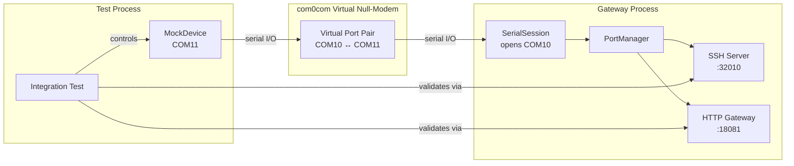
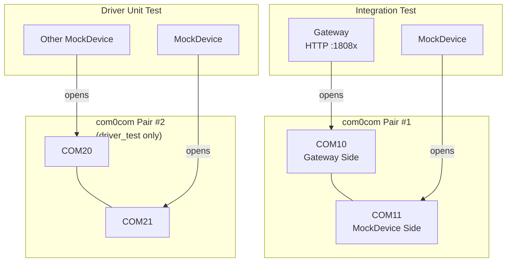
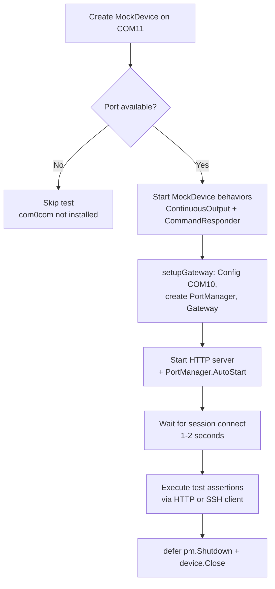

SerialGateway's integration test suite relies on a software-defined serial device simulator rather than physical hardware. This approach is enabled by **com0com**, a Windows kernel-mode driver that creates virtual COM port pairs connected by a null-modem link. The gateway opens one end of the pair; a `MockDevice` opens the other end, producing deterministic output that exercises the full stack — from serial I/O through SSH bridging and HTTP REST endpoints — without requiring any physical serial hardware.

This page documents the `MockDevice` abstraction, its two behavioral modes, the port-pair topology, and how integration tests orchestrate the entire gateway lifecycle.

## Why com0com: The Hardware-Free Test Strategy

Testing serial communication software traditionally requires physical devices, manual wiring, and careful timing coordination. SerialGateway eliminates this dependency by inserting a virtual serial loopback between the gateway's `SerialSession` and a software mock. The com0com driver creates pairs of virtual COM ports (e.g., `COM10` ↔ `COM11`) that behave identically to a real null-modem cable connection — data written to one port emerges on the other, with full support for baud rate configuration, parity, and flow control.

The key architectural decision is that the **gateway side** and the **test side** each own one port of the pair. The gateway opens `COM10` via its normal `serial.Open()` call path, while the test opens `COM11` through `MockDevice`. From the gateway's perspective, it cannot distinguish between a real embedded device and the mock — both are opaque byte streams on a serial port.



Sources: [driver.go](tests/vserial/driver.go#L1-L38), [integration_test.go](tests/integration_test.go#L23-L38)

## MockDevice Architecture

### Core Struct and Lifecycle

The `MockDevice` struct encapsulates a serial port handle, a device name, and two append-only logs protected by a mutex. It communicates with the com0com virtual port by opening one end of the pair using the standard `go.bug.st/serial` library — the same library the gateway itself uses.

| Field | Type | Purpose |
|-------|------|---------|
| `port` | `serial.Port` | Open handle to the com0com virtual port (e.g., COM11) |
| `deviceName` | `string` | Identifier used in log output and test assertions |
| `outputLog` | `[]string` | Records all lines produced by `StartContinuousOutput` |
| `writeLog` | `[]string` | Records all commands received by `StartCommandResponder` |
| `stopCh` | `chan struct{}` | Signals both goroutines to terminate on `Close()` |

The constructor `NewMockDevice(portName)` opens the specified port at **115200 baud** (matching the gateway's default) and returns a ready-to-use device. If the port cannot be opened — typically because com0com is not installed or the port pair does not exist — the function returns an error, which tests use to **gracefully skip** rather than fail.

Sources: [driver.go](tests/vserial/driver.go#L14-L38)

### Behavioral Mode 1: Continuous Heartbeat Output

`StartContinuousOutput(interval)` launches a background goroutine that emits timestamped log lines at a configurable interval. Each line follows the format:

```
[device-COM11] log line 0 — heartbeat at 2024-01-15T10:30:00Z
```

This mode simulates devices that continuously produce output — such as embedded systems printing sensor readings or boot logs. Integration tests use this to verify that the gateway's `SerialSession` correctly reads, buffers in the ring buffer, and broadcasts to SSH subscribers.

The goroutine runs a `time.Ticker` loop with a `select` against `stopCh`, ensuring clean shutdown when `Close()` is called. Every emitted line is appended to `outputLog` under mutex protection, allowing tests to assert on the exact number and content of produced lines.

Sources: [driver.go](tests/vserial/driver.go#L40-L59)

### Behavioral Mode 2: Command-Response Protocol

`StartCommandResponder()` runs a blocking read loop that parses newline-delimited commands from the serial port and dispatches them through `handleCommand()`. The supported command set is intentionally minimal:

| Command | Response |
|---------|----------|
| `help` | `Available commands: help, status, reboot, echo <msg>` |
| `status` | `device <name> running, uptime <RFC3339>` |
| `reboot` | `rebooting...` |
| `echo <msg>` | `<msg>` (echoes the argument) |
| *(anything else)* | `unknown command: <input>` |

The read loop accumulates bytes in a `lineBuf`, splits on `\n`, strips trailing `\r`, and records each received command in `writeLog` before generating a response. This design tests the full write path: test client → HTTP/SSH → gateway write queue → serial port → MockDevice → response → serial port → gateway read loop → SSH/HTTP output.

Sources: [driver.go](tests/vserial/driver.go#L61-L107)

## Port Pair Topology for Integration Tests

Integration tests use a fixed port numbering convention that aligns with the gateway's SSH port mapping formula (`base_port + COM_number`). The standard topology is:

| Component | COM Port | SSH Port (base 32000) | Role |
|-----------|----------|----------------------|------|
| Gateway `SerialSession` | COM10 | 32010 | Opens the "device-facing" port |
| `MockDevice` | COM11 | — | Opens the paired port as simulator |

The `setupGateway` helper function constructs a `Config` with `COM10` as the sole port entry and applies defaults. Each integration test then assigns a **unique HTTP port** (18080–18085) to avoid conflicts when tests share a machine, while the SSH base port remains 32000 across tests.



The second pair (COM20/COM21) is used exclusively in `driver_test.go` for isolated unit testing of the `MockDevice` itself, where one `MockDevice` acts as the command sender and another acts as the responder.

Sources: [integration_test.go](tests/integration_test.go#L23-L38), [driver_test.go](tests/vserial/driver_test.go#L24-L48)

## Integration Test Orchestration

The integration test suite in `tests/integration_test.go` validates the complete gateway pipeline. Each test follows a consistent orchestration pattern:



### Test Matrix

| Test Function | Validated Path | MockDevice Mode | Key Assertion |
|--------------|---------------|-----------------|---------------|
| `TestHTTPAPIPortsEndpoint` | HTTP GET `/api/ports` | None (COM10 only) | Response contains `ports` key |
| `TestSSHConnectionToVirtualPort` | SSH shell → serial → response | Both modes | Output contains `log line` + `Available commands` |
| `TestHTTPHistoryTailEndpoint` | HTTP GET `/tail` after data flows | ContinuousOutput | Ring buffer contains items |
| `TestHTTPExecEndpoint` | HTTP GET `/exec?cmd=help` → SSE | CommandResponder | SSE stream contains `Available commands` + `event: done` |
| `TestHTTPExecSilenceTimeout` | SSE stream silence detection | CommandResponder | Done reason is `silence`, finishes within timeout |
| `TestHTTPExecMissingCmd` | HTTP GET `/exec` without `cmd` | None | Returns 400 with error message |

The SSH integration test (`TestSSHConnectionToVirtualPort`) is the most comprehensive: it establishes an SSH connection to port 32010, opens a shell session, waits for heartbeat output to accumulate, sends `help\n` via stdin, and then verifies that the stdout buffer contains both the continuous heartbeat lines and the command response. This single test exercises serial read broadcasting, write queue dispatch, SSH session bridging, and the ring buffer simultaneously.

Sources: [integration_test.go](tests/integration_test.go#L40-L294)

## Graceful Degradation: The Skip Pattern

Every test that depends on com0com virtual ports follows a defensive skip pattern. When `NewMockDevice("COM11")` returns an error, the test calls `t.Skipf()` with the underlying error message rather than `t.Fatalf()`. This design choice means:

- **CI without com0com**: All virtual-port tests are skipped, but the suite passes
- **Developer workstation with com0com**: Full integration tests execute
- **Physical hardware available**: `real_port_test.go` and `ssh_echo_test.go` can be run against real devices with a running gateway

The skip pattern appears consistently across both integration tests and driver unit tests:

```go
device, err := vserial.NewMockDevice("COM11")
if err != nil {
    t.Skipf("COM11 not available (com0com not installed): %v", err)
}
defer device.Close()
```

This contrasts with `real_port_test.go`, which skips when the **gateway** is not running (rather than when com0com is absent), since it connects to a pre-existing gateway instance via SSH.

Sources: [integration_test.go](tests/integration_test.go#L62-L66), [driver_test.go](tests/vserial/driver_test.go#L9-L13), [real_port_test.go](tests/real_port_test.go#L36-L39)

## com0com Setup and Port Pair Creation

The com0com driver must be installed and configured before running integration tests. The setup process involves:

1. **Install com0com** from [https://com0com.sourceforge.net/](https://com0com.sourceforge.net/) and run the setup utility
2. **Create port pairs** using the com0com Setup Command Prompt (Administrator):

```powershell
# Create pair: COM10 <-> COM11 (for integration tests)
setupc g PortName=COM10 PortName=COM11

# Create pair: COM20 <-> COM21 (for driver unit tests)
setupc g PortName=COM20 PortName=COM21
```

3. **Verify the pairs** are visible in Windows Device Manager under "Ports (COM & LPT)" — they should appear as "com0com Serial Port Enumerator" entries
4. **Run the tests**:

```powershell
go test -v -timeout 60s ./tests/...
```

The default baud rate of **115200** is hardcoded in both `NewMockDevice` and the gateway's `ApplyDefaults`, so no baud rate configuration is needed in com0com's port pair setup — com0com virtual ports accept any baud rate transparently.

Sources: [driver.go](tests/vserial/driver.go#L25-L27), [config.go](internal/config/config.go#L118-L120)

## Relationship to Other Test Tiers

The com0com-based integration tests occupy the middle tier of SerialGateway's three-layer testing strategy:

| Tier | Files | Dependency | What It Validates |
|------|-------|-----------|-------------------|
| **Unit Tests** | `internal/**/*_test.go` | None | Individual components (ring buffer, config parsing, toast notifications) |
| **Integration Tests** | `tests/integration_test.go`, `tests/vserial/` | com0com installed | Full gateway pipeline with virtual serial loopback |
| **Real-Port Tests** | `tests/real_port_test.go`, `tests/ssh_echo_test.go` | Running gateway + physical device | End-to-end with actual hardware |

The `vserial` package bridges the unit and integration tiers: its `driver_test.go` tests the `MockDevice` in isolation (using COM20/COM21), while `integration_test.go` uses `MockDevice` as a test fixture to drive the gateway end-to-end.

Sources: [driver_test.go](tests/vserial/driver_test.go#L1-L48), [integration_test.go](tests/integration_test.go#L1-L294), [real_port_test.go](tests/real_port_test.go#L1-L84)

## Further Reading

- [Testing Strategy: Unit, Integration, and Real-Port Tests](25-testing-strategy-unit-integration-and-real-port-tests) — the overarching testing philosophy and coverage boundaries
- [SerialSession Lifecycle: Open, Read, Write, Close](12-serialsession-lifecycle-open-read-write-close) — how the gateway-side serial session processes the data that MockDevice produces
- [Read Broadcasting and Write Queue Concurrency Model](13-read-broadcasting-and-write-queue-concurrency-model) — the concurrency internals that integration tests exercise
- [Server-Sent Events (SSE) Streaming for Command Execution](19-server-sent-events-sse-streaming-for-command-execution) — the SSE protocol that `TestHTTPExecEndpoint` validates against the mock