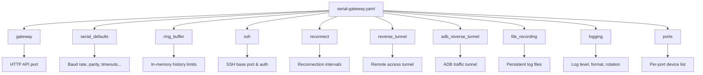

SerialGateway uses a single YAML configuration file to control every aspect of its behavior — from which serial ports to manage, to SSH authentication, logging, and remote tunneling. This page is your complete guide to every configuration option, its default value, and how it affects the gateway at runtime.

By default, the gateway looks for a file named `serial-gateway.yaml` in the current working directory. You can override this path using the `-config` command-line flag when launching the binary:

```bash
serial-gateway.exe -config C:\path\to\my-config.yaml
```

If the configuration file does not exist, SerialGateway starts normally using built-in defaults — it will **not** crash or refuse to run.

Sources: [main.go](cmd/serial-gateway/main.go#L19-L21), [config.go](internal/config/config.go#L96-L106)

## Configuration File Structure

The YAML file is organized into top-level sections, each controlling a distinct subsystem. Here is the overall structure at a glance:



Each section is optional. If you omit a section entirely, every field within it falls back to its default value.

Sources: [config.go](internal/config/config.go#L86-L93)

## Complete Configuration Example

Below is a fully annotated example that exercises every section. You can copy this as a starting template and adjust values for your environment:

```yaml
gateway:
  http_port: 18080

serial_defaults:
  baudrate: 115200
  timeout: 5s
  bytesize: 8
  parity: "N"
  stopbits: 1
  write_timeout: 10s
  exec_silence_timeout: 5s
  exec_max_duration: 30s

ring_buffer:
  max_lines: 100000
  max_bytes: 10485760

ssh:
  base_port: 2200
  auth:
    type: "password"
    password: ""

reconnect:
  initial_interval: 1s
  max_interval: 30s
  discard_input_on_disconnect: true

reverse_tunnel:
  host: ""
  port: 22
  user: "root"
  private_key_file: ""
  remote_port: 18080
  local_port: 18080
  bind_address: "0.0.0.0"

adb_reverse_tunnel:
  host: ""
  port: 22
  user: "root"
  private_key_file: ""
  remote_port: 15037
  local_port: 5037
  bind_address: "0.0.0.0"

file_recording:
  output_dir: "./serial_logs"
  max_size_mb: 1024
  trim_size_mb: 100

logging:
  level: "info"
  format: "text"
  output: "stdout"
  file_path: "gateway.log"
  max_size_mb: 100
  max_age_days: 30
  max_backups: 7
  compress: true

ports:
  - device: "COM3"
    baudrate: 115200
  - device: "COM25"
    baudrate: 115200
```

Sources: [serial-gateway.yaml](serial-gateway.yaml#L1-L59), [config.go](internal/config/config.go#L86-L93)

## Section-by-Section Reference

### `gateway`

Controls the HTTP REST API server that exposes port management, serial data access, and runtime configuration.

| Field | Type | Default | Description |
|-------|------|---------|-------------|
| `http_port` | integer | `8080` | The TCP port on which the HTTP API listens. Can also be overridden at launch with the `-http-port` CLI flag. |

The HTTP API provides endpoints for discovering serial ports, managing SSH mappings, reading serial history, sending commands, and updating configuration at runtime. See [Port Discovery and Mapping Management](5-port-discovery-and-mapping-management) and [Runtime Configuration Update via PUT /api/config](20-runtime-configuration-update-via-put-api-config) for details.

Sources: [config.go](internal/config/config.go#L10-L12), [config.go](internal/config/config.go#L107-L109), [main.go](cmd/serial-gateway/main.go#L22-L25)

### `serial_defaults`

Defines the default serial communication parameters applied to **all** ports unless a specific port overrides them in the `ports` section.

| Field | Type | Default | Description |
|-------|------|---------|-------------|
| `baudrate` | integer | `115200` | Default baud rate for serial communication. |
| `timeout` | duration | `5s` | Read timeout for the serial port connection. |
| `bytesize` | integer | `8` | Number of data bits per character (typically `5`, `6`, `7`, or `8`). |
| `parity` | string | `"N"` | Parity checking mode. Valid values: `"N"` (none), `"E"` (even), `"O"` (odd), `"M"` (mark), `"S"` (space). |
| `stopbits` | float | `1` | Number of stop bits. Valid values: `1`, `1.5`, `2`. |
| `write_timeout` | duration | `10s` | Maximum time to wait for a write operation to complete before reporting a timeout to the SSH client or HTTP caller. |
| `exec_silence_timeout` | duration | `5s` | When using the `/exec` endpoint, the stream ends after this duration of no new output from the device. |
| `exec_max_duration` | duration | `30s` | Absolute maximum time the `/exec` endpoint will collect output before terminating the stream. |

Duration values accept Go duration strings such as `5s`, `500ms`, `2m`.

Sources: [config.go](internal/config/config.go#L14-L23), [config.go](internal/config/config.go#L110-L131), [session.go](internal/serial/session.go#L80-L107)

### `ring_buffer`

Controls the in-memory ring buffer that stores recent serial output lines for each port. This is the data source for the `/tail` and `/log` HTTP endpoints.

| Field | Type | Default | Description |
|-------|------|---------|-------------|
| `max_lines` | integer | `100000` | Maximum number of lines retained in memory. When exceeded, oldest lines are evicted. |
| `max_bytes` | integer | `10485760` | Maximum total bytes (≈10 MB) retained in memory. Acts as a secondary eviction threshold alongside `max_lines`. |

Both limits are enforced simultaneously — whichever threshold is reached first triggers eviction. Each port gets its own independent ring buffer with these limits.

Sources: [config.go](internal/config/config.go#L39-L42), [config.go](internal/config/config.go#L119-L125)

### `ssh`

Configures the per-port SSH servers that allow terminal clients (like PuTTY or OpenSSH) to connect directly to serial devices.

| Field | Type | Default | Description |
|-------|------|---------|-------------|
| `base_port` | integer | `2200` | The base TCP port number. Each serial port is assigned an SSH port by adding its COM number to this base. For example, COM3 → port `2203`, COM25 → port `2225`. |
| `auth.type` | string | `"password"` | Authentication method. Currently `"password"` is supported. |
| `auth.password` | string | `""` | The password clients must provide when connecting via SSH. If empty, any password is accepted (since the comparison `password == ""` will succeed for empty input only). |
| `auth.public_keys` | list of strings | — | Reserved for future public-key authentication support. |

The SSH port mapping formula is: **SSH port = `base_port` + COM number**. For non-COM devices where the port number cannot be extracted, the server cannot be created.

Sources: [config.go](internal/config/config.go#L30-L37), [config.go](internal/config/config.go#L126-L131), [server.go](internal/ssh/server.go#L20-L30)

### `reconnect`

Controls the automatic reconnection behavior when a serial device is physically disconnected.

| Field | Type | Default | Description |
|-------|------|---------|-------------|
| `initial_interval` | duration | `1s` | The delay before the first reconnection attempt after a disconnect is detected. |
| `max_interval` | duration | `30s` | Reserved for future exponential backoff capping. Currently the reconnect loop uses `initial_interval` as a fixed delay between attempts. |
| `discard_input_on_disconnect` | boolean | `true` | When `true`, write requests received while the serial port is disconnected return an error immediately instead of blocking. When `false`, writes queue up and wait for reconnection. |

When a read error occurs on the serial port, the session broadcasts a `[serial disconnected]` notification to all subscribers and begins a background reconnect loop. Once reconnection succeeds, a `[serial reconnected]` message is broadcast.

Sources: [config.go](internal/config/config.go#L34-L38), [config.go](internal/config/config.go#L133-L138), [session.go](internal/serial/session.go#L247-L280)

### `reverse_tunnel`

Enables a reverse SSH tunnel that exposes the gateway's HTTP API to a remote server. This is useful for accessing the gateway from outside the local network without port forwarding.

| Field | Type | Default | Description |
|-------|------|---------|-------------|
| `host` | string | `""` | Remote SSH server hostname or IP. **If empty, the reverse tunnel is disabled entirely.** |
| `port` | integer | `22` | SSH port on the remote server. |
| `user` | string | `"root"` | SSH username for authentication to the remote server. |
| `password` | string | `""` | SSH password (alternative to key-based auth). |
| `private_key_file` | string | `""` | Path to an SSH private key file (e.g., `C:/Users/you/.ssh/id_ed25519`). |
| `remote_port` | integer | `18080` | The port on the remote server that will forward traffic back to the gateway. |
| `local_port` | integer | *(same as `gateway.http_port`)* | The local port to which remote traffic is forwarded. Defaults to the HTTP API port. |
| `bind_address` | string | `"0.0.0.0"` | The address on the remote server where the listener binds. Use `"127.0.0.1"` to restrict to localhost on the remote side. |

The tunnel automatically reconnects with exponential backoff (1s → 30s) if the connection drops. At least one authentication method (`password` or `private_key_file`) must be configured.

Sources: [config.go](internal/config/config.go#L49-L58), [config.go](internal/config/config.go#L140-L155), [reverse.go](internal/tunnel/reverse.go#L51-L72)

### `adb_reverse_tunnel`

Uses the same structure as `reverse_tunnel` but is intended for tunneling ADB (Android Debug Bridge) traffic through the remote server. It creates a separate, independent tunnel instance.

| Field | Type | Default | Description |
|-------|------|---------|-------------|
| `host` | string | `""` | Remote SSH server. **If empty, this tunnel is disabled.** |
| `port` | integer | `22` | SSH port on the remote server. |
| `user` | string | `"root"` | SSH username. |
| `password` | string | `""` | SSH password. |
| `private_key_file` | string | `""` | Path to SSH private key. |
| `remote_port` | integer | `15037` | Remote port for ADB traffic forwarding. |
| `local_port` | integer | `5037` | Local ADB server port (5037 is the standard ADB port). |
| `bind_address` | string | `"0.0.0.0"` | Bind address on the remote server. |

This tunnel is started independently from the main `reverse_tunnel` and only activates when `host` is non-empty.

Sources: [config.go](internal/config/config.go#L86-L93), [config.go](internal/config/config.go#L157-L172), [main.go](cmd/serial-gateway/main.go#L53-L61)

### `file_recording`

Controls persistent logging of raw serial data to files on disk. Each managed port gets its own log file in the output directory.

| Field | Type | Default | Description |
|-------|------|---------|-------------|
| `output_dir` | string | `"./serial_logs"` | Directory where serial log files are stored. Created automatically if it does not exist. |
| `max_size_mb` | integer | `1024` | Maximum file size in megabytes before trimming is triggered. |
| `trim_size_mb` | integer | `100` | Number of megabytes to trim from the beginning of the file when `max_size_mb` is exceeded. |

File recording is attached to each port's serial session during `AutoStart()`. Data is written asynchronously to avoid blocking the serial read loop.

Sources: [config.go](internal/config/config.go#L60-L64), [config.go](internal/config/config.go#L220-L229), [portmanager.go](internal/core/portmanager.go#L46-L57)

### `logging`

Configures the structured logging system, including log level, output format, destination, and file rotation.

| Field | Type | Default | Description |
|-------|------|---------|-------------|
| `level` | string | `"info"` | Minimum log level. Valid values: `"debug"`, `"info"`, `"warn"`, `"error"`. |
| `format` | string | `"text"` | Log output format. `"text"` produces compact, human-readable output with optional color. `"json"` produces structured JSON lines. |
| `output` | string | `"stdout"` | Where logs are written. Valid values: `"stdout"`, `"stderr"`, `"file"`. |
| `file_path` | string | `"gateway.log"` | Log file path (only used when `output` is `"file"`). |
| `max_size_mb` | integer | `100` | Maximum log file size in MB before rotation. |
| `max_age_days` | integer | `30` | Maximum number of days to retain old log files. |
| `max_backups` | integer | `7` | Maximum number of old log files to retain. |
| `compress` | boolean | `true` | Whether rotated log files are gzip-compressed. |

When `output` is `"stdout"` or `"stderr"`, the text format includes ANSI color codes for log levels. When `output` is `"file"`, colors are disabled and log rotation is handled by the `lumberjack` library.

Sources: [config.go](internal/config/config.go#L66-L75), [config.go](internal/config/config.go#L200-L219), [log.go](internal/log/log.go#L152-L199)

### `ports`

A list of serial ports to automatically open and manage at startup. Each entry creates an SSH server mapping and optionally attaches a file recorder.

| Field | Type | Default | Description |
|-------|------|---------|-------------|
| `device` | string | *(required)* | The serial port identifier (e.g., `"COM3"`, `"COM25"`). |
| `baudrate` | integer | *(from `serial_defaults.baudrate`)* | Override baud rate for this specific port. If set to `0` or omitted, the global default is used. |

Ports listed here are started automatically during `AutoStart()`. Additional ports can be added at runtime via the `POST /api/mappings` HTTP endpoint without restarting the gateway.

Sources: [config.go](internal/config/config.go#L44-L47), [portmanager.go](internal/core/portmanager.go#L32-L68)

## Command-Line Overrides

Two CLI flags are available when launching the gateway:

| Flag | Default | Description |
|------|---------|-------------|
| `-config` | `serial-gateway.yaml` | Path to the YAML configuration file. |
| `-http-port` | `0` (disabled) | Overrides `gateway.http_port` from the config file. Set to `0` to use the config file value. |

Example:

```bash
serial-gateway.exe -config D:\configs\lab.yaml -http-port 9090
```

Sources: [main.go](cmd/serial-gateway/main.go#L19-L26)

## Default Values Summary

The following table provides a quick reference of every default value applied when a configuration field is omitted or the config file is missing entirely:

| Section | Field | Default Value |
|---------|-------|---------------|
| `gateway` | `http_port` | `8080` |
| `serial_defaults` | `baudrate` | `115200` |
| `serial_defaults` | `timeout` | `5s` |
| `serial_defaults` | `bytesize` | `8` |
| `serial_defaults` | `parity` | `"N"` |
| `serial_defaults` | `stopbits` | `1` |
| `serial_defaults` | `write_timeout` | `10s` |
| `serial_defaults` | `exec_silence_timeout` | `5s` |
| `serial_defaults` | `exec_max_duration` | `30s` |
| `ring_buffer` | `max_lines` | `100000` |
| `ring_buffer` | `max_bytes` | `10485760` (10 MB) |
| `ssh` | `base_port` | `2200` |
| `ssh` | `auth.type` | `"password"` |
| `reconnect` | `initial_interval` | `1s` |
| `reconnect` | `max_interval` | `30s` |
| `reconnect` | `discard_input_on_disconnect` | `true` |
| `reverse_tunnel` | `port` | `22` |
| `reverse_tunnel` | `user` | `"root"` |
| `reverse_tunnel` | `remote_port` | `18080` |
| `reverse_tunnel` | `local_port` | *(= gateway.http_port)* |
| `reverse_tunnel` | `bind_address` | `"0.0.0.0"` |
| `adb_reverse_tunnel` | `port` | `22` |
| `adb_reverse_tunnel` | `user` | `"root"` |
| `adb_reverse_tunnel` | `remote_port` | `15037` |
| `adb_reverse_tunnel` | `local_port` | `5037` |
| `adb_reverse_tunnel` | `bind_address` | `"0.0.0.0"` |
| `file_recording` | `output_dir` | `"./serial_logs"` |
| `file_recording` | `max_size_mb` | `1024` |
| `file_recording` | `trim_size_mb` | `100` |
| `logging` | `level` | `"info"` |
| `logging` | `format` | `"text"` |
| `logging` | `output` | `"stdout"` |
| `logging` | `file_path` | `"gateway.log"` |
| `logging` | `max_size_mb` | `100` |
| `logging` | `max_age_days` | `30` |
| `logging` | `max_backups` | `7` |

Sources: [config.go](internal/config/config.go#L104-L229)

## Runtime Configuration Updates

The configuration can be updated without restarting the gateway by sending a `PUT` request to `/api/config` with a JSON body matching the full configuration structure. The new configuration replaces the current one in memory, and defaults are re-applied to any missing fields.

```bash
curl -X PUT http://localhost:18080/api/config -H "Content-Type: application/json" -d '{...}'
```

You can also retrieve the current active configuration at any time:

```bash
curl http://localhost:18080/api/config
```

**Important**: Runtime updates only affect the in-memory configuration. The YAML file on disk is **not** modified. Changes to SSH ports or serial parameters do not retroactively alter already-running SSH servers or open serial sessions — they apply to newly created mappings.

Sources: [handlers.go](internal/http/handlers.go#L162-L175)

## Minimal Configuration

If you want the simplest possible setup — just managing one COM port with all defaults — your entire config file can be:

```yaml
ports:
  - device: "COM3"
```

This will start SerialGateway with the HTTP API on port `8080`, an SSH server for COM3 on port `2203`, and all serial defaults at their built-in values.

Sources: [config.go](internal/config/config.go#L96-L106), [portmanager.go](internal/core/portmanager.go#L32-L68)

## What's Next

Now that you understand the configuration options, here are recommended next steps:

- **[Running as a Background Service](4-running-as-a-background-service)** — Learn how to run SerialGateway as a persistent background process on Windows.
- **[Port Discovery and Mapping Management](5-port-discovery-and-mapping-management)** — Start using the HTTP API to discover and manage serial port mappings.
- **[System Architecture and Component Overview](9-system-architecture-and-component-overview)** — Understand how the configuration flows through the system's internal components.