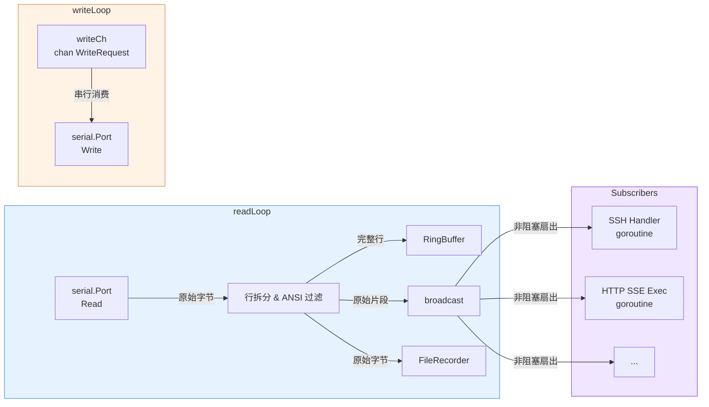
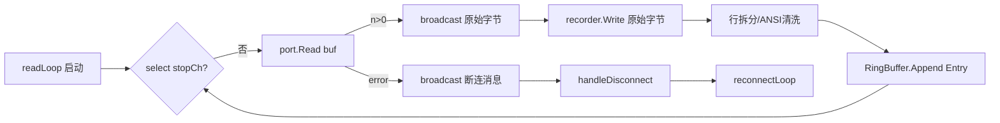
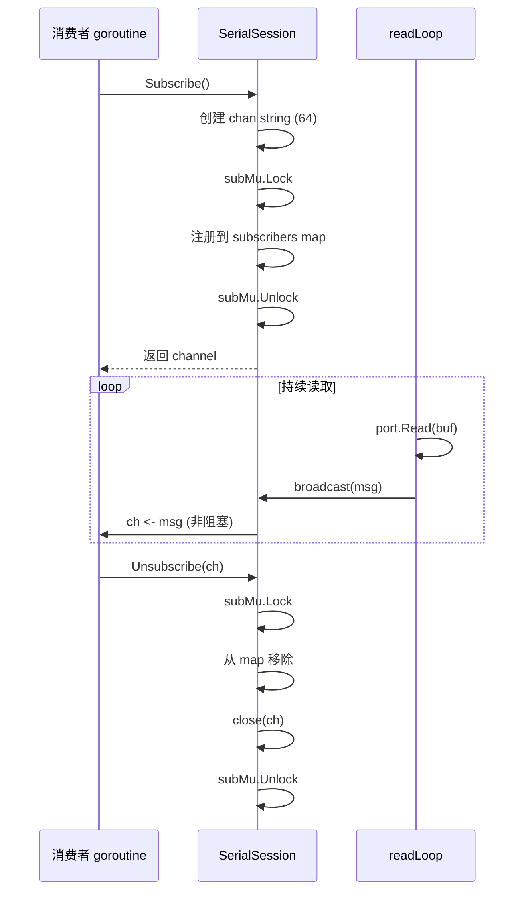

串口 I/O 管道是 SerialGateway 的数据平面核心，定义了串口数据如何在 **单个物理端口** 上实现并发读取分发与串行写入仲裁。本文将剖析 `SerialSession` 内部的两条独立 goroutine 管道 — `readLoop` 与 `writeLoop` — 以及它们如何通过订阅者模式和带缓冲 channel 实现生产者-消费者解耦。

## 架构概览：双管道 + 扇出广播



**设计原则**：读取和写入是两条完全独立的 goroutine 管道，彼此不直接交互。读取侧采用**扇出广播模型**将数据分发给所有订阅者，写入侧采用**单消费者串行队列模型**仲裁所有写入请求。这种分离确保了高吞吐读取不会被写入阻塞，反之亦然。

Sources: [session.go](internal/serial/session.go#L24-L44)

---

## 读取管道：readLoop

`readLoop` 在 `Open()` 调用时以 `go s.readLoop()` 启动，是一个运行在独立 goroutine 中的无限循环。

### 数据流步骤

1. **原始读取**：以 1024 字节缓冲区从串口读取原始字节块（`p.Read(buf)`）[session.go#L169](internal/serial/session.go#L169)
2. **实时广播**：原始字节立即通过 `broadcast()` 发送给所有已注册的订阅者，确保低延迟转发 [session.go#L179](internal/serial/session.go#L179)
3. **文件录制**：如果设置了 `recorder`（即 `FileRecorder`），原始字节异步写入录制文件 [session.go#L180-L182](internal/serial/session.go#L180-L182)
4. **行拆分与后处理**：维护一个 `lineBuf` 累积缓冲区，逐字节查找 `\n` 换行符拆分完整行 [session.go#L183-L207](internal/serial/session.go#L183-L207)
   - 去除行尾 `\r` 字符
   - 处理行内覆盖写入（`\r` 导致走到 `\r` 之后的部分）
   - 剥离 ANSI 转义序列（`\x1b[...` 格式）
5. **RingBuffer 写入**：将清洗后的行封装为 `Entry`（含时间戳、序号、行内容、字节数）追加到环形缓冲区 [session.go#L200-L206](internal/serial/session.go#L200-L206)

### 错误处理与断连检测

当 `p.Read(buf)` 返回非 nil 错误时，readLoop 不会无限重试。它立即广播断连通知 `"[serial disconnected - waiting for reconnect...]\n"`，调用 `handleDisconnect()` 清理资源并启动 `reconnectLoop` 后台 goroutine [session.go#L170-L174](internal/serial/session.go#L170-L174)。



Sources: [session.go](internal/serial/session.go#L152-L209)

---

## 写入管道：writeLoop

`writeLoop` 与 readLoop 同时启动于 `Open()`，同样运行在独立 goroutine 中。

### 写入请求契约

```go
type WriteRequest struct {
    Data []byte
    Done chan error
}
```

每个写入请求包含待发送的字节数据和一个用于接收结果的单向 channel。调用方在 `writeCh <- req` 之后通过 `<-req.Done` 等待写入结果或超时。

Sources: [session.go](internal/serial/session.go#L19-L22)

### 串行消费模型

```go
func (s *SerialSession) writeLoop() {
    for {
        select {
        case <-stopCh:
            return
        case req := <-s.writeCh:
            // 安全获取 port 引用
            s.mu.Lock()
            p := s.port
            s.mu.Unlock()
            if p == nil {
                // 断连时根据配置决定是否丢弃
                if s.cfg.Reconnect.DiscardInputOnDisconnect {
                    req.Done <- fmt.Errorf("serial disconnected, input discarded")
                }
                continue
            }
            _, err := p.Write(req.Data)
            req.Done <- err
        }
    }
}
```

关键设计决策：
- **单 goroutine 串行消费**：所有写入请求在 writeLoop 中按 FIFO 顺序依次处理，天然避免并发写入冲突
- **非阻塞获取 port**：使用 `s.mu.Lock()` 安全读取 `s.port` 引用，锁持有时间极短
- **断连丢弃策略**：通过配置 `DiscardInputOnDisconnect` 控制断连期间的写入行为 — 返回错误而非阻塞 [session.go#L222-L225](internal/serial/session.go#L222-L225)
- **channel 缓冲深度 64**：`writeCh` 创建时缓冲区大小为 64，允许写入请求在写入繁忙时短暂排队 [session.go#L58](internal/serial/session.go#L58)

Sources: [session.go](internal/serial/session.go#L211-L231)

---

## 广播机制：非阻塞扇出

`broadcast` 方法是读取管道与外部消费者之间的桥梁：

```go
func (s *SerialSession) broadcast(msg string) {
    s.subMu.RLock()
    defer s.subMu.RUnlock()
    for ch := range s.subscribers {
        select {
        case ch <- msg:
        default:
        }
    }
}
```

**设计要点**：
- **读锁保护**：使用 `sync.RWMutex` 的读锁，多个并发 broadcast 调用不会互斥，仅在订阅/取消订阅时写锁阻塞
- **非阻塞发送**：每个订阅 channel 的发送使用 `select default` 模式。如果订阅者消费不及时导致 channel 满，消息被静默丢弃 — 防止慢消费者拖慢整个读取管道
- **订阅 channel 容量 64**：每个订阅 channel 创建时缓冲区大小为 64，提供合理的容忍突发流量能力 [session.go#L138](internal/serial/session.go#L138)

| 消费者 | 订阅方式 | 数据用途 |
|--------|----------|----------|
| SSH 会话处理 | `Subscribe()` + goroutine 读取 | 将串口输出转发到 SSH 客户端终端 |
| HTTP Exec SSE | `Subscribe()` + for-select 循环 | 通过 SSE 流式推送命令执行结果 |
| HTTP Write 端点 | `Subscribe()` + 定时读取 | 写入后读取 RingBuffer 获取最近输出 |

Sources: [session.go](internal/serial/session.go#L233-L242)

---

## 生产者-消费者全景图

以下表格展示了从数据源到最终消费者的完整链路：

| 角色 | 组件 | 并发模型 | 缓冲机制 |
|------|------|----------|----------|
| **生产者 1** | readLoop goroutine | 单生产者 | 1024 字节读取缓冲区 |
| **生产者 2** | SSH 会话读取 goroutine | 多生产者 | 每个请求自带 WriteRequest |
| **生产者 3** | HTTP Exec/Write handler | 多生产者 | 同上 |
| **仲裁者** | writeLoop goroutine | 单消费者串行化 | writeCh 缓冲 64 个请求 |
| **分发者** | broadcast 方法 | 扇出 | 每个 sub channel 缓冲 64 条消息 |
| **消费者 1** | SSH 会话写入 goroutine | 独立消费 sub | 无额外缓冲 |
| **消费者 2** | HTTP Exec SSE for-select | 独立消费 sub | lineBuf 累积行 |
| **存储** | RingBuffer | 同步追加 | maxLines=100K, maxBytes=10MB |

Sources: [session.go](internal/serial/session.go#L46-L63), [config.go](internal/config/config.go#L42-L45)

---

## 订阅者生命周期管理

订阅（Subscribe）与取消订阅（Unsubscribe）是线程安全的，支持动态添加和移除消费者：



**关键行为**：
- 订阅 channel 在 `Unsubscribe` 中被 `close(ch)`，消费者必须正确处理 channel 关闭
- 消费者必须在不再需要时主动调用 `Unsubscribe`，否则会造成 goroutine 泄漏
- 非阻塞发送意味着慢消费者会丢失数据 — 这是设计上的权衡：优先保证系统整体吞吐而非单个消费者的完整性

Sources: [session.go](internal/serial/session.go#L137-L150)

---

## 与外部系统的集成点

串口 I/O 管道不直接暴露给外部，而是通过以下方式被消费：

| 外部接口 | 访问方式 | 使用管道 |
|----------|----------|----------|
| **SSH 终端** | `s.session.Subscribe()` + `s.session.WriteChannel()` | 读取广播 + 写入队列 |
| **HTTP GET /exec** | `sess.Subscribe()` + `sess.WriteChannel()` | 同上，+ SSE 流式输出 |
| **HTTP POST /write** | `sess.WriteChannel()` + `sess.RingBuffer().Tail()` | 写入队列 + 历史查询 |
| **HTTP GET /tail** | `sess.RingBuffer().Tail(n)` | 仅读取 RingBuffer |
| **HTTP GET /log** | `sess.RingBuffer().All()` | 仅读取 RingBuffer |

Sources: [exec.go](internal/http/exec.go#L27-L45), [handlers.go](internal/http/handlers.go#L227-L281), [handler.go](internal/ssh/handler.go#L32-L59)

---

## 两个你需要了解的设计权衡

1. **读取侧：实时性优先于完整性** — `broadcast` 发送原始字节后异步做行拆分，订阅者收到的消息可能是跨换行符的。但这也确保了从串口读取到消费者可见的延迟最小化。行级语义由消费者自己的 SSH handler 和 HTTP exec handler 各自按需解析。

2. **写入侧：串行化优先于并发** — 所有写入请求强制串行执行，没有任何写-写并发路径。这是串口物理特性的必然约束：串口是半双工或全双工但写入端必须串行化。**`writeCh` 的缓冲深度 64 和一个 `Done` channel** 构成的模式，让调用方可以自由选择同步等待结果或异步触发后不管。

Sources: [handler.go](internal/ssh/handler.go#L46-L69), [exec.go](internal/http/exec.go#L89-L153)

---

## 延伸阅读

- **掌握会话生命周期**：了解 `Open()` → `readLoop` + `writeLoop` → `Close()` 的完整时序：[串口会话生命周期：打开、读取、写入、关闭](5-chuan-kou-hui-hua-sheng-ming-zhou-qi-da-kai-du-qu-xie-ru-guan-bi)
- **深入写入端独立分析**：专注于写入超时处理、请求丢弃策略等细节：[串口写入并发模型：写入队列与超时处理](18-chuan-kou-xie-ru-bing-fa-mo-xing-xie-ru-dui-lie-yu-chao-shi-chu-li)
- **RingBuffer 内部机制**：内存环形缓冲区的 O(1) 追加与检索实现：[RingBuffer 内存历史存储与检索](16-ringbuffer-nei-cun-li-shi-cun-chu-yu-jian-suo)
- **断连重连流程**：handleDisconnect 与 reconnectLoop 的闭环设计：[断连检测与自动重连机制](6-duan-lian-jian-ce-yu-zi-dong-zhong-lian-ji-zhi)
- **文件录制器的异步写入**：FileRecorder 如何通过独立 channel 消费 readLoop 的原始数据：[文件录制器：异步串口日志持久化与自动裁剪](19-wen-jian-lu-zhi-qi-yi-bu-chuan-kou-ri-zhi-chi-jiu-hua-yu-zi-dong-cai-jian)