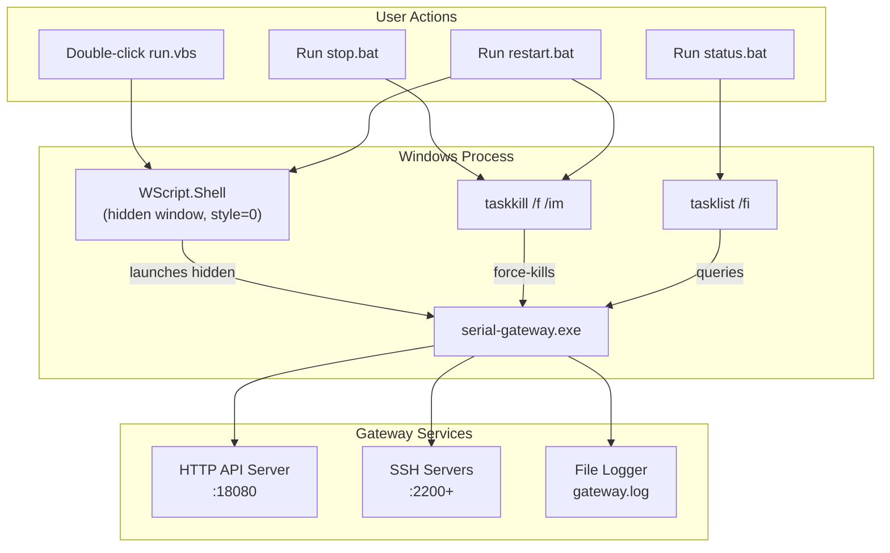
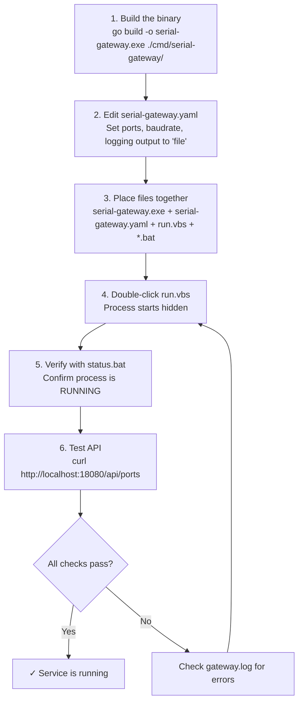

SerialGateway is designed to run as a persistent, headless background process on Windows without requiring a visible console window. Rather than integrating with the Windows Service Control Manager (SCM), the project uses a lightweight approach: a VBScript launcher hides the process window, and a set of batch scripts provides stop, restart, and status operations. This page walks you through every aspect of deploying and managing the gateway as a background service.

## Prerequisites

Before starting the gateway in the background, ensure you have completed the following:

1. **Built the executable** — Run `go build -o serial-gateway.exe ./cmd/serial-gateway/` from the repository root to produce the binary.
2. **Created a configuration file** — Place a `serial-gateway.yaml` file alongside the executable (or specify its path with `--config`).
3. **Verified COM port availability** — At least one serial device should be connected if you expect active port mappings on startup.

Sources: [main.go](cmd/serial-gateway/main.go#L1-L80), [serial-gateway.yaml](serial-gateway.yaml#L1-L59)

## Architecture Overview

The diagram below illustrates how the background service components interact on a Windows machine:



The key design decision is simplicity: no Windows Service registration, no `sc.exe` commands, and no third-party service wrappers. The VBScript launcher provides hidden-window execution, while standard Windows utilities (`taskkill`, `tasklist`) handle process lifecycle management.

## Starting the Service

### The VBS Launcher

The primary entry point for background execution is `run.vbs`. Double-clicking this file (or invoking it via `cscript //nologo run.vbs`) starts the gateway without opening a visible command prompt window.

```vbscript
Set WshShell = CreateObject("WScript.Shell")
WshShell.CurrentDirectory = CreateObject("Scripting.FileSystemObject").GetParentFolderName(WScript.ScriptFullName)
WshShell.Run "serial-gateway.exe --config serial-gateway.yaml", 0, False
```

Three aspects of this script are worth understanding:

- **`WScript.Shell`** — A COM object that provides access to the Windows shell, enabling process launching with fine-grained control over window visibility.
- **Window style `0`** — The second argument to `.Run` sets the window style to *hidden*. The process runs but produces no visible window on the desktop.
- **`False` (non-blocking)** — The third argument tells the script not to wait for the process to finish. The VBS script exits immediately, leaving `serial-gateway.exe` running independently.

The `CurrentDirectory` is set to the folder containing `run.vbs` itself, ensuring the executable and config file are resolved correctly regardless of where the script is invoked from.

Sources: [run.vbs](run.vbs#L1-L4)

### Command-Line Flags

The executable accepts two flags that control its startup behavior:

| Flag | Default | Description |
|---|---|---|
| `--config` | `serial-gateway.yaml` | Path to the YAML configuration file, resolved relative to the working directory. |
| `--http-port` | `0` (use config) | Overrides the HTTP port specified in the configuration file. A value of `0` means the config file value is used. |

To customize the launch command, edit the `.Run` line in `run.vbs`. For example, to use a different config file and override the port:

```vbscript
WshShell.Run "serial-gateway.exe --config C:\configs\my-gateway.yaml --http-port 9090", 0, False
```

Sources: [main.go](cmd/serial-gateway/main.go#L19-L28)

## Stopping the Service

The `stop.bat` script terminates the background process using the Windows `taskkill` command:

```batch
@echo off
taskkill /f /im serial-gateway.exe
echo serial-gateway.exe has been stopped.
```

The `/f` flag forces termination, and `/im` targets the process by image name. This is equivalent to a hard kill — the process does not receive a graceful shutdown signal. Any in-flight serial writes or HTTP responses may be interrupted.

Sources: [stop.bat](stop.bat#L1-L4)

### Graceful Shutdown (Manual)

The gateway's `main()` function listens for an `os.Interrupt` signal (Ctrl+C) to perform a clean shutdown — stopping reverse tunnels, closing serial sessions, and shutting down SSH servers. If you need graceful shutdown, you can send an interrupt signal programmatically:

```powershell
# Find the process ID
$pid = (Get-Process serial-gateway).Id
# Send CTRL_C_EVENT (requires external tool or Ctrl+C in attached console)
```

In practice, because the process runs hidden, `stop.bat` with `taskkill /f` is the standard approach. The gateway is designed to recover on restart — serial sessions are re-established and SSH servers are re-created automatically.

Sources: [main.go](cmd/serial-gateway/main.go#L72-L80)

## Restarting the Service

The `restart.bat` script combines stop and start into a single operation:

```batch
@echo off
echo Stopping serial-gateway.exe ...
taskkill /f /im serial-gateway.exe >nul 2>&1
timeout /t 1 /nobreak >nul
echo Starting serial-gateway.exe ...
cscript //nologo "%~dp0run.vbs"
echo serial-gateway.exe restarted.
```

The script follows a deliberate sequence: force-kill the existing process, wait one second for the OS to release bound ports, then re-launch via the VBS launcher. The `>nul 2>&1` redirection suppresses the error message if the process is not currently running (making the script safe to run even when the gateway is already stopped).

Sources: [restart.bat](restart.bat#L1-L8)

## Checking Service Status

The `status.bat` script reports whether the gateway process is currently running:

```batch
@echo off
tasklist /fi "imagename eq serial-gateway.exe" | findstr /i "serial-gateway.exe" >nul
if %errorlevel%==0 (
    echo serial-gateway.exe is RUNNING:
    tasklist /fi "imagename eq serial-gateway.exe"
) else (
    echo serial-gateway.exe is NOT running.
)
```

When the process is active, the output includes the PID, session name, and memory usage. When it is not running, a simple "NOT running" message is displayed. This script is useful for quick health checks from a command prompt or for integration into monitoring scripts.

Sources: [status.bat](status.bat#L1-L9)

## Quick Reference: Management Scripts

The table below summarizes all four management scripts shipped with the project:

| Script | Purpose | How to Run | What It Does |
|---|---|---|---|
| `run.vbs` | Start (hidden) | Double-click or `cscript //nologo run.vbs` | Launches `serial-gateway.exe` with a hidden window |
| `stop.bat` | Stop | Double-click or `stop.bat` | Force-kills the process via `taskkill` |
| `restart.bat` | Restart | Double-click or `restart.bat` | Stops, waits 1 second, then starts again |
| `status.bat` | Status check | Double-click or `status.bat` | Reports whether the process is running with PID info |

## Logging in Background Mode

When running as a background service, console output is not visible. The gateway's logging system is designed for this scenario, supporting three output modes:

| Output Mode | Config Value | Use Case |
|---|---|---|
| **File** | `"file"` | Production background operation. Logs written to `gateway.log` with automatic rotation. |
| **stdout** | `"stdout"` | Development/debugging with a visible console. Color-coded text output. |
| **stderr** | `"stderr"` | Alternative console output, also color-coded. |

For background service operation, set `output: "file"` in the `logging` section of your configuration:

```yaml
logging:
  level: "info"
  format: "text"
  output: "file"
  file_path: "gateway.log"
  max_size_mb: 100
  max_age_days: 30
  max_backups: 7
  compress: true
```

The file logger uses the [lumberjack](https://github.com/natefinish/lumberjack) library for log rotation. When the log file reaches `max_size_mb`, it is renamed with a timestamp and a new file is created. Old files beyond `max_backups` count are deleted, and files older than `max_age_days` are purged. Setting `compress: true` gzip-compresses rotated log files to save disk space.

Sources: [log.go](internal/log/log.go#L159-L200), [config.go](internal/config/config.go#L200-L216)

## Deployment Checklist

Follow this step-by-step flow to deploy the gateway as a background service:



Ensure the following files are co-located in the same directory:

| File | Role |
|---|---|
| `serial-gateway.exe` | The compiled gateway binary |
| `serial-gateway.yaml` | Configuration file (or use `--config` to point elsewhere) |
| `run.vbs` | Hidden-window launcher |
| `stop.bat` | Process termination script |
| `restart.bat` | Stop-then-start script |
| `status.bat` | Process status checker |

## Troubleshooting

| Symptom | Likely Cause | Fix |
|---|---|---|
| `bind: address already in use` | A previous instance is still running | Run `stop.bat`, then try again |
| No log file created | `logging.output` is set to `"stdout"` | Change to `"file"` in `serial-gateway.yaml` |
| Process starts but immediately exits | Config file not found or invalid YAML | Check `gateway.log` or run manually with `serial-gateway.exe --config serial-gateway.yaml` in a visible console |
| `taskkill` reports "not found" | Process is not running | No action needed; run `status.bat` to confirm |
| Toast notifications not showing | Running in a non-interactive session | Toast notifications require a Windows interactive desktop session; they do not work in headless/service contexts |
| Port mappings not appearing on startup | COM port not connected | Connect the serial device and run `restart.bat` |

Sources: [SKILL.md](.claude/skills/run-serialgateway/SKILL.md#L143-L151)

## Next Steps

Now that the gateway is running in the background, explore these topics to interact with it:

- **[Port Discovery and Mapping Management](5-port-discovery-and-mapping-management)** — Learn how to list available COM ports and create SSH mappings via the HTTP API.
- **[Reading Serial History: Tail and Log Endpoints](6-reading-serial-history-tail-and-log-endpoints)** — Retrieve buffered serial output from the running service.
- **[Sending Commands via Write and Exec Endpoints](7-sending-commands-via-write-and-exec-endpoints)** — Send data to serial devices through the REST API.
- **[Configuration Reference](3-configuration-reference)** — Detailed reference for all YAML configuration options.
- **[Batch Scripts and VBS Launcher for Windows](28-batch-scripts-and-vbs-launcher-for-windows)** — Deep dive into the implementation details of each management script.