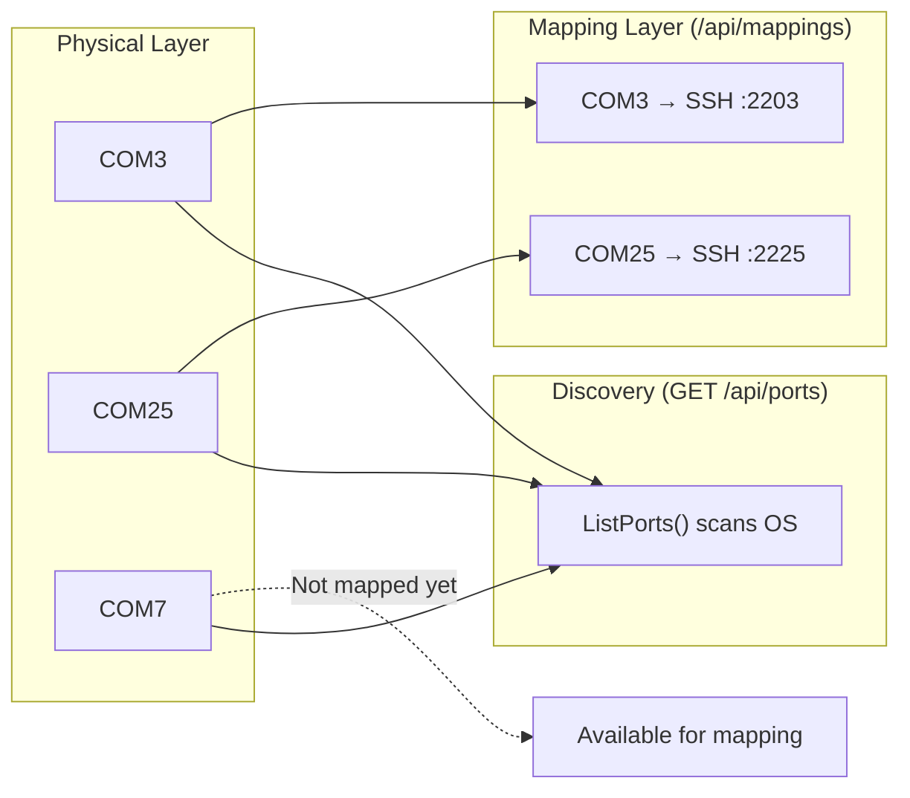
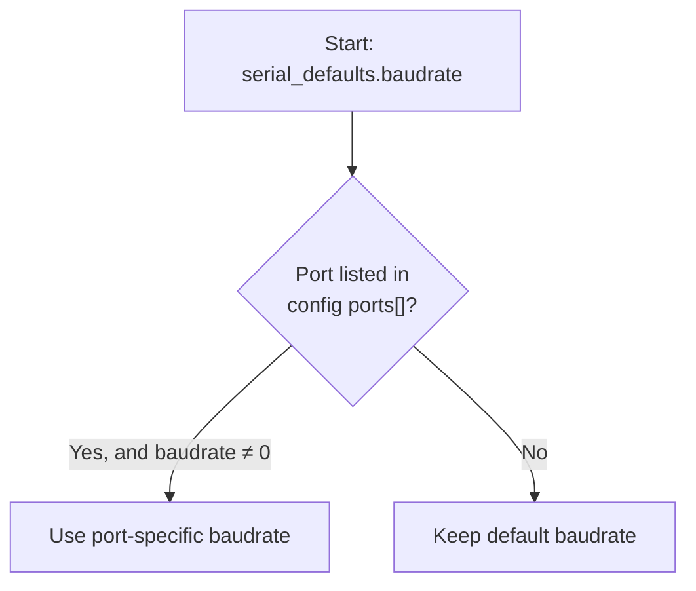
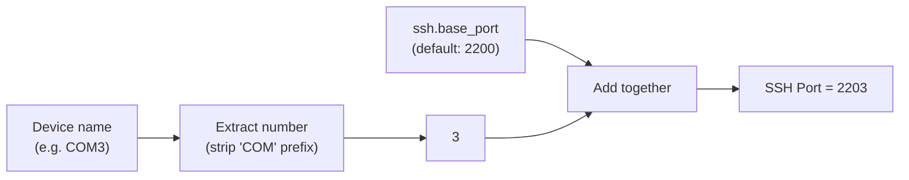
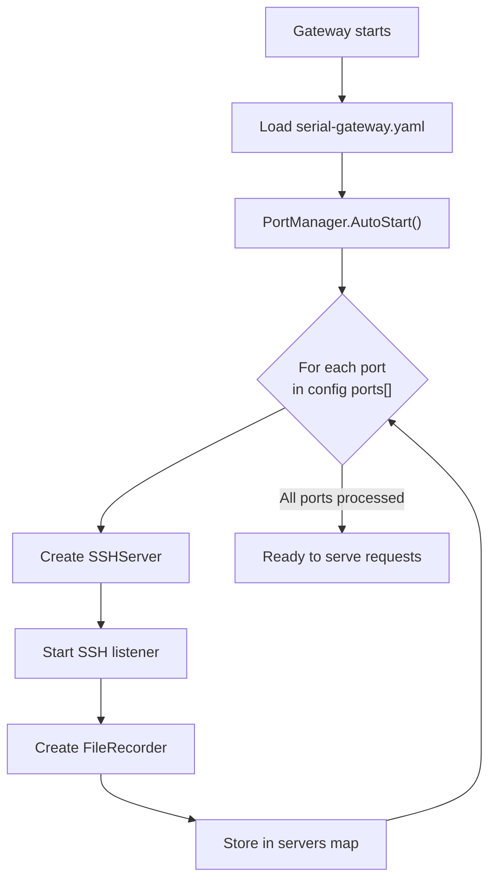

This page walks you through the HTTP API endpoints that let you **discover physical serial ports** on the host machine and **manage port mappings** — the bridge between a serial device (like `COM3`) and a dynamically-created SSH server. By the end of this guide, you'll know how to query what's plugged in, spin up new SSH-to-serial bridges at runtime, and tear them down when they're no longer needed.

All endpoints assume the gateway is running on its configured HTTP port (default `8080`, or `18080` if using the sample `serial-gateway.yaml`).

## How Port Discovery and Mapping Fit Together

Before diving into individual endpoints, it helps to understand the two core concepts and how they relate:



**Port Discovery** answers the question: *"What serial devices are physically connected to this machine?"* It queries the operating system for all available COM ports and returns metadata about each one — including what SSH port it *would* be assigned if mapped.

**Port Mapping** answers the question: *"Which serial devices currently have an active SSH server bridging them?"* A mapping means an SSH server is listening on a computed port, ready to forward terminal sessions to the underlying serial device.

Sources: [server.go](internal/http/server.go#L26-L34), [handlers.go](internal/http/handlers.go#L22-L56)

## Discovering Serial Ports

### `GET /api/ports`

This endpoint scans the host operating system for all detected serial ports using the `enumerator.GetDetailedPortsList()` function from the `go.bug.st/serial` library. It returns every physical port — whether or not it has an active SSH mapping.

**Example request:**

```
GET http://localhost:18080/api/ports
```

**Example response:**

```json
{
  "ports": [
    {
      "device": "COM3",
      "description": "USB Serial Device",
      "hwid": "0403:6001",
      "baudrate": 115200,
      "ssh_port": 2203,
      "status": "active"
    },
    {
      "device": "COM7",
      "description": "Prolific USB-to-Serial",
      "hwid": "067B:2303",
      "baudrate": 115200,
      "ssh_port": 2207,
      "status": "inactive"
    }
  ]
}
```

### Understanding Each Response Field

| Field | Type | Description |
|-------|------|-------------|
| `device` | string | The OS port name, e.g. `"COM3"`. This is the identifier you'll use in all other API calls. |
| `description` | string | Human-readable product name reported by the USB device driver. |
| `hwid` | string | Hardware ID in `VID:PID` format (e.g. `"0403:6001"`). Empty string if unavailable. |
| `baudrate` | integer | The baud rate for this port. Uses the per-port override from config if one exists, otherwise falls back to `serial_defaults.baudrate`. |
| `ssh_port` | integer | The SSH port this device would be (or is) mapped to, computed by the port mapping formula. |
| `status` | string | `"active"` if an SSH server is currently running for this device, `"inactive"` otherwise. |

Sources: [handlers.go](internal/http/handlers.go#L22-L56), [port.go](internal/serial/port.go#L7-L31)

### How the Baud Rate Is Resolved

When the `/api/ports` endpoint builds its response, it determines the baud rate for each discovered port using a two-step lookup. First, it starts with the global default from `serial_defaults.baudrate` (which defaults to `115200`). Then it checks whether the `ports` array in the configuration file contains an entry matching the discovered device name — if so, that entry's `baudrate` value overrides the default.



For example, if your `serial-gateway.yaml` contains:

```yaml
ports:
  - device: "COM3"
    baudrate: 9600
```

Then `COM3` will report `9600` in the API response, while all other ports report the default `115200`.

Sources: [handlers.go](internal/http/handlers.go#L33-L39), [config.go](internal/config/config.go#L47-L50)

## The SSH Port Mapping Formula

Every serial device is assigned a deterministic SSH port using a simple arithmetic formula. This is important to understand because it means **the SSH port for `COM3` will always be the same** — there's no random assignment or lookup table to memorize.



**The formula:**

```
SSH port = ssh.base_port + <COM number>
```

| Device | COM Number | Base Port | SSH Port |
|--------|-----------|-----------|----------|
| `COM3` | 3 | 2200 | **2203** |
| `COM7` | 7 | 2200 | **2207** |
| `COM25` | 25 | 2200 | **2225** |

If the device name doesn't follow the `COM<number>` pattern (or the number can't be parsed), the `PortMapping` function returns `0`, and the SSH server cannot be created for that device.

Sources: [server.go](internal/ssh/server.go#L20-L30), [config.go](internal/config/config.go#L148-L149)

## Managing Port Mappings

Mappings represent **active SSH-to-serial bridges**. Each mapping means an SSH server is running and listening on the computed port, ready to accept connections and forward them to the serial device.

### `GET /api/mappings` — List Active Mappings

Returns all currently active mappings — the serial devices that have SSH servers running.

**Example request:**

```
GET http://localhost:18080/api/mappings
```

**Example response:**

```json
{
  "mappings": [
    {
      "serial_port": "COM3",
      "ssh_port": 2203,
      "connections": 0,
      "baudrate": 115200,
      "connected": true
    },
    {
      "serial_port": "COM25",
      "ssh_port": 2225,
      "connections": 0,
      "baudrate": 115200,
      "connected": false
    }
  ]
}
```

| Field | Type | Description |
|-------|------|-------------|
| `serial_port` | string | The device name (e.g. `"COM3"`). |
| `ssh_port` | integer | The SSH port the bridge is listening on. |
| `connections` | integer | Currently hardcoded to `0`; reserved for future use. |
| `baudrate` | integer | The baud rate the serial session is using. |
| `connected` | boolean | Whether the underlying serial port is currently open and connected. |

Sources: [handlers.go](internal/http/handlers.go#L69-L83), [portmanager.go](internal/core/portmanager.go#L70-L82)

### `POST /api/mappings` — Create a New Mapping

Creates a new SSH-to-serial bridge at runtime, without restarting the gateway. This starts a new SSH server on the computed port for the specified device.

**Example request:**

```
POST http://localhost:18080/api/mappings
Content-Type: application/json

{
  "device": "COM7"
}
```

**Success response (201 Created):**

```json
{
  "serial_port": "COM7",
  "ssh_port": 2207,
  "status": "active"
}
```

**Error responses:**

| Status Code | Condition | Example Body |
|-------------|-----------|-------------|
| `400` | Missing or malformed request body | `{"error": "device is required"}` |
| `409` | A mapping for this device already exists | `{"error": "mapping already exists for COM3"}` |
| `500` | SSH server creation failed (e.g. port in use) | `{"error": "cannot determine SSH port for device X"}` |

Under the hood, `AddMapping` acquires a write lock on the PortManager, checks for duplicates, creates a new `SSHServer` instance (which also creates a `SerialSession`), starts the SSH listener, and stores the server in its internal map.

Sources: [handlers.go](internal/http/handlers.go#L85-L111), [portmanager.go](internal/core/portmanager.go#L90-L105)

### `GET /api/mappings/{device}` — Get Mapping Details

Retrieves the details of a single mapping by device name.

**Example request:**

```
GET http://localhost:18080/api/mappings/COM3
```

**Example response:**

```json
{
  "serial_port": "COM3",
  "ssh_port": 2203,
  "connected": true
}
```

If no mapping exists for the requested device, the API returns a `404` status:

```json
{"error": "mapping not found for COM7"}
```

Sources: [handlers.go](internal/http/handlers.go#L113-L156)

### `DELETE /api/mappings/{device}` — Remove a Mapping

Stops the SSH server for the given device and removes the mapping. The SSH server is shut down and the serial session is closed.

**Example request:**

```
DELETE http://localhost:18080/api/mappings/COM3
```

**Success response (200 OK):**

```json
{
  "device": "COM3",
  "status": "removed"
}
```

**Error response (404):**

```json
{"error": "no mapping for COM3"}
```

The `RemoveMapping` method acquires a write lock, calls `srv.Stop()` (which closes both the SSH listener and the serial session), then deletes the entry from the internal map. Note that this does **not** remove the device from the YAML configuration file — it only affects the runtime state. If the gateway restarts, the device will be re-mapped if it's still listed in `serial-gateway.yaml`.

Sources: [handlers.go](internal/http/handlers.go#L118-L129), [portmanager.go](internal/core/portmanager.go#L107-L117)

## Mappings vs. Ports: Key Differences

It's a common source of confusion for newcomers, so here's a direct comparison:

| Aspect | `/api/ports` (Discovery) | `/api/mappings` (Management) |
|--------|--------------------------|------------------------------|
| **What it shows** | All physical serial ports detected by the OS | Only ports with an active SSH bridge |
| **Read-only?** | Yes — it's a snapshot of hardware state | No — you can create and delete mappings |
| **Includes inactive devices?** | Yes, all detected ports regardless of status | No, only actively bridged ports |
| **Status field meaning** | Whether an SSH server is running for this port | Whether the serial port itself is connected |
| **Use case** | "What devices are plugged in?" | "What devices can I SSH into right now?" |

A typical workflow is: call `/api/ports` to see what's available, then call `POST /api/mappings` to create a bridge for the device you want to work with.

Sources: [handlers.go](internal/http/handlers.go#L22-L156)

## Auto-Start: Mappings Created at Boot

When the gateway starts up, the `PortManager.AutoStart()` method iterates over every device listed in the `ports` section of `serial-gateway.yaml` and automatically creates a mapping for each one. This means you don't need to manually call `POST /api/mappings` for devices that should always be available.



If a port fails to start (for example, the COM port doesn't exist or the SSH port is already in use), the gateway logs a warning and **continues** with the remaining ports — it does not abort the entire startup.

Sources: [portmanager.go](internal/core/portmanager.go#L30-L68)

## Complete API Reference Table

| Method | Endpoint | Description | Success Code |
|--------|----------|-------------|--------------|
| `GET` | `/api/ports` | List all physical serial ports with metadata | `200` |
| `GET` | `/api/mappings` | List all active SSH-to-serial mappings | `200` |
| `POST` | `/api/mappings` | Create a new mapping for a device | `201` |
| `GET` | `/api/mappings/{device}` | Get details of a single mapping | `200` |
| `DELETE` | `/api/mappings/{device}` | Remove a mapping and stop its SSH server | `200` |

All responses use `Content-Type: application/json`. Method violations return `405 Method Not Allowed`.

Sources: [server.go](internal/http/server.go#L26-L34)

## What's Next

Now that you know how to discover ports and manage mappings, the natural next steps are:

- **[Reading Serial History: Tail and Log Endpoints](6-reading-serial-history-tail-and-log-endpoints)** — Learn how to read data that your serial devices have produced, using the `/api/mappings/{device}/tail` and `/api/mappings/{device}/log` endpoints.
- **[Sending Commands via Write and Exec Endpoints](7-sending-commands-via-write-and-exec-endpoints)** — Learn how to send data to your serial devices through the `/api/mappings/{device}/write` and `/api/mappings/{device}/exec` endpoints.
- **[Connecting to a Serial Device Via SSH](8-connecting-to-a-serial-device-via-ssh)** — Now that you understand how SSH ports are assigned, learn how to actually connect using an SSH client.