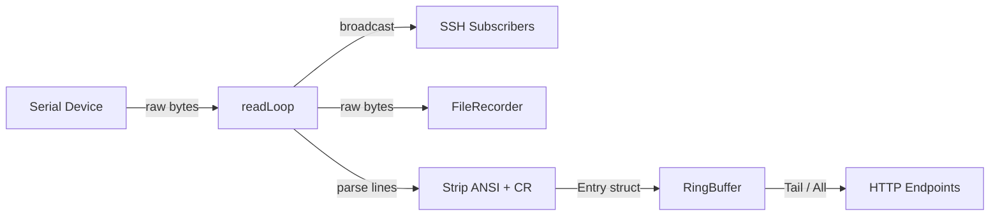
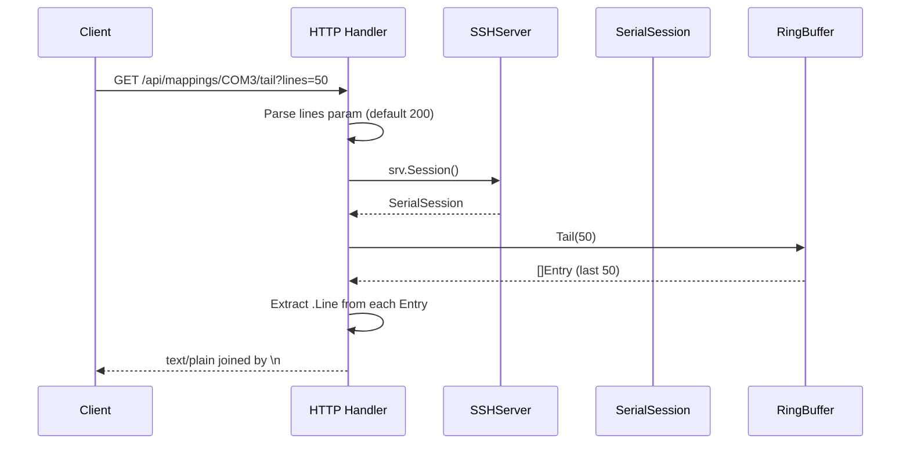
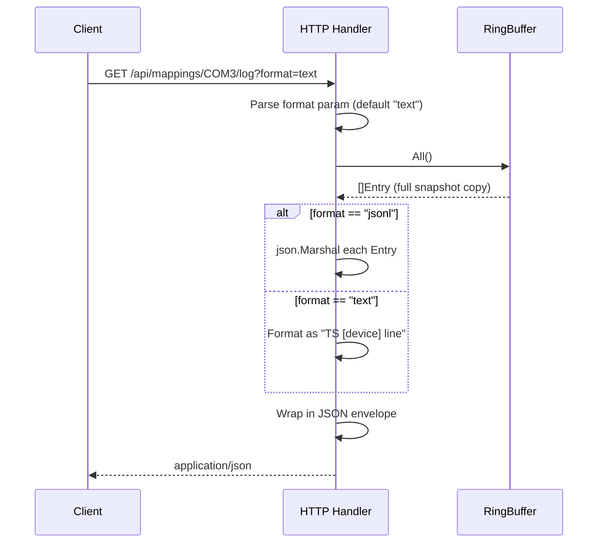

SerialGateway keeps a rolling window of every line received from each serial device in an in-memory **ring buffer**. Two HTTP endpoints — **tail** and **log** — let you retrieve that history at any time without connecting over SSH. The tail endpoint gives you a quick glance at the most recent output (like the Unix `tail` command), while the log endpoint returns the full buffered history with timestamps and structured metadata.

This page explains how to call both endpoints, what they return, and how the underlying data pipeline works.

## Prerequisites: How Data Reaches the Ring Buffer

Before exploring the endpoints, it helps to understand the short journey from serial wire to queryable history. Every time a serial device sends data, the `SerialSession.readLoop()` reads raw bytes, broadcasts them to live SSH subscribers, and then parses the bytes into individual lines. Each completed line is cleaned of ANSI escape codes and carriage returns, assigned a monotonically increasing sequence number, and appended to the session's `RingBuffer` as an `Entry` struct.



An `Entry` carries four fields: a timestamp (`TS`), a sequence number (`Seq`), the cleaned text (`Line`), and the byte length (`Bytes`). The ring buffer enforces two capacity limits — a maximum line count and a maximum total byte count — evicting the oldest entries whenever either limit is exceeded.

Sources: [session.go](internal/serial/session.go#L152-L208), [ringbuffer.go](internal/serial/ringbuffer.go#L8-L41)

## Endpoint Overview

Both endpoints live under the mapping detail route and are dispatched by the `handleMappingDetail` function based on the URL sub-path. The device identifier (e.g., `COM3`) is embedded directly in the URL.

| Feature | Tail Endpoint | Log Endpoint |
|---|---|---|
| **URL** | `GET /api/mappings/{device}/tail` | `GET /api/mappings/{device}/log` |
| **Default data** | Last 200 lines | All buffered entries |
| **Query params** | `?lines=N` | `?format=text\|jsonl` |
| **Content-Type** | `text/plain; charset=utf-8` | `application/json` |
| **Response body** | Raw text (lines joined by `\n`) | JSON object with metadata |
| **Use case** | Quick glance at recent output | Full history with timestamps |

Sources: [handlers.go](internal/http/handlers.go#L136-L149)

## The Tail Endpoint

The tail endpoint is designed for the simplest possible use case: "show me the last N lines from this device." It behaves like the Unix `tail` command — you get raw text, one line per row, with no wrapping JSON or metadata.

### Request

```
GET http://localhost:8080/api/mappings/COM3/tail
GET http://localhost:8080/api/mappings/COM3/tail?lines=50
```

The `lines` query parameter controls how many of the most recent entries to return. If omitted, the handler defaults to **200**. If the requested count exceeds what the ring buffer holds, all available entries are returned — the endpoint never errors on an oversized request.

Sources: [handlers.go](internal/http/handlers.go#L176-L191)

### Response

The response is a plain-text body with `Content-Type: text/plain; charset=utf-8`. Each entry's `Line` field is written verbatim, separated by newline characters:

```
[2024-01-15 10:30:01] System boot complete
Firmware version 2.4.1
Sensor reading: 23.5°C
OK
```

There is no JSON envelope, no timestamps prepended by the handler, and no device name in the output — the text is exactly what the ring buffer stored.

Sources: [handlers.go](internal/http/handlers.go#L184-L190)

### How Tail Works Internally



The handler calls `RingBuffer.Tail(n)`, which acquires a mutex, copies the last `n` entries from the internal slice, and returns them. The copy ensures the caller receives a stable snapshot that will not be affected by concurrent appends.

Sources: [ringbuffer.go](internal/serial/ringbuffer.go#L43-L52)

## The Log Endpoint

The log endpoint provides the **complete ring buffer contents** with timestamps, device identification, and structured metadata. It is the right choice when you need to analyze the full history, export data for processing, or build a simple log viewer.

### Request

```
GET http://localhost:8080/api/mappings/COM3/log
GET http://localhost:8080/api/mappings/COM3/log?format=jsonl
```

The `format` query parameter selects the output encoding. Two formats are supported:

| Format | Description |
|---|---|
| `text` (default) | Each entry rendered as `RFC3339_timestamp [device] line` |
| `jsonl` | Each entry serialized as a JSON object, one per line |

Sources: [handlers.go](internal/http/handlers.go#L193-L224)

### Text Format Response

When `format=text` (or no format is specified), the response is a JSON object with four fields:

```json
{
  "device": "COM3",
  "format": "text",
  "content": "2024-01-15T10:30:01+08:00 [COM3] System boot complete\n2024-01-15T10:30:02+08:00 [COM3] Firmware version 2.4.1",
  "bytes": 128
}
```

The `content` field is a single string where each entry is formatted as `timestamp [device_name] line_text`, joined by `\n`. The `bytes` field reports the byte length of the `content` string.

Sources: [handlers.go](internal/http/handlers.go#L214-L224)

### JSONL Format Response

When `format=jsonl` is specified, each ring buffer entry is independently marshaled to JSON, producing a newline-delimited JSON stream inside the `content` field:

```json
{
  "device": "COM3",
  "format": "jsonl",
  "content": "{\"ts\":\"2024-01-15T10:30:01+08:00\",\"seq\":1,\"line\":\"System boot complete\",\"bytes\":20}\n{\"ts\":\"2024-01-15T10:30:02+08:00\",\"seq\":2,\"line\":\"Firmware version 2.4.1\",\"bytes\":22}",
  "bytes": 180
}
```

Each line within `content` is a self-contained JSON object with four fields:

| Field | Type | Description |
|---|---|---|
| `ts` | string | RFC3339 timestamp of when the line was received |
| `seq` | integer | Monotonically increasing sequence number |
| `line` | string | The cleaned text content (ANSI escapes stripped) |
| `bytes` | integer | Byte length of the `line` value |

Sources: [handlers.go](internal/http/handlers.go#L199-L212), [ringbuffer.go](internal/serial/ringbuffer.go#L8-L13)

### How Log Works Internally



The handler calls `RingBuffer.All()`, which returns a mutex-protected copy of every entry currently held in the buffer. For the text format, each entry is formatted using `fmt.Sprintf` with the RFC3339 timestamp, device name, and line text. For JSONL, the standard `json.Marshal` function serializes each `Entry` struct directly, leveraging its `json` struct tags.

Sources: [handlers.go](internal/http/handlers.go#L193-L224), [ringbuffer.go](internal/serial/ringbuffer.go#L54-L59)

## Ring Buffer Capacity and Eviction

Both endpoints read from the same in-memory ring buffer, so understanding its capacity limits is essential for interpreting what you get back.

The ring buffer is initialized with two limits from the configuration file:

| Config Key | Default | Purpose |
|---|---|---|
| `ring_buffer.max_lines` | 100,000 | Maximum number of line entries to retain |
| `ring_buffer.max_bytes` | 10,485,760 (10 MB) | Maximum total byte size of all stored lines |

Whichever limit is hit first triggers eviction. The buffer removes entries from the **oldest end** one at a time until both constraints are satisfied. This means:

- The **tail endpoint** always returns the most recent data — it is unaffected by eviction as long as you request fewer lines than the buffer holds.
- The **log endpoint** returns whatever is currently in the buffer. If the device has been running for a long time with high throughput, the oldest data will have been evicted.

Sources: [config.go](internal/config/config.go#L42-L45), [config.go](internal/config/config.go#L142-L147), [ringbuffer.go](internal/serial/ringbuffer.go#L31-L41)

### Configuration Example

In `serial-gateway.yaml`:

```yaml
ring_buffer:
  max_lines: 100000
  max_bytes: 10485760   # 10 MB
```

Increasing these values allows the log endpoint to return more historical data at the cost of higher memory usage. Decreasing them reduces the memory footprint but shortens the available history window.

Sources: [serial-gateway.yaml](serial-gateway.yaml#L13-L15)

## Error Handling

Both endpoints share the same error path. If the device does not have an active mapping (no SSH server was created for it), the parent `handleMappingDetail` function returns a 404 before the tail or log handler is ever called:

```json
{"error": "mapping not found for COM99"}
```

If the device exists but the serial port has not yet received any data, the ring buffer will be empty. In that case:

- **Tail** returns an empty body with HTTP 200 (no lines to join).
- **Log** returns a JSON object with an empty `content` string and `bytes: 0`.

Neither endpoint returns an error for an empty buffer — an empty history is a valid state.

Sources: [handlers.go](internal/http/handlers.go#L131-L135)

## Practical Examples

### Quick health check with curl

```bash
# Get the last 20 lines from COM3
curl http://localhost:8080/api/mappings/COM3/tail?lines=20
```

### Export full history to a file

```bash
# Save the text-format log to a local file
curl -s http://localhost:8080/api/mappings/COM3/log | jq -r .content > com3_history.txt
```

### Parse JSONL entries programmatically

```bash
# Extract just the line text from JSONL format
curl -s http://localhost:8080/api/mappings/COM3/log?format=jsonl \
  | jq -r .content \
  | while IFS= read -r json_line; do echo "$json_line" | jq -r .line; done
```

### Monitor recent activity in a script

```bash
# Poll the last 10 lines every 5 seconds
while true; do
  clear
  curl -s http://localhost:8080/api/mappings/COM3/tail?lines=10
  sleep 5
done
```

## Tail vs. Log: When to Use Which

| Scenario | Recommended Endpoint | Why |
|---|---|---|
| "Is the device still sending data?" | **Tail** (`?lines=5`) | Minimal payload, instant answer |
| "What happened in the last hour?" | **Log** (`format=text`) | Full timestamps let you filter by time |
| "I need to parse history in code" | **Log** (`format=jsonl`) | Structured JSON entries with sequence numbers |
| "Show output in a terminal" | **Tail** | Plain text renders directly, no parsing needed |
| "Export data for offline analysis" | **Log** (`format=jsonl`) | Machine-readable with timestamps and byte counts |

## Where to Go Next

Now that you understand how to **read** serial history, the natural next step is learning how to **write** to a serial device and capture the response:

- **[Sending Commands via Write and Exec Endpoints](7-sending-commands-via-write-and-exec-endpoints)** — learn how to send data to a device and receive structured command output.
- **[Ring Buffer: In-Memory History Storage and Retrieval](15-ring-buffer-in-memory-history-storage-and-retrieval)** — deep dive into the ring buffer's concurrency model and eviction algorithm.
- **[File Recorder: Persistent Serial Logging with Size Limits and Trim](21-file-recorder-persistent-serial-logging-with-size-limits-and-trim)** — for persistent on-disk logging that survives restarts (unlike the in-memory ring buffer).