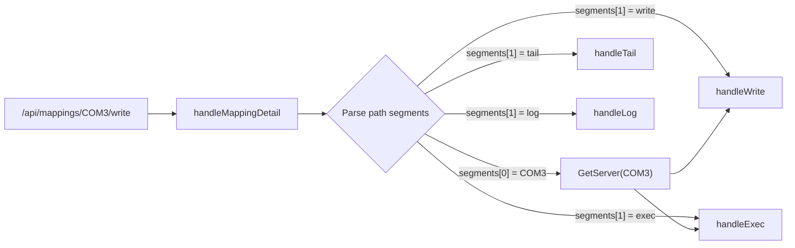
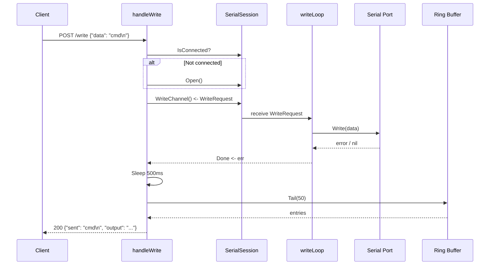
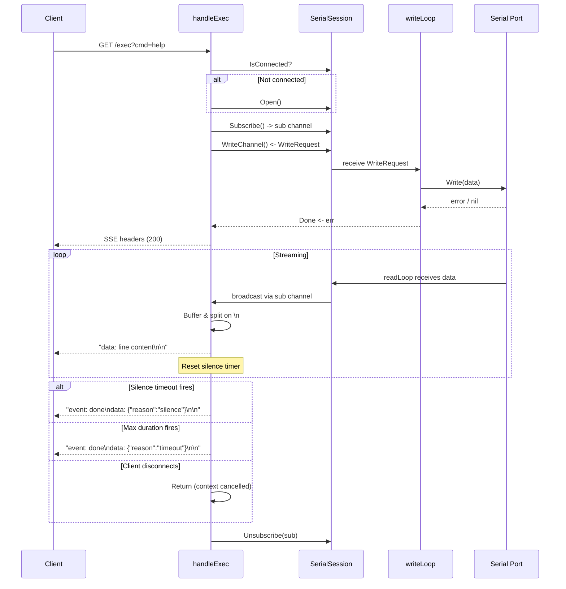

Serial Gateway exposes two HTTP endpoints for sending data to serial devices: **Write** for fire-and-forget payloads with a snapshot of recent output, and **Exec** for command-response workflows with real-time streaming. Understanding when to use each—and how they interact with the serial session's concurrency model—is essential for building reliable automation on top of the gateway.

## Endpoint Overview

Both endpoints live under the mapping detail route `/api/mappings/{device}/` and share the same underlying write pipeline, but they differ fundamentally in how they return results to the caller.

| Dimension | Write Endpoint | Exec Endpoint |
|---|---|---|
| **HTTP Method** | `POST` | `GET` |
| **Route** | `/api/mappings/{device}/write` | `/api/mappings/{device}/exec` |
| **Input** | JSON body `{"data": "..."}` | Query parameter `?cmd=...` |
| **Response format** | JSON (single response) | Server-Sent Events (streaming) |
| **Output capture** | Last 50 lines from ring buffer after 500ms delay | Real-time subscription, line-by-line |
| **Termination** | Immediate after write + delay | Silence timeout or max duration |
| **Best for** | Quick commands, status checks | Interactive command-response, scripted sequences |

Sources: [handlers.go](internal/http/handlers.go#L227-L281), [exec.go](internal/http/exec.go#L15-L155)

## Routing and Request Dispatch

The URL `/api/mappings/{device}/write` is handled by a single dispatcher function that parses the URL path to extract both the device identifier and the action sub-path. The `handleMappingDetail` function splits the path after `/api/mappings/`, treats the first segment as the device name, and routes to the appropriate handler based on the second segment.



If the SSH server (and therefore the serial session) for the requested device does not exist, the dispatcher returns a `404` with the message `"mapping not found for {device}"`. This means the device must first be registered as a mapping via the `POST /api/mappings` endpoint before write or exec operations can succeed.

Sources: [handlers.go](internal/http/handlers.go#L113-L156), [server.go](internal/http/server.go#L26-L34)

## Write Endpoint: POST /api/mappings/{device}/write

The write endpoint provides a simple request-response pattern: send data to the serial port, wait briefly for the device to respond, then return a snapshot of the most recent output from the ring buffer.

### Request Format

```http
POST /api/mappings/COM3/write
Content-Type: application/json

{
  "data": "version\n"
}
```

The `data` field is required and must be non-empty. It is sent as raw bytes to the serial port—no encoding or escaping is applied by the gateway. Include `\n` in your data string if the device expects a newline terminator.

Sources: [handlers.go](internal/http/handlers.go#L227-L242)

### Processing Pipeline



The handler performs the following steps in sequence:

1. **Connection check** — If the serial session is not connected, it attempts to open the port automatically. A failure here returns `500` with the error message.
2. **Write dispatch** — A `WriteRequest` containing the data and a `Done` channel is sent to the session's buffered write channel (capacity 64). The `writeLoop` goroutine picks it up and performs the actual port write.
3. **Write confirmation** — The handler blocks on the `Done` channel, subject to the configured `write_timeout` (default 10 seconds). If the timeout fires first, a `500` error is returned.
4. **Response delay** — After a successful write, the handler sleeps for **500 milliseconds** to give the device time to produce output.
5. **Snapshot capture** — The last 50 entries from the ring buffer are collected and returned as the `output` field.

Sources: [handlers.go](internal/http/handlers.go#L244-L281), [session.go](internal/serial/session.go#L211-L231)

### Response Format

```json
{
  "sent": "version\n",
  "output": "Firmware v2.3.1\nBuild 2024-01-15\nOK"
}
```

The `output` field contains lines joined by `\n`. Since it draws from the ring buffer (which stores all recent serial output, not just the response to your command), it may include lines that arrived from other sources or background device output.

Sources: [handlers.go](internal/http/handlers.go#L270-L281)

## Exec Endpoint: GET /api/mappings/{device}/exec

The exec endpoint is designed for command-response interactions where you need to capture the device's output in real time. It uses **Server-Sent Events (SSE)** to stream each line of output as it arrives, then terminates the stream when the device goes silent or a maximum duration is reached.

### Request Format

```http
GET /api/mappings/COM3/exec?cmd=help
```

The `cmd` query parameter is required. Like the write endpoint, the command string is sent as raw bytes—append `\n` if your device requires a newline. Two optional query parameters control termination behavior:

| Parameter | Type | Default | Description |
|---|---|---|---|
| `cmd` | string | *(required)* | The command string to send |
| `silence_timeout` | float (seconds) | `5.0` | End the stream after this many seconds of no output |
| `max_duration` | float (seconds) | `30.0` | Hard cap on total stream duration |

Example with overrides:

```http
GET /api/mappings/COM3/exec?cmd=factory_reset&silence_timeout=10&max_duration=60
```

Sources: [exec.go](internal/http/exec.go#L21-L80), [config.go](internal/config/config.go#L20-L22)

### Processing Pipeline



The critical architectural decision in the exec endpoint is the **subscribe-before-write** pattern. The handler calls `sess.Subscribe()` to register for broadcast messages *before* sending the command to the write channel. This guarantees that no output produced by the device in response to the command is missed—even if the device responds within milliseconds.

Sources: [exec.go](internal/http/exec.go#L36-L44), [session.go](internal/serial/session.go#L137-L143)

### SSE Stream Protocol

The exec endpoint sets the standard SSE headers and streams data using the `text/event-stream` content type. Each complete line received from the serial device is sent as an SSE `data:` field. The stream concludes with a named `done` event containing a JSON payload with the termination reason.

**Data events** — one per complete line from the device:

```
data: Firmware v2.3.1

data: Available commands: help, version, status

data: OK

```

**Termination event** — signals end of stream:

```
event: done
data: {"reason":"silence"}

```

The `reason` field is either `"silence"` (no data received within the silence timeout window) or `"timeout"` (the maximum duration was reached). Any partial data remaining in the line buffer is flushed before the done event is emitted.

Sources: [exec.go](internal/http/exec.go#L57-L153)

### Line Buffering Logic

Incoming serial data does not necessarily arrive in clean line-delimited chunks. The exec handler implements a line accumulator that buffers partial data and emits complete lines as they become available. Data is appended to `lineBuf`, then scanned for `\n` characters. Each complete line is trimmed of trailing `\r` and emitted as an SSE event. Partial lines remain buffered until either more data arrives or a termination event forces a flush.

Sources: [exec.go](internal/http/exec.go#L87-L153)

## The Shared Write Pipeline

Both endpoints rely on the same concurrency-safe write mechanism. The `SerialSession` exposes a buffered channel (`writeCh`, capacity 64) that accepts `WriteRequest` structs. A dedicated `writeLoop` goroutine drains this channel sequentially, ensuring that writes to the physical serial port are never concurrent.

```go
type WriteRequest struct {
    Data []byte
    Done chan error
}
```

The `Done` channel provides synchronous error reporting: the caller blocks until the write completes or fails. The HTTP handlers add a timeout layer on top (`write_timeout`, default 10 seconds) to prevent indefinite blocking if the write loop stalls.

Sources: [session.go](internal/serial/session.go#L19-L22), [session.go](internal/serial/session.go#L211-L231), [config.go](internal/config/config.go#L133-L135)

### Auto-Open Behavior

Both endpoints attempt to open the serial port automatically if it is not currently connected. This is useful for first-time access but means that a write or exec call may trigger the port open sequence (including baud rate negotiation). If the port is physically disconnected, the auto-open will fail with a `500` error; however, the session's background reconnection loop will attempt to restore the connection independently.

Sources: [handlers.go](internal/http/handlers.go#L245-L249), [exec.go](internal/http/exec.go#L28-L33), [session.go](internal/serial/session.go#L263-L280)

## Configuration Reference

The following configuration values in `serial_defaults` directly affect write and exec behavior:

| Config Key | Type | Default | Affects |
|---|---|---|---|
| `write_timeout` | duration | `10s` | Maximum time to wait for serial write confirmation (both endpoints) |
| `exec_silence_timeout` | duration | `5s` | Default silence gap before exec stream terminates |
| `exec_max_duration` | duration | `30s` | Default hard cap on exec stream lifetime |

These values are set in `serial-gateway.yaml` and can also be modified at runtime via the `PUT /api/config` endpoint.

Sources: [config.go](internal/config/config.go#L14-L23), [config.go](internal/config/config.go#L133-L141), [serial-gateway.yaml](serial-gateway.yaml#L6-L13)

## Practical Examples

### Sending a Simple Command with Write

```bash
curl -X POST http://localhost:8080/api/mappings/COM3/write \
  -H "Content-Type: application/json" \
  -d '{"data": "status\n"}'
```

Response:

```json
{
  "sent": "status\n",
  "output": "Temperature: 42C\nUptime: 3h15m\nOK"
}
```

### Streaming Command Output with Exec

```bash
curl -N "http://localhost:8080/api/mappings/COM3/exec?cmd=help"
```

Output:

```
data: Available commands:

data:   help     - Show this help

data:   version  - Show firmware version

data:   status   - Show device status

event: done
data: {"reason":"silence"}
```

### Exec with Custom Timeouts

For commands that produce output slowly (e.g., a diagnostic scan), increase the silence timeout:

```bash
curl -N "http://localhost:8080/api/mappings/COM3/exec?cmd=diag_full&silence_timeout=15&max_duration=120"
```

### Consuming Exec SSE in JavaScript

```javascript
const eventSource = new EventSource(
  "http://localhost:8080/api/mappings/COM3/exec?cmd=help"
);

eventSource.onmessage = (event) => {
  console.log("Line:", event.data);
};

eventSource.addEventListener("done", (event) => {
  const info = JSON.parse(event.data);
  console.log("Stream ended:", info.reason);
  eventSource.close();
});
```

## Error Handling

Both endpoints return structured JSON errors for failure conditions:

| HTTP Status | Condition | Error Message Pattern |
|---|---|---|
| `400` | Missing `data` (write) or `cmd` (exec) | `"data is required"` / `"cmd query parameter is required"` |
| `400` | Malformed JSON body (write) | `"invalid request body"` |
| `404` | Device not mapped | `"mapping not found for {device}"` |
| `405` | Wrong HTTP method | `"method not allowed, use POST"` / `"method not allowed, use GET"` |
| `500` | Serial port open failure | `"serial open failed: {detail}"` |
| `500` | Write operation failure | `"write timeout"` or port error |

Sources: [handlers.go](internal/http/handlers.go#L228-L268), [exec.go](internal/http/exec.go#L16-L54)

## Choosing Between Write and Exec

Use **Write** when you need a simple fire-and-forget interaction, the response is not time-critical, or you're integrating with systems that don't support SSE streaming. The 500ms delay and ring buffer snapshot approach works well for status polling and configuration commands.

Use **Exec** when you need deterministic capture of command output, real-time streaming for UI display, or when commands produce multi-line responses with variable timing. The subscribe-before-write pattern ensures zero data loss, and the silence-based termination adapts to variable response lengths without requiring you to know the output size in advance.

For further reading on how serial data flows through the session and into consumers, see [Read Broadcasting and Write Queue Concurrency Model](13-read-broadcasting-and-write-queue-concurrency-model). For details on the SSE streaming implementation, see [Server-Sent Events (SSE) Streaming for Command Execution](19-server-sent-events-sse-streaming-for-command-execution). To understand how the ring buffer stores the history that the write endpoint snapshots, see [Ring Buffer: In-Memory History Storage and Retrieval](15-ring-buffer-in-memory-history-storage-and-retrieval).