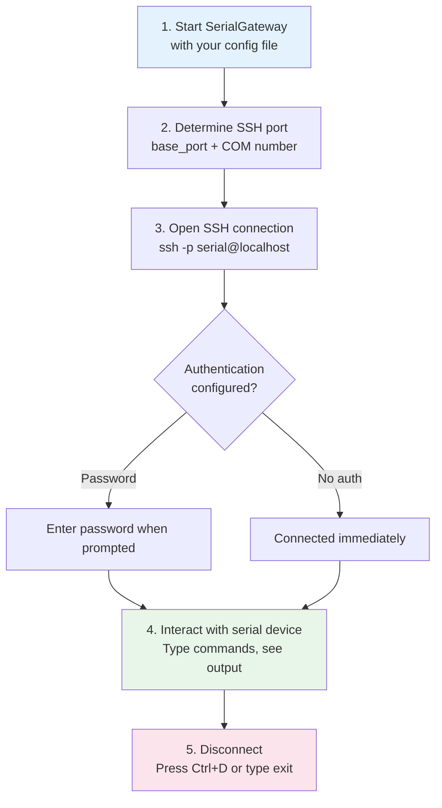
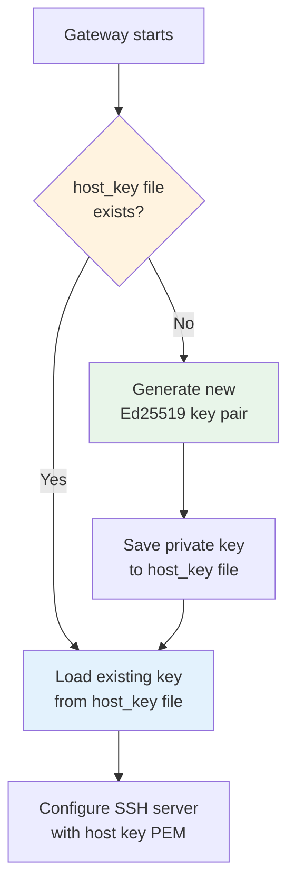
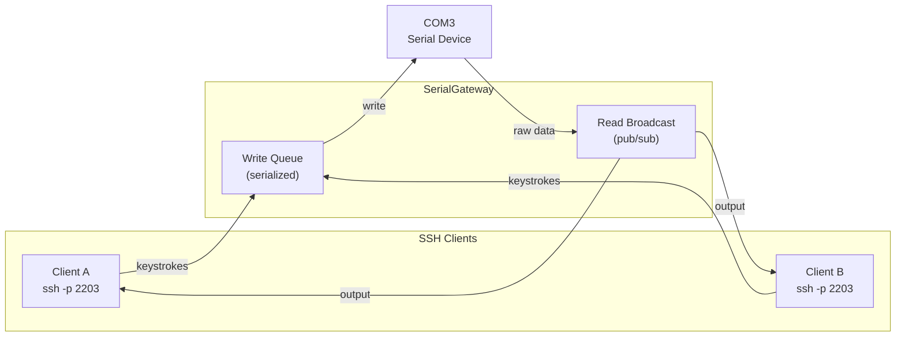

SerialGateway transforms each physical COM port into an SSH-accessible endpoint, allowing you to interact with serial devices using any standard SSH client. Instead of relying on specialized serial terminal software, you simply open an SSH session and work with the device as if you were directly connected to its console. This page walks you through the port mapping logic, connection procedure, authentication setup, and practical usage patterns.

## How SSH Port Mapping Works

Every COM port managed by SerialGateway is automatically assigned a unique SSH listening port. The mapping follows a deterministic formula that makes it easy to calculate the correct port without consulting any lookup table.


The formula is straightforward: **SSH port = `base_port` + COM port number**. The `base_port` value is defined in the `ssh` section of your configuration file and defaults to `2200` if not specified. The COM port number is extracted by stripping the `COM` prefix from the device name and parsing the remaining digits.

Sources: [server.go](internal/ssh/server.go#L20-L30), [config.go](internal/config/config.go#L148-L150)

### Port Mapping Examples

| COM Device | Calculation | SSH Port |
|---|---|---|
| COM3 | 2200 + 3 | **2203** |
| COM8 | 2200 + 8 | **2208** |
| COM25 | 2200 + 25 | **2225** |
| COM1 | 2200 + 1 | **2201** |

> **Customizing the base port**: If the default range conflicts with existing services, change `base_port` in `serial-gateway.yaml` under the `ssh` section. For example, setting `base_port: 3200` would map COM3 to port 3203.

Sources: [server_test.go](internal/ssh/server_test.go#L10-L21)

## Prerequisites

Before connecting via SSH, ensure the following conditions are met:

1. **SerialGateway is running** — the gateway process must be started and actively managing at least one COM port. See [Quick Start](2-quick-start) for launch instructions.
2. **The target COM port is configured** — the device must appear in the `ports` list of `serial-gateway.yaml`, or it must have been added at runtime via the HTTP API.
3. **An SSH client is available** — any standard SSH client works (OpenSSH `ssh` command, PuTTY, Windows Terminal, or programmatic libraries like Go's `golang.org/x/crypto/ssh`).
4. **Firewall allows the SSH port** — the calculated SSH port (e.g., 2203) must not be blocked by local firewall rules.

Sources: [serial-gateway.yaml](serial-gateway.yaml#L55-L59), [portmanager.go](internal/core/portmanager.go#L30-L68)

## Step-by-Step: Connecting with an SSH Client



### Step 1: Verify the Gateway Is Running

Check that SerialGateway is active and your COM port is mapped by querying the HTTP API:

```powershell
curl http://localhost:18080/api/mappings
```

A successful response looks like:

```json
{
  "mappings": [
    {
      "serial_port": "COM3",
      "ssh_port": 2203,
      "connected": false,
      "baudrate": 115200
    }
  ]
}
```

The `ssh_port` field confirms which port to use. The `connected` field indicates whether the underlying serial port is currently open (it opens automatically on first SSH connection).

Sources: [handlers.go](internal/http/handlers.go#L69-L83)

### Step 2: Connect via SSH

Use your SSH client to connect to `localhost` on the mapped port. The default username is `serial`:

```powershell
ssh -p 2203 serial@localhost
```

**What happens behind the scenes**: When your SSH session is established, SerialGateway performs the following sequence automatically:

1. Opens the serial port if it is not already connected (using the configured baudrate and serial parameters).
2. Subscribes your SSH session to the serial port's read broadcast, so all incoming serial data is forwarded to your terminal.
3. Captures your keyboard input and writes it to the serial port through a queued write channel, ensuring safe concurrent access.

Sources: [handler.go](internal/ssh/handler.go#L15-L73)

### Step 3: Interact with the Device

Once connected, you are interacting directly with the serial device. Everything you type is sent to the device, and everything the device outputs appears in your terminal. This is identical to sitting at the device's physical console.

```
# Example: connected to a Linux-based embedded device via COM3
root@device:~# ls /dev/
ttyS0  ttyS1  null  zero
root@device:~# cat /etc/hostname
embedded-board-01
root@device:~#
```

**Line ending handling**: SerialGateway automatically normalizes line endings for terminal compatibility. Incoming serial data with `\r\n` sequences is converted to `\n` and then back to `\r\n` before being sent to your SSH client, ensuring correct display in standard terminal emulators.

Sources: [handler.go](internal/ssh/handler.go#L37-L41)

### Step 4: Disconnect

To end your SSH session, press `Ctrl+D` or type `exit` if the remote device supports it. Alternatively, closing your terminal window terminates the connection. When you disconnect, SerialGateway unsubscribes your session from the read broadcast but keeps the serial port open for other consumers (other SSH clients, the HTTP API, or the file recorder).

Sources: [handler.go](internal/ssh/handler.go#L32-L33)

## Authentication Configuration

SerialGateway supports password-based SSH authentication. The authentication behavior is controlled by the `ssh.auth` section in `serial-gateway.yaml`.

| Configuration Field | Type | Default | Description |
|---|---|---|---|
| `ssh.auth.type` | string | `"password"` | Authentication method. Set to `"password"` to require a password. |
| `ssh.auth.password` | string | *(empty)* | The password clients must provide. If empty, any password is accepted when type is `"password"`. |

### Example: Setting a Password

```yaml
ssh:
  base_port: 2200
  auth:
    type: "password"
    password: "my-secret-password"
```

With this configuration, connecting clients will be prompted for a password:

```powershell
ssh -p 2203 serial@localhost
# serial@localhost's password: my-secret-password
```

### Example: No Authentication (Development Only)

If `auth.type` is set to `"password"` but no `password` value is configured, the gateway will still prompt for a password but will reject all attempts since the comparison checks against an empty string. To allow open access during development, you would need to explicitly set a known password and share it.

> **Security note**: Password authentication transmits credentials over the SSH-encrypted channel, so it is safe from network sniffing. However, for production deployments, consider using public key authentication (configured via `ssh.auth.public_keys`) for stronger identity verification.

Sources: [config.go](internal/config/config.go#L25-L34), [server.go](internal/ssh/server.go#L110-L114), [serial-gateway.yaml](serial-gateway.yaml#L17-L21)

## Host Key Management

SSH servers identify themselves to clients using a **host key**. SerialGateway automatically manages this key so you never need to generate one manually.



On first startup, SerialGateway generates an **Ed25519** key pair and saves the private key to a file named `host_key` in the working directory (with `0600` permissions for security). On subsequent startups, this file is loaded and reused, ensuring that SSH clients see a consistent server identity and do not trigger "host key changed" warnings.

If your SSH client warns about a host key change, it usually means the `host_key` file was deleted and regenerated. You can resolve this by removing the old entry from your `~/.ssh/known_hosts` file:

```powershell
ssh-keygen -R "[localhost]:2203"
```

Sources: [server.go](internal/ssh/server.go#L64-L92), [server.go](internal/ssh/server.go#L101-L109)

## Connecting from Code (Programmatic Access)

For automated workflows or test scripts, you can connect to a serial device programmatically using Go's `golang.org/x/crypto/ssh` library. The following pattern mirrors what SerialGateway's own integration tests use:

```go
package main

import (
    "fmt"
    "time"

    gossh "golang.org/x/crypto/ssh"
)

func main() {
    config := &gossh.ClientConfig{
        User: "serial",
        Auth: []gossh.AuthMethod{
            gossh.Password("serial"),
        },
        HostKeyCallback: gossh.InsecureIgnoreHostKey(),
        Timeout:         10 * time.Second,
    }

    conn, err := gossh.Dial("tcp", "localhost:2203", config)
    if err != nil {
        panic(err)
    }
    defer conn.Close()

    session, err := conn.NewSession()
    if err != nil {
        panic(err)
    }
    defer session.Close()

    stdin, _ := session.StdinPipe()
    session.Stdout = os.Stdout

    session.Shell()

    // Send a command to the serial device
    fmt.Fprintf(stdin, "ls /dev/\n")
    time.Sleep(2 * time.Second)
}
```

**Key points for programmatic clients**:
- Use `session.Shell()` rather than `session.Run()` — SerialGateway provides an interactive serial bridge, not a command execution environment.
- The `HostKeyCallback` can be set to `InsecureIgnoreHostKey()` for testing, but production code should verify the host key.
- Writes sent to `stdin` are forwarded character-by-character to the serial device through the write queue, with a configurable timeout (default: 10 seconds).

Sources: [ssh_echo_test.go](tests/ssh_echo_test.go#L11-L65), [handler.go](internal/ssh/handler.go#L45-L69)

## Write Behavior and Timeout

When you type characters in your SSH session, each keystroke is packaged into a `WriteRequest` and sent through the serial session's write channel. This channel has a buffer capacity of 64 requests, providing backpressure protection if the serial device is slow to accept data.

Each write operation waits for acknowledgment with a timeout governed by `serial_defaults.write_timeout` (default: **10 seconds**). If the serial port does not accept the data within this window, your SSH session receives a `[write timeout]` message. Similarly, if the serial port encounters an error during writing, a `[write error: ...]` message appears in your terminal.

| Scenario | What You See |
|---|---|
| Successful write | Characters appear on device (echoed back if device supports it) |
| Write timeout (>10s) | `[write timeout]` |
| Serial port write error | `[write error: <details>]` |
| Serial port not connected | `[serial disconnected - waiting for reconnect...]` |

Sources: [handler.go](internal/ssh/handler.go#L55-L68), [session.go](internal/serial/session.go#L58)

## Multiple Simultaneous Connections

SerialGateway supports **multiple SSH clients connected to the same COM port simultaneously**. Each SSH session subscribes independently to the serial port's read broadcast, meaning all connected clients see the same output in real-time. Writes from any client are serialized through the shared write channel, preventing data corruption.



This is useful for scenarios like pair debugging, where two developers need to observe and interact with the same device console at the same time.

Sources: [session.go](internal/serial/session.go#L137-L150), [handler.go](internal/ssh/handler.go#L32-L43)

## Troubleshooting

| Symptom | Likely Cause | Resolution |
|---|---|---|
| `Connection refused` on SSH port | Gateway not running or COM port not configured | Start SerialGateway and verify the port appears in `GET /api/mappings` |
| `Permission denied` during login | Incorrect password | Check `ssh.auth.password` in your config matches what you typed |
| `[serial open failed: ...]` after connecting | COM port is in use by another application | Close any other program (e.g., PuTTY, Arduino IDE) that has the COM port open |
| `[serial disconnected - waiting for reconnect...]` | Physical cable unplugged or device powered off | Reconnect the cable or power on the device; SerialGateway will auto-reconnect |
| Host key warning from SSH client | `host_key` file was regenerated | Run `ssh-keygen -R "[localhost]:<port>"` to clear the old key |
| Characters not appearing after typing | Device echo disabled or write timeout | Verify the device is configured to echo input; check `write_timeout` in config |

Sources: [handler.go](internal/ssh/handler.go#L22-L30), [server.go](internal/ssh/server.go#L94-L125)

## Configuration Quick Reference

Here is a minimal configuration focused on the SSH-relevant settings:

```yaml
ssh:
  base_port: 2200          # SSH port = base_port + COM number
  auth:
    type: "password"       # Authentication type
    password: "serial"     # Required password for SSH login

serial_defaults:
  baudrate: 115200         # Default baudrate for serial connections
  write_timeout: 10s       # How long to wait for serial write confirmation

ports:
  - device: "COM3"         # First managed serial port → SSH on 2203
    baudrate: 115200
  - device: "COM8"         # Second managed serial port → SSH on 2208
    baudrate: 9600
```

Sources: [serial-gateway.yaml](serial-gateway.yaml#L17-L21), [config.go](internal/config/config.go#L31-L34), [config.go](internal/config/config.go#L14-L23)

## What's Next

Now that you can connect to serial devices via SSH, explore these related topics:

- **[Port Discovery and Mapping Management](5-port-discovery-and-mapping-management)** — Learn how to dynamically add or remove COM port mappings at runtime via the HTTP API, without restarting the gateway.
- **[Reading Serial History: Tail and Log Endpoints](6-reading-serial-history-tail-and-log-endpoints)** — Access serial output history even when you weren't connected, using the `/tail` and `/log` HTTP endpoints.
- **[Sending Commands via Write and Exec Endpoints](7-sending-commands-via-write-and-exec-endpoints)** — Send commands to serial devices programmatically via HTTP instead of SSH, with structured response streaming.
- **[SSH Port Mapping Strategy and Host Key Management](11-ssh-port-mapping-strategy-and-host-key-management)** — A deeper architectural dive into how SSH servers are created, managed, and secured per port.