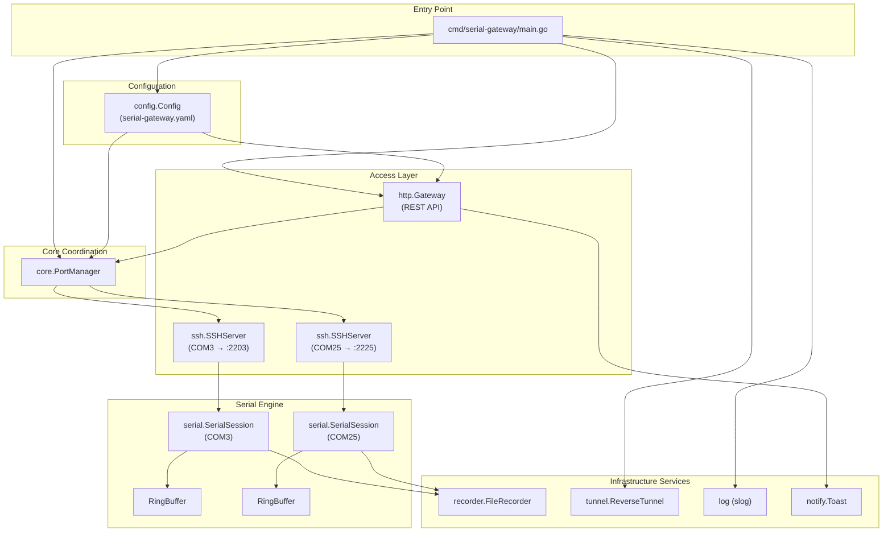
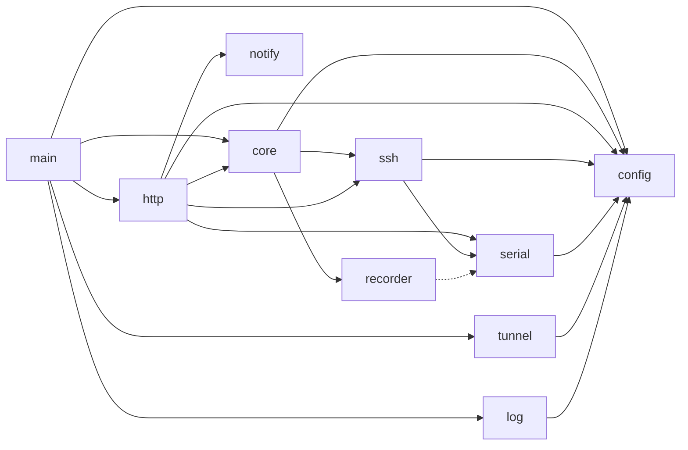
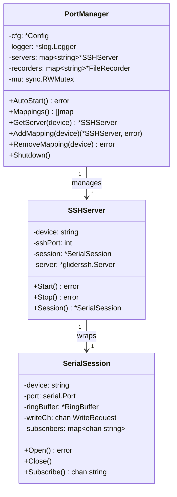
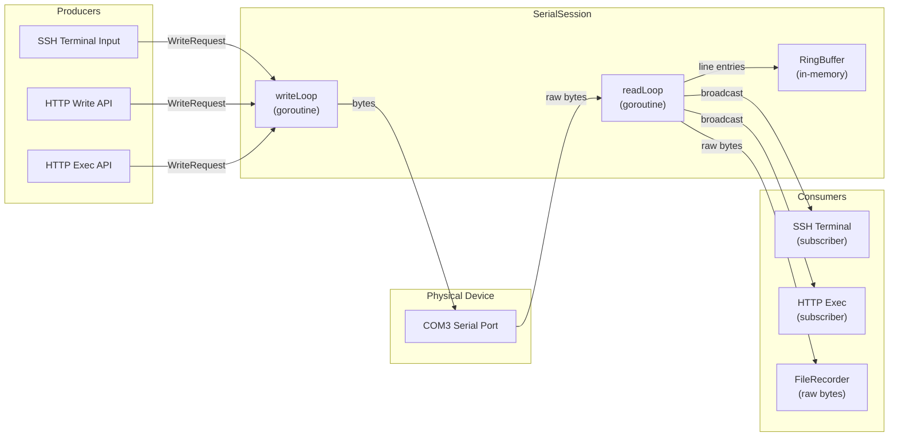

SerialGateway is a Go-based service that bridges physical serial (COM) ports to network-accessible interfaces. It exposes each connected serial device through both an **SSH terminal** and an **HTTP REST API**, enabling remote interaction with hardware that traditionally requires direct physical access. This page provides a structural understanding of how the system's components fit together, the data flows between them, and the design decisions that shape the codebase.

## High-Level Architecture

The system follows a **layered architecture** with four distinct tiers: a thin bootstrap entry point, a core coordination layer, dual access protocols (HTTP and SSH), and the serial communication engine at the foundation.

The entry point in `main.go` orchestrates startup in a linear sequence: load configuration, initialize the logger, create the PortManager, auto-start all configured serial port mappings, optionally launch reverse tunnels, and finally start the HTTP server in a background goroutine. The process then blocks on an OS interrupt signal before performing orderly shutdown.

Sources: [main.go](cmd/serial-gateway/main.go#L17-L80)

## Project Structure

The codebase is organized under a standard Go project layout with clear package boundaries:

| Directory | Package | Responsibility |
|---|---|---|
| `cmd/serial-gateway/` | `main` | Application entry point; bootstraps all services |
| `internal/config/` | `config` | YAML configuration parsing with typed defaults |
| `internal/core/` | `core` | PortManager — coordinates SSH servers and recorders per device |
| `internal/serial/` | `serial` | Serial port I/O, session lifecycle, ring buffer, port enumeration |
| `internal/ssh/` | `ssh` | Per-device SSH server; bridges terminal I/O to serial sessions |
| `internal/http/` | `http` | REST API gateway; route registration and request handlers |
| `internal/recorder/` | `recorder` | Asynchronous file-based serial logging with size trimming |
| `internal/tunnel/` | `tunnel` | Reverse SSH tunnel for exposing local services remotely |
| `internal/notify/` | `notify` | Windows toast notification dispatch via PowerShell |
| `internal/log/` | `log` | Structured logging with color text and JSON format support |

Sources: [go.mod](go.mod#L1-L18)

## Component Dependency Graph

Understanding which packages depend on which reveals the system's coupling boundaries. The architecture is designed so that lower-level packages (serial, config) have no knowledge of higher-level ones (http, ssh), and cross-cutting concerns are injected rather than imported directly.

The **serial** package sits at the bottom of the dependency graph — it knows only about `config` and the third-party `go.bug.st/serial` library. The **ssh** package depends on `serial` because it creates `SerialSession` instances and bridges their I/O. The **http** package depends on both `core` (to query and mutate mappings) and `serial` (to access ring buffer data and write channels). This one-directional dependency flow prevents circular references and keeps the serial engine testable in isolation.

Sources: [portmanager.go](internal/core/portmanager.go#L1-L11), [server.go](internal/ssh/server.go#L1-L18), [server.go](internal/http/server.go#L1-L10)

## The PortManager: Central Coordinator

The `PortManager` is the architectural keystone — it owns the lifecycle of every active serial-to-SSH mapping. It maintains two concurrent-safe maps: one of `ssh.SSHServer` instances keyed by device name (e.g., "COM3"), and one of `recorder.FileRecorder` instances for persistent logging.

During `AutoStart()`, the PortManager iterates over every port entry in the configuration. For each device, it creates an `SSHServer` (which internally creates a `SerialSession`), starts the SSH listener, and attaches a `FileRecorder` to the session. The `AddMapping()` and `RemoveMapping()` methods allow the HTTP API to create and destroy mappings at runtime with full mutex protection.

Sources: [portmanager.go](internal/core/portmanager.go#L13-L130)

## Data Flow: Serial I/O Pipeline

The most critical architectural pattern is the **serial I/O pipeline**, which governs how bytes flow from a physical device to all connected consumers. This pipeline operates through three parallel paths that fork from a single `readLoop` goroutine.

**Read path**: The `readLoop` reads up to 1024 bytes at a time from the serial port. Each chunk is simultaneously broadcast to all subscribers (SSH sessions and exec handlers), written to the file recorder, and split into newline-delimited entries for the ring buffer. ANSI escape sequences are stripped before storage, and a monotonically increasing sequence number is attached to each entry.

**Write path**: All write operations are serialized through a buffered channel (`writeCh`, capacity 64). The `writeLoop` dequeues `WriteRequest` structs, performs the physical write, and signals completion through a per-request `Done` channel. This channel-based serialization prevents concurrent writes from interleaving on the wire.

**Disconnect handling**: When a read error occurs, `handleDisconnect()` closes the port, resets the stop channel, and spawns a `reconnectLoop()` that attempts to reopen the port at the configured retry interval. During disconnection, the write loop discards or buffers writes based on the `DiscardInputOnDisconnect` configuration flag.

Sources: [session.go](internal/serial/session.go#L152-L280), [ringbuffer.go](internal/serial/ringbuffer.go#L1-L60)

## Access Layer: Dual Protocol Exposure

SerialGateway exposes serial devices through two independent protocol paths that share the same underlying `SerialSession`:

| Aspect | SSH Gateway | HTTP REST API |
|---|---|---|
| **Primary use case** | Interactive terminal access | Programmatic automation and monitoring |
| **Connection model** | Persistent session (pub/sub) | Request-response (stateless) |
| **Data access** | Real-time stream via subscriber | Ring buffer queries (tail, log) |
| **Write mechanism** | Terminal input → WriteChannel | JSON payload → WriteChannel |
| **Port assignment** | `base_port + COM number` | Single shared HTTP port |
| **Library** | `gliderlabs/ssh` | `net/http` (stdlib) |

The **SSH gateway** creates one `gliderlabs/ssh` server per device. When a client connects, the handler in `handler.go` opens the serial port if needed, subscribes to the broadcast channel, and bidirectionally bridges terminal I/O with the serial session. Line endings are normalized (`\n` → `\r\n`) for terminal compatibility.

The **HTTP gateway** uses a single `net/http.ServeMux` with route handlers that delegate to the `PortManager` for mapping operations and directly to `SerialSession` for data access. The exec endpoint is architecturally notable — it uses **Server-Sent Events (SSE)** to stream command output in real time, subscribing before writing so no output is missed, and terminating on either a silence timeout or a maximum duration.

Sources: [handler.go](internal/ssh/handler.go#L15-L73), [server.go](internal/http/server.go#L26-L40), [exec.go](internal/http/exec.go#L15-L155)

## SSH Port Mapping Strategy

The mapping from physical COM port to SSH listening port follows a deterministic arithmetic convention. The function `PortMapping()` extracts the numeric suffix from a device name (e.g., "COM3" → 3) and adds it to the configured `base_port` (default: 2200).

| Device | SSH Port (base 2200) |
|---|---|
| COM3 | 2203 |
| COM8 | 2208 |
| COM25 | 2225 |

This convention means that anyone who knows the COM port number and the base port can predictably determine the SSH endpoint without querying the API. Each SSH server generates or loads a persistent Ed25519 host key from a `host_key` file, ensuring stable key fingerprints across restarts.

Sources: [server.go](internal/ssh/server.go#L20-L30), [server.go](internal/ssh/server.go#L64-L92)

## Infrastructure Services

Beyond the core serial-to-network bridge, several infrastructure services operate as independent subsystems:

### Reverse SSH Tunnel

The `ReverseTunnel` component establishes an outbound SSH connection to a remote host and opens a reverse TCP listener. Incoming connections on the remote port are forwarded bidirectionally to a local port (typically the HTTP API port). This enables remote machines to access the gateway's HTTP API as if it were local. The tunnel includes automatic reconnection with exponential backoff (1s → 30s max) and proactive killing of residual processes holding the remote port.

Sources: [reverse.go](internal/tunnel/reverse.go#L18-L251)

### File Recorder

The `FileRecorder` provides persistent serial output logging with asynchronous writes (buffered channel of 256 entries). When the file exceeds `max_size_mb`, a trim operation removes the oldest `trim_size_mb` bytes from the head of the file, preserving recent data. The recorder is attached to a `SerialSession` via the `SetRecorder()` method and receives raw bytes directly from the read loop.

Sources: [recorder.go](internal/recorder/recorder.go#L13-L200)

### Structured Logging

The logging subsystem wraps Go's `log/slog` with a custom compact text handler that supports ANSI color output for terminal targets and JSON format for file targets. When configured for file output, it uses `lumberjack.Logger` for automatic log rotation with configurable max size, age, backup count, and compression.

Sources: [log.go](internal/log/log.go#L157-L200)

### Toast Notifications

The notify package dispatches Windows toast notifications by generating XML toast templates, embedding them in PowerShell scripts, and executing via `-EncodedCommand` (UTF-16LE + Base64). Non-ASCII characters are converted to XML numeric character references to avoid encoding issues across the Go/PowerShell/XML boundary. This is exposed through the `POST /api/notify` HTTP endpoint.

Sources: [toast.go](internal/notify/toast.go#L1-L111), [notify_handler.go](internal/http/notify_handler.go#L16-L50)

## Configuration Architecture

All runtime behavior is driven by a single `Config` struct parsed from a YAML file. The configuration is organized into orthogonal sections, each with sensible defaults applied by `applyDefaults()`:

| Section | Purpose | Key Defaults |
|---|---|---|
| `gateway` | HTTP listener port | `8080` |
| `serial_defaults` | Baud rate, parity, timeouts | `115200`, `8N1`, 5s timeout |
| `ring_buffer` | In-memory history limits | 100K lines, 10MB |
| `ssh` | SSH base port and auth | Port `2200`, password auth |
| `reconnect` | Retry intervals on disconnect | 1s initial, 30s max |
| `reverse_tunnel` | Remote access tunnel config | Optional (empty = disabled) |
| `file_recording` | Persistent log settings | `./serial_logs`, 1GB max |
| `logging` | Application log settings | `info` level, text format |
| `ports` | Device list with per-port baud rate | Empty (no auto-start) |

If the YAML file is missing, the system boots with all defaults and an empty port list — a deliberate design choice that allows the binary to start without any configuration and be managed entirely through the HTTP API.

Sources: [config.go](internal/config/config.go#L80-L229), [serial-gateway.yaml](serial-gateway.yaml#L1-L59)

## Concurrency Model Summary

The system employs several concurrency patterns, each chosen for its specific use case:

| Pattern | Where Used | Purpose |
|---|---|---|
| **Channel-based write queue** | `SerialSession.writeCh` | Serialize all writes to a serial port |
| **Pub/sub broadcast** | `SerialSession.subscribers` | Fan-out read data to multiple consumers |
| **sync.RWMutex** | `PortManager.mu`, `SerialSession.subMu` | Concurrent-safe reads, exclusive writes |
| **sync.Mutex** | `SerialSession.mu`, `SSHServer.mu` | Protect port state and running flag |
| **Stop channel + select** | All goroutines (readLoop, writeLoop, reconnectLoop) | Cooperative cancellation |
| **sync.Once** | `ReverseTunnel.Stop()` | Idempotent shutdown |
| **WaitGroup** | `ReverseTunnel.wg` | Await goroutine completion on shutdown |

The combination of channels for data flow and mutexes for state protection creates a system where the serial I/O path is never blocked by slow consumers (broadcast uses non-blocking sends with `select/default`), and the PortManager can safely serve concurrent HTTP requests while SSH servers are being added or removed.

Sources: [session.go](internal/serial/session.go#L24-L63), [portmanager.go](internal/core/portmanager.go#L13-L19)

## Navigating the Architecture

With this structural overview established, the following pages drill into each component's implementation details:

- **Startup sequence**: Trace the exact initialization order from [Startup Flow: From main.go to Running Services](10-startup-flow-from-main-go-to-running-services)
- **Serial engine internals**: Understand the session lifecycle in [SerialSession Lifecycle: Open, Read, Write, Close](12-serialsession-lifecycle-open-read-write-close) and the concurrency model in [Read Broadcasting and Write Queue Concurrency Model](13-read-broadcasting-and-write-queue-concurrency-model)
- **SSH layer**: Explore per-server creation in [Per-Port SSH Server Creation and Session Bridging](16-per-port-ssh-server-creation-and-session-bridging) and host key management in [SSH Port Mapping Strategy and Host Key Management](11-ssh-port-mapping-strategy-and-host-key-management)
- **HTTP API internals**: Examine route registration in [Route Registration and Gateway Struct](18-route-registration-and-gateway-struct) and SSE streaming in [Server-Sent Events (SSE) Streaming for Command Execution](19-server-sent-events-sse-streaming-for-command-execution)
- **PortManager coordination**: Deep dive into [PortManager: Coordinating SSH Servers and Recorders](17-portmanager-coordinating-ssh-servers-and-recorders)