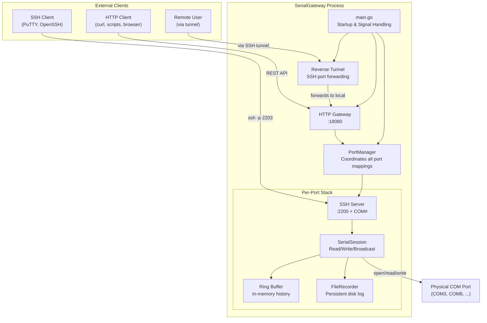

**SerialGateway** is a Go-based Windows service that transforms physical COM serial ports into network-accessible resources. It bridges the gap between legacy serial hardware and modern network tooling by exposing each COM port through two simultaneous interfaces: an **SSH server** for interactive terminal access and an **HTTP REST API** for programmatic management, history retrieval, and command execution.

Whether you are debugging an embedded device, managing a fleet of routers through their console ports, or automating serial communication in a CI pipeline, SerialGateway eliminates the need for direct physical access or single-user serial terminal software. Multiple users and scripts can interact with the same serial device concurrently through standard network protocols.

Sources: [README.md](README.md#L1-L86)

## What Problem Does It Solve?

Traditional serial communication requires dedicated terminal software (PuTTY, Tera Term) running on the machine physically connected to the device. This creates several friction points:

- **Single-user access** — Only one person can interact with a serial port at a time.
- **No remote access** — You must be at the physical machine to use the serial console.
- **No automation-friendly interface** — Scripting serial interactions requires custom serial libraries.
- **No history** — Once the terminal is closed, the output is lost unless manually logged.

SerialGateway solves all of these by acting as a **persistent middleware daemon** that keeps serial ports open, records all output in memory and on disk, and provides standardized SSH and HTTP interfaces that any tool or script can consume.

Sources: [cmd/serial-gateway/main.go](cmd/serial-gateway/main.go#L17-L80), [internal/core/portmanager.go](internal/core/portmanager.go#L13-L28)

## System Architecture at a Glance

The following diagram illustrates how SerialGateway's internal components interact. The **PortManager** sits at the center, coordinating SSH servers, serial sessions, and file recorders for each mapped COM port. The HTTP Gateway and Reverse Tunnel operate as independent services alongside it.



**Key architectural decisions:**

- Each COM port gets its **own independent SSH server** listening on a deterministic port (`base_port + COM number`), so COM3 maps to port 2203.
- The **SerialSession** is the single owner of the physical port handle. It runs dedicated read and write goroutines, broadcasts incoming data to all subscribers (SSH clients, HTTP exec requests), and stores history in a ring buffer.
- The **HTTP Gateway** is a single shared server that delegates to the PortManager for per-device operations.
- The **Reverse Tunnel** is an optional outbound SSH connection that exposes the local HTTP API on a remote machine for remote access scenarios.

Sources: [internal/core/portmanager.go](internal/core/portmanager.go#L13-L68), [internal/ssh/server.go](internal/ssh/server.go#L20-L57), [internal/serial/session.go](internal/serial/session.go#L24-L63), [internal/http/server.go](internal/http/server.go#L12-L40), [internal/tunnel/reverse.go](internal/tunnel/reverse.go#L18-L44)

## Key Features

| Feature | Description | Access Method |
|---|---|---|
| **SSH Terminal Access** | Interactive terminal session to a serial device, supporting password authentication and auto-generated host keys | `ssh -p <2200+COM#> serial@localhost` |
| **Port Discovery** | List all COM ports detected on the system with hardware IDs and current mapping status | `GET /api/ports` |
| **Dynamic Mapping** | Create or remove COM-to-SSH mappings at runtime without restarting | `POST/DELETE /api/mappings` |
| **History Tail** | Retrieve the last N lines of serial output from the in-memory ring buffer | `GET /api/mappings/{device}/tail?lines=N` |
| **Full Log Export** | Download the complete buffered serial history in text or JSONL format | `GET /api/mappings/{device}/log?format=text` |
| **Command Write** | Send raw data or commands to the serial port via HTTP | `POST /api/mappings/{device}/write` |
| **Command Exec with SSE** | Send a command and stream the response back via Server-Sent Events | `GET /api/mappings/{device}/exec?cmd=...` |
| **Persistent File Recording** | Asynchronous disk logging with automatic size-based trimming | Configured via `file_recording` in YAML |
| **Reverse SSH Tunnel** | Expose the HTTP API on a remote server for off-site access | Configured via `reverse_tunnel` in YAML |
| **Windows Toast Notifications** | Push desktop notifications programmatically via HTTP | `POST /api/notify` |
| **Runtime Config Update** | Modify gateway configuration without restarting | `PUT /api/config` |
| **Automatic Reconnection** | Detects serial disconnects and retries with exponential backoff | Configured via `reconnect` in YAML |

Sources: [internal/http/handlers.go](internal/http/handlers.go#L22-L174), [internal/http/exec.go](internal/http/exec.go#L15-L155), [internal/http/notify_handler.go](internal/http/notify_handler.go#L16-L50), [internal/recorder/recorder.go](internal/recorder/recorder.go#L13-L61)

## Technology Stack

| Component | Library / Tool | Purpose |
|---|---|---|
| **Language** | Go 1.22+ | Core implementation |
| **SSH Server** | [gliderlabs/ssh](https://github.com/gliderlabs/ssh) | Per-port SSH listener with session bridging |
| **Serial I/O** | [go.bug.st/serial](https://github.com/bugst/go-serial) | Cross-platform serial port access and enumeration |
| **Configuration** | [gopkg.in/yaml.v3](https://gopkg.in/yaml.v3) | YAML-based configuration parsing |
| **HTTP Server** | `net/http` (standard library) | REST API and SSE streaming |
| **SSH Client** | `golang.org/x/crypto/ssh` | Reverse tunnel outbound connections |
| **Log Rotation** | [lumberjack.v2](https://gopkg.in/natefinch/lumberjack.v2) | File-based log output with size/age rotation |
| **Toast Notifications** | PowerShell + Windows Runtime XML | Native Windows desktop notifications |

Sources: [go.mod](go.mod#L1-L18), [internal/log/log.go](internal/log/log.go#L157-L200), [internal/notify/toast.go](internal/notify/toast.go#L14-L110)

## Project Structure

```
SerialGateway/
├── cmd/serial-gateway/
│   └── main.go                 # Entry point: config load, service startup, signal handling
├── internal/
│   ├── config/config.go        # YAML config structs and loader with defaults
│   ├── core/portmanager.go     # Central coordinator for SSH servers and recorders
│   ├── http/
│   │   ├── server.go           # HTTP Gateway and route registration
│   │   ├── handlers.go         # REST API handlers (ports, mappings, tail, log, write)
│   │   ├── exec.go             # SSE-streaming command execution endpoint
│   │   └── notify_handler.go   # Windows toast notification endpoint
│   ├── log/log.go              # Structured logging with color and rotation support
│   ├── notify/toast.go         # Windows toast notification via PowerShell
│   ├── recorder/recorder.go    # Async file recorder with size-based trimming
│   ├── serial/
│   │   ├── port.go             # COM port enumeration
│   │   ├── session.go          # Serial session lifecycle, read/write loops, broadcasting
│   │   └── ringbuffer.go       # In-memory ring buffer for line history
│   ├── ssh/
│   │   ├── server.go           # Per-port SSH server creation and host key management
│   │   └── handler.go          # SSH session ↔ serial session bridging
│   └── tunnel/reverse.go       # Reverse SSH tunnel for remote access
├── serial-gateway.yaml         # Default configuration file
├── run.vbs                     # Headless background launcher (no console window)
├── restart.bat                 # Kill-and-restart helper script
├── stop.bat                    # Process termination script
└── status.bat                  # Runtime status check script
```

Sources: [cmd/serial-gateway/main.go](cmd/serial-gateway/main.go#L1-L80), [internal/config/config.go](internal/config/config.go#L80-L91), [run.vbs](run.vbs#L1-L4)

## SSH Port Mapping Convention

SerialGateway uses a deterministic port numbering scheme to map COM ports to SSH listening ports. The formula is straightforward:

> **SSH Port = `base_port` + COM port number**

| COM Device | SSH Port (base_port=2200) |
|---|---|
| COM3 | 2203 |
| COM8 | 2208 |
| COM25 | 2225 |

This convention means any user or automation script can derive the SSH port from the COM port name without querying the API. The `base_port` value is configurable in the YAML file under `ssh.base_port`.

Sources: [internal/ssh/server.go](internal/ssh/server.go#L20-L30), [serial-gateway.yaml](serial-gateway.yaml#L20-L22)

## HTTP API Summary

The HTTP API listens on the configured `gateway.http_port` (default: `18080`) and provides the following endpoints:

| Method | Endpoint | Purpose |
|---|---|---|
| `GET` | `/api/ports` | List all detected COM ports with status |
| `GET` | `/api/mappings` | List active COM→SSH mappings |
| `POST` | `/api/mappings` | Create a new mapping (body: `{"device": "COM3"}`) |
| `DELETE` | `/api/mappings/{device}` | Remove a mapping and stop its SSH server |
| `GET` | `/api/mappings/{device}/tail?lines=N` | Get the last N lines from the ring buffer |
| `GET` | `/api/mappings/{device}/log?format=text\|jsonl` | Download full buffered history |
| `POST` | `/api/mappings/{device}/write` | Send data to the serial port (body: `{"data": "cmd\n"}`) |
| `GET` | `/api/mappings/{device}/exec?cmd=...` | Send a command and stream output via SSE |
| `GET` | `/api/config` | View current runtime configuration |
| `PUT` | `/api/config` | Update runtime configuration (JSON body) |
| `POST` | `/api/notify` | Send a Windows desktop toast notification |

Sources: [internal/http/server.go](internal/http/server.go#L26-L34), [internal/http/handlers.go](internal/http/handlers.go#L22-L174), [internal/http/exec.go](internal/http/exec.go#L15-L55), [internal/http/notify_handler.go](internal/http/notify_handler.go#L16-L50)

## Configuration Overview

SerialGateway is configured through a single YAML file (`serial-gateway.yaml` by default, overridable with `--config`). The configuration is organized into logical sections:

| Section | Key Settings | Defaults |
|---|---|---|
| **`gateway`** | HTTP API port | `http_port: 8080` |
| **`serial_defaults`** | Baud rate, data bits, parity, stop bits, timeouts | `115200`, `8N1`, 5s read / 10s write |
| **`ring_buffer`** | Maximum lines and bytes stored in memory | `100000` lines, `10 MB` |
| **`ssh`** | Base port, authentication type and credentials | `base_port: 2200`, `password` auth |
| **`reconnect`** | Retry intervals and disconnect behavior | `1s` initial, `30s` max |
| **`reverse_tunnel`** | Remote SSH host, credentials, port forwarding | Disabled unless `host` is set |
| **`file_recording`** | Output directory, max file size, trim threshold | Disabled unless configured |
| **`logging`** | Level, format, output target, rotation settings | `info`, `text`, `file` |
| **`ports`** | List of COM devices to auto-map at startup | Empty list |

If the configuration file is missing, SerialGateway starts with built-in defaults and no port mappings.

Sources: [internal/config/config.go](internal/config/config.go#L80-L108), [serial-gateway.yaml](serial-gateway.yaml#L1-L59)

## Where to Go Next

Now that you understand what SerialGateway does and how its components fit together, here is the recommended reading progression:

1. **[Quick Start](2-quick-start)** — Build, configure, and run SerialGateway for the first time with a real COM device.
2. **[Configuration Reference](3-configuration-reference)** — Explore every YAML configuration option in detail with examples.
3. **[Running as a Background Service](4-running-as-a-background-service)** — Set up SerialGateway as a persistent background process on Windows.
4. **[Port Discovery and Mapping Management](5-port-discovery-and-mapping-management)** — Learn how to use the HTTP API to discover ports and manage mappings dynamically.
5. **[Reading Serial History: Tail and Log Endpoints](6-reading-serial-history-tail-and-log-endpoints)** — Retrieve buffered serial output through the API.
6. **[Sending Commands via Write and Exec Endpoints](7-sending-commands-via-write-and-exec-endpoints)** — Send data and stream command responses.
7. **[Connecting to a Serial Device via SSH](8-connecting-to-a-serial-device-via-ssh)** — Interactive terminal access through SSH.

For a deeper architectural understanding, proceed to the **Deep Dive** section starting with [System Architecture and Component Overview](9-system-architecture-and-component-overview).