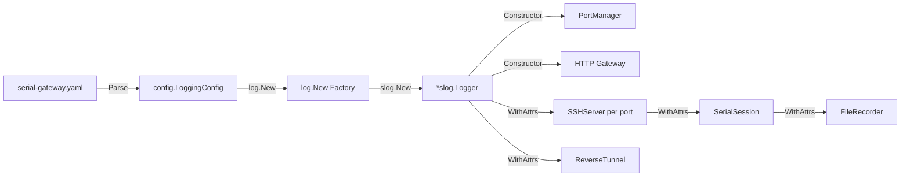

The gateway's logging infrastructure is built on Go 1.21+ `log/slog` — the standard library's structured logging package — and extends it with a custom compact text handler, terminal colorization, level-based filtering, file rotation via `lumberjack`, and contextual log propagation across the entire module hierarchy. The design prioritizes zero external dependency for the core logging contract (only `lumberjack` for file rotation), machine-parseable output, and structured context that follows each component's lifecycle through `logger.With("key", "value")`.

## Architecture: From Configuration to Consumer

The logging system is wired into the application through a clear dependency chain: YAML configuration → `config.LoggingConfig` → `log.New()` factory → `*slog.Logger` instance → propagated via constructor injection to every module.



The factory function `log.New(cfg *config.LoggingConfig) (*slog.Logger, error)` [log.go](internal/log/log.go#L157-L200) serves as the single point of creation. It receives a `LoggingConfig` struct and returns a fully configured `*slog.Logger`. This logger is then passed to `core.NewPortManager(cfg, logger)` [portmanager.go](internal/core/portmanager.go#L21-L28), which in turn passes derived loggers downstream using `logger.With(...)`.

Sources: [log.go](internal/log/log.go#L157-L200), [portmanager.go](internal/core/portmanager.go#L21-L28), [config.go](internal/config/config.go#L69-L78)

## Configuration Structure and Defaults

The `LoggingConfig` struct [config.go](internal/config/config.go#L69-L78) exposes eight configurable parameters, each with sensible defaults applied in `applyDefaults()` [config.go](internal/config/config.go#L198-L218):

| Parameter | Type | Default | Description |
|---|---|---|---|
| `level` | `string` | `"info"` | Log threshold: `debug`, `info`, `warn`, `error` |
| `format` | `string` | `"text"` | Output format: `text` (compact, colored) or `json` (standard `slog.JSONHandler`) |
| `output` | `string` | `"stdout"` | Destination: `stdout`, `stderr`, or `file` |
| `file_path` | `string` | `"gateway.log"` | Path when `output: "file"` |
| `max_size_mb` | `int` | `100` | Max log file size before rotation (MB) |
| `max_age_days` | `int` | `30` | Max age of retained log files (days) |
| `max_backups` | `int` | `7` | Max number of rotated files to keep |
| `compress` | `bool` | `false` | Whether to gzip-compress rotated files |

A production-typical configuration from the example YAML [serial-gateway.yaml](serial-gateway.yaml#L45-L53) shows file-based logging with rotation:

```yaml
logging:
  level: "info"
  format: "text"
  output: "file"
  file_path: "gateway.log"
  max_size_mb: 100
  max_age_days: 30
  max_backups: 7
  compress: true
```

The `ParseLevel` function [log.go](internal/log/log.go#L17-L30) maps human-readable strings to `slog.Level` constants with an explicit error for invalid values, providing a clean failure path at startup rather than silent fallback.

Sources: [config.go](internal/config/config.go#L69-L78), [config.go](internal/config/config.go#L198-L218), [log.go](internal/log/log.go#L17-L30), [serial-gateway.yaml](serial-gateway.yaml#L45-L53)

## The Custom Compact Handler

While the `json` format delegates to Go's built-in `slog.NewJSONHandler` [log.go](internal/log/log.go#L186-L189), the `text` format uses a custom `compactHandler` [log.go](internal/log/log.go#L70-L77) designed for human readability in terminal and log file contexts.

### Design Decisions

**Single-line format with fixed-width level labels.** Each log entry occupies exactly one line: `15:04:05.000 INFO  message key=value` [log.go](internal/log/log.go#L87-L123). The time uses `time.Format("15:04:05.000")` — millisecond precision without date (assumes same-day observability). Level labels are padded to five characters (`"INFO "`, `"WARN "`, `"DEBUG"`, `"ERROR"`) for column alignment.

**Conditional terminal colorization.** When output is `stdout` or `stderr`, color is enabled via ANSI escape codes [log.go](internal/log/log.go#L32-L38): red for errors, yellow for warnings, green for info, cyan for debug. File output disables colors to avoid control characters in log files [log.go](internal/log/log.go#L163-L182).

**Pre-attached attributes via `WithAttrs`.** The handler implements the `slog.Handler` interface's `WithAttrs` method [log.go](internal/log/log.go#L136-L142) by creating a copy of itself with merged pre-attrs. This is the mechanism behind `logger.With("device", "COM3")` — each derived logger carries its context as pre-attrs that are rendered before the per-call attributes.

**Thread-safe with a mutex.** The `mu sync.Mutex` [log.go](internal/log/log.go#L74) protects the `strings.Builder` during `Handle()`. This is necessary because `slog` may call `Handle` concurrently from multiple goroutines, and the builder is not safe for concurrent use.

**Group support via dot-notation.** The `WithGroup` method [log.go](internal/log/log.go#L144-L155) implements attribute namespacing by prefixing keys with the group name and a dot separator (e.g., `serial.baudrate=115200`). This is a deliberate simplification over `slog`'s default grouping behavior.

Sources: [log.go](internal/log/log.go#L32-L53), [log.go](internal/log/log.go#L70-L155)

## Writer Abstraction: stdout, stderr, and File Rotation

The factory selects the output writer based on the `Output` field [log.go](internal/log/log.go#L163-L183):

```go
case "stdout":
    w = os.Stdout
    color = true
case "stderr":
    w = os.Stderr
    color = true
case "file":
    w = &lumberjack.Logger{
        Filename:   cfg.FilePath,
        MaxSize:    cfg.MaxSizeMB,
        MaxAge:     cfg.MaxAgeDays,
        MaxBackups: cfg.MaxBackups,
        Compress:   cfg.Compress,
        LocalTime:  true,
    }
```

The `lumberjack` logger wraps the file with automatic rotation: when the file reaches `MaxSize` MB, it's atomically renamed and a new file is opened. The `LocalTime: true` flag ensures timestamps in rotated filenames use the system's local timezone. Since `lumberjack.Logger` implements `io.WriteCloser`, it integrates seamlessly with `slog.Handler` without additional adapters.

Sources: [log.go](internal/log/log.go#L157-L183), [go.mod](go.mod#L16)

## Logger Propagation Pattern: Context Through the Module Tree

The logging system employs a consistent **constructor injection** pattern across all modules. Each component that needs logging receives a `*slog.Logger` as a constructor parameter and uses `logger.With(...)` to add context-specific attributes before passing it to child components.

### The Propagation Chain

```
main() (or equivalent entry point)
  └─ log.New(cfg.Logging)                 → base *slog.Logger
      └─ core.NewPortManager(cfg, logger) → PortManager.logger
          ├─ ssh.NewSSHServer(device, cfg, logger.With("device", "COM3"))
          │   └─ serial.NewSerialSession(device, cfg, logger.With("component", "serial"))
          │       └─ SerialSession.readLoop() uses s.logger for error logging
          ├─ recorder.NewFileRecorder(device, dir, ..., logger.With("component", "recorder", "device", "COM3"))
          └─ http.NewGatewayWithManager(cfg, pm, logger) → Gateway.logger
```

**Evidence in code:**

- `PortManager.AutoStart()` calls `pm.logger.With("device", portCfg.Device)` [portmanager.go](internal/core/portmanager.go#L35) when creating each SSH server
- `SSHServer.handleSession()` creates a local `logf` closure that prepends `remote_addr` to every log call [handler.go](internal/ssh/handler.go#L16-L19)
- `NewSSHServer` passes `logger.With("component", "serial")` to `serial.NewSerialSession` [server.go](internal/ssh/server.go#L48)
- `ReverseTunnel.New` uses `logger.With("component", "tunnel")` [reverse.go](internal/tunnel/reverse.go#L29)
- `FileRecorder` receives a pre-configured logger with component and device attrs [portmanager.go](internal/core/portmanager.go#L50)
- The HTTP `Gateway` stores the base logger and uses it for API-level logging [server.go](internal/http/server.go#L15), [notify_handler.go](internal/notify_handler.go#L43)

This propagation ensures every log line carries the context needed to trace it back to a specific device, component, and operation — without manual `fmt.Sprintf` or global state.

Sources: [portmanager.go](internal/core/portmanager.go#L35), [server.go](internal/ssh/server.go#L48), [handler.go](internal/ssh/handler.go#L16-L19), [reverse.go](internal/tunnel/reverse.go#L29), [server.go](internal/http/server.go#L15)

## Level-Based Filtering in Practice

The `Enabled()` method on the compact handler [log.go](internal/log/log.go#L79-L81) implements `slog.Handler`'s level gate:

```go
func (h *compactHandler) Enabled(_ context.Context, level slog.Level) bool {
    return level >= h.level.Level()
}
```

This means a logger configured with `level: "info"` will discard `slog.LevelDebug` calls at the handler level — before string formatting or attribute serialization occurs. This provides performance benefits for debug-level logging in production, as the cost is a single integer comparison per call rather than full log entry construction.

The four supported levels map directly to `slog`'s standard hierarchy: `debug < info < warn < error`.

Sources: [log.go](internal/log/log.go#L79-L81), [log.go](internal/log/log.go#L17-L30)

## Integration with the Broader System

The logging system connects to other infrastructure components in two notable ways:

**SSE Exec Endpoint.** The `handleExec` function [exec.go](internal/http/exec.go#L15-L155) uses the standard library `log.Printf` for a single warning about missing `http.Flusher` support [exec.go](internal/http/exec.go#L67) — a deliberate choice since this is a one-time startup diagnostic that should surface regardless of the structured logger's configuration.

**Windows Toast Notifications.** The `handleNotify` handler [notify_handler.go](internal/notify_handler.go#L16-L50) uses `gw.logger` to log both successes (`"toast notification dispatched"`) and failures (`"toast notification failed"`), providing auditable records of notification activity alongside the structured context of which component triggered it.

**File Recorder.** The `FileRecorder` uses its injected logger extensively for operational diagnostics: channel overflow warnings [recorder.go](internal/recorder/recorder.go#L73), write errors [recorder.go](internal/recorder/recorder.go#L128), trim operations [recorder.go](internal/recorder/recorder.go#L191), and file lifecycle events. Each log line carries the `device` attribute, enabling filtering by serial port in aggregated log streams.

Sources: [exec.go](internal/http/exec.go#L67), [notify_handler.go](internal/notify_handler.go#L43-L48), [recorder.go](internal/recorder/recorder.go#L73)

## Summary

The custom structured logging system is a pragmatic application of Go's standard `log/slog` package: it provides two output formats (compact colored text and standard JSON), three output destinations (stdout, stderr, rotated files), configurable level filtering, and — most importantly — a consistent context propagation pattern through `logger.With()` that ensures every log entry in the system carries the device, component, and operation context needed for debugging and monitoring. The design deliberately avoids global state, dependency injection frameworks, or custom log levels, staying within the boundaries of the standard library's extensibility points while adding only `lumberjack` for file rotation.

---

**Next:** Explore how the logging system integrates with the application's concurrency model in [Shared Read / Queued Write Concurrency Model](22-shared-read-queued-write-concurrency-model), or see how the logger's context propagation supports debugging in [Disconnect Resilience & Exponential Backoff Reconnection](23-disconnect-resilience-and-exponential-backoff-reconnection).