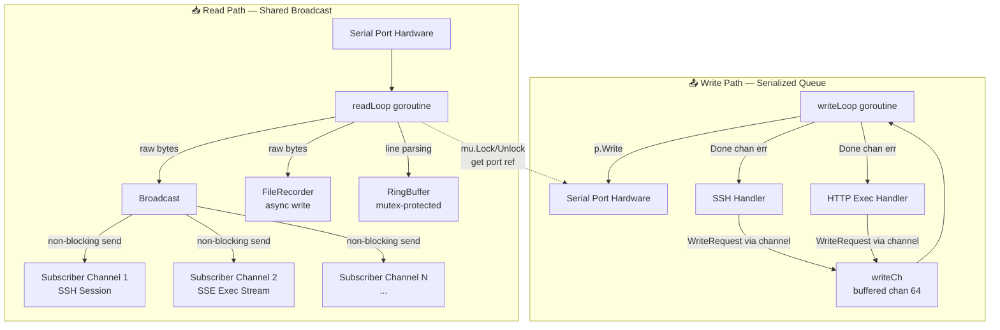

A single serial port is inherently half-duplex — one wire, one conversation at a time. Yet SerialGateway must serve multiple concurrent consumers (SSH sessions, SSE streams, file recorders) all reading from the same port while ensuring writes remain strictly ordered. The solution decomposes the problem into two orthogonal patterns: a **shared-read broadcast fan-out** for incoming data and a **single-goroutine serialized queue** for outgoing commands. This page examines the design decisions, synchronization strategy, and failure semantics of that model.

## The Core Architectural Split

The division is clean because the read path and write path have fundamentally different concurrency constraints. Reading from a serial port yields a single stream of bytes that every consumer needs — the natural pattern is **one producer, many consumers**. Writing to a serial port requires that bytes go out in exactly the order they were submitted, with no interleaving — the natural pattern is **many producers, one consumer**. The `SerialSession` struct encodes this split at the type level.



The `readLoop` goroutine is the sole reader of the physical port; the `writeLoop` goroutine is the sole writer. They share the `port` reference through `s.mu sync.Mutex`, each acquiring the lock only long enough to copy the pointer into a local variable before releasing it. This minimizes lock contention: the critical section is a single pointer read or write, not the actual I/O operation.

Sources: [session.go](internal/serial/session.go#L24-L44), [session.go readLoop](internal/serial/session.go#L152-L209), [session.go writeLoop](internal/serial/session.go#L211-L231)

## The Broadcast Mechanism — Fan-Out Without Backpressure

Subscribers register by calling `Subscribe()`, which creates a **buffered channel (capacity 64)** and adds it to a `map[chan string]struct{}` protected by `subMu sync.RWMutex`. When data arrives from the serial port, the `broadcast` method acquires a read lock and iterates over the map, performing a **non-blocking send** (`select` with `default`) to each subscriber channel.

```go
func (s *SerialSession) broadcast(msg string) {
    s.subMu.RLock()
    defer s.subMu.RUnlock()
    for ch := range s.subscribers {
        select {
        case ch <- msg:
        default:
        }
    }
}
```

Sources: [session.go broadcast](internal/serial/session.go#L233-L242)

This non-blocking send is the **critical design choice** for reliability. A single slow consumer — one that reads from its channel infrequently — cannot stall the read loop or starve other consumers. The trade-off is **message dropping**: if a subscriber's 64-slot buffer is full, the broadcast silently skips that subscriber. The rationale is that serial data is a real-time stream; a consumer that cannot keep up should miss frames rather than cause systemic latency. Restoring historical context is the responsibility of the RingBuffer, not the broadcast.

The `FileRecorder` is notably **not** a subscriber. It receives raw bytes via a direct `s.recorder.Write(buf[:n])` call in the read loop, outside the broadcast. This gives it priority access to unparsed data while keeping recording off the subscription path.

Sources: [session.go readLoop direct recorder write](internal/serial/session.go#L180-L182)

## Subscriber Lifecycle — Registration, Cleanup, and Channel Safety

Each consumer follows a strict lifecycle pattern:

```
Subscribe() → returns chan string
... receive until done ...
Unsubscribe(ch) → deletes from map, closes channel
```

`Unsubscribe` closes the channel after removing it from the map. This ensures no further sends will occur on a closing channel (the map deletion happens first under `subMu.Lock`), and the consumer's receive loop terminates naturally when it reads from the closed channel.

**SSH sessions** create one subscriber per `handleSession` invocation. The subscriber is cleaned up via `defer s.session.Unsubscribe(sub)` — if the SSH session drops, the channel is removed and closed automatically. **SSE exec endpoints** follow the identical pattern: subscribe before writing the command to avoid missing the first response bytes, then receive in a select loop until a silence timeout, max duration, or client disconnect terminates the request.

Sources: [handler.go subscriber lifecycle](internal/ssh/handler.go#L32-L33), [exec.go subscriber lifecycle](internal/http/exec.go#L36-L37)

## The Write Queue — Serialization with Backpressure Signaling

Writes enter a `chan WriteRequest` (buffered to 64), where each request bundles the data payload with a `Done chan error` for synchronous completion notification.

```go
type WriteRequest struct {
    Data []byte
    Done chan error
}
```

Sources: [session.go WriteRequest](internal/serial/session.go#L19-L22)

The `writeLoop` goroutine processes one request at a time: it acquires the port reference under `mu`, calls `p.Write(req.Data)`, and sends the result (or `nil`) back on `req.Done`. This serialization guarantees **write ordering** — two concurrent callers submitting commands will have them executed in the exact order they arrived on the channel, with no interleaving.

The calling side (SSH handler or HTTP exec) submits a request and then blocks on `req.Done` with a **configurable timeout** (`WriteTimeout`, default 10 seconds). This transforms what is fundamentally an asynchronous channel write into a synchronous RPC-like operation at the consumer's boundary.

```go
// SSH handler write submission pattern
req := serial.WriteRequest{
    Data: buf[:n],
    Done: make(chan error, 1),
}
s.session.WriteChannel() <- req
select {
case writeErr := <-req.Done:
    if writeErr != nil {
        fmt.Fprintf(sess, "[write error: %v]\n", writeErr)
    }
case <-time.After(s.cfg.SerialDefaults.WriteTimeout):
    fmt.Fprintf(sess, "[write timeout]\n")
}
```

Sources: [handler.go write submission](internal/ssh/handler.go#L55-L67), [exec.go write submission](internal/http/exec.go#L40-L55)

The `Done` channel is created with a buffer of 1, making the send in `writeLoop` non-blocking. This prevents the writer goroutine from stalling on a consumer that is no longer listening — the error or success persists in the buffer until the consumer reads it or the channel is garbage-collected.

Sources: [session.go writeLoop Done send](internal/serial/session.go#L228)

## Disconnect Semantics — Graceful Degradation

When the serial port disconnects mid-operation, the model enters a defined degraded state:

1. **`readLoop` terminates**: `p.Read(buf)` returns an error, `handleDisconnect()` is called, which closes the port, sets `s.port = nil`, closes the old `stopCh`, creates a new one, and spawns `reconnectLoop`.

2. **`writeLoop` continues**: It remains alive and continues draining `writeCh`. For each request, it checks `s.port == nil` under lock. If the port is gone and `DiscardInputOnDisconnect` is `true`, it returns an error on `req.Done`. If `DiscardInputOnDisconnect` is `false` (default), the request is silently skipped — the write is lost but no error is reported.

3. **Subscribers remain**: Their channels stay in the subscriber map. The `broadcast` still works (non-blocking sends to channels with capacity). This means SSE streams and SSH sessions can continue to display buffered data until their own timeouts or disconnects terminate them.

4. **After reconnection**: `reconnectLoop` calls `s.Open()`, which creates a new serial port, spawns fresh `readLoop` and `writeLoop` goroutines (the old ones are already dead), and broadcasting resumes.

The `stopCh` mechanism is noteworthy: when `handleDisconnect` closes the old `stopCh`, both the running `readLoop` and `writeLoop` detect it and return. After creating a new `stopCh` and reconnecting, the new goroutines receive on the fresh channel. This prevents stale goroutines from operating on a closed port.

Sources: [session.go handleDisconnect](internal/serial/session.go#L244-L261), [session.go writeLoop skip logic](internal/serial/session.go#L222-L225), [config.go DiscardInputOnDisconnect](internal/config/config.go#L39)

## Synchronization Surface — Three Locks, Three Responsibilities

The `SerialSession` uses exactly three synchronization primitives, each with a distinct responsibility:

| Lock | Type | Protects | Contention Risk |
|------|------|----------|-----------------|
| `mu` | `sync.Mutex` | `port` reference, `connected` flag | Low — read/write loops hold only for pointer copy; `IsConnected` callers are infrequent |
| `subMu` | `sync.RWMutex` | `subscribers` map | Low — broadcast uses `RLock` (concurrent readers); register/unregister uses `Lock` (rare) |
| `ringBuffer.mu` | `sync.Mutex` (internal) | `entries` slice, `totalBytes` | Low — append/tail/all operations are O(1) or O(n) on a small working set |

The **absence of a lock around the subscriber channel sends** is deliberate — channel operations are goroutine-safe by design in Go. The `broadcast` method only needs the read lock to safely iterate the map; the actual `ch <- msg` sends are lock-free.

Sources: [session.go struct definition](internal/serial/session.go#L24-L44), [ringbuffer.go mutex](internal/serial/ringbuffer.go#L16)

## Thread-Safety Model — Visual Summary

```
                  ┌─────────────────────────────────────────┐
                  │           SerialSession                  │
                  │                                          │
                  │  ┌────────────┐   ┌──────────────────┐  │
                  │  │    mu      │   │     subMu         │  │
                  │  │  (Mutex)   │   │   (RWMutex)       │  │
                  │  │            │   │                  │  │
                  │  │ port ──────┼───┤ subscribers map   │  │
                  │  │ connected  │   │ (chan string→{})  │  │
                  │  │ seqCounter │   └──────────────────┘  │
                  │  └────────────┘                         │
                  │                                         │
                  │  ┌──────────────┐                       │
                  │  │   writeCh    │ (chan WriteRequest)    │
                  │  │  (buffered)  │                       │
                  │  └──────────────┘                       │
                  │                                         │
                  │  ┌──────────────┐                       │
                  │  │  ringBuffer  │──→ internal sync.Mutex│
                  │  └──────────────┘                       │
                  └─────────────────────────────────────────┘
                                        │
                    readLoop ───────────┤
                    (only goroutine     │
                     that reads port)   │
                                        │
                    writeLoop ──────────┤
                    (only goroutine     │
                     that writes port)  │
                                        │
                    Subscriber 1 ───────┤  non-blocking
                    Subscriber 2 ───────┤  broadcast
                    Subscriber N ───────┘
```

## Comparative Analysis — Why This Model Over Alternatives

| Pattern | Chosen Model | Alternative: Single Mutex | Alternative: Actor Model |
|---------|-------------|--------------------------|--------------------------|
| **Read concurrency** | Broadcast fan-out with non-blocking sends | Lock entire read loop — serializes all consumers | Message-passing to actor — adds indirection |
| **Write concurrency** | Channel-serialized single goroutine | Mutex-protected write — caller blocks on lock | Actor processes write messages in mailbox |
| **Backpressure** | Drop messages on slow consumer (lossy) | Block on slow consumer (risks deadlock) | Rate-limit with bounded mailbox (drop or block) |
| **Complexity** | ~30 lines for broadcast + write queue | ~10 lines but fragile | ~100+ lines of actor infrastructure |
| **Failure isolation** | High — one slow consumer cannot affect others | Low — one slow consumer blocks entire system | High — actors isolate failures |
| **Real-time suitability** | Excellent — bounded-latency broadcast | Poor — unbounded blocking | Good — but more overhead |

The chosen model is a pragmatic hybrid: a **shared-memory broadcast** (simpler than actors for fan-out) combined with a **channel-based serializer** (safer than a mutex for write ordering). The non-blocking broadcast is the key differentiator — it trades a small probability of message loss for strong guarantees against head-of-line blocking.

Sources: [session.go readLoop](internal/serial/session.go#L152-L209), [session.go writeLoop](internal/serial/session.go#L211-L231), [session.go broadcast](internal/serial/session.go#L233-L242)

## Implications for Consumers

**SSH sessions** receive exactly the same broadcast as all other consumers. The `handleSession` function in `handler.go` spawns a goroutine that reads from the subscriber channel and writes to the SSH connection, converting line endings (`\n` → `\r\n`) for terminal compatibility. If the SSH connection is slow (e.g., a high-latency network link), the subscriber channel fills up and the session will start dropping frames — the user sees gaps rather than a frozen session.

**SSE exec endpoints** (`handleExec`) subscribe before sending the command, ensuring they do not miss the first bytes of the response. They implement their own silence and max-duration timers, and unsubscribe when either fires or the HTTP context is cancelled. This is a self-contained guard: even if the serial port is stuck, the HTTP stream will terminate after `ExecMaxDuration` (default 30 seconds).

**File recorders** bypass the broadcast entirely, receiving raw bytes directly in the read loop. This ensures recording fidelity is not affected by subscriber speed. The recorder's own `Write([]byte)` method is expected to be fast or asynchronous — the read loop does not block on it.

Sources: [handler.go SSH read goroutine](internal/ssh/handler.go#L36-L43), [exec.go SSE loop](internal/http/exec.go#L89-L153), [session.go recorder write](internal/serial/session.go#L180-L182)

## Configurable Parameters Affecting the Model

| Parameter | File Location | Default | Effect |
|-----------|--------------|---------|--------|
| `writeCh` buffer size | `session.go` L58 | 64 | Maximum queued write requests before callers block on channel send |
| Subscriber channel buffer | `session.go` L138 | 64 | Maximum buffered messages per subscriber before dropping |
| `WriteTimeout` | `config.go` L133 | 10s | How long a write caller waits for completion acknowledgement |
| `DiscardInputOnDisconnect` | `config.go` L39 | `false` | Whether queued writes get an error or are silently skipped on disconnect |
| `ExecSilenceTimeout` | `config.go` L137 | 5s | SSE stream idle timeout — terminates if no data received |
| `ExecMaxDuration` | `config.go` L139 | 30s | SSE stream hard deadline — terminates regardless of data activity |
| RingBuffer capacity | `config.go` L143-L145 | 100K lines / 10MB | Historical buffer for catch-up reads, independent of live broadcast |

The subscriber channel buffer of 64 is a notable constant: large enough to absorb network jitter for SSH sessions, small enough that a genuinely disconnected consumer will become full and be dropped from the broadcast within milliseconds. This is a deliberate design choice that prioritizes system health over individual consumer completeness.

## Formal Properties

The model satisfies the following correctness properties:

1. **Write serialization**: All writes to the physical serial port happen in the order they were submitted, with no interleaving. Proof: a single `writeLoop` goroutine processes one `WriteRequest` at a time from a FIFO channel.

2. **Read non-interference**: No consumer can block the read loop. Proof: the broadcast uses non-blocking channel sends. In the worst case, a consumer with a full buffer is silently skipped.

3. **Port safety**: The underlying `serial.Port` is only used from the `readLoop` or `writeLoop` goroutines, and never concurrently. Proof: both goroutines copy the port reference under `mu` into a local variable before using it, and the port is only reassigned (in `Open` or `handleDisconnect`) under `mu`.

4. **Graceful degradation on disconnect**: The `readLoop` terminates cleanly via `stopCh`; the `writeLoop` continues processing with safe port-nil checks; subscribers remain registered; reconnection reinitializes both loops.

Sources: [session.go Open port assignment](internal/serial/session.go#L108-L110), [session.go handleDisconnect stopCh replacement](internal/serial/session.go#L253-L258)

## Next Steps

To see this concurrency model in action across the codebase, continue to the following related pages:

- **[SSH Session Handling & I/O Bridging](14-ssh-session-handling-and-i-o-bridging)** — how SSH sessions interact with this subscriber/writer pattern
- **[SSE Exec Endpoint: Long-Running Command Streaming](16-sse-exec-endpoint-long-running-command-streaming)** — how the HTTP layer uses subscription and write queue together
- **[Disconnect Resilience & Exponential Backoff Reconnection](23-disconnect-resilience-and-exponential-backoff-reconnection)** — what happens when the read loop dies and how the system recovers
- **[RingBuffer: In-Memory History Storage](12-ringbuffer-in-memory-history-storage)** — the historical complement to the live broadcast