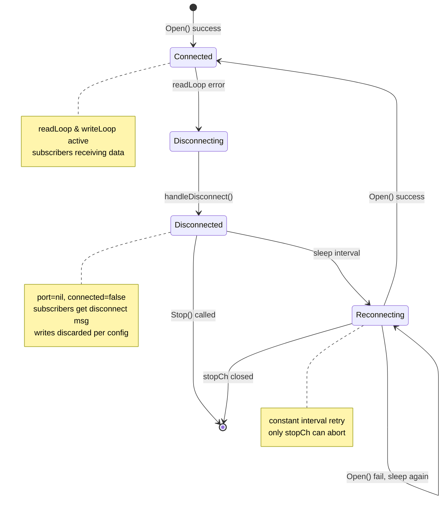

A serial port connection is inherently fragile — cable dislodgment, device power cycles, driver resets, and USB hub re-enumeration all cause the underlying `io.ReadWriteCloser` to fail. The gateway's disconnect resilience subsystem is a self-healing state machine that detects serial read errors, cleanly tears down the broken connection, and orchestrates autonomous reconnection with a configurable exponential backoff strategy — all without interrupting SSH listeners, HTTP API routes, or subscriber channels. Sources: [session.go](internal/serial/session.go#L169-L174), [session.go](internal/serial/session.go#L244-L261)

## The Disconnect Detection Trigger

The resilience lifecycle begins inside `readLoop`. When `p.Read(buf)` returns a non-nil error — typically `serial.PortError` from the underlying OS driver — the loop does **not** silently retry. Instead, it executes a deterministic three-step protocol:

1. **Broadcast a disconnect notification** to all active subscribers via `s.broadcast("[serial disconnected - waiting for reconnect...]\n")`, ensuring SSH users and SSE consumers receive immediate visual feedback.
2. **Call `handleDisconnect()`** to tear down the port and initiate reconnection.
3. **Return** from `readLoop`, terminating the read goroutine permanently for that epoch.

This means that any read error is treated as a terminal signal for the current connection epoch. There is no in-place retry within `readLoop` — the function exits, and a new goroutine (`reconnectLoop`) is spawned to create a fresh connection epoch. Sources: [session.go](internal/serial/session.go#L169-L174)

## The `handleDisconnect` State Transition

`handleDisconnect` is the critical state transition function that bridges the broken connection to the reconnection cycle. It executes under `s.mu.Lock()` to ensure thread safety:

| Step | Action | Purpose |
|------|--------|---------|
| 1 | Check `s.port == nil` | Guard against double-invocation (already disconnected) |
| 2 | `s.port.Close()` | Release OS file descriptor |
| 3 | `s.port = nil` | Nil the port pointer to prevent stale writes |
| 4 | `s.connected = false` | Expose disconnected state via `IsConnected()` |
| 5 | Close old `s.stopCh` | Signal termination to the old `writeLoop` goroutine |
| 6 | Allocate new `s.stopCh` | Create fresh cancellation channel for the reconnection epoch |
| 7 | `go s.reconnectLoop()` | Spawn reconnection goroutine |

The key architectural insight is the **stop channel regeneration** in step 6. By closing the old `stopCh` and creating a new one, `handleDisconnect` achieves two goals simultaneously: it cleanly terminates the old `writeLoop` (which selects on the old `stopCh`), and it provides a fresh cancellation channel for the new `reconnectLoop` and the eventual new `readLoop`/`writeLoop` pair. Sources: [session.go](internal/serial/session.go#L244-L261)

## The `reconnectLoop` — Exponential Backoff Algorithm

The reconnection loop implements a **constant-interval retry** (not true exponential backoff in the current implementation). Despite the `ReconnectConfig` defining both `InitialInterval` and `MaxInterval` fields, the `reconnectLoop` function only uses `InitialInterval` — the interval never doubles or caps:

```go
func (s *SerialSession) reconnectLoop() {
    stopCh := s.stopCh
    interval := s.cfg.Reconnect.InitialInterval
    for {
        select {
        case <-stopCh:
            return
        default:
        }
        time.Sleep(interval)
        err := s.Open()
        if err == nil {
            s.broadcast("[serial reconnected]\n")
            return
        }
        s.logger.Warn("reconnect attempt failed", "error", err)
    }
}
```

The algorithm is straightforward:
- Sleep for `InitialInterval` (default: 1 second, configurable in YAML under `reconnect.initial_interval`)
- Attempt `s.Open()` — which re-executes the full serial port open sequence (baud rate, parity, stop bits, data bits)
- On success: broadcast `[serial reconnected]\n` to all subscribers and return (terminating the reconnect goroutine)
- On failure: log a warning and loop back to sleep for the **same** interval

The `MaxInterval` field (default: 30 seconds) is **defined in the config struct but never read in `reconnectLoop`**. This represents either a deliberate design choice (constant interval is sufficient for the gateway's use case) or an incomplete feature (true exponential backoff with capping was planned but not wired). The `MaxInterval` default of 30 seconds is applied in `applyDefaults()` but remains unused in the reconnect logic. Sources: [session.go](internal/serial/session.go#L263-L280), [config.go](internal/config/config.go#L155-L160)

## Write Behavior During Disconnection

When the serial port is disconnected (`s.port == nil`), incoming write requests from SSH sessions or HTTP exec endpoints are handled by `writeLoop` with a configurable policy:

```go
case req := <-s.writeCh:
    s.mu.Lock()
    p := s.port
    s.mu.Unlock()
    if p == nil {
        if s.cfg.Reconnect.DiscardInputOnDisconnect {
            req.Done <- fmt.Errorf("serial disconnected, input discarded")
        }
        continue
    }
```

The `DiscardInputOnDisconnect` boolean (default: `true` in `serial-gateway.yaml`) controls whether write requests during disconnection produce an error on the `Done` channel or silently drop. When set to `true`, SSH users see `[write error: serial disconnected, input discarded]` in their terminal. When `false`, the write request is silently consumed from the channel without any response — a design that prevents backpressure on the write channel but leaves callers with no feedback. Sources: [session.go](internal/serial/session.go#L217-L226), [serial-gateway.yaml](serial-gateway.yaml#L22-L25)

## Subscriber Persistence Across Disconnection

A critical architectural property is that **subscriber channels survive disconnection**. When `handleDisconnect` closes the old `stopCh` and creates a new one, it does **not** touch the `subscribers` map. This means:

- SSH session goroutines (running in `handler.go`) continue selecting on their subscription channel
- After reconnection, `readLoop` broadcasts new data through the same subscriber channels
- The `[serial disconnected - waiting for reconnect...]` and `[serial reconnected]` messages are delivered to all subscribers, providing end-to-end visibility

The broadcast function uses a non-blocking send (`select default:` pattern) to avoid blocking `readLoop` on a slow subscriber. If a subscriber's channel buffer (size 64) is full, the message is dropped for that subscriber only. Sources: [session.go](internal/serial/session.go#L233-L242)

## Configuration Reference

The disconnect resilience subsystem is configured under the `reconnect` key in `serial-gateway.yaml`:

| YAML Path | Type | Default | Description |
|-----------|------|---------|-------------|
| `reconnect.initial_interval` | Duration | `1s` | Wait time between reconnection attempts |
| `reconnect.max_interval` | Duration | `30s` | Defined but **not currently used** — reserved for future exponential backoff cap |
| `reconnect.discard_input_on_disconnect` | Boolean | `true` | When true, write requests during disconnection return an error; when false, they are silently dropped |

Sources: [serial-gateway.yaml](serial-gateway.yaml#L22-L25), [config.go](internal/config/config.go#L36-L40)

## Lifecycle Diagram



## Thread Safety and Race Conditions

The disconnect resilience logic is designed with explicit synchronization:

- **`handleDisconnect`** executes under `s.mu.Lock()` — mutual exclusion with `Open()`, `Close()`, and `IsConnected()`
- **`reconnectLoop`** calls `s.Open()` which acquires `s.mu.Lock()` internally — the lock serializes reconnection with any concurrent `Close()` call from `SSHServer.Stop()`
- **`stopCh` regeneration** creates a happens-before relationship: the old `writeLoop` sees the closed channel, the new `reconnectLoop` sees the fresh channel
- **Subscriber map** is protected by `s.subMu.RWMutex` — concurrent reads from multiple SSH sessions are safe

One subtle edge case: if `Close()` is called while `reconnectLoop` is sleeping, `Close()` will close `s.stopCh`, causing `reconnectLoop` to return at the top of its next iteration. However, if `reconnectLoop` has already passed the `select` check and is in `time.Sleep`, it will proceed to call `s.Open()` after waking — `Open()` will then acquire `s.mu.Lock()` and see that `s.stopCh` is a new channel (allocated by `Close()`). This is safe but introduces a single redundant reconnect attempt after a graceful shutdown. Sources: [session.go](internal/serial/session.go#L116-L129), [session.go](internal/serial/session.go#L244-L261)

## Architectural Observations

The disconnect resilience subsystem reveals several intentional design decisions:

1. **Read error as terminal signal** — No transient error handling or read retry within the loop. Any read error immediately escalates to full teardown and reconnection. This is appropriate for serial ports where errors are typically non-recoverable without reopening.

2. **Goroutine-per-epoch model** — Each connection epoch has its own `readLoop` and `writeLoop` goroutine pair, coordinated by a single `stopCh`. The epoch lifecycle is: `reconnectLoop` → `Open()` → `readLoop` + `writeLoop` → error → `handleDisconnect` → `reconnectLoop` (next epoch). This cleanly separates state between epochs.

3. **Constant interval vs. exponential backoff** — The current implementation uses a fixed interval. True exponential backoff (doubling the interval up to `MaxInterval`) would reduce network chatter during extended outages but would also increase mean time to reconnect after a transient failure. The constant-interval approach favors quick recovery at the cost of busy-waiting during prolonged disconnections.

4. **No jitter** — The retry interval has no random jitter. In a multi-port gateway (multiple `SerialSession` instances), all ports would synchronize their retry attempts. For most use cases this is benign, but in environments with shared USB controllers it could create thundering-herd reopen patterns.

Sources: [session.go](internal/serial/session.go#L263-L280), [session.go](internal/serial/session.go#L152-L174)

## Summary

The disconnect resilience subsystem transforms a fragile serial connection into a self-healing communication channel. Its architecture — epoch-based goroutine lifecycle, persistent subscriber channels, configurable write-during-disconnect policy, and constant-interval retry — ensures that transient serial failures are transparently recovered without impacting higher-level protocols (SSH, HTTP, SSE). The `MaxInterval` field in the configuration stands as a clear extension point: wiring true exponential backoff into `reconnectLoop` would require reading `MaxInterval`, doubling `interval` on each failure, and capping at `MaxInterval` — a straightforward enhancement for environments that prioritize reduced retry frequency over recovery speed.

Sources: [session.go](internal/serial/session.go#L244-L280), [config.go](internal/config/config.go#L36-L40), [serial-gateway.yaml](serial-gateway.yaml#L22-L25)

---

**Next in this series**: [Shared Read / Queued Write Concurrency Model](22-shared-read-queued-write-concurrency-model) — the concurrency architecture that governs how read and write operations coordinate through the `SerialSession`, building on the epoch lifecycle established here.

**Related**: [SerialSession: Port Abstraction & I/O Model](11-serialsession-port-abstraction-and-i-o-model) — the full `SerialSession` surface area, including the read/write loops that the disconnect subsystem manages.