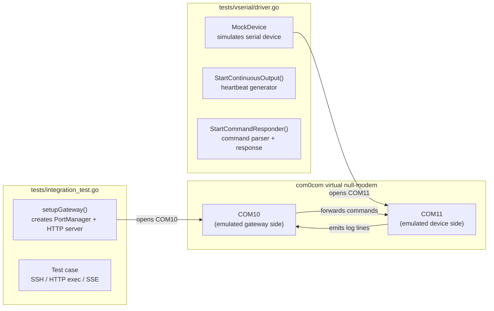

The SerialGateway project employs a pragmatic, multi-layered testing strategy. Unit tests focus on isolated logic verification through interface-based mocking and function variable substitution, while integration tests validate end-to-end behavior using virtual serial port hardware. This page documents the specific mocking patterns, test infrastructure strategies, and architectural decisions that make the test suite resilient, deterministic, and maintainable across Go 1.26 and Windows environments.

Sources: [go.mod](go.mod#L1-L5)

## Function Variable Mocking: Replacing Side-Effect Boundaries

The most distinctive testing pattern in this codebase is **exported function variable mocking** — a Go idiom where a package-level function is declared as a `var` of function type, allowing tests to replace the implementation without requiring an interface or dependency injection framework.

The canonical example lives in `internal/notify/toast.go`, where the `Show` function is defined as a mutable variable:

```go
var Show = showImpl
```

This pattern is used in `internal/http/notify_handler_test.go` to fully control the toast notification behavior during HTTP handler tests. Each test case saves the original function, installs a mock, and restores it via `defer`:

```go
origShow := notify.Show
defer func() { notify.Show = origShow }()
notify.Show = func(title, content, duration string) error {
    // mock implementation
    return nil
}
```

The power of this pattern is visible across six test functions in `notify_handler_test.go`. The mock is tuned per test case to enforce different behaviors:

| Test Case | Mock Behavior | What It Verifies |
|---|---|---|
| `TestHandleNotify_Valid` | Returns `nil` | Happy path: 200 + `"status":"dispatched"` |
| `TestHandleNotify_MissingTitle` | Checks empty fields | 400 error before `Show` is called |
| `TestHandleNotify_MissingContent` | Same missing-field check | 400 error |
| `TestHandleNotify_EmptyFields` | Tabled sub-tests via `t.Run` | All empty-field variants return 400 |
| `TestHandleNotify_InvalidJSON` | Calls `t.Fatal` if invoked | Routing rejects bad JSON before handler logic |
| `TestHandleNotify_WrongMethod` | Same guard | GET returns 405, `Show` never called |
| `TestHandleNotify_ShowFails` | Returns error | 500 with error message relayed to client |

The critical architectural insight: this pattern works because `notify.Show` sits at the **system boundary** of a side effect (Windows toast notifications via PowerShell). The function variable acts as a seam — tests replace the real implementation with a deterministic stub, while production code calls `notify.Show` exactly as it would the real function. No interfaces, no factory patterns, no constructor injection needed.

However, this pattern has a limitation: it cannot mock **internal calls** within the same package. The `notify.Show` variable is only replaceable from outside the `notify` package (as the `http` package does). Internal callers within `notify` would call `showImpl` directly, bypassing the variable. This is by design — the variable is an exported seam for external consumers.

Sources: [internal/notify/toast.go#L19-L22](internal/notify/toast.go#L19-L22), [internal/http/notify_handler_test.go#L1-L222](internal/http/notify_handler_test.go#L1-L222), [internal/http/notify_handler.go#L1-L50](internal/http/notify_handler.go#L1-L50)

## HTTP Handler Testing: httptest Without a Server

All HTTP handler unit tests use `net/http/httptest` to exercise routing logic **without binding to a TCP port**. The pattern is consistent across all handler test files:

```go
gw := NewGatewayWithManager(cfg, pm, slog.Default())
handler := gw.Handler()

req := httptest.NewRequest("GET", "/api/ports", nil)
w := httptest.NewRecorder()
handler.ServeHTTP(w, req)
```

The architecture here is deliberate. The `Gateway.Handler()` method returns a standard `http.Handler` (a `http.ServeMux`), which is directly invocable via `ServeHTTP`. The `httptest.NewRecorder` implements `http.ResponseWriter` and captures status code, headers, and body for assertion. No HTTP server goroutine, no port allocation, no network I/O.

The handler tests in `internal/http/handlers_test.go` demonstrate three levels of validation:

1. **Status code assertion**: `if w.Code != 200 { t.Fatalf(...) }`
2. **Response body structure**: JSON unmarshal and key presence checks
3. **Type-specific logging**: `t.Logf` for debugging test output

The `Gateway` struct is constructed with a real `PortManager` (from `internal/core`) and a real `config.Config` with defaults applied. This means the handler tests exercise **real routing, real middleware, and real JSON serialization** — only the external side effects (serial port I/O, SSH server binding) are absent because no actual connections are made. The `PortManager` is initialized but never started (no `AutoStart()` call), so it holds empty maps rather than live SSH servers.

Sources: [internal/http/handlers_test.go#L1-L78](internal/http/handlers_test.go#L1-L78), [internal/http/handlers.go#L1-L50](internal/http/handlers.go#L1-L50)

## Session Construction Without Hardware: Lightweight Object Tests

The `SerialSession` type in `internal/serial/session.go` manages a serial port connection, write queue, subscriber broadcast, and ring buffer. Unit tests in `internal/serial/session_test.go` validate its construction and channel wiring **without opening any serial port**:

```go
func TestSessionWriteQueue(t *testing.T) {
    cfg := &config.Config{}
    config.ApplyDefaults(cfg)
    sess := NewSerialSession("COM_FAKE", cfg, slog.Default())
    ch := sess.WriteChannel()
    if ch == nil {
        t.Fatal("write channel should not be nil")
    }
}
```

The pattern exploits the fact that `NewSerialSession` only allocates channels, initializes maps, and configures parameters — it does not call `serial.Open`. The session's `Open()` method (which does physical I/O) is tested only by attempting it and accepting failure:

```go
func TestSessionOpenClose(t *testing.T) {
    sess := NewSerialSession("COM_TEST", cfg, slog.Default())
    err := sess.Open()
    if err == nil {
        sess.Close()
    }
}
```

This **accept-failure-on-real-hardware** pattern is intentional: the test does not require `COM_TEST` to exist. If `Open()` fails, the test still passes; if it succeeds (because the port happens to be available), `Close()` is called and the device name is verified. This keeps the test deterministic in CI environments without physical serial ports, while still providing coverage for the open/close code path when run on a developer machine with hardware attached.

The same lightweight construction pattern extends to the `RingBuffer` integration test within `session_test.go`:

```go
rb := sess.RingBuffer()
rb.Append(Entry{Seq: 1, Line: "hello", TS: time.Now(), Bytes: 5})
```

This validates that the session's ring buffer is properly initialized and accessible, without any serial I/O.

Sources: [internal/serial/session.go#L1-L80](internal/serial/session.go#L1-L80), [internal/serial/session_test.go#L1-L61](internal/serial/session_test.go#L1-L61)

## SSH Server Construction: Port Mapping Logic Verification

The SSH server tests in `internal/ssh/server_test.go` validate two key concerns: **port number derivation** and **server object construction**. The `PortMapping` function computes a deterministic SSH port from a COM device name and a base port:

```go
func TestSSHPortMapping(t *testing.T) {
    cfg := &config.Config{}
    config.ApplyDefaults(cfg)
    mapping := PortMapping("COM3", cfg)
    if mapping != 2203 {
        t.Errorf("expected COM3->2203, got %d", mapping)
    }
}
```

The formula is simple: extract the numeric suffix from "COM{n}", add to `cfg.SSH.BasePort` (default 2200). This test verifies the mapping algorithm without starting any SSH server.

The `NewSSHServer` test extends this to confirm that the constructed server object carries the correct port:

```go
srv, err := NewSSHServer("COM3", cfg, slog.Default())
if err != nil {
    t.Fatalf("NewSSHServer failed: %v", err)
}
if srv.Port() != 2203 {
    t.Errorf("expected port 2203, got %d", srv.Port())
}
```

`NewSSHServer` only allocates Go structs and goroutine-safe primitives — it does not bind to a TCP socket (that happens in `srv.Start()`). This keeps the unit test fast and hardware-independent.

Sources: [internal/ssh/server_test.go#L1-L33](internal/ssh/server_test.go#L1-L33), [internal/config/config.go#L1-L69](internal/config/config.go#L1-L69)

## File Recorder: Async I/O Verification Through Timing Windows

The `FileRecorder` in `internal/recorder/recorder_test.go` presents a unique testing challenge: it is an asynchronous, channel-driven writer that buffers writes and flushes them in a background goroutine. The test suite handles this with **intentional timing windows** and **synchronization via `time.Sleep`**:

```go
func TestFileRecorder_Write(t *testing.T) {
    r.Write([]byte("hello"))
    r.Write([]byte(" world"))
    r.Stop()
    time.Sleep(50 * time.Millisecond)  // wait for writeLoop to drain

    data, err := os.ReadFile(filepath.Join(tmpDir, "COM2"))
    if string(data) != "hello world" {
        t.Fatalf("expected 'hello world', got '%s'", string(data))
    }
}
```

The architectural decision to use `time.Sleep` rather than a synchronization primitive (e.g., a done channel) is deliberate: the recorder's `writeLoop` is a background goroutine that should not block the caller. Introducing a flush-waiter would change the production API. Instead, the test accepts the slight non-determinism, mitigated by the fact that 50ms is orders of magnitude longer than the writeLoop iteration time.

The test suite validates five distinct recorder behaviors:

| Test | What It Validates |
|---|---|
| `TestNewFileRecorder_CreatesDirAndFile` | Directory creation and file open on construction |
| `TestFileRecorder_Write` | Sequential writes are correctly concatenated |
| `TestFileRecorder_Append` | Stop/restart preserves prior data (append mode) |
| `TestFileRecorder_StopIdempotent` | Double `Stop()` does not panic |
| `TestFileRecorder_NonBlockingWrite` | 500 rapid writes fill channel buffer without deadlock |
| `TestFileRecorder_Trim` | File size trimming logic when exceeding `maxSize` |

The **non-blocking write test** is particularly important: by writing 500 items into a channel with buffer capacity 256, it proves that the `Write()` method drops data rather than blocking the caller when the background goroutine cannot keep up. This is a resilience property — in production, a slow disk must never stall serial port I/O.

The **trim test** demonstrates a common testing technique: **manipulating private fields** (`r.maxSize`, `r.trimSize`) after construction to speed up test execution. Rather than writing megabytes of data to trigger the trim threshold, the test lowers the threshold values directly. This is acceptable because Go's visibility rules are package-level — the test file is in the same package (`recorder`) and has access to unexported fields.

Sources: [internal/recorder/recorder_test.go#L1-L155](internal/recorder/recorder_test.go#L1-L155)

## RingBuffer: Deterministic Algorithm Verification

The `RingBuffer` in `internal/serial/ringbuffer_test.go` is the purest algorithmic unit test in the codebase. No I/O, no goroutines, no external dependencies — just data structures and assertions:

```go
func TestRingBufferOverflow(t *testing.T) {
    rb := NewRingBuffer(5, 65536)  // capacity 5, byte limit 64KB
    for i := 0; i < 10; i++ {
        rb.Append(Entry{Seq: i + 1, Line: "x", TS: time.Now(), Bytes: 1})
    }
    entries := rb.Tail(100)
    if len(entries) != 5 {
        t.Fatalf("expected 5 entries after overflow, got %d", len(entries))
    }
    if entries[0].Seq != 6 {
        t.Errorf("expected oldest kept seq=6, got %d", entries[0].Seq)
    }
}
```

Four test functions cover the ring buffer's complete contract:

1. **`TestRingBufferAppendAndTail`**: Sequential append of 50 items, then verify `Tail(10)` returns the last 10 in order (seq 41-50)
2. **`TestRingBufferOverflow`**: Write 10 items into capacity 5, verify only 5 are retained (seq 6-10)
3. **`TestRingBufferAllEntries`**: Write fewer items than capacity, verify `All()` returns exactly those
4. **`TestRingBufferByteLimit`**: Enforce a secondary byte-based limit (20 bytes) over 10 writes of 7 bytes each, verify retention is limited by the stricter constraint

The byte limit test validates a subtle architectural feature: the ring buffer has **two independent eviction policies** — line count (`maxLines`) and total byte size (`maxBytes`). The test proves that the more restrictive policy (byte limit) dominates even when line count capacity is not exhausted.

Sources: [internal/serial/ringbuffer_test.go#L1-L65](internal/serial/ringbuffer_test.go#L1-L65)

## Configuration Loading: Filesystem Isolation with Temp Files

The config package tests in `internal/config/config_test.go` use `os.CreateTemp` to create isolated YAML files, ensuring tests never depend on the project's actual `serial-gateway.yaml`:

```go
tmp, err := os.CreateTemp("", "config-*.yaml")
defer os.Remove(tmp.Name())
tmp.WriteString(content)
tmp.Close()

cfg, err := Load(tmp.Name())
```

The default-loading test (`TestLoadDefaults`) verifies that calling `Load("nonexistent.yaml")` returns sensible defaults rather than an error — a critical architectural property that makes the gateway work out of the box with zero configuration:

```go
if cfg.Gateway.HTTPPort != 8080 { t.Errorf(...) }
if cfg.SerialDefaults.Baudrate != 115200 { t.Errorf(...) }
if cfg.SSH.BasePort != 2200 { t.Errorf(...) }
if cfg.RingBuffer.MaxLines != 100000 { t.Errorf(...) }
if cfg.Reconnect.MaxInterval != 30*time.Second { t.Errorf(...) }
```

Sources: [internal/config/config_test.go#L1-L69](internal/config/config_test.go#L1-L69)

## Toast Notification: Multi-Stage Verification with Conditional Skip

The toast notification tests in `internal/notify/toast_test.go` form a **progressive verification pipeline**, each test building on the previous one's guarantees. The tests are organized as numbered test cases (TC01-TC07), reflecting their sequential dependency:

```
TC01: XML generation produces pure ASCII (no raw Chinese)
  ↓
TC02: English text preserved verbatim in XML
  ↓
TC03: UTF-16LE base64 encoding roundtrips
  ↓
TC04: Full pipeline preserves numeric references through encoding
  ↓
TC05: PowerShell XML parser correctly decodes references (conditional)
  ↓
TC06: End-to-end toast dispatch on real Windows (conditional)
  ↓
TC07: Duration attribute in XML
```

Tests TC05 and TC06 are **conditionally skipped** via `t.Skip()` based on the `RUN_TOAST_TEST` environment variable:

```go
if os.Getenv("RUN_TOAST_TEST") == "" {
    t.Skip("Set RUN_TOAST_TEST=1 to run (requires Windows desktop)")
}
```

This is the correct architectural pattern for side-effect tests: they exist in the source tree for manual verification, but are excluded from automated CI runs. The `RUN_TOAST_TEST=1` guard makes the skip explicit and discoverable.

The test also demonstrates a common Windows testing technique: **writing intermediate artifacts to temp files** for manual inspection:

```go
tmpFile := os.TempDir() + "\\toast_test_script.ps1"
bom := []byte{0xEF, 0xBB, 0xBF}
os.WriteFile(tmpFile, append(bom, []byte(decodedScript)...), 0644)
t.Logf("Script written to: %s", tmpFile)
```

Sources: [internal/notify/toast_test.go#L1-L217](internal/notify/toast_test.go#L1-L217)

## PortManager: Minimal Construction Without Side Effects

The `PortManager` tests in `internal/core/portmanager_test.go` validate construction and initialization without triggering any real serial port or SSH server binding:

```go
func TestNewPortManager(t *testing.T) {
    cfg := &config.Config{}
    config.ApplyDefaults(cfg)
    pm := NewPortManager(cfg, slog.Default())
    if pm == nil {
        t.Fatal("PortManager should not be nil")
    }
}
```

The `AutoStart()` test demonstrates the **graceful-degradation-accepting** pattern: if no ports are configured (empty config), `AutoStart()` returns an error, which the test logs rather than fails:

```go
err := pm.AutoStart()
if err != nil {
    t.Logf("AutoStart returned error (expected if no ports available): %v", err)
}
```

This communicates intent: the error is expected behavior for the test's configuration, not a regression. The test verifies that `AutoStart()` completes (panics or deadlocks would be the real failure modes) and that its error is sensible.

Sources: [internal/core/portmanager_test.go#L1-L40](internal/core/portmanager_test.go#L1-L40)

## Integration Testing: Virtual Serial Ports via com0com

The integration test suite in `tests/integration_test.go` and `tests/vserial/driver.go` provides **hardware-in-the-loop verification** using [com0com](https://github.com/yvzn/Null-modem-emulator) virtual serial port pairs. The architecture follows a three-layer model:



The `MockDevice` (in `tests/vserial/driver.go`) opens the opposite end of a virtual serial pair and generates realistic traffic:

1. **`StartContinuousOutput(interval)`**: A goroutine writes timestamped log lines at a configurable interval, simulating a device that continuously emits data (e.g., sensor readings)

2. **`StartCommandResponder()`**: A read loop that parses incoming commands (newline-delimited), matches them against a simple dispatch table, and writes responses back. Supported commands match what a real embedded device might expose: `help`, `status`, `reboot`, `echo <msg>`

The integration test case `TestSSHConnectionToVirtualPort` orchestrates the full pipeline:

1. Create a `MockDevice` on COM11 (emulated device)
2. Create a gateway with COM10 configured (emulated gateway side)
3. Start the HTTP server
4. Establish an SSH connection to port 32010 (COM10 → base 32000 + 10)
5. Open an SSH session, write `help\n`, read the stream
6. Verify both heartbeat log lines and command responses appear in the output

This end-to-end test validates five layers simultaneously: serial port I/O via com0com, SSH server binding, session I/O bridging, command routing, and SSE output formatting. It's a **smoke test** — if it passes, the entire data plane is functional.

Sources: [tests/integration_test.go#L1-L294](tests/integration_test.go#L1-L294), [tests/vserial/driver.go#L1-L128](tests/vserial/driver.go#L1-L128), [tests/vserial/driver_test.go#L1-L48](tests/vserial/driver_test.go#L1-L48)

## Summary: Testing Taxonomy

The complete test suite can be categorized across two dimensions — **isolation level** and **dependency type**:

| Category | Files | Dependency | Execution |
|---|---|---|---|
| Pure algorithm | `ringbuffer_test.go` | None | Always, deterministic |
| Config parsing | `config_test.go` | Temp filesystem | Always, deterministic |
| Object construction | `session_test.go`, `server_test.go`, `portmanager_test.go` | None | Always, deterministic |
| HTTP routing | `handlers_test.go`, `notify_handler_test.go` | Mocked toast | Always, deterministic |
| Async I/O | `recorder_test.go` | Temp filesystem | Always, small timing window |
| XML/encoding pipeline | `toast_test.go` (TC01-TC04, TC07) | None | Always, deterministic |
| PowerShell Windows | `toast_test.go` (TC05-TC06) | Real PowerShell | Only with `RUN_TOAST_TEST=1` |
| Integration | `integration_test.go` | com0com virtual ports | Only with com0com installed |

The key architectural principle: **unit tests are deterministic and self-contained**; integration tests are explicitly gated on external infrastructure (com0com, PowerShell). No test modifies global state that outlives its execution, and all mock setups are restored via `defer`.

Sources: [internal/serial/ringbuffer_test.go](internal/serial/ringbuffer_test.go), [internal/config/config_test.go](internal/config/config_test.go), [internal/serial/session_test.go](internal/serial/session_test.go), [internal/ssh/server_test.go](internal/ssh/server_test.go), [internal/core/portmanager_test.go](internal/core/portmanager_test.go), [internal/http/handlers_test.go](internal/http/handlers_test.go), [internal/http/notify_handler_test.go](internal/http/notify_handler_test.go), [internal/recorder/recorder_test.go](internal/recorder/recorder_test.go), [internal/notify/toast_test.go](internal/notify/toast_test.go), [tests/integration_test.go](tests/integration_test.go)

## Next Steps

- Explore how virtual serial ports enable end-to-end testing in [Integration Testing with Virtual Serial Ports](24-integration-testing-with-virtual-serial-ports)
- Understand the architectural patterns that these tests verify: [PortManager: Central Lifecycle Coordinator](10-portmanager-central-lifecycle-coordinator) and [SerialSession: Port Abstraction & I/O Model](11-serialsession-port-abstraction-and-i-o-model)
- Examine how the concurrency model is stress-tested in [Shared Read / Queued Write Concurrency Model](22-shared-read-queued-write-concurrency-model)